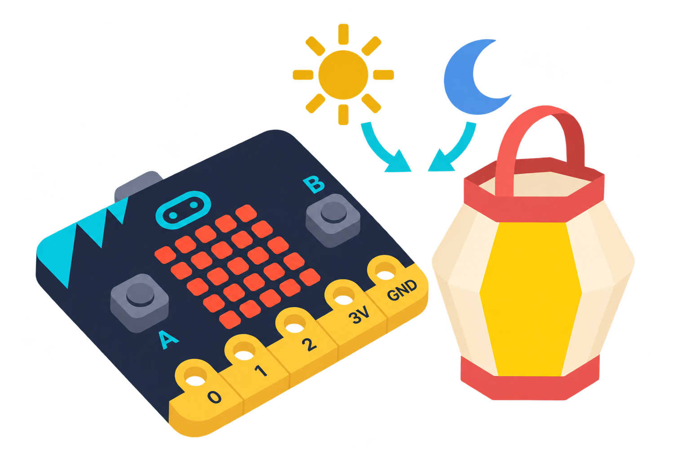

## 🎯 Repte i objectius



Construeix un fanalet que responga a la llum ambiental i ajusta el llindar amb proves en espais diferents. La matriu LED de micro:bit pot funcionar alhora com a eixida visual i com a sensor de llum.

- Entendre que la matriu LED també pot llegir la llum ambiental.
- Utilitzar una lectura de sensor dins d’una condició i un bucle.
- Ajustar un llindar a partir de proves en diferents espais.

## 🧰 Materials i preparació

- Placa BBC micro:bit (V1 o V2) o simulador MakeCode.
- Ordinador amb navegador i MakeCode.
- Portapiles opcional per a les proves fora de l’ordinador.

## 🧩 Funcions del robot treballades

- Matriu 5 × 5 com a eixida LED i sensor de llum ambiental.
- Lectura del nivell de llum i condicional amb llindar calibrat.

## 👣 Seqüència guiada

### 1. Creeu el projecte i programeu el fanalet

Obriu MakeCode, creeu un projecte nou i comproveu el simulador. En la categoria **Entrada**, busqueu la lectura del nivell de llum. El nom pot aparéixer en anglés («light level») si l’editor no està traduït.

Dins de «per sempre», poseu una peça «si… aleshores… si no». En la condició, compareu **nivell de llum < 100**. Dins d’«aleshores», afegiu una icona; dins de «si no», poseu «neteja la pantalla». La lectura de llum és a **Entrada** i la comparació a **Lògica**. El valor 100 és només un punt de partida.

```makecode
basic.forever(function () {
    if (input.lightLevel() < 100) {
        basic.showIcon(IconNames.SmallDiamond)
    } else {
        basic.clearScreen()
    }
})
```

### 2. Calibreu i personalitzeu la resposta

Per triar un valor adequat, deseu el fanalet i creeu **un altre projecte de prova**. En «en prémer el botó A», poseu «mostra el número» amb «nivell de llum» dins:

```makecode
input.onButtonPressed(Button.A, function () {
    basic.showNumber(input.lightLevel())
})
```

Descarregueu aquest projecte a la placa. Premeu A i anoteu el nombre en un lloc clar; repetiu fent ombra suaument a la matriu. La primera lectura pot ser zero mentre s’activa el sensor: torneu a prémer A per comprovar-la.

Torneu a obrir el projecte del fanalet i poseu un valor entre les dues lectures. Per exemple, si heu anotat 30 amb ombra i 150 amb llum, proveu amb 90. Descarregueu-lo i comproveu que la icona apareix quan feu ombra.

> **💡 Consell docent:** els LED que mostren la icona també s’utilitzen per estimar la llum. Comproveu el comportament amb la placa del centre i deixeu un breu interval entre lectures si la pantalla parpelleja.

Canvieu el diamant per una estrella, una casa o un símbol creat per l’alumnat. Si la placa queda connectada a un portapiles, col·loqueu-la estable i no la tapeu amb materials que puguen acumular calor.

## 🧪 Prova, depura i reflexiona

Proveu la placa en un lloc clar i després feu-li ombra suaument. Anoteu quan apareix el dibuix. La lectura va de 0 (molt fosc) a 255 (molt clar): si el canvi no es veu, ajusteu el valor 100 i torneu a provar sense canviar l’orientació de la placa.

### Preguntes per comprovar

- Quina diferència heu mesurat entre els dos espais?
- Què passa si el llindar és més alt? I si és més baix?
- Com podem saber si el canvi és causat per la llum o per haver mogut la placa?


## ♿ Accessibilitat i seguretat

Faciliteu un projecte inicial amb el bucle preparat i deixeu que cada parella trie la icona o el llindar. Com a ampliació, recolliu cinc lectures per espai i compareu-les; manteniu la placa en la mateixa orientació.

## ✅ Evidències d’aprenentatge
- Projecte del fanalet i projecte de prova de la llum.
- Dues lectures anotades i una explicació del valor triat entre aquestes.
- Prova de la icona amb llum i amb ombra. La matriu no il·lumina una habitació.

## 🔗 Fonts oficials i límits

Adaptació pròpia del projecte oficial [Nightlight de micro:bit](https://www.microbit.org/projects/make-it-code-it/nightlight/), que usa el bloc [nivell de llum de MakeCode](https://makecode.microbit.org/reference/input/light-level). La lectura va de 0 a 255 i pot variar segons la llum i la posició de la placa; per això cal ajustar el llindar a l’aula.
