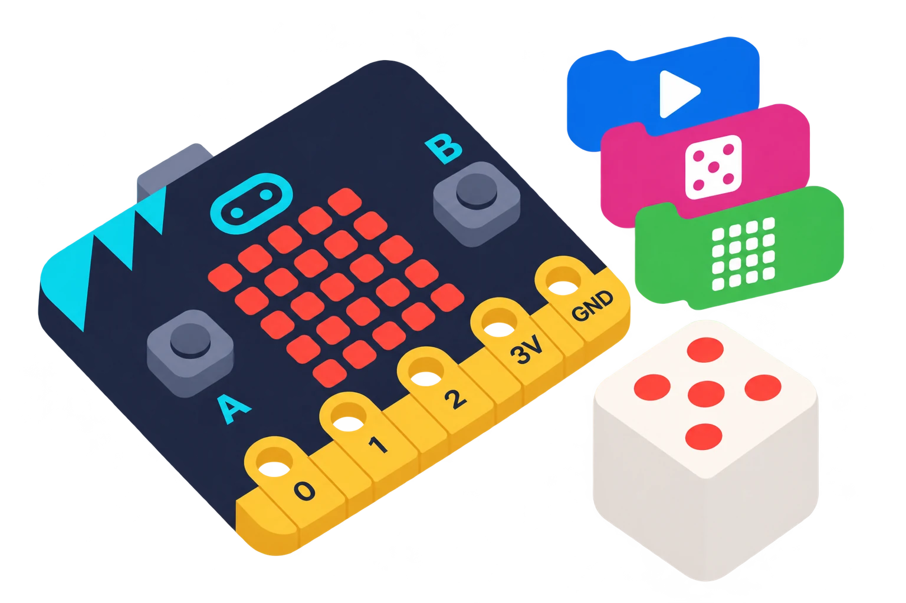

## 🎯 Què aprendrem?

Construïu un dau electrònic que reaccione a una sacsejada i mostreu-lo tant al simulador com a la placa. La seqüència presenta MakeCode, l’acceleròmetre (el sensor que detecta canvis de moviment), la matriu de 5 × 5 llums i la transferència del programa.

- Obrir un projecte MakeCode i provar-lo al simulador.
- Mostrar un nombre de l’1 al 6 quan se sacseja la placa.
- Transferir el programa a una micro:bit amb el mètode que ofereix l’ordinador.



## 🧰 Materials i preparació

- micro:bit V1 o V2 i cable USB de dades.
- Ordinador amb navegador i accés a MakeCode.

## 🧩 Funcions i controls

- MakeCode i matriu de 5 × 5 llums LED.
- Sacsejada detectada per l’acceleròmetre en les versions V1 i V2.

## 👣 Pas a pas

### 1. Creeu el projecte i el dau

Obriu MakeCode, trieu **Nou projecte** i poseu-li el nom «El meu dau». Abans de connectar la placa, comproveu que el simulador mostra la micro:bit.

En **Entrada**, afegiu «si es sacseja» i, dins, «mostra el número» amb «tria a l’atzar de l’1 al 6». Aquest exemple mostra l’ordre dels blocs:

```makecode
input.onGesture(Gesture.Shake, function () {
    basic.showNumber(randint(1, 6))
})
```

Els noms de les peces poden aparéixer en una altra llengua segons la configuració de MakeCode. La primera detecta la sacsejada i la segona mostra un nombre entre 1 i 6.

### 2. Proveu i transferiu el programa

Sacsegeu la micro:bit del simulador i comproveu que mostra un nombre de l’1 al 6. Per provar-ho amb la placa, connecteu-la per USB i premeu **Descarregar**. Si MakeCode desa un fitxer `.hex`, copieu-lo a la unitat **MICROBIT** i espereu que la transferència acabe abans de desconnectar el cable. Sacsegeu la placa i comproveu el resultat.

> **💡 Consell d’ús:** Mostreu el simulador de MakeCode: permet provar el programa abans de connectar la placa.

## 🧪 Comprovació i resolució de problemes

Sacsegeu la placa suaument i comproveu que mostra un nombre de l’1 al 6. Si el simulador funciona i la placa no, reviseu que la transferència haja acabat i que heu carregat el programa a la micro:bit correcta.

## 🛡️ Ús i seguretat

Subjecteu la placa per les vores i sacsegeu-la suaument. Si preferiu provar el programa sense moure-la, useu el simulador de MakeCode. No estireu el cable USB ni doblegueu el connector.

## 🔗 Fonts i límits

La [vista general oficial de micro:bit](https://microbit.org/get-started/features/overview/) descriu els botons, la matriu i els sensors integrats. La sacsejada d’aquesta pràctica es detecta amb l’acceleròmetre de la placa.
