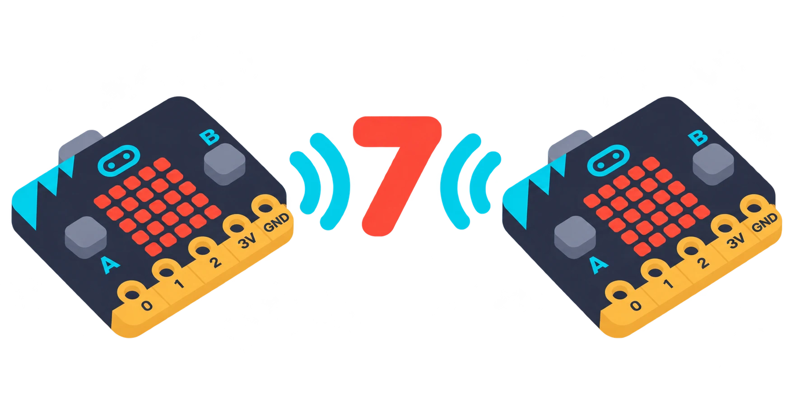

## 🎯 Què aprendrem?

Feu que una placa envie el número 7 i que una altra el mostre. Després canvieu el grup d’una placa i observeu què passa. És una comunicació local: no cal Wi-Fi i no transmet veu.

- Posar dues plaques en el mateix grup de ràdio.
- Enviar un número de prova i mostrar-lo a l’altra placa.
- Comprovar què passa quan canvia el grup.



## 🧰 Materials i preparació

- 2 o més plaques micro:bit amb portapiles
- Ordinador amb MakeCode per preparar i transferir un programa a cada placa.
- Full de registre per anotar grup, missatge enviat i missatge rebut.

Prepareu un programa emissor i un de receptor. Si hi ha altres plaques a prop, trieu un grup de ràdio que no utilitzen per evitar interferències.

## 🧩 Funcions i controls

- Ràdio integrada per enviar i rebre missatges dins d’un grup configurat.
- Comunicació per ràdio entre plaques sense Wi-Fi; és difusió local, no un canal privat ni un servei meteorològic.

## 👣 Pas a pas

### 1. Prepareu i envieu el missatge

A la placa emissora, poseu «ràdio: fixa grup a 7» a **en iniciar**. Dins de «en prémer el botó A», afegiu «ràdio: envia número 7». Descarregueu el programa. Les plaques emissora i receptora han d’usar el mateix grup de ràdio.

```makecode
radio.setGroup(7)
input.onButtonPressed(Button.A, function () {
    radio.sendNumber(7)
})
```

### 2. Prepareu el receptor i feu la prova

A la segona placa, poseu també el grup 7 a **en iniciar**. Afegiu «en rebre número per ràdio» i, dins, «mostra el número» rebut. Descarregueu aquest altre programa a la placa receptora abans de prémer A a l’emissora:

```makecode
radio.setGroup(7)
radio.onReceivedNumber(function (receivedNumber) {
    basic.showNumber(receivedNumber)
})
```

La [referència oficial de recepció per ràdio](https://makecode.microbit.org/reference/radio/on-received-number) mostra la peça de recepció i enllaça les peces d’enviament i de grup.

> **💡 Consell d’ús:** Useu el mateix grup de ràdio en les dues plaques de prova i un grup diferent del d’altres dispositius propers.

## 🧪 Comprovació i resolució de problemes

Premeu A cinc vegades a l’emissora i compteu quantes vegades apareix el 7 a la receptora. Deixeu que el número acabe de mostrar-se abans de tornar a prémer. Després canvieu només el grup de la receptora, descarregueu-li el programa i repetiu la prova. Torneu al grup 7 en acabar.

## 🛡️ Ús i seguretat

No envieu dades personals: qualsevol placa del mateix grup de ràdio pot rebre el missatge. Useu números de prova i comproveu el grup configurat en cada dispositiu abans de transmetre.

## 🔗 Fonts i límits

La [guia oficial de funcions de micro:bit](https://microbit.org/get-started/features/overview/) descriu la ràdio integrada i la diferència amb Bluetooth. La ràdio d’aquest exemple envia un número al grup configurat; no és privada i no necessita connexió a Internet.
