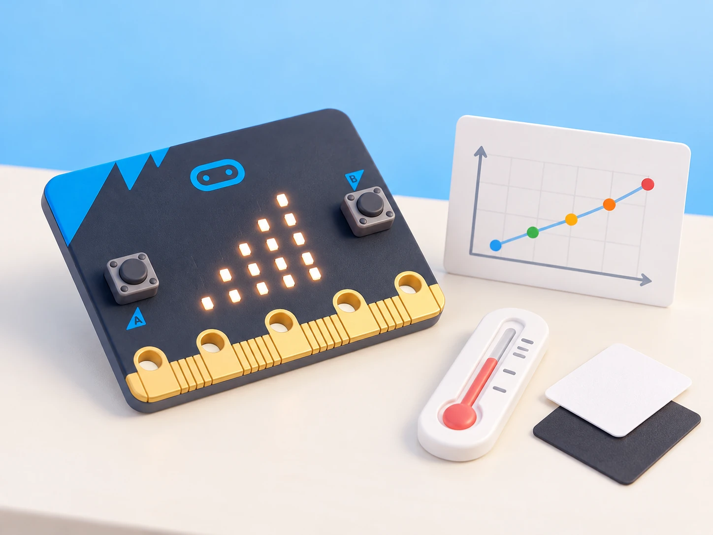

## 🎯 Repte i objectius

Prepareu un registre curt de condicions de l’aula amb una micro:bit V2. L’equip decidirà quines dades necessita, cada quant les llegirà, com confirmarà que el registre està actiu i com les recuperarà per interpretar-les. El registrador desa valors al dispositiu; no els envia automàticament a Internet ni converteix les lectures en una mesura científica calibrada.

- Crear columnes identificables per a les lectures que es volen recollir.
- Iniciar i aturar una captura manual amb un control comprensible.
- Recuperar les dades de la memòria i representar-les en una taula o gràfic.
- Diferenciar una variació observada d’una conclusió sobre tota l’aula o el dia.

## 🧰 Materials i preparació

- micro:bit V2 identificada per la marca de versió i amb firmware compatible amb MakeCode Data logging.
- Ordinador amb MakeCode i connexió USB per transferir el programa i recuperar les dades.
- Termòmetre de referència i targetes clara/fosca; són comparadors externs, no sensors connectats.
- Full de planificació amb variables, unitats o escala, interval de captura i duració de la prova.

En MakeCode, creeu un projecte nou i afegiu l’extensió oficial `datalogger`. Abans de transferir el programa, comproveu que el simulador mostra la funció de registre i assageu el control. Decidiu si la prova durarà pocs minuts i qui podrà consultar el fitxer. Eviteu enregistrar noms, veus, ubicacions personals o dades identificables.

## 🧩 Funcions del robot treballades

- Registre de dades de MakeCode en micro:bit V2 amb l’extensió `datalogger`.
- Sensor de llum de la matriu i lectura tèrmica interna per a observacions aproximades.
- Emmagatzematge local que es conserva en desconnectar l’alimentació fins que s’esborra o se sobreescriu el registre.
- Recuperació de les files en connectar la placa a un ordinador; visualització en taula o gràfic i exportació quan el navegador/editor ho ofereix.
- La guia no atribueix el registre persistent a V1 ni considera la temperatura del processador un termòmetre ambiental calibrat.

## 👣 Seqüència guiada

### 1. Planifiqueu les dades

Trieu una pregunta acotada: per exemple, si la lectura de llum canvia entre una taula il·luminada i una zona d’ombra. Escriviu els noms de les columnes, la freqüència i la duració abans de programar. Per a aquesta primera prova, useu una captura manual amb A i registreu una fila cada vegada; així podeu controlar quantes mostres s’han afegit i evitar omplir la memòria sense adonar-vos-en.

### 2. Prepareu el registre

Afegiu l’extensió `datalogger` i el bloc per establir els títols de columna, com ara `llum` i `temperatura_aproximada`, i un esdeveniment de botó A que afegisca una fila amb les lectures disponibles. Mostreu una icona breu quan la fila s’haja registrat. Si una versió del bloc no permet una de les lectures triades, retireu-la de les columnes i expliqueu-ho: no inventeu un valor de sensor.

```blocks
en iniciar:
  posa els títols de columna a [llum, temperatura_aproximada]
en prémer el botó A:
  registra una fila amb [nivell de llum, temperatura]
  mostra la icona ✓ durant 1 segon
```

### 3. Feu una captura controlada

Transfereix el programa a la placa V2, desconnecta el cable només quan haja acabat la transferència i fes cinc lectures: tres amb la matriu orientada cap a la zona clara i dues amb la targeta d’ombra a la mateixa distància. Prem A una vegada per mostra i anota en paper quina condició correspon a cada fila. Mantén la placa immòbil i no tapes els LED amb la mà durant tota la captura.

### 4. Recupera i interpreta les files

Connecta de nou la micro:bit a l’ordinador i recupera les dades registrades obrint la visualització de dades de MakeCode segons la guia oficial. Revisa els títols, l’ordre, els valors i les marques de temps; compara les files amb les anotacions de camp. Si el navegador permet exportar-les, desa una còpia sense dades personals i fes un gràfic. No combines captures si els encapçalaments o el rellotge s’han reiniciat sense documentar-ho.



_El gràfic és una representació per analitzar les mostres; no és una pantalla ni una funció visual integrada a la placa._

### 5. Esborreu només després de conservar l’evidència

Guardeu primer el fitxer o una captura de la taula i confirmeu que les dades corresponen a la prova. La transferència d’un programa nou pot invalidar el registre anterior; per això, no torneu a descarregar codi fins que hàgeu recuperat el que necessiteu. Després d’una còpia verificada, reinicieu el registre amb el procediment de MakeCode i comproveu que apareixen els títols abans de començar una nova sèrie.

## 🧪 Prova, depura i reflexiona

Compareu les cinc files registrades amb les condicions anotades en paper. Comproveu que hi ha cinc mostres, que cada valor ocupa la columna correcta i que la marca temporal segueix l’ordre de captura. Repetiu una lectura si hi ha una fila buida o una condició anotada incorrectament; no esborreu la memòria fins a haver conservat les dades útils. Si utilitzeu el simulador, identifiqueu-ne clarament les lectures com a simulades i no les barregeu amb les de la placa.

### Preguntes per comprovar

- Quina pregunta concreta respon el conjunt de dades i quines columnes ajuden a respondre-la?
- Com sabem que s’ha enregistrat cada fila i quin control inicia una mostra?
- Quina diferència hi ha entre el valor de llum i la temperatura interna aproximada?
- Què es conserva quan desconnectem la placa i quina acció podria esborrar o reemplaçar les dades?

## ♿ Accessibilitat i seguretat

Permeteu que una persona manipule A i una altra anote les condicions; també es pot assajar primer amb el simulador i una taula en paper. La placa pot mostrar una icona per confirmar cada registre. Manteniu el dispositiu pla, no tapeu els components amb materials que acumulen calor i feu la captura en un espai acordat. No registreu ni compartiu informació personal.

## ✅ Evidències d’aprenentatge

- Projecte MakeCode amb títols de columna clars i captura manual.
- Cinc files recuperades i relacionades amb les condicions observades.
- Taula o gràfic amb una conclusió limitada a les mostres recollides.
- Nota que identifique versió de la placa, simulació o maquinari, i moment en què s’ha conservat o esborrat el registre.

## 🔗 Fonts oficials i límits

La guia oficial de [registre de dades de micro:bit](https://microbit.org/get-started/user-guide/data-logging/) descriu l’extensió `datalogger`, la captura manual i automàtica, la recuperació i l’emmagatzematge local de micro:bit V2. La [vista general de funcions](https://microbit.org/get-started/features/overview/) detalla les diferències entre V1 i V2. Les lectures depenen del sensor i de les condicions de la prova; el registre no calibra els instruments ni valida per si mateix una hipòtesi.
