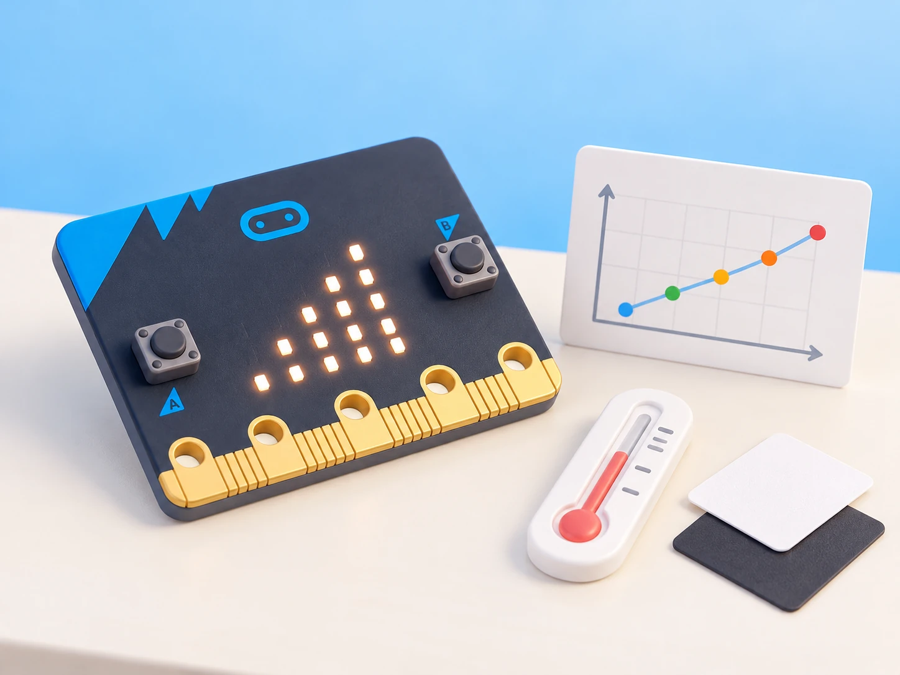

## 🎯 Repte i objectius

Amb una micro:bit V2, registreu cinc lectures de llum: tres en un lloc clar i dues fent ombra. Després compareu-les amb les anotacions. Les dades es guarden a la placa i no s’envien a Internet automàticament.

- Crear una columna amb un nom clar.
- Registrar una lectura cada vegada que es prem el botó A.
- Recuperar les dades de la memòria i representar-les en una taula o gràfic.
- Diferenciar una variació observada d’una conclusió sobre tota l’aula o el dia.

## 🧰 Materials i preparació

- micro:bit V2; la V1 no admet aquest registre de dades.
- Ordinador amb MakeCode i connexió USB per transferir el programa i recuperar les dades.
- Una targeta per fer ombra i un full amb dues opcions: «llum» i «ombra».

En MakeCode, creeu un projecte nou. Abans de descarregar-lo, guardeu les dades anteriors que necessiteu: un programa nou pot esborrar el registre visible.

## 🧩 Funcions del robot treballades

- Registre de dades de MakeCode en micro:bit V2 amb l’extensió `datalogger`.
- Sensor de llum de la matriu LED, emprat per comparar les condicions de la prova.
- Emmagatzematge local que es conserva en desconnectar l’alimentació fins que s’esborra o se sobreescriu el registre.
- Recuperació de les files en connectar la placa a un ordinador; visualització en taula o gràfic i exportació quan el navegador/editor ho ofereix.
- El registre persistent d’aquest tutorial és de V2; les lectures depenen de les condicions de la prova.

## 👣 Seqüència guiada

### 1. Planifiqueu les dades

Pregunteu-vos: «Canvia la lectura quan fem ombra a la placa?». Preparareu una columna anomenada `llum` i premeu A una vegada per cada mostra.

Abans de registrar dades, podeu provar la llum en un **projecte separat**. Guardeu primer qualsevol registre anterior que vulgueu conservar; després, carregueu aquesta prova i premeu A en una zona clara i en una d’ombra:

```makecode
input.onButtonPressed(Button.A, function () {
    basic.showNumber(input.lightLevel())
})
```

La primera lectura pot ser zero mentre s’activa el sensor; premeu A una altra vegada. Aquest programa només mostra un número: encara no guarda cap dada. En el pas següent creareu el programa de registre.

### 2. Prepareu el registre

Afegiu l’extensió **datalogger** des d’«Extensions». L’[exemple oficial de registre manual en MakeCode](https://makecode.microbit.org/#pub:_gHx1MJdJziaE) mostra les peces; per a aquesta prova, deixeu només la columna de llum.

1. A **en iniciar**, poseu el bloc per definir títols de columna i escriviu `llum`.
2. A **en prémer el botó A**, afegiu el bloc de registrar dades i associeu `llum` amb el nivell de llum.
3. Afegiu una icona de confirmació, una pausa d’un segon i «neteja la pantalla».

Per muntar les peces, useu els blocs equivalents en la versió de MakeCode del centre. També podeu obrir la pestanya **JavaScript**, copiar aquest exemple i tornar a **Blocs** per veure la traducció:

```makecode
datalogger.includeTimestamp(FlashLogTimeStampFormat.Seconds)
datalogger.setColumns(["llum"])
input.onButtonPressed(Button.A, function () {
    datalogger.logData([datalogger.createCV("llum", input.lightLevel())])
    basic.showIcon(IconNames.Yes)
    basic.pause(1000)
    basic.clearScreen()
})
```

El programa registra una fila cada vegada que premeu A i mostra un senyal de confirmació. Espereu que desaparega abans de fer la mostra següent. Si el bloc de registre no està disponible en l’editor, no substituïu la dada per un número mostrat a la pantalla: eixe programa no guardaria cap fila. La [guia oficial de registre](https://microbit.org/get-started/user-guide/data-logging/) mostra l’apartat «Manual logging».

### 3. Feu una captura controlada

Transferiu el programa a la V2 i espereu que acabe la transferència. Feu tres lectures amb llum i dues fent ombra amb la targeta. Premeu A una vegada per mostra, espereu que desaparega la icona i anoteu en paper si era una prova amb llum o amb ombra. Manteniu la placa en la mateixa posició.

### 4. Recupera i interpreta les files

Per recuperar les dades, connecteu de nou la micro:bit a l’ordinador. Obriu la unitat **MICROBIT** i feu doble clic al fitxer **MY_DATA**: s’obrirà una taula al navegador. Compareu les files amb les anotacions i, si voleu, copieu o descarregueu les dades. Per veure els gràfics de MY_DATA cal connexió a Internet; sense connexió podeu consultar la taula. La columna de temps compta des de l’últim reinici de la placa, no indica l’hora del dia.



_El gràfic és una representació per analitzar les mostres; no és una pantalla ni una funció visual integrada a la placa._

### 5. Esborreu només després de conservar l’evidència

Guardeu una còpia de la taula abans de descarregar un programa nou o esborrar el registre. Per començar una altra prova, seguiu el procediment d’esborrat de la guia oficial i torneu a preparar els títols de les columnes.

## 🧪 Prova, depura i reflexiona

Compareu les cinc files amb el full: hi ha tres proves amb llum i dues amb ombra? Si falta una fila, torneu a prémer A i anoteu la nova mostra. Les dades del simulador són simulades; distingiu-les de les que recull la placa.

### Preguntes per comprovar

- Quina pregunta concreta respon el conjunt de dades i quines columnes ajuden a respondre-la?
- Com sabem que s’ha enregistrat cada fila i quin control inicia una mostra?
- Quina diferència hi ha entre les lectures quan hi ha llum i quan fem ombra?
- Què es conserva quan desconnectem la placa i quina acció podria esborrar o reemplaçar les dades?

## ♿ Accessibilitat i seguretat

Permeteu que una persona manipule A i una altra anote les condicions; també es pot assajar primer amb el simulador i una taula en paper. La placa pot mostrar una icona per confirmar cada registre. Manteniu el dispositiu pla, no tapeu els components amb materials que acumulen calor i feu la captura en un espai acordat. No registreu ni compartiu informació personal.

## ✅ Evidències d’aprenentatge

- Projecte MakeCode amb títols de columna clars i captura manual.
- Cinc files recuperades i relacionades amb les condicions observades.
- Taula o gràfic amb una conclusió limitada a les mostres recollides.
- Nota que identifique versió de la placa, simulació o maquinari, i moment en què s’ha conservat o esborrat el registre.

## 🔗 Fonts oficials i límits

La guia oficial de [registre de dades de micro:bit](https://microbit.org/get-started/user-guide/data-logging/) descriu l’extensió `datalogger`, la captura manual i automàtica, la recuperació i l’emmagatzematge local de micro:bit V2. La [vista general de funcions](https://microbit.org/get-started/features/overview/) detalla les diferències entre V1 i V2. Les lectures depenen del sensor i de les condicions de la prova; el registre no calibra els instruments ni valida per si mateix una hipòtesi.
