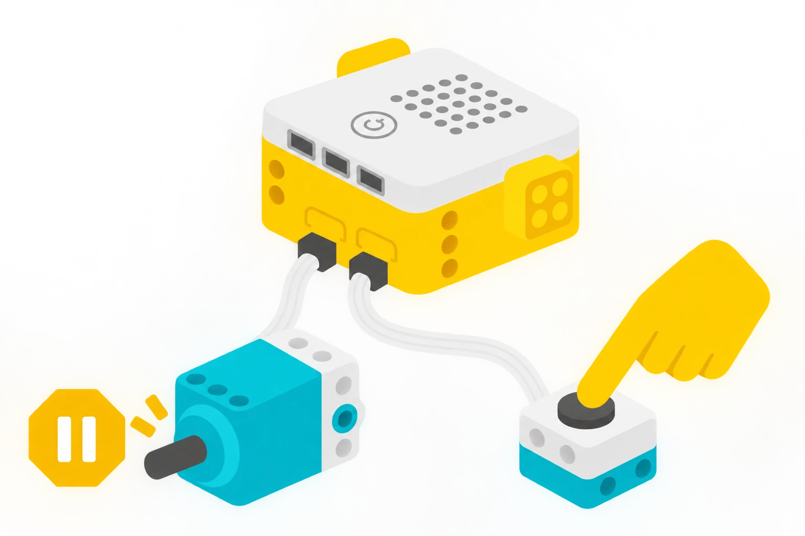

## 🎯 Què aprendrem?

Programeu un motor solt perquè s’ature en prémer el sensor de força amb el dit. No cal construir cap braç ni pinça, ni encaixar peces LEGO.

- Distingir els estats premut i alliberat.
- Relacionar una entrada del sensor amb una ordre al motor.
- Provar una condició i explicar el resultat.



## 🧰 Materials i preparació

- Hub SPIKE Prime, un motor angular i un sensor de força.
- Ordinador o tauleta amb SPIKE App i connexió USB o Bluetooth.

Connecteu només els cables. Recolzeu el motor de manera estable sobre la taula, amb l’eix lliure i sense cap peça afegida. Deixeu el sensor separat del motor i fàcil d’abastar.

## 🧩 Funcions i controls

- Lectura de contacte del sensor de força i control d’un motor angular.
- Espera condicional; el sensor no mesura distància.

## 👣 Pas a pas

### 1. Comproveu el sensor amb el motor parat

Connecteu el motor al port A i el sensor de força al B. Obriu la informació del Hub a SPIKE App. Premeu suaument la superfície del sensor amb el dit i deixeu-la anar: comproveu si l’estat canvia entre premut i alliberat. Si no canvia, reviseu el cable i el port.

### 2. Programeu l’aturada en prémer

Busqueu els blocs equivalents de la vostra versió de SPIKE App:

```spikeapp
quan comença el programa
activa el motor [A v] a velocitat baixa
espera fins que el sensor de força [B v] estiga premut
atura el motor [A v]
```

Inicieu el programa amb el sensor alliberat. Premeu-lo sense acostar la mà al motor i observeu l’aturada. Deixar anar el sensor no reinicia aquest programa: cal tornar-lo a executar. Manteniu també accessible l’aturada manual del Hub o de l’app.

### 3. Compareu dos estats inicials

Repetiu tres vegades començant amb el sensor alliberat. Després inicieu el programa amb el sensor ja premut i comproveu la resposta. Si l’app ofereix una lectura numèrica de força, observeu com varia amb una pressió suau; no cal fer força elevada ni canviar el programa.

## 🧪 Comprovació i resolució de problemes

Registreu l’estat inicial, si heu premut el sensor i si el motor s’ha aturat. Si continua girant, atureu-lo manualment i reviseu els ports i la condició.

## 🛡️ Ús i seguretat

Situeu el sensor on siga còmode prémer-lo. No toqueu l’eix del motor en moviment. La condició programada no substitueix l’aturada manual ni és un sistema de protecció.

## 🔗 Fonts i límits

La [fitxa tècnica del sensor](https://assets.education.lego.com/v3/assets/blt293eea581807678a/blt23df304b05e587b2/5f8801ba721f8178f2e5e626/techspecs_technicforcesensor.pdf?locale=en-us) diferencia detecció de contacte i mesura de força. LEGO també ofereix una [pràctica de sensor i motor](https://education.lego.com/en-us/lessons/spike-python-u3-sensor-control/spike-python-u3l1-start-sensing/); aquella lliçó usa Python, mentre que aquest tutorial fa servir blocs.
