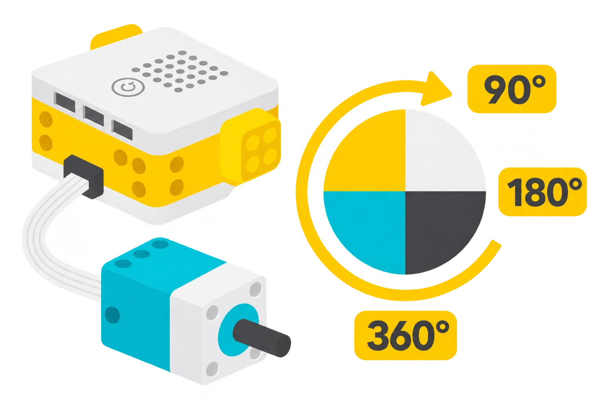

## 🎯 Què aprendrem?

Programeu i comproveu el gir d’un motor angular solt. No cal muntar cap vehicle ni encaixar peces LEGO: treballareu amb el motor tal com ve al kit.

- Relacionar 90°, 180° i 360° amb un quart, mitja volta i una volta completa.
- Comprovar que el gir correspon a l’angle programat.
- Distingir l’angle de gir del motor de la distància recorreguda per un vehicle.



## 🧰 Materials i preparació

- Hub SPIKE Prime carregat i un motor angular.
- Paper amb un cercle dividit en quatre parts per comprovar el gir.
- Ordinador o tauleta amb SPIKE App i connexió USB o Bluetooth.

Recolzeu el motor de manera estable sobre la taula amb la marca de la part giratòria visible. No hi afegiu rodes, braços ni eixos. El paper serveix de referència visual al costat del motor, sense tocar-lo.

## 🧩 Funcions i controls

- Motor angular: gir programat en graus, sentit i velocitat.
- Observació de la posició angular; sense rodes no es calcula una distància lineal.

## 👣 Pas a pas

### 1. Connecteu i identifiqueu la posició inicial

Connecteu el motor al port A i comproveu que SPIKE App el reconeix. Observeu la marca de la part giratòria i dibuixeu-ne la posició inicial al paper. Useu les marques del paper per comprovar després un quart de volta.

### 2. Programeu un gir curt

Seleccioneu els blocs equivalents de la vostra versió de l’app i una velocitat baixa:

```spikeapp
quan comença el programa
fixa la velocitat del motor [A v] a (20) %
motor [A v] gira (90) graus
```

Executeu una vegada i comproveu que la marca ha girat un quart de volta. No toqueu ni freneu la part giratòria. Si el motor es desplaça sobre la taula, atureu-lo i busqueu una posició de suport estable abans de continuar.

### 3. Compareu tres angles

Proveu 90°, 180° i 360°, mantenint la mateixa velocitat. Abans de cada execució, anoteu la posició de partida i dibuixeu el resultat esperat: el gir és relatiu a aquella posició, no a un zero fix. En una volta completa, la marca torna aproximadament al punt inicial; observeu també el moviment per distingir-la d’una absència de gir.

### 4. Canvieu només la velocitat

Repetiu el gir de 180° amb dues velocitats baixes diferents. Compareu l’angle final i el temps que tarda. Manteniu el mateix port, sentit i angle en totes dues proves.

## 🧪 Comprovació i resolució de problemes

Comproveu la posició final de la marca del motor per a 90°, 180° i 360°. Si el gir no correspon al valor indicat, reviseu la unitat del bloc, el port i la posició inicial abans de repetir.

## 🛡️ Ús i seguretat

Manteniu mans, roba, cabells i cables lluny del motor en marxa. Recolzeu-lo de manera estable i atureu el programa abans de recol·locar-lo. No freneu l’eix amb els dits.

## 🔗 Fonts i límits

Les [especificacions de SPIKE Prime](https://education.lego.com/it-it/product-resources/spike-prime/downloads/technical-specifications/) descriuen els motors angulars. Aquesta prova observa el gir del motor sense càrrega; no mesura un desplaçament lineal.
