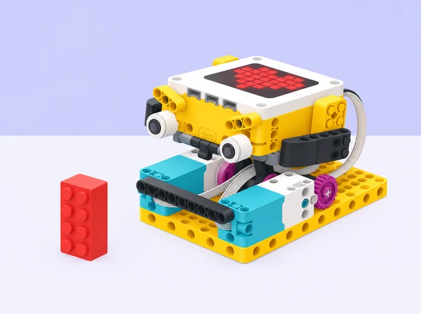

## 🎯 Repte i objectius



Estima quant avançarà la base motriu i compara el resultat amb la distància real al bloc. La pràctica utilitza els graus del motor i la geometria de les rodes per planificar la parada, i reserva el sensor de força per detectar el contacte en una prova comparativa.

- Relacionar els girs de les rodes amb la distància que recorre la base.
- Fer una estimació, provar-la i ajustar-la amb dades.
- Distingir una parada calculada d’una parada activada per contacte.

## 🧰 Materials i preparació

- Conjunt LEGO Education SPIKE Prime amb Hub, dos motors i sensor de força opcional per a la comparació final.
- Peces Technic per muntar una base motriu estable.
- Un bloc LEGO vertical com a obstacle i cinta de paper per marcar la sortida.
- Regle o cinta mètrica.

## 🧩 Funcions del robot treballades

- Motor angular i càlcul de desplaçament a partir de rotacions i geometria de roda.
- La comparació amb el sensor de força detecta contacte; no s’utilitza el sensor d’ultrasons/distància en aquesta pràctica.

## 👣 Seqüència guiada

### 1. Prepareu la base i el punt de partida

Construïu una base que avance recta amb dos motors. Anoteu-ne els ports i marqueu la posició inicial del davant de la base. Deixeu el camí lliure en la primera prova; col·locareu el bloc després d’haver comprovat quant avança el robot.

### 2. Estimeu el desplaçament

Mesureu el diàmetre de la roda. Per a una primera estimació, multipliqueu-lo per 3: així aproximareu la distància d’una volta completa. Trieu quantes voltes voleu provar i anoteu el desplaçament previst. En SPIKE App, busqueu el bloc de moviment per voltes o graus.

### 3. Fer una prova lenta

Programeu l’avanç a velocitat baixa i executeu-lo des de la marca **sense posar encara el bloc davant del robot**. Mesureu quant s’ha desplaçat. Repetiu tres vegades i anoteu les voltes, la distància real i les diferències entre intents.

```spikeapp
quan comença el programa
configura els motors de moviment [B i D v]
mou endavant (1) voltes a velocitat baixa
```

L’esquema mostra l’ordre dels blocs; busqueu-ne els equivalents en SPIKE App. Canvieu els ports si els motors estan connectats en uns altres i substituïu una volta pel valor que vulgueu provar. Comenceu en un espai lliure. Quan conegueu el desplaçament real, poseu el bloc més enllà del punt previst i feu una prova supervisada.

> **💡 Repte d’equip:** aconseguiu quedar-vos tan a prop com pugueu sense tocar el bloc. Quan funcione a un metre, canvieu la distància d’eixida i reutilitzeu les dades per fer una nova predicció.

### 4. Comparar amb una parada per contacte

Si el muntatge incorpora un sensor de força al davant, afegiu-lo com a topall tou contra una paret feta amb blocs. Programeu el moviment perquè s’ature quan el sensor detecte el contacte. Feu aquesta comparació a velocitat baixa i amb un obstacle estable; el sensor de força no és un sensor de distància i aquesta segona prova sí que acaba en contacte.

## 🧪 Prova, depura i reflexiona

Repetiu tres vegades des de la mateixa marca i compareu la distància amb la predicció. Si el robot s’acosta massa al bloc, atureu-lo manualment i reduïu les voltes per a l’intent següent. El sensor de força de la prova comparativa detecta contacte; no mesura l’espai que queda.

### Preguntes per comprovar

- Quantes voltes havíeu previst i quantes n’han calgut després de provar?
- Què ha canviat quan heu modificat la velocitat?
- En quin cas el robot s’atura abans del contacte i en quin cas espera a tocar?


## ♿ Accessibilitat i seguretat

Per començar, faciliteu una taula de conversions roda-voltes-distància o trieu una distància que corresponga a voltes completes. Com a ampliació, compareu rodes de diàmetres diferents o representeu les proves en un gràfic. Repartiu els rols de conducció, mesura i registre.

## ✅ Evidències d’aprenentatge
- Recolliu una taula amb les prediccions i resultats, una explicació de l’ajust triat i una demostració de cada tipus de parada. Eviteu fotografiar cares o dades personals.

## 🔗 Fonts oficials i límits

Adaptació pròpia del repte [Going the Distance de LEGO Education](https://education.lego.com/en-us/lessons/prime-extra-resources/going-the-distance/), que calcula un recorregut amb les rodes i el compara amb una parada per contacte. La prova amb sensor de força és opcional i requereix un muntatge adequat.

Les [especificacions de SPIKE Prime](https://education.lego.com/it-it/product-resources/spike-prime/downloads/technical-specifications/) descriuen els motors angulars i el sensor de força. El càlcul és una estimació: la roda, la superfície i la càrrega poden canviar la distància real.
