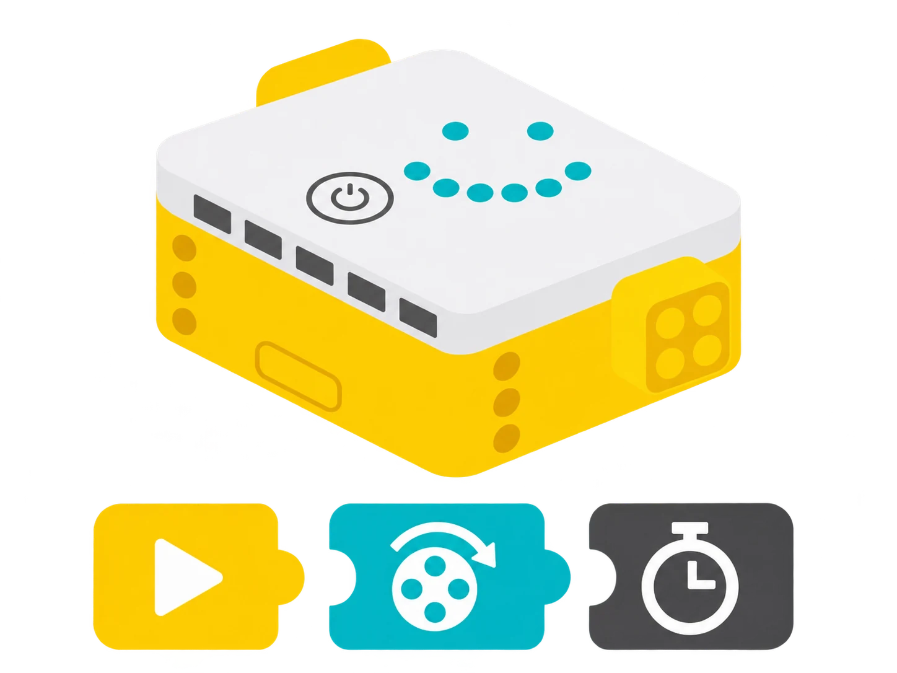

## 🎯 Què aprendrem?

Connecta el Hub gran SPIKE Prime i crea el teu primer programa: una cara que apareix i desapareix. Després identifica els botons, els ports A–F i el sensor d’orientació. Només necessites el Hub: no cal encaixar peces LEGO ni construir cap model.

- Comprovar la càrrega del Hub i connectar-lo per Bluetooth o USB a SPIKE App.
- Programar la matriu de 25 píxels per mostrar icones i animacions.
- Identificar els sis ports d’entrada/eixida A–F i els botons del Hub gran SPIKE Prime.
- Distingir les lectures d’inclinació del sensor de sis eixos de gestos com sacsejar o tocar el Hub.



## 🧰 Materials i preparació

- Hub gran SPIKE Prime (model 45601)
- App LEGO SPIKE instal·lada
- Cable USB

## 🧩 Funcions i controls

- Hub SPIKE Prime: matriu LED 5 × 5, botó central, botons laterals, ports i sensor d’orientació de sis eixos.
- Connexió i programació amb SPIKE App; els ports i elements connectats s’han d’identificar en cada prova.
- Bateria recarregable del Hub; l’estat de càrrega i els indicadors poden variar segons la versió de l’app.

## 👣 Pas a pas

### 1. Enceneu i connecteu el Hub Prime

Comproveu que el Hub té càrrega i enceneu-lo amb el botó central. Obriu SPIKE App, creeu un projecte i seleccioneu **Connecta**. Trieu el Hub que mostra el mateix nom o indicador que el vostre. També podeu connectar-lo amb el cable USB. Si l’app demana una actualització, seguiu les instruccions en pantalla i espereu que acabe abans de desconnectar-lo.

### 2. Mostreu una icona a la matriu

Creeu un projecte amb blocs de paraules o d’icones. Quan comence el programa, mostreu una icona a la matriu 5 × 5 i esborreu-la. Comproveu que es tracta d’una matriu de llum del Hub i no d’una pantalla de píxels a color.

```spikeapp
quan comença el programa
mostra una cara feliç
espera (2) segons
esborra la pantalla
```

### 3. Llegiu el sensor d’orientació

En un projecte nou, busqueu a l’app l’esdeveniment que detecta una inclinació del Hub i afegiu-hi una ordre per mostrar una fletxa. Transferiu i executeu el programa. Poseu el Hub sobre la taula i inclineu-lo en la direcció triada: hauria d’aparéixer la fletxa. Torneu-lo a una posició estable abans de repetir. Si no respon, reviseu el sentit seleccionat en l’esdeveniment i que el projecte siga el que heu executat. El sensor de sis eixos combina giroscopi i acceleròmetre; no és una brúixola que indique el nord.

### 4. Exploreu els botons i els indicadors

Amb el Hub desconnectat de motors i sensors, useu els botons esquerre i dret per recórrer els programes guardats i el botó central per iniciar-ne un. Observeu l’indicador del Hub mentre es connecta i executa el projecte. Els botons laterals naveguen pels programes del Hub; no són botons A i B d’un controlador separat.

> **💡 Consell d’ús:** Identifiqueu el nom del Hub abans de connectar-lo per Bluetooth, especialment si hi ha altres dispositius encesos a prop.

## 🧪 Comprovació i resolució de problemes

Executeu el programa i comproveu que la cara apareix, es manté dos segons i s’esborra. Si no passa, reviseu la connexió i l’ordre dels blocs. Identifiqueu els ports A–F per les lletres del Hub abans de connectar accessoris.

## 🛡️ Ús i seguretat

Comenceu amb el Hub sobre la taula i sense motors connectats. No interrompeu una actualització del firmware. Desconnecteu el cable USB agafant-ne el connector.

## 🔗 Fonts i límits

La [fitxa tècnica i guia oficial de SPIKE Prime](https://education.lego.com/en-us/teacher-resources/lego-education-spike-prime/support-technical-info/lego-education-spike-prime-support-technical-info-product-info/) descriu el Hub gran amb sis ports, matriu 5 × 5, BLE, altaveu, sensor de sis eixos i bateria recarregable, així com els passos de connexió i actualització. Aquesta guia és per al Hub gran SPIKE Prime; SPIKE Essential té un hub diferent amb només dos ports. LEGO indica que continuarà donant suport a SPIKE App fins al 30 de juny de 2031 ([actualització de LEGO Education](https://education.lego.com/en-us/spike-update-2026/)).
