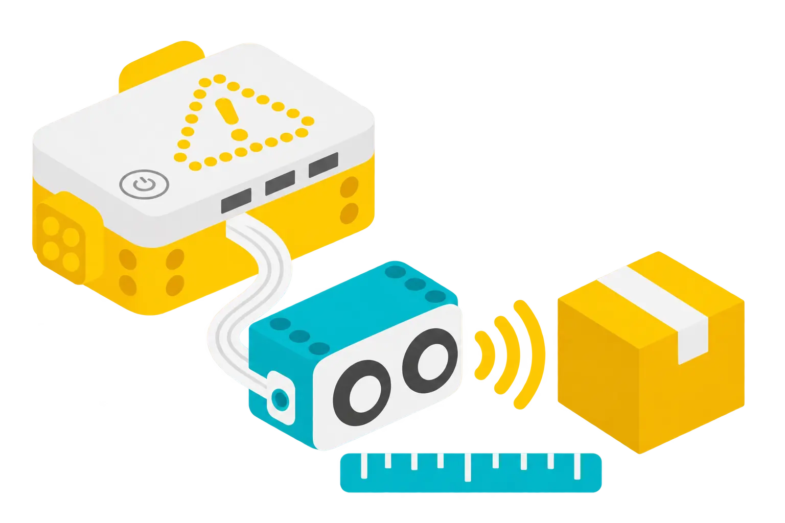

## 🎯 Què aprendrem?

Creeu un avís de proximitat amb el sensor quiet sobre la taula. Moveu una caixa a mà per activar-lo i exploreu després el gir del Hub, també a mà. No cal construir cap base ni encaixar peces LEGO; aquest exemple no utilitza motors.

- Comparar lectures amb tres distàncies conegudes.
- Programar un avís condicionat per la distància.
- Observar un angle de gir amb el sensor de moviment del Hub.



## 🧰 Materials i preparació

- Hub SPIKE Prime carregat i sensor de distància Technic.
- Caixa de cartó amb una cara plana, regle i paper amb un angle recte dibuixat.
- Ordinador o tauleta amb SPIKE App i connexió USB o Bluetooth.

Deixeu el sensor recolzat sobre la taula, amb les finestres orientades cap a la caixa i sense obstruccions. Només cal connectar-ne el cable al Hub. Comproveu la unitat de lectura que mostra l’app.

## 🧩 Funcions i controls

- Sensor ultrasònic per estimar distància.
- Giroscopi del Hub per observar un gir manual.
- Altaveu integrat i matriu LED com a avisos complementaris.

## 👣 Pas a pas

### 1. Comproveu tres distàncies

Connecteu el sensor de distància ultrasònic al port C i obriu la informació del Hub en SPIKE App. Manteniu el sensor quiet i poseu la cara plana de la caixa a 10, 20 i 30 cm de les finestres, mesurant amb el regle. Anoteu la lectura en cada posició. Si varia molt, reviseu l’orientació i deixeu l’espai entre caixa i sensor lliure.

### 2. Programeu un avís de proximitat

Poseu la caixa a 30 cm i prepareu els blocs equivalents de la vostra versió de SPIKE App:

```spikeapp
quan comença el programa
esborra la pantalla
espera fins que la distància del sensor [C v] siga menor de (12) cm
mostra un signe d’exclamació
emet un to curt amb el Hub
```

Comproveu les unitats: 12 cm equivalen a 120 mm. Executeu el programa i acosteu lentament la caixa a mà, sense moure el sensor. Observeu quan apareix la icona i sona el to de l’altaveu del Hub. El programa avisa una vegada; per repetir, allunyeu la caixa i torneu a executar-lo.

### 3. Observeu un gir manual amb el giroscopi

Feu aquesta prova en un projecte separat. Deixeu el Hub pla i quiet, i poseu a zero l’angle de gir amb el bloc corresponent de l’app. Gireu el Hub a mà un quart de volta sobre la taula, seguint l’angle recte del paper. Observeu si la lectura s’acosta a 90° o −90°: el signe depén del sentit. Deixeu marge al cable del sensor, sense estirar-lo. Torneu a la posició inicial, poseu a zero i repetiu tres vegades.

### 4. Compareu els avisos

Repetiu la prova de proximitat amb un altre llindar, per exemple 20 cm. Manteniu la icona com a alternativa al so i compareu a quina distància s’activa. Ajusteu el volum a un nivell còmode amb les opcions disponibles en l’app.

## 🧪 Comprovació i resolució de problemes

Comproveu que l’avís s’activa quan la caixa travessa el llindar programat. Si no ho fa, reviseu el port, les unitats, l’orientació i la lectura del sensor. En la prova manual del Hub, poseu a zero l’angle abans de girar-lo.

## 🛡️ Ús i seguretat

Manipuleu el Hub sense estirar els cables i deixeu espai per moure la caixa. Useu un avís breu a volum moderat. L’exemple no és una alarma real de seguretat.

## 🔗 Fonts i límits

La fitxa tècnica LEGO del [sensor de distància Technic](https://assets.education.lego.com/v3/assets/blt293eea581807678a/blt64c2b9534cf10f68/5f8801b8bc43790f5c4389ea/techspecs_technicdistancesensor.pdf?locale=en-us) descriu la tecnologia ultrasònica i els rangs; les [especificacions del Hub Prime](https://assets.education.lego.com/v3/assets/blt293eea581807678a/bltf512a371e82f6420/5f8801baf4f4cf0fa39d2feb/techspecs_techniclargehub.pdf?locale=en-us) documenten altaveu i sensor de moviment. Les lectures són aproximades; aquest exemple no és un sistema de seguretat.
