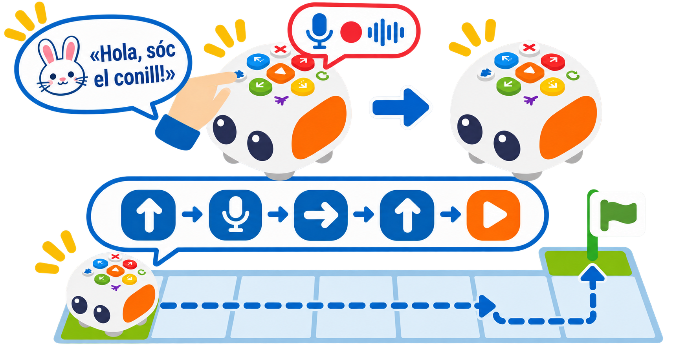

## 🎯 Repte i objectius

Enregistreu un missatge breu perquè Tale-Bot el reproduïsca durant una ruta. La pràctica diferencia l’enregistrament d’àudio del reconeixement de parla: el robot no interpreta ordres parlades.

- Preparar i enregistrar una frase breu, sense dades personals.
- Afegir el missatge gravat a una seqüència de botons.
- Crear rutes narratives de contacontes interactius.

## 🧰 Materials i preparació

- Tale-Bot Pro carregat.
- Targetes de personatges i una ruta curta sobre una superfície plana.
- Un missatge de prova inventat, sense noms ni dades personals.

## 🧩 Funcions del robot treballades

- Gravació i reproducció d’un missatge de veu amb el botó Record (màxim oficial de 30 segons per gravació).
- No reconeix ni interpreta la parla com una ordre de navegació.

## 👣 Seqüència guiada

### 1. Enregistreu i comproveu el missatge

Trieu una frase curta, per exemple «Hola, sóc el conill!». Manteniu premut el botó de gravació mentre parleu i deixeu-lo anar en acabar. Cada gravació pot durar fins a 30 segons; en deixar anar el botó, escolteu la reproducció. Si no se sent o no s’entén, torneu a gravar-la en un lloc més tranquil. Una persona adulta pot enregistrar el missatge si l’alumnat no vol compartir la seua veu.

### 2. Afegiu el missatge a una ruta

Manteniu X més d’un segon per esborrar les ordres anteriors i comproveu que els indicadors s’apaguen. Després premeu **Endavant → gravació breument → Dreta → Endavant → Play**. La pulsació breu del botó de gravació afegeix el missatge a la seqüència; mantindre’l premut inicia una gravació nova.

> **💡 Consell docent:** Si una criatura prefereix no gravar la seua veu, pot triar la frase o ordenar les targetes mentre una persona adulta fa la gravació.

## 🧪 Prova, depura i reflexiona

Executeu la ruta i comproveu que el missatge sona després del primer avanç. Si no sona, reviseu que heu gravat una frase i que heu afegit l’ordre amb una pulsació breu. Repetiu la prova des de la mateixa posició inicial.

### Preguntes per comprovar

- Quan comença i acaba la gravació?
- L'ordre es reprodueix o el robot la interpreta per moure's?
- En quina part del procés s’emmagatzema la veu i com podeu reproduir-la sense donar cap ordre de moviment?

## ♿ Accessibilitat i seguretat

Oferiu targetes amb les ordres i un missatge enregistrat per una persona adulta. Parlar i consentir l’enregistrament són opcions diferents.

## ✅ Evidències d’aprenentatge
- Mapa amb la ruta i el lloc on sona el missatge.
- Registre de la seqüència de botons i comprovació que l’àudio es reprodueix.
- Explicació que diferencia gravar, reproduir i interpretar una ordre. No cal conservar ni compartir l’enregistrament.

## 🔗 Fonts oficials i límits

La [guia oficial de Tale-Bot Pro](https://matatalab.com/en/lesson4.2) indica que la gravació dura fins a 30 segons i que una pulsació breu del botó afig la gravació a la seqüència. Tale-Bot reproduïx l’àudio; no interpreta la frase com una ordre.
