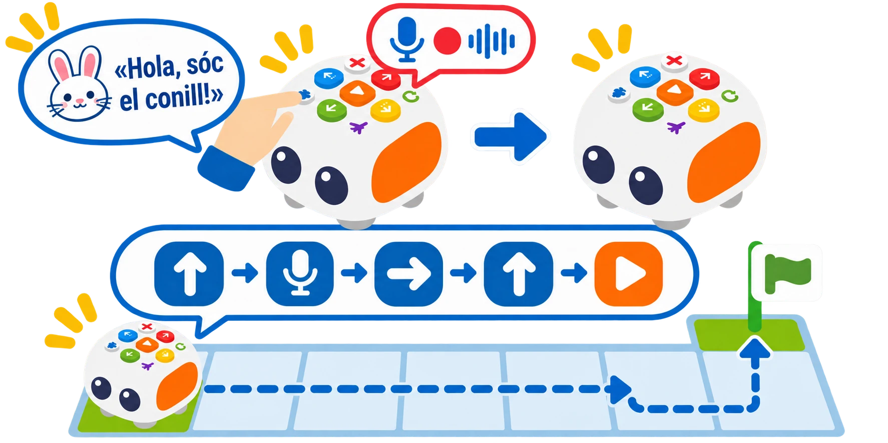

## 🎯 Què aprendrem?

Enregistreu un missatge breu perquè Tale-Bot el reproduïsca durant una ruta. La pràctica diferencia l’enregistrament d’àudio del reconeixement de parla: el robot no interpreta ordres parlades.

- Preparar i enregistrar una frase breu, sense dades personals.
- Afegir el missatge gravat a una seqüència de botons.
- Crear seqüències de moviment amb reproducció de veu.



## 🧰 Materials i preparació

- Tale-Bot Pro carregat.
- Targetes de personatges i una ruta curta sobre una superfície plana.
- Un missatge de prova inventat, sense noms ni dades personals.

## 🧩 Funcions i controls

- Gravació i reproducció d’un missatge de veu amb el botó Record (màxim oficial de 30 segons per gravació).
- No reconeix ni interpreta la parla com una ordre de navegació.

## 👣 Pas a pas

### 1. Enregistreu i comproveu el missatge

Trieu una frase curta, per exemple «Hola, sóc el conill!». Manteniu premut el botó de gravació mentre parleu i deixeu-lo anar en acabar. Cada gravació pot durar fins a 30 segons; en deixar anar el botó, escolteu la reproducció. Si no se sent o no s’entén, torneu a gravar-la en un lloc més tranquil. Useu una frase fictícia sense dades personals.

### 2. Afegiu el missatge a una ruta

Manteniu X més d’un segon per esborrar les ordres anteriors i comproveu que els indicadors s’apaguen. Després premeu **Endavant → gravació breument → Dreta → Endavant → Play**. La pulsació breu del botó de gravació afegeix el missatge a la seqüència; mantindre’l premut inicia una gravació nova.

```talebot
avançar -> gravació -> girar dreta -> avançar -> executa
```

> **💡 Consell d’ús:** Comproveu la gravació abans d’afegir-la al programa; una pulsació llarga del botó substitueix el missatge anterior.

## 🧪 Comprovació i resolució de problemes

Executeu la ruta i comproveu que el missatge sona després del primer avanç. Si no sona, reviseu que heu gravat una frase i que heu afegit l’ordre amb una pulsació breu. Repetiu la prova des de la mateixa posició inicial.

## 🛡️ Ús i seguretat

Enregistreu un missatge fictici sense dades personals. La pulsació llarga grava un missatge nou; la curta l’afegeix al programa. Manteniu lliure la ruta abans de prémer Play.

## 🔗 Fonts i límits

La [guia oficial de Tale-Bot Pro](https://matatalab.com/en/lesson4.2) indica que la gravació dura fins a 30 segons i que una pulsació breu del botó afig la gravació a la seqüència. Tale-Bot reproduïx l’àudio; no interpreta la frase com una ordre.
