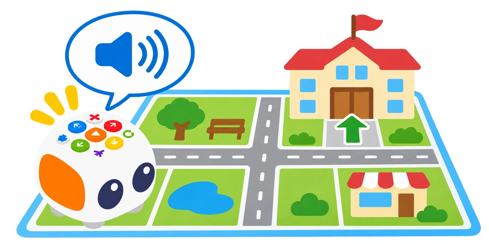

## 🎯 Repte i objectius

Prepareu una ruta curta, proveu la repetició i descobriu què passa sobre un mapa interactiu compatible. Les marques especials del mapa permeten que el robot reproduïsca instruccions; un mapa imprés normal no té aquesta funció.

- Comparar un programa repetit amb un programa que inclou ordres addicionals.
- Diferenciar una dansa predefinida d’una seqüència programada amb els botons.
- Explorar la lectura OID i la gravació només amb accessoris compatibles.

## 🧰 Materials i preparació

- Tale-Bot Pro carregat, en una superfície plana.
- Un mapa interactiu OID compatible o, com a alternativa, un mapa imprés sense funcions interactives.
- Targetes de comandament i una ruta curta amb inici i destinació marcats.
- Dos retoladors rentables i el suport de dibuix només si formen part del kit del centre.

Abans de començar, comproveu les tecles físiques de moviment, Play, esborrat, repetició, dansa i gravació. El fabricant documenta una gravació de veu de fins a 30 segons i sis danses predefinides; les funcions interactives del mapa depenen del mapa concret.

## 🧩 Funcions del robot treballades

- Botó de repetició per repetir unitats d’ordres del programa complet; no permet repetir només un fragment d’un programa més llarg.
- Indicadors de color per seguir les ordres enregistrades.
- Botó de dansa aleatòria amb moviments predefinits.
- Lectura OID del mapa compatible i instruccions de veu contextuals.
- Gravació i reproducció d’àudio, diferenciades de la interpretació de parla.
- Dibuix mitjançant accessori compatible, com a extensió opcional.

## 👣 Seqüència guiada

### 1. Programeu i repetiu una seqüència

Manteniu X més d’un segon per començar sense ordres anteriors. Prepareu amb targetes **Endavant → Dreta**, introduïu eixes dues ordres i premeu Play sense activar la repetició. Compteu els moviments i torneu el robot a la posició i orientació inicials. Introduïu de nou la seqüència si cal, premeu el botó de repetició, observeu els llums i premeu Play. Compteu quantes vegades es fa la seqüència. Canvieu el nombre de repeticions amb el botó i torneu a provar des de l’inici. La repetició s’aplica al programa complet: no permet seleccionar només un fragment si després hi ha altres ordres. Si no sabeu quina opció de repetició està activa, comenceu amb una prova curta en un espai ampli i atureu el robot si continua més del previst.

### 2. Compareu la dansa predefinida

Esborreu les ordres anteriors, premeu una vegada el botó de dansa i després **Play**. Repetiu la prova tres vegades i anoteu si el moviment canvia. Compareu-lo amb una seqüència direccional pròpia: la dansa selecciona un patró incorporat, mentre que la ruta depén de les ordres introduïdes.

### 3. Exploreu la guia d’un mapa OID

Amb un mapa interactiu compatible, col·loqueu el robot a l’entrada principal i escolteu la instrucció. Després proveu una entrada secundària i compareu el missatge. Programeu una ruta i premeu Play. Per tornar a utilitzar-lo fora del mapa, apagueu el robot i torneu-lo a encendre. Si només disposeu d’un mapa imprés, una persona pot llegir les instruccions d’una targeta: indiqueu que és una simulació.

### 4. Afegiu una veu gravada o un traç opcional

Manteniu premut el botó de gravació mentre dieu una frase fictícia curta i solteu-lo. El robot la reproduirà perquè la pugueu comprovar. Esborreu les ordres anteriors i introduïu **Endavant → gravació** amb una pulsació curta del botó de gravació; premeu Play i escolteu el missatge després del moviment.

No demaneu dades identificatives ni feu servir la veu d’un infant sense els acords del centre. Si el suport de retoladors és al kit, també podeu provar una ruta senzilla sobre paper fix.

_Il·lustració decorativa: no identifica un mapa ni uns retoladors compatibles. La lectura OID només funciona amb un mapa compatible del conjunt._

## 🧪 Prova, depura i reflexiona

Feu tres execucions de la ruta: sense repetició, amb repetició i amb una ordre esborrada abans de Play. Registreu les ordres previstes i el resultat. Proveu també la dansa i la gravació; si teniu mapa compatible, compareu les entrades que hi haja disponibles. Si no en teniu, anoteu que la guia del mapa s’ha simulat amb targetes.

### Preguntes per comprovar

- Què canvia entre executar la seqüència una vegada i activar-ne la repetició?
- Per què no podem demanar al botó que repetisca només un fragment intermedi?
- La dansa és programada amb les targetes o és un moviment predefinit?
- Quina diferència hi ha entre la veu gravada per l’usuari i la instrucció OID del mapa?
- El mapa imprés i el mapa OID ofereixen exactament la mateixa funció?

## ♿ Accessibilitat i seguretat

Oferiu la ruta en format visual, oral o tàctil i permeteu treballar amb mapes impresos quan el mapa interactiu no estiga disponible. Manteniu mans i retoladors lluny de les rodes i esborreu el programa abans de moure el robot. La gravació és opcional i es pot substituir per un missatge de l’adult o una targeta; no publiqueu noms ni veus identificables.

## ✅ Evidències d’aprenentatge
- Recolliu el mapa de ruta, la seqüència de targetes, el registre de les tres execucions i una explicació que distingisca repetició, dansa predefinida, gravació i lectura OID. Identifiqueu quin accessori s’ha utilitzat i quines funcions no estaven disponibles al vostre kit.

## 🔗 Fonts oficials i límits

El [curs oficial de Tale-Bot Pro de Matatalab](https://matatalab.com/en/lesson4.2) descriu botons, indicadors, gravació/reproducció, dansa i repetició. Les [instruccions oficials de l’Activity Box](https://matatalab.com/en/lesson4.3) documenten l’ús dels mapes interactius i les entrades OID. La gravació no és reconeixement de parla; la dansa no és una seqüència creada per l’usuari; la repetició no permet seleccionar una subseqüència dins d’un programa més llarg; i la lectura de mapa requereix material OID compatible.
