<!-- _class: cover -->

## Per on comencem amb la robòtica?

**Sessió 1 · Comuna als dos formats · 2 hores**

Formació presencial per a docents de primària

Robòtica per a docents

<!--
Preparació: comproveu projector i navegació. Només està garantida la projecció; les activitats admeten resposta oral o en paper. Si hi ha dispositius, assageu abans les demostracions i substituïu les simulacions per proves curtes.

**Guió de conducció**

**Obertura suggerida**
«Aquesta és la sessió primera, comuna als dos formats. Hui volem triar una eina amb criteri i preparar una primera activitat. No cal conéixer tots els dispositius per participar».

**Fil conductor**
Comenceu amb una experiència de rutes i després llegiu-la com a docents. La presentació dels sis materials és un mapa de possibilitats, no un curs de connexió de tots els kits.

**Preparació abans de projectar**
Obriu les diapositives i la vista del presentador, comproveu que es veuen les imatges i identifiqueu les activitats en parelles. Només tenim garantit projector o PDI. Si disposeu de robots, prepareu una demostració curta abans; no dediqueu l’obertura a una instal·lació improvisada.

**Què observar en començar**
Pregunteu si el grup recorda una idea de la sessió anterior o, en la primera, quina necessitat d’aula vol treballar. Ajusteu els aclariments a les respostes sense afegir més objectius.
-->

---

<!-- _class: section -->

## Començarem amb un repte

<!--
Bloc «Començarem amb un repte»: 00–15 min de sessió (15 minuts).

Aquest temps inclou explicacions, treball dels participants i posada en comú. Controleu el tancament del bloc sense avançar les solucions abans de la predicció.

**Guió de conducció**

**Objectiu d’aquest bloc**
Viure una activitat abans de donar definicions.

**Com conduir-lo**
Presenteu la meta, recolliu una necessitat d’aula i acordeu les regles de la graella abans de demanar la ruta. Reserveu el final per explicar per què un gir no avança.

**Resultat que convé recollir abans d’avançar**
Una seqüència que una altra persona puga executar i justificar.

**Gestió del temps**
Useu la franja indicada al començament de la nota com a límit del bloc complet, no com a durada d’aquesta pantalla. Les aclaracions del guió són un banc de suport: seleccioneu-les segons les respostes del grup, sense llegir-les totes literalment.
-->

---

## Què ens emportarem hui?

Una manera de triar material segons l’aprenentatge.

Una primera activitat que puguem explicar i preparar.

Una pauta per organitzar equips i observar què aprenen.

<!--
Bloc «Començarem amb un repte»: 00–15 min de sessió (15 minuts).

**Guió de conducció**

**Què explicar**

Presenteu tres resultats, no una llista de robots: «Volem saber triar una eina, preparar una primera activitat i reconéixer què hi aprén l’alumnat. No heu d’acabar dominant sis aparells». Expliqueu que una proposta curta i ben entesa és una bona primera aplicació.

**Com mostrar-ho**

Assenyaleu les tres frases i relacioneu cadascuna amb una decisió docent: material, consigna i evidència. Per exemple, podem treballar orientació amb una quadrícula encara que no disposem de robot.

**Pregunta i resposta esperable**

«Què us faria sentir preparats per començar?» Una resposta útil és poder explicar una activitat i anticipar què cal preparar. Recolliu també els dubtes de connexió, però reserveu-los per al moment corresponent.

**Si apareix aquest dubte**

No prometeu que la robòtica resol per si mateixa la motivació o la comprensió. El valor de l’eina dependrà del repte i de la conversa que organitzem.

**Enllaç amb el pas següent**

Expliqueu ara com treballarem per arribar a aquests tres resultats.
-->

---

## Com treballarem

Treballarem en parelles: llegirem, anticiparem i compartirem les nostres decisions.

Podeu respondre oralment o representar les proves en paper.

<!--
Bloc «Començarem amb un repte»: 00–15 min de sessió (15 minuts).

Si hi ha robots disponibles i preparats, substituïu la simulació per una demostració assajada; no afegiu temps extra al bloc.

**Guió de conducció**

**Què explicar**

«Experimentarem primer com a participants i després mirarem què hauria de fer la persona docent. No és una prova de coneixements previs». La parella permet explicar una decisió abans d’exposar-la al grup.

**Com mostrar-ho**

Identifiqueu amb qui treballarà cada persona. Mostreu que el paper representa allò que el dispositiu executaria: una fitxa fa de robot i un dibuix fa de pantalla.

**Pregunta i resposta esperable**

«Si no tenim robots, quina part podem practicar?» Esperem: ordenar, anticipar, comprovar i explicar. La connexió i la resposta física s’hauran de provar quan hi haja material.

**Si apareix aquest dubte**

Una simulació ajuda a entendre el programa, però no comprova bateria, fricció, distància de moviment ni lectura d’un sensor real. Distingiu pensar la solució de validar el dispositiu.

**Enllaç amb el pas següent**

Comenceu demanant una necessitat d’aula, abans de presentar cap eina.
-->

---

<!-- _class: activity -->

## Abans de començar

Penseu en un contingut que ja treballeu amb el vostre grup.

Expliqueu-lo a la persona del costat.

Conserveu aquest exemple: al final triarem si algun material ens ajuda a treballar-lo.

<!--
Bloc «Començarem amb un repte»: 00–15 min de sessió (15 minuts).

Temps orientatiu de la dinàmica: 2 minuts.

**Guió de conducció**

**Què explicar**

«Penseu en una cosa que el vostre grup ja necessita aprendre: descriure una ruta, ordenar una història o comparar observacions. Encara no decidiu quin robot utilitzaríeu». L’objectiu és que la formació tinga un fil propi per a cada docent.

**Com mostrar-ho**

Doneu un exemple acotat: «Vull que expliquen com arribar a la biblioteca», en lloc de «vull treballar matemàtiques». Deixeu un breu moment individual i després feu l’intercanvi.

**Pregunta i resposta esperable**

«Què faria l’alumnat si ho haguera entés?» Si responen «gaudir» o «participar», demaneu una acció més observable, com donar instruccions que una altra persona puga seguir.

**Si apareix aquest dubte**

No cal redactar encara una SDA ni triar una funció avançada. Si no troben un exemple, poden utilitzar la ruta de la biblioteca que veurem ara.

**Enllaç amb el pas següent**

Demaneu que conserven la idea: hi tornarem per triar material i preparar una primera proposta.
-->

---

<!-- _class: diagram -->

## El repte de la biblioteca

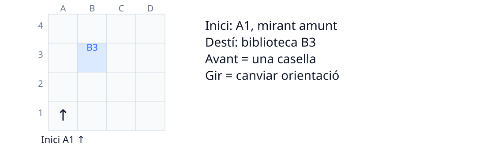

**A1 ↑ → biblioteca B3.** Una ordre «avant» avança una casella; un gir canvia l’orientació sense moure la fitxa.

<!--
Bloc «Començarem amb un repte»: 00–15 min de sessió (15 minuts).

**Guió de conducció**

**Què explicar**

Expliqueu com es llig el mapa abans de demanar cap programa: les lletres identifiquen columnes i els nombres, files. A1 és baix a l’esquerra; B3 està una columna a la dreta i dues files més amunt. La fletxa inicial indica cap on mira la fitxa.

**Com mostrar-ho**

Assenyaleu A1, després B3 i finalment la fletxa ↑. Amb el dit, mostreu només un avançament d’A1 a A2. Acordeu dues regles: avançar mou una casella; girar canvia l’orientació sense canviar de casella. No traceu encara la ruta completa.

**Pregunta i resposta esperable**

«Si la fitxa està a A1 mirant amunt, on queda després d’un avant?» Resposta: A2, encara mirant amunt. «Un gir a la dreta l’envia a B1?» No: continua a A1, ara mirant a la dreta.

**Si apareix aquest dubte**

La dreta és la de la fitxa, no sempre la de qui mira la pantalla. Aquesta graella és un model: amb un robot real cal ajustar la mida de les caselles al seu desplaçament.

**Enllaç amb el pas següent**

Ara que compartim les regles, podem escriure ordres sense improvisar-ne el significat.
-->

---

<!-- _class: activity -->

## Escriviu una ruta

1. Acordeu les ordres per arribar a la biblioteca.
2. Una persona les escriu o les diu.
3. L’altra les executa amb el dit o mentalment.

Comproveu també **cap on mira al final**.

<!--
Bloc «Començarem amb un repte»: 00–15 min de sessió (15 minuts).

Temps orientatiu de la dinàmica: 3 minuts.

**Guió de conducció**

**Què explicar**

Formuleu la consigna completa: «Porteu la fitxa d’A1 a B3, començant cap amunt. Escriviu les ordres i indiqueu l’orientació final». Una persona dicta i l’altra executa exactament allò que escolta, sense completar ordres que falten.

**Com mostrar-ho**

Feu una primera passada per les parelles per comprovar que mantenen el mateix inici. Si treballen oralment, poden marcar els passos amb els dits. No corregiu la ruta mentre l’executen: deixeu que comparen el final amb la predicció.

**Pregunta i resposta esperable**

Una solució és avant, avant, dreta, avant. També hi ha altres rutes vàlides; no exigiu la més curta. Demaneu «on acabes i cap on mires?» per distingir posició i orientació.

**Si apareix aquest dubte**

Si una parella gira i avança en una sola ordre, torneu a les dues regles pactades. Si corregeix sobre la marxa, proposeu repetir la seqüència escrita des del principi.

**Enllaç amb el pas següent**

En acabar, conserveu almenys una proposta per llegir-la ordre a ordre a la transparència següent.
-->

---

<!-- _class: solution -->

## Una solució, ordre a ordre

| Ordre | Casella | Orientació |
|---|---|---|
| Inici | A1 | Amunt |
| Avant | A2 | Amunt |
| Avant | A3 | Amunt |
| Dreta | A3 | Dreta |
| Avant | B3 | Dreta |

<!--
Bloc «Començarem amb un repte»: 00–15 min de sessió (15 minuts).

**Guió de conducció**

**Què explicar**

Llegiu cada fila com una foto de l’estat de la fitxa després d’una ordre. Comencem a A1 ↑; el primer avant porta a A2 ↑ i el segon a A3 ↑. El gir conserva A3 i canvia ↑ per →. L’últim avant porta a B3 →.

**Com mostrar-ho**

Tapeu amb la mà o assenyaleu només la fila actual. Abans de passar a la següent, deixeu que algú anticipe què canviarà: la casella, l’orientació o totes dues. La taula no és un registre de botons premuts simultàniament.

**Pregunta i resposta esperable**

«Per què A3 apareix dues vegades?» Perquè entre aquestes files hem girat, però no ens hem desplaçat. «Quantes ordres de moviment hem escrit?» Quatre; tres avançaments i un gir.

**Si apareix aquest dubte**

Arribar a B3 no garanteix haver entés la ruta: algú pot haver-la endevinada. La justificació de les files ens permet comprovar la comprensió.

**Enllaç amb el pas següent**

Mostreu després el mateix procés al mapa: canvia la representació, no el programa.
-->

---

<!-- _class: diagram -->

## La solució, vista sobre el mapa


El recorregut arriba a B3 i acaba mirant a la dreta. **El tercer pas és un gir: no avança de casella.**

<!--
Bloc «Començarem amb un repte»: 00–15 min de sessió (15 minuts).

**Guió de conducció**

**Què explicar**

«La taula anterior i aquest dibuix expliquen la mateixa seqüència». El traç blau resumeix els desplaçaments; la llista de la dreta conserva les quatre ordres. El gir no crea una casella nova, per això no apareix com un tram de recorregut.

**Com mostrar-ho**

Seguiu amb el dit A1 → A2 → A3, atureu-vos per representar el gir i continueu a B3. Acabeu orientant el dit a la dreta. Relacioneu cada parada amb el número d’ordre de la llista.

**Pregunta i resposta esperable**

«Podríem reconstruir tot el programa mirant només la línia blava?» Caldria conéixer també inici, orientació i significat de les ordres. El dibuix del camí, tot sol, no diu tots els girs.

**Si apareix aquest dubte**

No confongueu la fletxa del traç, que indica el sentit del recorregut, amb una ordre independent afegida al programa. Hi ha les quatre ordres de la llista.

**Enllaç amb el pas següent**

Feu explícit que hem passat de representar un camí a comunicar instruccions comprovables.
-->

---

<!-- _class: section -->

## Què podem aprendre?

<!--
Bloc «Què podem aprendre?»: 15–30 min de sessió (15 minuts).

Aquest temps inclou explicacions, treball dels participants i posada en comú. Controleu el tancament del bloc sense avançar les solucions abans de la predicció.

**Guió de conducció**

**Objectiu d’aquest bloc**
Rellegir l’experiència com una decisió docent.

**Com conduir-lo**
Recupereu exemples del grup per posar nom a ordenar, anticipar i revisar. Distingiu resultat i evidència i demaneu una acció observable relacionada amb el contingut triat.

**Resultat que convé recollir abans d’avançar**
Un aprenentatge principal i una evidència que el faça visible.

**Gestió del temps**
Useu la franja indicada al començament de la nota com a límit del bloc complet, no com a durada d’aquesta pantalla. Les aclaracions del guió són un banc de suport: seleccioneu-les segons les respostes del grup, sense llegir-les totes literalment.
-->

---

## Què ens ha obligat a pensar?

<div class="flow"><span>Situar-nos</span><span class="arrow">→</span><span>Ordenar</span><span class="arrow">→</span><span>Anticipar</span><span class="arrow">→</span><span>Comprovar</span></div>

Hem necessitat un inici, una orientació i ordres compartides.

Una altra ruta també pot ser correcta: cal executar-la i justificar-la.

<!--
Bloc «Què podem aprendre?»: 15–30 min de sessió (15 minuts).

**Guió de conducció**

**Què explicar**

Poseu nom al procés viscut: ens hem situat en un mapa, hem ordenat accions, hem imaginat el resultat i l’hem contrastat. Això és el nucli que ens interessa traslladar a l’aula; prémer botons és només una manera d’executar-lo.

**Com mostrar-ho**

Recorreu el diagrama d’esquerra a dreta. Per a cada etapa, recupereu una acció real del grup: acordar A1 ↑, escriure les ordres, dir B3 → abans de moure i comprovar el final.

**Pregunta i resposta esperable**

«En quin moment hem pensat abans d’actuar?» Quan hem anticipat el resultat. «Si una ruta diferent també funciona, com ho sabem?» Executant-la amb les mateixes regles i explicant el final.

**Si apareix aquest dubte**

No convertiu aquestes quatre paraules en un nou vocabulari per memoritzar. Si el grup pot explicar què ha fet, ja tenim una base per introduir termes més específics.

**Enllaç amb el pas següent**

Deteniu-vos en la confusió que sol donar més informació: girar i avançar no són el mateix.
-->

---

<!-- _class: diagram -->

## Girar i avançar són accions diferents

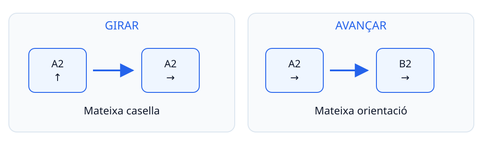

La dreta és la del personatge segons cap on mira. **Després d’un gir, continuem a la mateixa casella.**

<!--
Bloc «Què podem aprendre?»: 15–30 min de sessió (15 minuts).

**Guió de conducció**

**Què explicar**

Expliqueu els dos panells per separat. A l’esquerra, A2 es repeteix: la fitxa gira d’amunt a dreta sense deixar la casella. A la dreta, A2 canvia a B2 perquè la fitxa, que ja mira a la dreta, avança una casella.

**Com mostrar-ho**

Feu de fitxa amb una mà: un gir és canviar cap on apunta el dit; avançar és desplaçar la mà mantenint aquella direcció. Aquesta representació es pot fer asseguts i sense material.

**Pregunta i resposta esperable**

«Si ara mirem avall, on apunta un gir a la dreta?» Cap a l’esquerra de la pantalla. Demaneu que es posen en el lloc del personatge abans de respondre.

**Si apareix aquest dubte**

Un avançament no significa sempre pujar en el dibuix. Significa moure’s en la direcció que té la fitxa. Eviteu dir simplement «dreta de la pantalla» com si fora una regla del robot.

**Enllaç amb el pas següent**

Recupereu la ruta de la biblioteca per donar nom a les decisions que acabem de comprovar.
-->

---

## Pensament computacional, amb un exemple

**Descompondre:** dividir la ruta en moviments.
**Crear una seqüència:** ordenar les instruccions.
**Depurar:** localitzar i corregir una ordre.

El vocabulari posa nom a decisions que ja hem pres.

<!--
Bloc «Què podem aprendre?»: 15–30 min de sessió (15 minuts).

**Guió de conducció**

**Què explicar**

Expliqueu les paraules amb allò que ja hem fet. Descompondre és separar una tasca en accions manejables. Una seqüència és l’ordre d’aquestes accions. Depurar és buscar per què el resultat no coincideix i fer una correcció justificada.

**Com mostrar-ho**

Useu un únic cas: «anar a la biblioteca» es divideix en avançar i girar; les ordres s’ordenen; si acabem a C2 en lloc de B3, revisem en quin moment hem girat. No afegiu definicions abstractes desconnectades de l’experiència.

**Pregunta i resposta esperable**

«Si provem botons a l’atzar fins que funciona, hem depurat?» Hem provat, però encara ens falta localitzar i explicar la causa. Una resposta útil identifica una ordre i l’efecte del canvi.

**Si apareix aquest dubte**

Pensament computacional no equival a usar una pantalla, ni exigeix començar per un llenguatge de programació. També apareix quan expliquem un procediment amb paper o conversa.

**Enllaç amb el pas següent**

Mostreu ara com una versió inicial i una revisió fan visible aquest procés.
-->

---

<!-- _class: visual -->

## Llegir, provar i revisar una ordre


La il·lustració mostra versions d’una seqüència.

**Abans:** què esperem que faça?

**Després:** quina ordre hem revisat i quin efecte té?

<!--
Bloc «Què podem aprendre?»: 15–30 min de sessió (15 minuts).

**Guió de conducció**

**Què explicar**

La il·lustració representa versions d’una seqüència. Useu-la per conversar sobre la revisió, no com una demostració mesurada: el dibuix no certifica quants centímetres ha recorregut el robot ni quin programa hi havia carregat.

**Com mostrar-ho**

Assenyaleu les files successives i feu buscar una diferència entre ordres. Relacioneu-ho amb una primera versió conservada al paper i una segona versió que podem comparar.

**Pregunta i resposta esperable**

«Com sabríem si el canvi ajuda?» Repetint la prova amb el mateix inici i orientació. «Què voldríem que explicara l’alumnat?» Quina ordre ha canviat i quin resultat esperava obtenir.

**Si apareix aquest dubte**

Canviar diverses coses alhora pot resoldre la ruta, però dificulta saber què ha passat. Si la imatge sembla mostrar més d’un canvi, utilitzeu-la per plantejar aquesta limitació.

**Enllaç amb el pas següent**

Passeu de la revisió del robot a la pregunta docent: quin aprenentatge volíem observar?
-->

---

## Quin aprenentatge guia la proposta?

**Llengua:** explicar una ruta perquè una altra persona la seguisca.

**Matemàtiques:** descriure posicions i canvis d’orientació.

**Medi:** comparar dades obtingudes amb el mateix procediment.

<!--
Bloc «Què podem aprendre?»: 15–30 min de sessió (15 minuts).

**Guió de conducció**

**Què explicar**

Expliqueu que un mateix recorregut pot servir a objectius diferents. En llengua, ens interessa la claredat de l’explicació; en matemàtiques, la posició i els girs; en medi, pot interessar comparar observacions. La funció del robot no determina per si sola què s’aprén.

**Com mostrar-ho**

Poseu dues consignes sobre el mateix mapa: «Descriu la ruta perquè una altra parella la seguisca» i «Compara dues rutes i explica els girs». El material no canvia, però sí la pregunta i l’evidència que recollim.

**Pregunta i resposta esperable**

«Si el robot arriba, sabem que l’explicació oral ha sigut clara?» Només si algú ha pogut executar les instruccions que s’han comunicat; l’arribada sola no ho demostra.

**Si apareix aquest dubte**

No cal atribuir molts objectius curriculars a la primera activitat. Trieu-ne un de principal i decidiu què observareu per comprovar-lo.

**Enllaç amb el pas següent**

Introduïu evidència com una mostra concreta d’allò que una persona ha fet o entés.
-->

---

## L’activitat necessita una evidència

Arribar al destí és un resultat.

**Explicar per què hem canviat una ordre** ens informa de la comprensió.

Podem recollir una ruta anotada, una conversa o dues versions del programa.

<!--
Bloc «Què podem aprendre?»: 15–30 min de sessió (15 minuts).

**Guió de conducció**

**Què explicar**

«Una evidència és una cosa que podem mirar o escoltar per justificar què s’ha aprés». Pot ser la ruta escrita, una predicció oral o l’explicació d’una correcció. No és necessàriament una fitxa extra ni una fotografia del robot.

**Com mostrar-ho**

Compareu dues frases: «hem arribat» descriu el resultat; «hem avançat abans de girar perquè faltava una casella cap amunt» explica una decisió. La segona ens dona més informació per orientar l’ajuda.

**Pregunta i resposta esperable**

«Què podríem recollir sense interrompre la classe?» Una nota breu de la conversa, dues versions del programa o un dibuix amb una correcció assenyalada.

**Si apareix aquest dubte**

Fer una foto del producte pot ser útil, però no sempre mostra qui ha comprés la seqüència o per què s’ha modificat. Combineu resultat i explicació.

**Enllaç amb el pas següent**

Recupereu les necessitats d’aula triades a l’inici i demaneu una evidència possible.
-->

---

<!-- _class: activity -->

## De la pantalla a la conversa

Recupereu el contingut que heu triat en començar.

Què hauria de fer o explicar l’alumnat per demostrar que l’ha entés?

<!--
Bloc «Què podem aprendre?»: 15–30 min de sessió (15 minuts).

Temps orientatiu de la dinàmica: 3 minuts.

Recolliu dues respostes concretes i relacioneu-les amb el contingut triat a l’inici.

**Guió de conducció**

**Què explicar**

Doneu una consigna curta: «Torneu al contingut que heu triat i descriviu una acció que demostraria comprensió». La conversa ha de concretar l’aprenentatge, no triar encara totes les eines.

**Com mostrar-ho**

Passeu per una o dues parelles i ajudeu a transformar «treballar orientació» en «donar ordres perquè una altra parella arribe a una casella». Feu explícit que respondre oralment és suficient.

**Pregunta i resposta esperable**

Un exemple de resposta és «sabrien explicar per què el gir no canvia de casella». Si responen «estarien motivats», demaneu què farien o explicarien, a més de mostrar interés.

**Si apareix aquest dubte**

No cal que totes les parelles compartisquen en plenari. Recolliu dos exemples contrastats i conserveu els altres per a la proposta final.

**Enllaç amb el pas següent**

Expliqueu que coneixerem els materials per veure quins faciliten aquestes accions.
-->

---

<!-- _class: section -->

## Coneixem les possibilitats

<!--
Bloc «Coneixem les possibilitats»: 30–55 min de sessió (25 minuts).

Aquest temps inclou explicacions, treball dels participants i posada en comú. Controleu el tancament del bloc sense avançar les solucions abans de la predicció.

**Guió de conducció**

**Objectiu d’aquest bloc**
Triar amb criteri entre models de funcionament diferents.

**Com conduir-lo**
Presenteu els sis materials amb una primera funció i un límit. No intenteu configurar-los tots. En aquest bloc la comparació és més important que el domini tècnic; reserveu la demostració detallada per al bloc següent.

**Resultat que convé recollir abans d’avançar**
Poder relacionar una eina amb una acció de l’alumnat i una preparació assumible.

**Gestió del temps**
Useu la franja indicada al començament de la nota com a límit del bloc complet, no com a durada d’aquesta pantalla. Les aclaracions del guió són un banc de suport: seleccioneu-les segons les respostes del grup, sense llegir-les totes literalment.
-->

---

<!-- _class: visual -->

## Tale-Bot

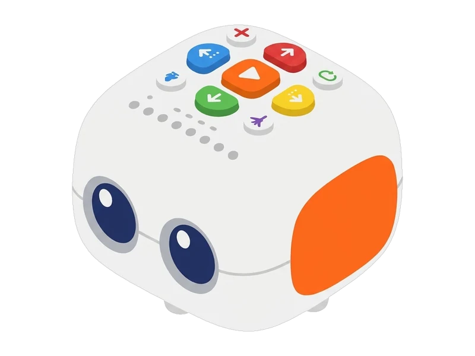

Programem moviments amb els botons del robot.

**Una proposta:** Una ruta entre tres llocs d’un conte.

<!--
Bloc «Coneixem les possibilitats»: 30–55 min de sessió (25 minuts).

**Guió de conducció**

**Què explicar**

Presenteu-lo com un robot amb botons al mateix aparell. «Per començar, podem fer una ruta curta entre dos llocs d’un conte». Escrivim primer les ordres i després les introduïm. No necessita un editor de blocs en pantalla per a aquesta prova.

**Com mostrar-ho**

Assenyaleu en la imatge els elements que intervenen en aquesta proposta, sense repassar tots els accessoris del kit. La il·lustració identifica el material; no és una prova del programa que expliquem.

**Pregunta i resposta esperable**

«Quina acció de l’alumnat ens permet aquest material?» Busquem planificar, anticipar una resposta o comparar una prova, segons l’exemple. Demaneu una justificació de la tria, no una preferència per l’aparença del robot.

**Si apareix aquest dubte**

No atribuïu lectura automàtica a qualsevol mapa de paper ni detecció genèrica d’obstacles. Si no disposeu del dispositiu físic, no improviseu una connexió: llegiu i representeu la seqüència amb el grup.

**Enllaç amb el pas següent**

La transparència següent acota una primera decisió i els límits que convé tindre clars.
-->

---

## Tale-Bot · Primera decisió

**Què cal tindre present?**

Els mapes interactius necessiten zones codificades compatibles; una quadrícula de paper serveix per orientar-nos, però no activa eixes funcions.

**Abans de la prova:** què esperem observar?
**Després:** quina decisió podrà explicar l’alumnat?

<!--
Bloc «Coneixem les possibilitats»: 30–55 min de sessió (25 minuts).

**Guió de conducció**

**Què explicar**

Recupereu la proposta anterior i llegiu-ne el límit: No atribuïu lectura automàtica a qualsevol mapa de paper ni detecció genèrica d’obstacles. L’objectiu d’aquesta pantalla és evitar començar amb una expectativa que el material no pot complir.

**Com mostrar-ho**

Plantegeu una ruta curta entre dos llocs d’un conte i feu distingir allò que prepara la persona docent d’allò que executa el dispositiu. Useu el programa o el recorregut, no una resposta atribuïda a una voluntat del robot.

**Pregunta i resposta esperable**

«Abans de provar, què esperem observar? Després, quina decisió podrà explicar l’alumnat?» Accepteu una resposta concreta vinculada a l’exemple: ordre, botó, lectura o condició.

**Si apareix aquest dubte**

Si algú proposa una funció diferent, anoteu-la per consultar el tutorial del model disponible. No deduïu prestacions a partir de l’aspecte del robot o d’un altre kit.

**Enllaç amb el pas següent**

Continueu amb la representació del programa si n’hi ha una; en cas contrari, compareu aquesta opció amb el material següent.
-->

---

<!-- _class: tangible -->

## Tale-Bot · Llegim els botons en ordre

```talebot
endavant
endavant
dreta
endavant
executa
```

Preparem les ordres i després premem **executa**. El gir canvia l’orientació: no avança. Les icones representen la seqüència, no la disposició física dels botons.

<!--
Bloc «Coneixem les possibilitats»: 30–55 min de sessió (25 minuts).

**Guió de conducció**

**Què explicar**

Llegiu endavant, endavant, dreta, endavant i, al final, executa. Les primeres quatre icones preparen ordres; l’última posa en marxa la seqüència. El dibuix és una fila per llegir, no la disposició real del panell.

**Com mostrar-ho**

Assenyaleu una icona cada vegada i relacioneu-la amb la ruta A1 ↑ fins a B3 →. Diferencieu preparar el programa i veure’l executar: no esperem un desplaçament físic en cada lectura de la fila projectada.

**Pregunta i resposta esperable**

«Executa afegeix una casella a la ruta?» No: inicia la seqüència preparada. «El tercer símbol desplaça el robot?» No, és un gir.

**Si apareix aquest dubte**

Amb material, reviseu abans les ordres guardades i la distància real d’un avançament. Els colors i la disposició s’han d’identificar en el model disponible.

**Enllaç amb el pas següent**

Compareu amb Coding Set: la seqüència també existeix, però les ordres són peces externes.
-->

---

<!-- _class: visual -->

## Coding Set

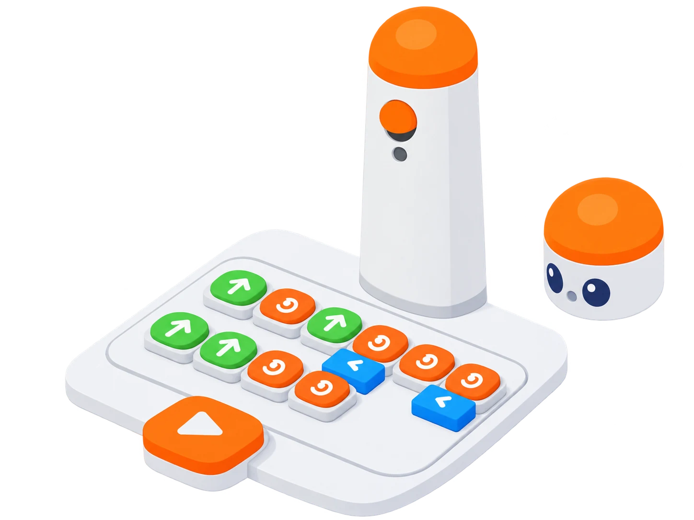

Construïm el programa amb peces al tauler; la torre el llig i el MatataBot el segueix.

**Una proposta:** Comparar dues seqüències movent una peça.

<!--
Bloc «Coneixem les possibilitats»: 30–55 min de sessió (25 minuts).

**Guió de conducció**

**Què explicar**

Presenteu-lo com un sistema amb tauler, torre de lectura i MatataBot. «Per començar, podem fer comparar una seqüència inicial i una versió amb una peça canviada». Les peces mantenen el programa a la vista. La torre el llig i comunica les ordres al MatataBot.

**Com mostrar-ho**

Assenyaleu en la imatge els elements que intervenen en aquesta proposta, sense repassar tots els accessoris del kit. La il·lustració identifica el material; no és una prova del programa que expliquem.

**Pregunta i resposta esperable**

«Quina acció de l’alumnat ens permet aquest material?» Busquem planificar, anticipar una resposta o comparar una prova, segons l’exemple. Demaneu una justificació de la tria, no una preferència per l’aparença del robot.

**Si apareix aquest dubte**

Una peça és una ordre del programa; no és un botó situat damunt del robot. Si no disposeu del dispositiu físic, no improviseu una connexió: llegiu i representeu la seqüència amb el grup.

**Enllaç amb el pas següent**

La transparència següent acota una primera decisió i els límits que convé tindre clars.
-->

---

## Coding Set · Primera decisió

**Què cal tindre present?**

Cal preparar torre, tauler i robot; no són botons sobre el mateix robot.

**Abans de la prova:** què esperem observar?
**Després:** quina decisió podrà explicar l’alumnat?

<!--
Bloc «Coneixem les possibilitats»: 30–55 min de sessió (25 minuts).

**Guió de conducció**

**Què explicar**

Recupereu la proposta anterior i llegiu-ne el límit: Una peça és una ordre del programa; no és un botó situat damunt del robot. L’objectiu d’aquesta pantalla és evitar començar amb una expectativa que el material no pot complir.

**Com mostrar-ho**

Plantegeu comparar una seqüència inicial i una versió amb una peça canviada i feu distingir allò que prepara la persona docent d’allò que executa el dispositiu. Useu el programa o el recorregut, no una resposta atribuïda a una voluntat del robot.

**Pregunta i resposta esperable**

«Abans de provar, què esperem observar? Després, quina decisió podrà explicar l’alumnat?» Accepteu una resposta concreta vinculada a l’exemple: ordre, botó, lectura o condició.

**Si apareix aquest dubte**

Si algú proposa una funció diferent, anoteu-la per consultar el tutorial del model disponible. No deduïu prestacions a partir de l’aspecte del robot o d’un altre kit.

**Enllaç amb el pas següent**

Continueu amb la representació del programa si n’hi ha una; en cas contrari, compareu aquesta opció amb el material següent.
-->

---

<!-- _class: tangible -->

## Coding Set · Llegim les peces

```coding-set
endavant
endavant
dreta
endavant
```

Al tauler, llegim les peces **d’esquerra a dreta i de dalt a baix**. Aquesta fila representa una ruta; la torre ha de poder llegir-la abans d’executar-la.

<!--
Bloc «Coneixem les possibilitats»: 30–55 min de sessió (25 minuts).

**Guió de conducció**

**Què explicar**

Les quatre peces representen endavant, endavant, dreta i endavant. El tauler fa de suport del programa; no cal recordar una fila de botons perquè les peces queden visibles. La torre ha de poder llegir la seqüència segons les instruccions del kit.

**Com mostrar-ho**

Feu llegir la fila d’esquerra a dreta abans de simular cap moviment. Després proposeu moure la tercera peça a una altra posició i anticipeu que no tindrem necessàriament el mateix resultat.

**Pregunta i resposta esperable**

«Què ens facilita deixar el programa a la vista?» Revisar una ordre, comparar dues versions i explicar el canvi a una altra persona.

**Si apareix aquest dubte**

No suposeu que la lectura ocorre només perquè les peces estan prop del robot. Tauler, torre, robot i ordre de lectura s’han de preparar i comprovar.

**Enllaç amb el pas següent**

El diagrama següent separa el paper de cada element del sistema.
-->

---

<!-- _class: diagram -->

## Coding Set · Com circulen les ordres?

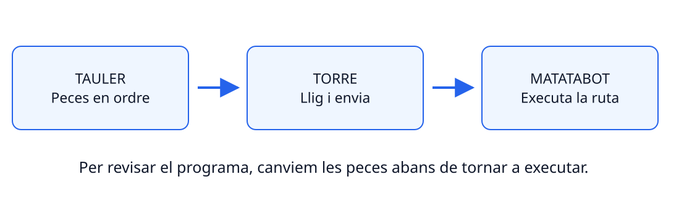

El tauler manté el programa visible. La torre el llig i envia les ordres; el MatataBot les executa.

<!--
Bloc «Coneixem les possibilitats»: 30–55 min de sessió (25 minuts).

**Guió de conducció**

**Què explicar**

Expliqueu el diagrama com tres funcions: al tauler escrivim amb peces; la torre llig el programa i envia les ordres; el MatataBot les executa. Les fletxes representen aquest flux de lectura i comunicació, no un recorregut del robot damunt de tres caixes.

**Com mostrar-ho**

Assenyaleu cada caixa i feu la correspondència amb la imatge anterior. Per a una seqüència equivocada, reviseu primer les peces; per a un sistema que no respon, comproveu també alimentació i connexió del kit.

**Pregunta i resposta esperable**

«Si canviem una peça, què ha de passar abans que canvie la ruta?» Cal tornar a llegir i executar el programa preparat. El robot no interpreta allò que una persona volia escriure.

**Si apareix aquest dubte**

No presenteu la torre com un sensor del recorregut o de la destinació. En aquesta prova intervé en la lectura del programa.

**Enllaç amb el pas següent**

Passeu al tren per mostrar un altre model: allí la via mateixa condiciona per on es mou.
-->

---

<!-- _class: visual -->

## Coding Express

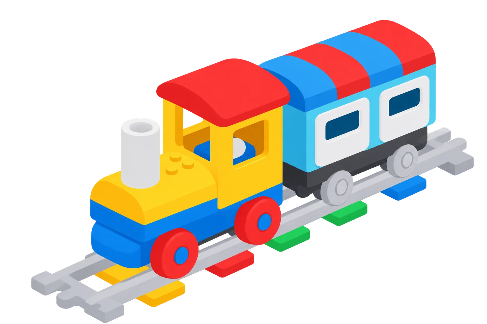

La via defineix el recorregut; els maons d’acció provoquen respostes del tren.

**Una proposta:** Una història amb estació, parada i destinació.

<!--
Bloc «Coneixem les possibilitats»: 30–55 min de sessió (25 minuts).

**Guió de conducció**

**Què explicar**

Presenteu-lo com un tren que circula per vies i respon a maons d’acció. «Per començar, podem fer ordenar una història amb estació, parada i destinació». Muntem la via per decidir el recorregut i situem un maó per provocar una resposta en passar.

**Com mostrar-ho**

Assenyaleu en la imatge els elements que intervenen en aquesta proposta, sense repassar tots els accessoris del kit. La il·lustració identifica el material; no és una prova del programa que expliquem.

**Pregunta i resposta esperable**

«Quina acció de l’alumnat ens permet aquest material?» Busquem planificar, anticipar una resposta o comparar una prova, segons l’exemple. Demaneu una justificació de la tria, no una preferència per l’aparença del robot.

**Si apareix aquest dubte**

El tren no comprén el relat ni tria el destí. Via i maó tenen funcions diferents. Si no disposeu del dispositiu físic, no improviseu una connexió: llegiu i representeu la seqüència amb el grup.

**Enllaç amb el pas següent**

La transparència següent acota una primera decisió i els límits que convé tindre clars.
-->

---

## Coding Express · Primera decisió

**Què cal tindre present?**

El tren no tria una destinació. Els girs de la via no són ordres de gir com en Tale-Bot.

**Abans de la prova:** què esperem observar?
**Després:** quina decisió podrà explicar l’alumnat?

<!--
Bloc «Coneixem les possibilitats»: 30–55 min de sessió (25 minuts).

**Guió de conducció**

**Què explicar**

Recupereu la proposta anterior i llegiu-ne el límit: El tren no comprén el relat ni tria el destí. Via i maó tenen funcions diferents. L’objectiu d’aquesta pantalla és evitar començar amb una expectativa que el material no pot complir.

**Com mostrar-ho**

Plantegeu ordenar una història amb estació, parada i destinació i feu distingir allò que prepara la persona docent d’allò que executa el dispositiu. Useu el programa o el recorregut, no una resposta atribuïda a una voluntat del robot.

**Pregunta i resposta esperable**

«Abans de provar, què esperem observar? Després, quina decisió podrà explicar l’alumnat?» Accepteu una resposta concreta vinculada a l’exemple: ordre, botó, lectura o condició.

**Si apareix aquest dubte**

Si algú proposa una funció diferent, anoteu-la per consultar el tutorial del model disponible. No deduïu prestacions a partir de l’aspecte del robot o d’un altre kit.

**Enllaç amb el pas següent**

Continueu amb la representació del programa si n’hi ha una; en cas contrari, compareu aquesta opció amb el material següent.
-->

---

<!-- _class: diagram -->

## Coding Express · Via i resposta

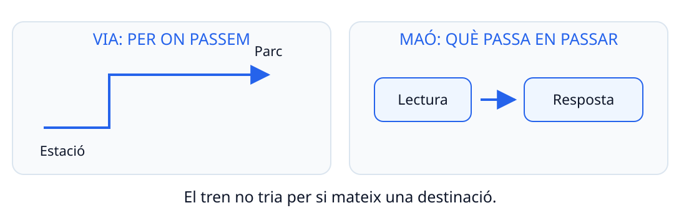

La via resol el recorregut. El maó introdueix una resposta. **No és una ordre de gir en una quadrícula.**

<!--
Bloc «Coneixem les possibilitats»: 30–55 min de sessió (25 minuts).

**Guió de conducció**

**Què explicar**

Llegiu el panell esquerre com una decisió de construcció: la via determina per on pot passar el tren. Llegiu el dret com una relació entre lectura d’un maó i resposta. Són dues decisions que sovint es confonen en començar.

**Com mostrar-ho**

Assenyaleu el recorregut estació-parc i imagineu canviar una corba: canviaria el camí. Després manteniu la via i situeu un maó d’acció: canviaríem què passa en un punt del viatge.

**Pregunta i resposta esperable**

«Un maó que provoca un so decideix a quina estació anem?» No. «Canviar la via pot canviar el recorregut sense afegir cap ordre de gir?» Sí.

**Si apareix aquest dubte**

Comproveu les respostes dels maons del kit abans de fer una demostració. El diagrama no diu que qualsevol peça de color tinga una funció ni que el tren trie una branca per comprendre el relat.

**Enllaç amb el pas següent**

Relacioneu aquest model amb una història: l’alumnat dona sentit a les parades i comprova l’ordre.
-->

---

<!-- _class: visual -->

## Codey Rocky

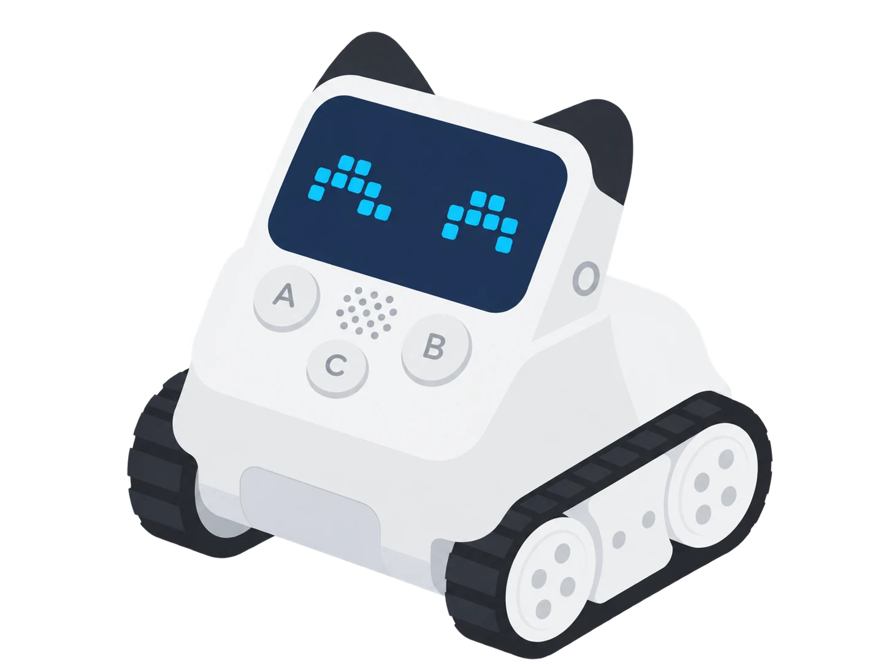

Programem amb mBlock una pantalla, els botons i altres respostes.

**Una proposta:** Prémer A perquè mostre una cara dibuixada.

<!--
Bloc «Coneixem les possibilitats»: 30–55 min de sessió (25 minuts).

**Guió de conducció**

**Què explicar**

Presenteu-lo com un dispositiu que podem programar amb mBlock. «Per començar, podem fer associar el botó A a una imatge de la pantalla». Codey és la part amb pantalla i botons; Rocky aporta la base mòbil. La primera prova de pantalla es pot fer sense moviment.

**Com mostrar-ho**

Assenyaleu en la imatge els elements que intervenen en aquesta proposta, sense repassar tots els accessoris del kit. La il·lustració identifica el material; no és una prova del programa que expliquem.

**Pregunta i resposta esperable**

«Quina acció de l’alumnat ens permet aquest material?» Busquem planificar, anticipar una resposta o comparar una prova, segons l’exemple. Demaneu una justificació de la tria, no una preferència per l’aparença del robot.

**Si apareix aquest dubte**

Mostrar una cara no significa sentir ni reconéixer una emoció. Si no disposeu del dispositiu físic, no improviseu una connexió: llegiu i representeu la seqüència amb el grup.

**Enllaç amb el pas següent**

La transparència següent acota una primera decisió i els límits que convé tindre clars.
-->

---

## Codey Rocky · Primera decisió

**Què cal tindre present?**

Una expressió programada no implica que el robot senta ni reconega emocions.

**Abans de la prova:** què esperem observar?
**Després:** quina decisió podrà explicar l’alumnat?

<!--
Bloc «Coneixem les possibilitats»: 30–55 min de sessió (25 minuts).

**Guió de conducció**

**Què explicar**

Recupereu la proposta anterior i llegiu-ne el límit: Mostrar una cara no significa sentir ni reconéixer una emoció. L’objectiu d’aquesta pantalla és evitar començar amb una expectativa que el material no pot complir.

**Com mostrar-ho**

Plantegeu associar el botó A a una imatge de la pantalla i feu distingir allò que prepara la persona docent d’allò que executa el dispositiu. Useu el programa o el recorregut, no una resposta atribuïda a una voluntat del robot.

**Pregunta i resposta esperable**

«Abans de provar, què esperem observar? Després, quina decisió podrà explicar l’alumnat?» Accepteu una resposta concreta vinculada a l’exemple: ordre, botó, lectura o condició.

**Si apareix aquest dubte**

Si algú proposa una funció diferent, anoteu-la per consultar el tutorial del model disponible. No deduïu prestacions a partir de l’aspecte del robot o d’un altre kit.

**Enllaç amb el pas següent**

Continueu amb la representació del programa si n’hi ha una; en cas contrari, compareu aquesta opció amb el material següent.
-->

---

<!-- _class: visual -->

## micro:bit

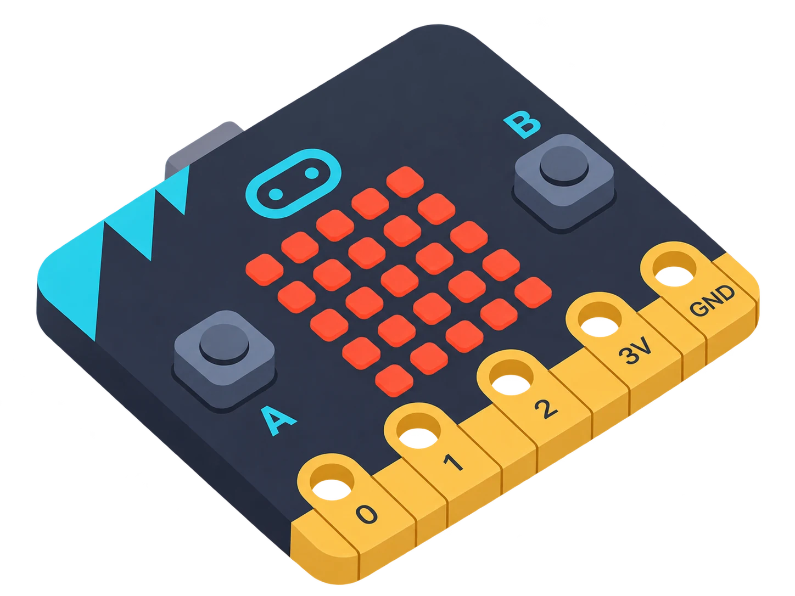

Relacionem botons o lectures de sensors amb respostes en la matriu LED.

**Una proposta:** Un fanalet que mostra una icona quan baixa la llum.

<!--
Bloc «Coneixem les possibilitats»: 30–55 min de sessió (25 minuts).

**Guió de conducció**

**Què explicar**

Presenteu-lo com una placa que rep informació i pot mostrar respostes. «Per començar, podem fer comparar lectures de llum i mostrar una icona». Els botons poden iniciar accions; la matriu LED pot mostrar informació i estimar la llum ambiental.

**Com mostrar-ho**

Assenyaleu en la imatge els elements que intervenen en aquesta proposta, sense repassar tots els accessoris del kit. La il·lustració identifica el material; no és una prova del programa que expliquem.

**Pregunta i resposta esperable**

«Quina acció de l’alumnat ens permet aquest material?» Busquem planificar, anticipar una resposta o comparar una prova, segons l’exemple. Demaneu una justificació de la tria, no una preferència per l’aparença del robot.

**Si apareix aquest dubte**

No tots els models tenen totes les funcions. La prova de llum no és una mesura en lux. Si no disposeu del dispositiu físic, no improviseu una connexió: llegiu i representeu la seqüència amb el grup.

**Enllaç amb el pas següent**

La transparència següent acota una primera decisió i els límits que convé tindre clars.
-->

---

## micro:bit · Primera decisió

**Què cal tindre present?**

La lectura de llum és relativa i depén de la posició; no és una mesura en lux.

**Abans de la prova:** què esperem observar?
**Després:** quina decisió podrà explicar l’alumnat?

<!--
Bloc «Coneixem les possibilitats»: 30–55 min de sessió (25 minuts).

**Guió de conducció**

**Què explicar**

Recupereu la proposta anterior i llegiu-ne el límit: No tots els models tenen totes les funcions. La prova de llum no és una mesura en lux. L’objectiu d’aquesta pantalla és evitar començar amb una expectativa que el material no pot complir.

**Com mostrar-ho**

Plantegeu comparar lectures de llum i mostrar una icona i feu distingir allò que prepara la persona docent d’allò que executa el dispositiu. Useu el programa o el recorregut, no una resposta atribuïda a una voluntat del robot.

**Pregunta i resposta esperable**

«Abans de provar, què esperem observar? Després, quina decisió podrà explicar l’alumnat?» Accepteu una resposta concreta vinculada a l’exemple: ordre, botó, lectura o condició.

**Si apareix aquest dubte**

Si algú proposa una funció diferent, anoteu-la per consultar el tutorial del model disponible. No deduïu prestacions a partir de l’aspecte del robot o d’un altre kit.

**Enllaç amb el pas següent**

Continueu amb la representació del programa si n’hi ha una; en cas contrari, compareu aquesta opció amb el material següent.
-->

---

<!-- _class: visual -->

## SPIKE Prime


Connectem i programem motors i sensors; podem construir mecanismes.

**Una proposta:** Aturar un motor quan el sensor detecta una targeta roja.

<!--
Bloc «Coneixem les possibilitats»: 30–55 min de sessió (25 minuts).

**Guió de conducció**

**Què explicar**

Presenteu-lo com un conjunt amb hub, motors, sensors i peces de construcció. «Per començar, podem fer aturar un motor quan es detecta una targeta roja». El hub executa el programa; connectem al port correcte el sensor i el motor. Podem començar amb un motor solt, sense construir un vehicle.

**Com mostrar-ho**

Assenyaleu en la imatge els elements que intervenen en aquesta proposta, sense repassar tots els accessoris del kit. La il·lustració identifica el material; no és una prova del programa que expliquem.

**Pregunta i resposta esperable**

«Quina acció de l’alumnat ens permet aquest material?» Busquem planificar, anticipar una resposta o comparar una prova, segons l’exemple. Demaneu una justificació de la tria, no una preferència per l’aparença del robot.

**Si apareix aquest dubte**

El temps de muntatge i connexió també compta. Una maqueta de parada no és un sistema real de seguretat. Si no disposeu del dispositiu físic, no improviseu una connexió: llegiu i representeu la seqüència amb el grup.

**Enllaç amb el pas següent**

La transparència següent acota una primera decisió i els límits que convé tindre clars.
-->

---

## SPIKE Prime · Primera decisió

**Què cal tindre present?**

Reserveu temps per al muntatge, els ports, la connexió i les proves.

**Abans de la prova:** què esperem observar?
**Després:** quina decisió podrà explicar l’alumnat?

<!--
Bloc «Coneixem les possibilitats»: 30–55 min de sessió (25 minuts).

**Guió de conducció**

**Què explicar**

Recupereu la proposta anterior i llegiu-ne el límit: El temps de muntatge i connexió també compta. Una maqueta de parada no és un sistema real de seguretat. L’objectiu d’aquesta pantalla és evitar començar amb una expectativa que el material no pot complir.

**Com mostrar-ho**

Plantegeu aturar un motor quan es detecta una targeta roja i feu distingir allò que prepara la persona docent d’allò que executa el dispositiu. Useu el programa o el recorregut, no una resposta atribuïda a una voluntat del robot.

**Pregunta i resposta esperable**

«Abans de provar, què esperem observar? Després, quina decisió podrà explicar l’alumnat?» Accepteu una resposta concreta vinculada a l’exemple: ordre, botó, lectura o condició.

**Si apareix aquest dubte**

Si algú proposa una funció diferent, anoteu-la per consultar el tutorial del model disponible. No deduïu prestacions a partir de l’aspecte del robot o d’un altre kit.

**Enllaç amb el pas següent**

Continueu amb la representació del programa si n’hi ha una; en cas contrari, compareu aquesta opció amb el material següent.
-->

---

<!-- _class: pause -->

## Pausa

En tornar, continuarem amb el bloc següent.

Deixeu anotada una pregunta que vulgueu recuperar.

<!--
Bloc «Pausa»: 55–60 min de sessió (5 minuts).

Temps orientatiu de la dinàmica: 5 minuts.

Respecteu els cinc minuts de pausa; recupereu una de les preguntes anotades en reprendre la sessió.

**Guió de conducció**

Conducció de la pausa
Doneu un punt clar de retorn i conserveu les preguntes pendents. Podeu demanar que cada parella trie quin dubte voldria recuperar després, sense convertir la pausa en una nova tasca obligatòria.

Abans de reprendre
Recordeu en una frase què ja hem comprovat i quin canvi introduirem ara. Si hi ha hagut una incidència tècnica, manteniu l’alternativa en paper per preservar el temps d’aprenentatge. No intenteu recuperar tota la pausa accelerant les explicacions següents.
-->

---

<!-- _class: section -->

## Del programa a la resposta

<!--
Bloc «Del programa a la resposta»: 60–85 min de sessió (25 minuts).

Aquest temps inclou explicacions, treball dels participants i posada en comú. Controleu el tancament del bloc sense avançar les solucions abans de la predicció.

**Guió de conducció**

**Objectiu d’aquest bloc**
Llegir un programa senzill i anticipar la resposta.

**Com conduir-lo**
Llegiu la pila de Codey, demaneu prediccions i contrasteu-les amb el temps. Després introduïu la lectura de llum i les dues branques del fanalet. Si no hi ha material, representeu el resultat oralment o en paper.

**Resultat que convé recollir abans d’avançar**
Distingir què inicia una seqüència i quina regla produeix cada resposta.

**Gestió del temps**
Useu la franja indicada al començament de la nota com a límit del bloc complet, no com a durada d’aquesta pantalla. Les aclaracions del guió són un banc de suport: seleccioneu-les segons les respostes del grup, sense llegir-les totes literalment.
-->

---

<!-- _class: visual -->

## Demostració · Una resposta al botó A


**Objectiu:** entendre què inicia el programa.

Primer llegim el programa. Després anticipem la pantalla.

Codey pot fer aquesta prova sense moure Rocky.

<!--
Bloc «Del programa a la resposta»: 60–85 min de sessió (25 minuts).

**Guió de conducció**

**Què explicar**

«Ara el programa no indica una ruta: associa un fet concret a una resposta. El fet és prémer A i la resposta és mostrar una imatge». Codey és la part amb pantalla i botons; el moviment de la base no intervé en aquesta prova.

**Com mostrar-ho**

Assenyaleu el botó A en la il·lustració i després la pantalla. Si no hi ha dispositiu, feu de pantalla amb un cor dibuixat que puguem mostrar i tapar. No executeu encara la seqüència: primer la llegirem.

**Pregunta i resposta esperable**

«Què hauria d’ocórrer perquè comence?» Prémer A. Encendre el dispositiu i prémer A són fets diferents en aquest exemple.

**Si apareix aquest dubte**

Una cara dibuixada és una resposta programada. No s’està llegint una emoció de cap persona ni detectant si algú està content.

**Enllaç amb el pas següent**

Mostreu els blocs per explicar com s’ha construït aquesta relació.
-->

---

<!-- _class: blocks -->

## Codey · Llegim el programa

```mblock
quan es prem el botó [A v]
mostra la imatge [cor v]
espera (1) segons
esborra la pantalla
```

**Què inicia la seqüència? Què ocorre durant l’espera?**

<!--
Bloc «Del programa a la resposta»: 60–85 min de sessió (25 minuts).

**Guió de conducció**

**Què explicar**

Llegiu de dalt a baix: quan es prem A, mostra un cor, espera un segon i esborra la pantalla. El primer bloc indica quan s’inicia la pila; els altres indiquen què passa i en quin ordre. No cal executar cada bloc amb una pulsació nova.

**Com mostrar-ho**

Assenyaleu el bloc inicial i després recorreu la pila amb el dit. En arribar a espera, manteniu visible el cor imaginari; no l’amagueu fins a esborra. Expliqueu un segon com a durada de la imatge en aquesta seqüència.

**Pregunta i resposta esperable**

«Durant l’espera es veu el cor o la pantalla està buida?» Es veu el cor, perquè encara no hem arribat a l’ordre d’esborrar. «Cal prémer A per a cada bloc?» No.

**Si apareix aquest dubte**

La lectura d’esquerra a dreta d’una frase no substitueix l’ordre vertical de la pila. Els noms exactes poden variar en mBlock, però la relació entre inici i accions és la mateixa.

**Enllaç amb el pas següent**

Demaneu ara prediccions en diferents instants abans de mostrar la comprovació temporal.
-->

---

<!-- _class: activity -->

## Codey · Predicció abans de provar

Quan premem A, què veurem…

- just després?
- mig segon després?
- dos segons després?

En parelles, acordeu les tres respostes.

<!--
Bloc «Del programa a la resposta»: 60–85 min de sessió (25 minuts).

**Guió de conducció**

**Què explicar**

Preciseu dues condicions: premem A una sola vegada i no hi ha altres programes modificant la pantalla. Demaneu tres respostes, una per a cada instant, amb el motiu. La meta és seguir la seqüència mentalment, no endevinar una animació.

**Com mostrar-ho**

Doneu un breu temps individual i després feu comparar la parella. Podeu marcar el temps dient «premem A ara» i comptant un segon; eviteu que aquesta teatralització substituïsca l’explicació dels blocs.

**Pregunta i resposta esperable**

Esperem cor just després de prémer i mig segon després; pantalla apagada dos segons després. La justificació és que l’espera manté el dibuix durant un segon i després s’executa esborra.

**Si apareix aquest dubte**

Si algú pensa que esperar significa deixar la pantalla buida, demaneu en quin bloc s’ha donat l’ordre d’esborrar. No avancen la resposta els qui ja coneixen el robot.

**Enllaç amb el pas següent**

Useu el diagrama temporal per contrastar les tres prediccions, també les que no coincideixen.
-->

---

<!-- _class: diagram -->

## Codey · La seqüència en el temps

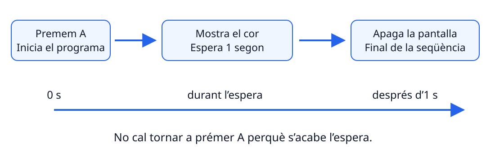

Suposem que només premem A una vegada. L’espera manté el cor abans d’apagar la pantalla.

<!--
Bloc «Del programa a la resposta»: 60–85 min de sessió (25 minuts).

**Guió de conducció**

**Què explicar**

Expliqueu que la fila superior mostra accions i la línia inferior ajuda a situar-les en el temps. Prémer A inicia el programa. Mostrar el cor ocorre abans de l’espera; després d’un segon, la pantalla es neteja i aquesta pila acaba.

**Com mostrar-ho**

Recorreu la línia del temps i representeu el cor amb la mà durant l’interval central. Compareu amb les tres respostes de la parella. Aquesta és una representació conceptual, no una mesura precisa del temps d’arrencada del dispositiu.

**Pregunta i resposta esperable**

«Si ja hem premut A, què fa que s’acabe l’espera?» El pas del temps previst al programa; no una altra pulsació. «Què queda després?» La pantalla neta, si no s’executa cap altra acció.

**Si apareix aquest dubte**

El dibuix del cor no desapareix simplement perquè deixem de prémer A. Desapareix per una ordre posterior. Aquest detall ajuda a distingir un programa d’un comandament mantingut.

**Enllaç amb el pas següent**

Plantegeu una modificació mínima: augmentar quant de temps veiem el cor.
-->

---

## Codey · Una modificació, una predicció

**Repte:** volem veure el cor durant tres segons.

Quin bloc canvia? Quins es conserven?

<!--
Bloc «Del programa a la resposta»: 60–85 min de sessió (25 minuts).

Solució per a la posada en comú: canvia l’espera d’1 a 3 segons. El botó i el dibuix continuen igual.

Pregunta docent: «Com ho sabies abans de provar?»

Deixeu que les parelles justifiquen el canvi abans de donar la resposta. El resultat es pot comprovar amb el diagrama temporal anterior.

**Guió de conducció**

**Què explicar**

«Volem mantindre exactament el mateix comportament, però veure el cor durant tres segons». Feu que identifiquen què és constant: el botó A, la imatge i l’ordre d’esborrar. Només canvia la durada de l’espera.

**Com mostrar-ho**

Torneu a la pila anterior si cal i demaneu que assenyalen un únic bloc. No proposeu afegir tres cors o prémer el botó tres vegades: aquestes opcions introdueixen altres accions.

**Pregunta i resposta esperable**

La resposta esperada és canviar espera 1 segon per espera 3 segons. Pregunteu «com ho sabies abans de provar?» i accepteu una justificació que relacione l’interval amb la pantalla visible.

**Si apareix aquest dubte**

Si proposen repetir tot el programa, compareu: esborrar i tornar a mostrar no és necessàriament mantindre la mateixa imatge de manera contínua. Canviar una variable ens permet predir millor l’efecte.

**Enllaç amb el pas següent**

Feu el pont amb els sensors: el botó és una entrada que hem accionat nosaltres; altres entrades aporten lectures.
-->

---

<!-- _class: diagram -->

## Un botó i un sensor aporten informació

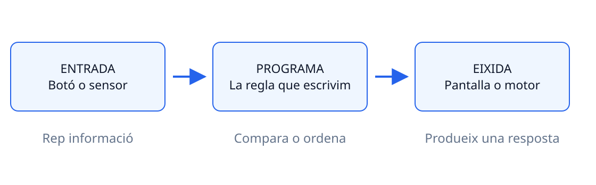

El programa el dissenyem nosaltres. Un botó activa un esdeveniment; un sensor aporta una lectura que podem comparar.

<!--
Bloc «Del programa a la resposta»: 60–85 min de sessió (25 minuts).

**Guió de conducció**

**Què explicar**

Expliqueu les tres caixes amb verbs: una entrada aporta informació; el programa aplica les ordres o regles que hem escrit; una eixida produeix una resposta observable. Eixida no significa una porta física: pot ser la pantalla, el so o un motor.

**Com mostrar-ho**

Llegiu primer l’exemple del botó: A premut → executar la pila → mostrar el cor. Després canvieu només l’entrada: lectura de llum → comparar amb un valor → mostrar una icona o netejar la pantalla.

**Pregunta i resposta esperable**

«La pantalla és el sensor de la nostra intenció?» No. «Qui ha triat què vol dir el cor?» La persona que programa. El dispositiu executa aquella relació.

**Si apareix aquest dubte**

Botó i sensor no funcionen exactament igual en tots els programes: un esdeveniment de botó inicia una seqüència, mentre que una lectura es pot consultar una vegada o repetidament.

**Enllaç amb el pas següent**

Introduïu el fanalet com un exemple de resposta a una lectura que pot anar canviant.
-->

---

<!-- _class: visual -->

## Demostració · Un fanalet amb micro:bit

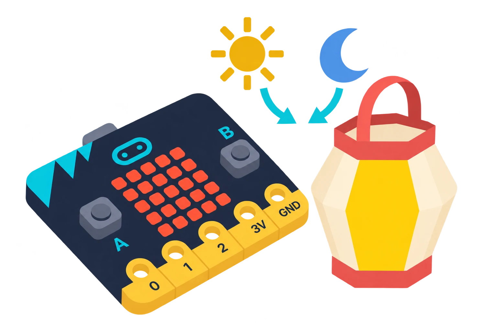

**Pregunta:** com fem que una icona responga a la llum?

La matriu LED pot mostrar dibuixos i estimar la llum.

Primer observem lectures; després triem una condició.

<!--
Bloc «Del programa a la resposta»: 60–85 min de sessió (25 minuts).

**Guió de conducció**

**Què explicar**

«Farem servir una lectura de llum per decidir quan es veu una icona». La micro:bit no ha d’entendre què és la nit: compara un nombre amb un valor que triem. La proposta connecta una observació del medi amb una resposta visible.

**Com mostrar-ho**

Assenyaleu la matriu de LED de la placa a la il·lustració. Expliqueu que participa en l’estimació de llum i també mostra dibuixos. La imatge del fanalet és un context creatiu, no un sistema real d’il·luminació automàtica.

**Pregunta i resposta esperable**

«Què necessitem conéixer abans de triar el valor de comparació?» Algunes lectures en les condicions de la prova. Si no hi ha placa, usarem dades simulades identificades com a exemple.

**Si apareix aquest dubte**

La lectura és relativa, de 0 a 255, i no és una mesura en lux. No tapeu components ni presenteu una lectura simulada com si fora una mesura real del centre.

**Enllaç amb el pas següent**

Mostreu les dues branques de la decisió i feu explícit què passa en cadascuna.
-->

---

<!-- _class: diagram -->

## La llum obri dues possibilitats

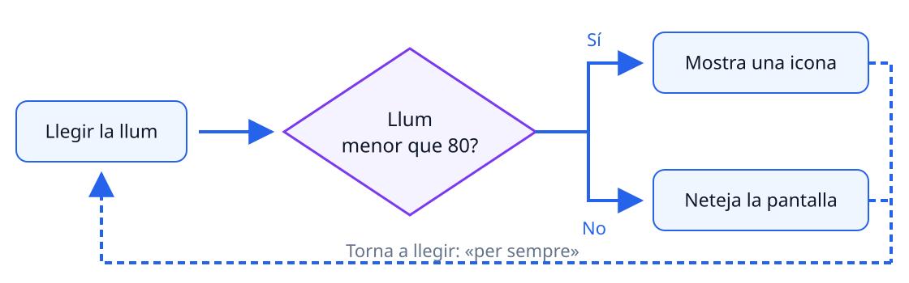

El programa segueix **una branca en cada comprovació**. 80 és un exemple: primer cal observar les lectures reals.

<!--
Bloc «Del programa a la resposta»: 60–85 min de sessió (25 minuts).

**Guió de conducció**

**Què explicar**

Llegiu el rombe com una pregunta amb dues respostes: «la lectura és menor que 80?». Si és sí, es mostra una icona. Si és no, es neteja la pantalla. Una branca és simplement un dels camins que pot seguir el programa després d’aquesta pregunta.

**Com mostrar-ho**

Seguiu amb el dit el camí d’una lectura 40: entrada, pregunta i branca sí. Repetiu amb 120 per la branca no. Finalment seguiu la fletxa discontínua: tornem a llegir, no ens quedem per sempre en la primera decisió.

**Pregunta i resposta esperable**

«I si la lectura és exactament 80?» No és menor que 80; segueix la branca no. «Es fan les dues respostes en la mateixa comprovació?» No, se’n tria una segons la condició.

**Si apareix aquest dubte**

80 és un exemple. No és un llindar universal de nit, foscor o confort visual. Amb placa real, observem lectures abans de triar-lo i controlem posició i ombra.

**Enllaç amb el pas següent**

En la sessió de sensors aprofundirem en les lectures; ara recupereu el criteri de començar per una sola funció.
-->

---

<!-- _class: section -->

## Com ho organitzem?

<!--
Bloc «Com ho organitzem?»: 85–100 min de sessió (15 minuts).

Aquest temps inclou explicacions, treball dels participants i posada en comú. Controleu el tancament del bloc sense avançar les solucions abans de la predicció.

**Guió de conducció**

**Objectiu d’aquest bloc**
Convertir les possibilitats tècniques en una activitat viable.

**Com conduir-lo**
Relacioneu cicle, experiència i funció inicial. Després concreteu torns, rols i suports: qui no manipula ha de continuar prenent decisions i explicant.

**Resultat que convé recollir abans d’avançar**
Una pauta d’organització que mantinga el treball de tots els equips.

**Gestió del temps**
Useu la franja indicada al començament de la nota com a límit del bloc complet, no com a durada d’aquesta pantalla. Les aclaracions del guió són un banc de suport: seleccioneu-les segons les respostes del grup, sense llegir-les totes literalment.
-->

---

## Una tria inicial raonable

**Primer cicle:** rutes curtes i narració amb Tale-Bot o Coding Set.

**Segon cicle:** ampliar rutes o començar respostes amb Codey Rocky.

**Tercer cicle:** dades amb micro:bit o mecanismes amb SPIKE.

Són punts de partida flexibles, segons experiència i material.

<!--
Bloc «Com ho organitzem?»: 85–100 min de sessió (15 minuts).

**Guió de conducció**

**Què explicar**

Expliqueu que les franges proposades orienten una primera entrada, no estableixen requisits d’edat del producte ni prohibicions. El criteri és la complexitat del repte, l’experiència del grup i el temps de preparació disponible.

**Com mostrar-ho**

Compareu una ruta de dues ordres amb una decisió de sensor. En la primera podem concentrar-nos en ordenar i explicar; en la segona cal entendre també una lectura i una condició. Un grup amb experiència pot avançar per una altra via.

**Pregunta i resposta esperable**

«Podríem treballar rutes en tercer cicle?» Sí, ampliant les restriccions o la justificació. «Hem d’usar micro:bit perquè som tercer cicle?» No: depén de l’aprenentatge i del material disponible.

**Si apareix aquest dubte**

No equipareu robot més complex amb aprenentatge més valuós. Una seqüència curta pot donar una conversa molt rica si demanem anticipació i explicació.

**Enllaç amb el pas següent**

Convertiu aquest criteri en una primera experiència acotada i fàcil de comprovar.
-->

---

<!-- _class: visual -->

## Una funció és suficient per començar

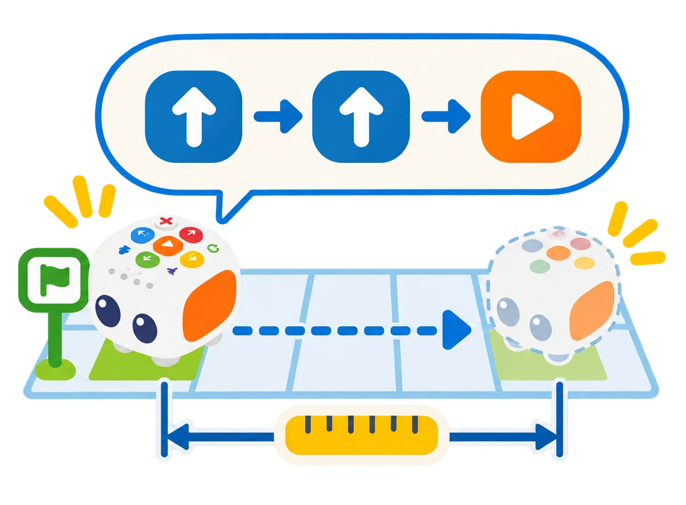

**Primer:** observar un moviment.

**Després:** preparar dues ordres i anticipar el final.

**Ampliar:** afegir un gir quan el grup puga explicar les primeres proves.

<!--
Bloc «Com ho organitzem?»: 85–100 min de sessió (15 minuts).

**Guió de conducció**

**Què explicar**

«La primera vegada no cal contar una història completa, enregistrar so i dibuixar alhora». Comencem observant un moviment, després preparem dues ordres i només afegim un gir quan el grup pot explicar el resultat.

**Com mostrar-ho**

Useu la imatge per distingir inici, desplaçament i destinació. Amb material, una sola ordre permet veure quant avança el model i ajustar el mapa. Amb paper, manteniu la regla d’una casella per avant.

**Pregunta i resposta esperable**

«Quan té sentit ampliar?» Quan podem dir què esperàvem, què ha passat i per què canvia una ordre. Arribar una vegada per casualitat no és una prova suficient.

**Si apareix aquest dubte**

Si una primera ruta falla, reduïu-ne la longitud abans d’afegir ajudes o funcions noves. Una tasca petita fa més fàcil localitzar la causa i repartir els torns.

**Enllaç amb el pas següent**

Mostreu com aquesta mateixa funció es pot posar al servei d’una narració.
-->

---

<!-- _class: visual -->

## Una ruta per contar una història


Observeu la il·lustració.

Quin lloc seria l’inici?
Quina parada tindria sentit en el relat?
Què explicaria l’alumnat en arribar-hi?

<!--
Bloc «Com ho organitzem?»: 85–100 min de sessió (15 minuts).

**Guió de conducció**

**Què explicar**

La imatge proposa una biblioteca i llocs d’un recorregut, però la història la construeix l’alumnat. Per exemple: un personatge va a buscar un llibre i fa una parada per demanar una recomanació. La ruta ha de mantindre l’ordre del relat.

**Com mostrar-ho**

Assenyaleu dos llocs i demaneu quin seria l’inici. Si es vol programar, afegiu abans marques d’inici, orientació i desplaçaments: la il·lustració sola no és una graella operativa ni un mapa codificat.

**Pregunta i resposta esperable**

«Què explicaria una persona en arribar a cada parada?» Una frase que faça avançar el relat. «Què passaria si canviem l’ordre de les parades?» Pot canviar el sentit de la història.

**Si apareix aquest dubte**

No atribuïu al robot comprensió del text ni lectura de qualsevol icona. El robot executa ordres; nosaltres relacionem aquelles accions amb el relat.

**Enllaç amb el pas següent**

Introduïu l’organització dels equips perquè la narració i la planificació continuen mentre un grup prova.
-->

---

<!-- _class: diagram -->

## Una prova amb treball per a tothom

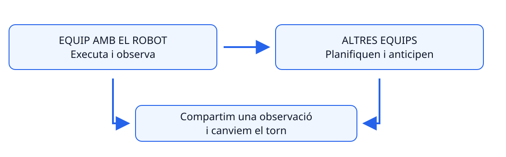

Cada equip conserva la seua tasca mentre espera. El torn acaba amb una observació que els altres poden aprofitar.

<!--
Bloc «Com ho organitzem?»: 85–100 min de sessió (15 minuts).

**Guió de conducció**

**Què explicar**

Expliqueu que disposar d’una sola unitat no obliga a una classe sencera a esperar. El diagrama diferencia l’equip que executa i observa del treball dels altres: planificar, anticipar o comparar versions en paper.

**Com mostrar-ho**

Imagineu quatre equips. L’equip que prova té una seqüència curta preparada; els altres anoten on acabarà o revisen la pròpia ruta. En acabar, comparteix una observació útil i cedeix el torn.

**Pregunta i resposta esperable**

«Quina tasca concreta tenen els equips que esperen?» No basta «mirar»: poden predir la casella final i justificar-la, o detectar una diferència respecte de la ruta prevista.

**Si apareix aquest dubte**

No convertiu el canvi de torn en una prova de rapidesa. Si un equip no està preparat, ha de poder seguir treballant en paper sense perdre la possibilitat d’aprendre.

**Enllaç amb el pas següent**

Concreteu els rols perquè manipular el robot no siga l’única forma visible de participar.
-->

---

## Rols rotatius

**Planifica:** proposa i justifica les ordres.
**Programa:** introdueix allò acordat.
**Comprova:** compara predicció i resultat.
**Explica:** registra una decisió.

En equips de tres, uniu comprovació i explicació.

<!--
Bloc «Com ho organitzem?»: 85–100 min de sessió (15 minuts).

**Guió de conducció**

**Què explicar**

Expliqueu que els rols distribueixen responsabilitats, no etiqueten capacitats. Planificar proposa i justifica; programar introdueix allò acordat; comprovar compara amb la predicció; explicar deixa constància d’una decisió.

**Com mostrar-ho**

Useu una mateixa ruta i demaneu què faria cada rol abans, durant i després de la prova. En equips de tres es poden unir comprovació i explicació. Acordeu una rotació després de cada prova o repte curt.

**Pregunta i resposta esperable**

«Qui pensa el programa?» Tot l’equip, encara que una persona introduïsca les ordres. «Qui ha de saber explicar-lo?» Tothom; el rol de portaveu no eximeix les altres persones de comprendre.

**Si apareix aquest dubte**

Eviteu que la persona amb més experiència es quede sempre el dispositiu. Tampoc interpreteu una dificultat de manipulació com una dificultat de comprensió.

**Enllaç amb el pas següent**

Reforceu les diverses maneres de participar i explicar l’aprenentatge.
-->

---

## Participar també és anticipar i explicar

Fletxes grans, consignes orals i temps per pensar.

Podem explicar amb veu, dibuix o demostració.

Una altra persona pot manipular el dispositiu seguint les nostres instruccions.

<!--
Bloc «Com ho organitzem?»: 85–100 min de sessió (15 minuts).

**Guió de conducció**

**Què explicar**

«Fer robòtica no és només tocar el robot». Una persona pot formular les ordres, anticipar el resultat o justificar una correcció mentre una altra executa. Aquesta distinció permet adaptar l’accés sense llevar l’objectiu.

**Com mostrar-ho**

Poseu un exemple: una persona dicta dues fletxes grans i una altra les introdueix. Després la primera explica si la predicció coincideix. Oferiu veu, dibuix i demostració com a formes de resposta.

**Pregunta i resposta esperable**

«Quin suport canviaria l’accés però mantindria el repte?» Fletxes més grans, consigna oral, menys ordres inicials o una persona que manipule seguint instruccions.

**Si apareix aquest dubte**

Eviteu repartir rols segons suposicions fixes sobre l’alumnat. El suport ha de permetre prendre decisions, no convertir una persona en espectadora permanent.

**Enllaç amb el pas següent**

Expliqueu com les preguntes del docent ajuden a revisar sense resoldre el repte per l’equip.
-->

---

<!-- _class: diagram -->

## Com acompanyem una revisió?

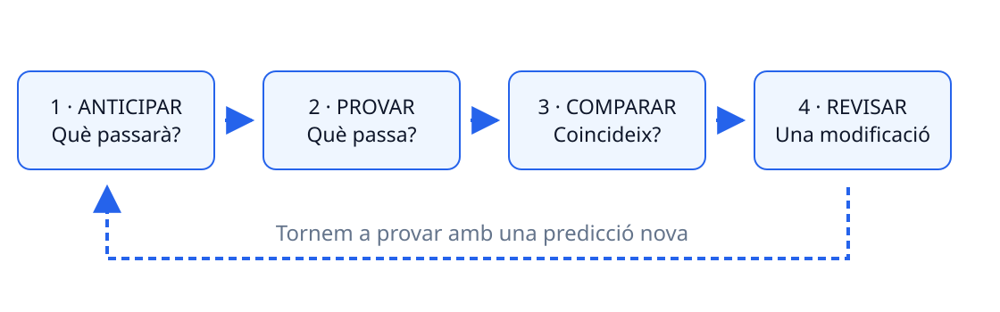

Preguntem què esperàvem i què ha passat. Després canviem **una sola cosa** i tornem a provar.

<!--
Bloc «Com ho organitzem?»: 85–100 min de sessió (15 minuts).

**Guió de conducció**

**Què explicar**

Llegiu el cicle com una conversa: abans, què esperes? Després de provar, què ha passat? En comparar, on es diferencien? En revisar, què canviaràs? La darrera fletxa indica que la modificació necessita una nova comprovació.

**Com mostrar-ho**

Torneu a una ruta que acabaria a C2. En lloc de dir immediatament l’ordre correcta, demaneu que localitzen el gir i comparen el camí amb la destinació B3.

**Pregunta i resposta esperable**

Una resposta útil és «hem girat massa prompte; provarem d’avançar una vegada més abans de girar». Si diuen «està malament», demaneu quin fet concret els ho fa pensar.

**Si apareix aquest dubte**

Canviar una sola cosa és una pauta per entendre la causa, no una prohibició absoluta. Si el programa té diversos errors, aneu resolent-los de manera que es puga explicar cada canvi.

**Enllaç amb el pas següent**

Conserveu aquestes preguntes en preparar la proposta pròpia del final.
-->

---

<!-- _class: section -->

## Preparem una primera proposta

<!--
Bloc «Preparem una primera proposta»: 100–120 min de sessió (20 minuts).

Aquest temps inclou explicacions, treball dels participants i posada en comú. Controleu el tancament del bloc sense avançar les solucions abans de la predicció.

**Guió de conducció**

**Objectiu d’aquest bloc**
Eixir amb una primera aplicació acotada.

**Com conduir-lo**
Feu completar les quatre frases i intercanviar la proposta. Ajudeu a reduir funcions si el repte és massa gran i preserveu una pregunta final que mostre la comprensió.

**Resultat que convé recollir abans d’avançar**
Una proposta breu amb aprenentatge, repte, prova i evidència.

**Gestió del temps**
Useu la franja indicada al començament de la nota com a límit del bloc complet, no com a durada d’aquesta pantalla. Les aclaracions del guió són un banc de suport: seleccioneu-les segons les respostes del grup, sense llegir-les totes literalment.
-->

---

<!-- _class: activity -->

## La proposta que m’emporte

Completeu oralment o en paper:

**Amb el meu grup treballaria…**
**El repte seria…**
**La primera prova consistiria en…**
**Sabria que han aprés perquè…**

<!--
Bloc «Preparem una primera proposta»: 100–120 min de sessió (20 minuts).

Temps orientatiu de la dinàmica: 5 minuts.

**Guió de conducció**

**Què explicar**

Demaneu una proposta breu, no una programació completa. Les quatre frases han de formar una cadena: aprenentatge, repte, primera prova i evidència. La mateixa ruta de la biblioteca és vàlida si poden justificar com l’adaptarien.

**Com mostrar-ho**

Modeleu una resposta: «Treballaria instruccions clares; una parella guiaria una altra a un llibre; provaríem dues ordres; escoltaria si expliquen què han corregit». Després deixeu que cada parella concrete el seu grup i material.

**Pregunta i resposta esperable**

«Com sabrem que no hem triat primer el robot i després inventat l’objectiu?» L’aprenentatge i la prova continuen tenint sentit encara que representem la solució en paper.

**Si apareix aquest dubte**

Si la proposta inclou moltes funcions, demaneu quina és imprescindible per a la primera prova. Si l’evidència és «que funcione», afegiu què haurà d’explicar l’alumnat.

**Enllaç amb el pas següent**

La parella següent escoltarà la proposta per comprovar si una altra persona la podria entendre.
-->

---

## Compartim una decisió

Expliqueu a una altra parella la proposta en un minut.

Qui escolta pregunta: **«Què farà l’alumnat per demostrar-ho?»**

Reviseu un element abans de donar-la per preparada.

<!--
Bloc «Preparem una primera proposta»: 100–120 min de sessió (20 minuts).

**Guió de conducció**

**Què explicar**

Organitzeu un intercanvi curt. Qui explica ha de dir què aprendria el grup, què faria i què observaria. Qui escolta no puntua la idea: formula una pregunta que permeta preparar-la millor.

**Com mostrar-ho**

Proposeu la pregunta projectada i doneu un exemple: «Si el robot arriba però no poden explicar el gir, què et faltaria comprovar?». En acabar, cada parella fa una modificació concreta.

**Pregunta i resposta esperable**

Esperem que l’evidència es concrete: «demanarem que anticipen el final abans de provar i expliquen una correcció». No cal que totes les propostes utilitzen el mateix material.

**Si apareix aquest dubte**

No convertiu el compartir en sis exposicions llargues si el temps és curt. Prioritzeu que totes les parelles reben una pregunta i revisen la pròpia proposta.

**Enllaç amb el pas següent**

Tanqueu amb la preparació mínima per al primer dia, no amb una nova llista de funcions.
-->

---

## Abans de la primera prova a l’aula

Comproveu material, espai i alimentació.
Prepareu una alternativa en paper.
Reserveu temps per explicar una millora.

**Una primera experiència curta i comprensible és suficient per començar.**

<!--
Bloc «Preparem una primera proposta»: 100–120 min de sessió (20 minuts).

**Guió de conducció**

**Què explicar**

Recapituleu tres decisions operatives: material que funciona, alternativa preparada i temps reservat per explicar. La primera aplicació és una prova docent que després revisarem; no ha de desplegar totes les possibilitats del kit.

**Com mostrar-ho**

Demaneu que cadascú identifique què ha de comprovar abans d’entrar a classe. Amb dispositiu: alimentació, connexió i resposta prevista. Sense dispositiu: mapa, regles i consigna que una altra persona entenga.

**Pregunta i resposta esperable**

«Què és més important afegir ara: una funció nova o una pregunta que ens mostre la comprensió?» En aquesta primera proposta, normalment la pregunta i la comprovació.

**Si apareix aquest dubte**

No sacrifiqueu el tancament perquè el muntatge o la connexió s’allarguen. Si cal, completeu la conversa amb la representació en paper.

**Enllaç amb el pas següent**

Presenteu els recursos com a ajuda per continuar, no com a contingut que s’haja de llegir ara.
-->

---

<!-- _class: resources -->

## Les propostes de partida del web

[Tale-Bot i rutes](https://gerardfp.github.io/robotica200/robot/tale-bot/index.html) · [Coding Set](https://gerardfp.github.io/robotica200/robot/coding-set/index.html)

[Botons i pantalla de Codey](https://gerardfp.github.io/robotica200/tutorial/cr-primeres-passes/index.html)

[El fanalet de micro:bit](https://gerardfp.github.io/robotica200/tutorial/mb-fanalet-llum/index.html)

[Parada per color amb SPIKE](https://gerardfp.github.io/robotica200/tutorial/sp-motors-sensors/index.html)

Les demostracions simplifiquen aquests tutorials. Els noms dels blocs poden variar segons l’idioma de l’aplicació.

<!--
Aquests enllaços són per a consulta posterior. No cal obrir-los durant la sessió ni disposar de connexió per completar les activitats.

**Guió de conducció**

**Què explicar**

Expliqueu què aporta cada tipus de recurs: el tutorial resol l’ús concret del dispositiu; una situació d’aprenentatge situa aquell ús dins d’un repte, una seqüència i unes evidències. Escola 4.0 és el referent institucional del projecte.

**Com mostrar-ho**

Assenyaleu un enllaç relacionat amb una demostració que ja hàgem entés. No navegueu per tot el catàleg durant el tancament: l’objectiu és que sàpien on tornar quan preparen una activitat.

**Pregunta i resposta esperable**

«Si vull saber com connectar Codey, què consultaria?» El tutorial. «Si vull adaptar un repte a diverses sessions?» Una SDA, revisant-ne grup, temps i material.

**Si apareix aquest dubte**

Els noms dels blocs poden variar segons l’idioma i la versió de l’aplicació. Els exemples visuals de la formació ajuden a raonar, però no substitueixen la comprovació del model real.

**Enllaç amb el pas següent**

Tanqueu recuperant una decisió que cada parella s’emporta i la pregunta que voldria provar a l’aula.
-->

---

## Recursos per continuar

**Tutorials del web:** preparar connexions, controls i primeres proves.

**Situacions d’aprenentatge:** context, seqüència i evidències per adaptar.

[Robòtica per a docents](https://gerardfp.github.io/robotica200/) · [Escola 4.0 · GVA](https://portal.edu.gva.es/escola40/va/inici/)

Les imatges reutilitzen il·lustracions del projecte.

<!--
Bloc «Preparem una primera proposta»: 100–120 min de sessió (20 minuts).

**Guió de conducció**

**Què explicar**

Expliqueu què aporta cada tipus de recurs: el tutorial resol l’ús concret del dispositiu; una situació d’aprenentatge situa aquell ús dins d’un repte, una seqüència i unes evidències. Escola 4.0 és el referent institucional del projecte.

**Com mostrar-ho**

Assenyaleu un enllaç relacionat amb una demostració que ja hàgem entés. No navegueu per tot el catàleg durant el tancament: l’objectiu és que sàpien on tornar quan preparen una activitat.

**Pregunta i resposta esperable**

«Si vull saber com connectar Codey, què consultaria?» El tutorial. «Si vull adaptar un repte a diverses sessions?» Una SDA, revisant-ne grup, temps i material.

**Si apareix aquest dubte**

Els noms dels blocs poden variar segons l’idioma i la versió de l’aplicació. Els exemples visuals de la formació ajuden a raonar, però no substitueixen la comprovació del model real.

**Enllaç amb el pas següent**

Tanqueu recuperant una decisió que cada parella s’emporta i la pregunta que voldria provar a l’aula.
-->
