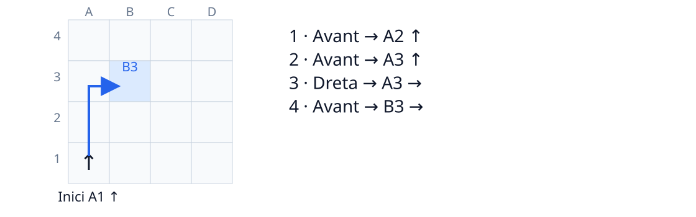
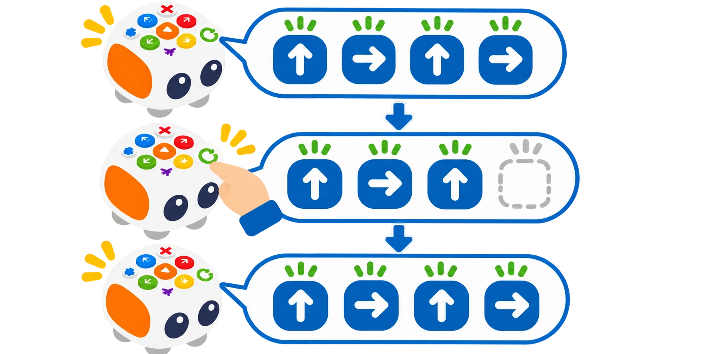
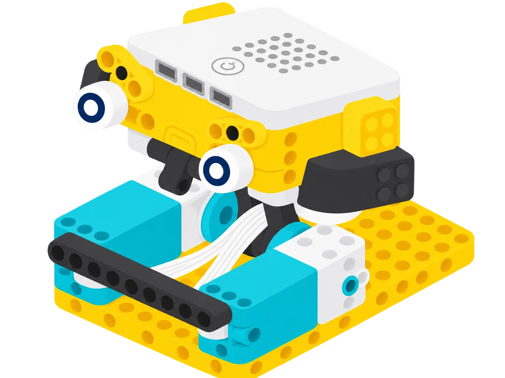
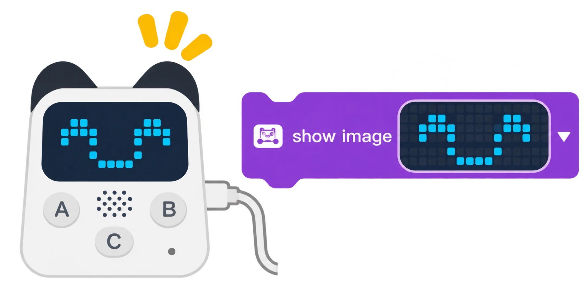
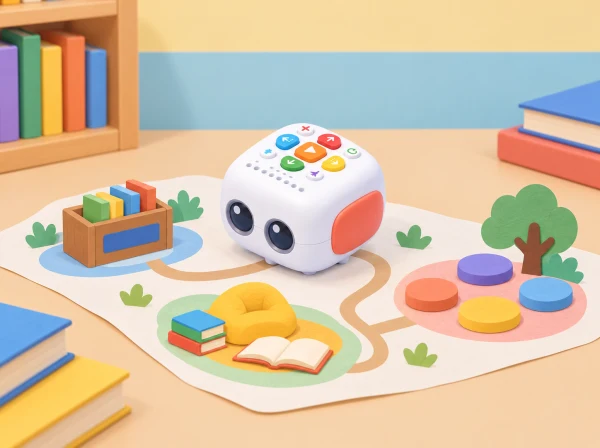

<!-- _class: cover -->

## Per on comencem amb la robòtica?

**Sessió 1 · Comuna als dos formats · 2 hores**

Formació presencial per a docents de primària

Robòtica per a docents

<!--
Preparació: comproveu projector i navegació. Només està garantida la projecció; les activitats admeten resposta oral o en paper. Si hi ha dispositius, assageu abans les demostracions i substituïu les simulacions per proves curtes.
-->

---

<!-- _class: section -->

## Començarem amb un repte

<!--
Bloc «Començarem amb un repte»: 00–15 min de sessió (15 minuts).

Aquest temps inclou explicacions, treball dels participants i posada en comú. Controleu el tancament del bloc sense avançar les solucions abans de la predicció.
-->

---

## Què ens emportarem hui?

Una manera de triar material segons l’aprenentatge.

Una primera activitat que puguem explicar i preparar.

Una pauta per organitzar equips i observar què aprenen.

<!--
Bloc «Començarem amb un repte»: 00–15 min de sessió (15 minuts).
-->

---

## Com treballarem

Treballarem en parelles: llegirem, anticiparem i compartirem les nostres decisions.

Podeu respondre oralment o representar les proves en paper.

<!--
Bloc «Començarem amb un repte»: 00–15 min de sessió (15 minuts).

Si hi ha robots disponibles i preparats, substituïu la simulació per una demostració assajada; no afegiu temps extra al bloc.
-->

---

<!-- _class: activity -->

## Abans de començar

Penseu en un contingut que ja treballeu amb el vostre grup.

Expliqueu-lo a la persona del costat.

Conserveu aquest exemple: al final triarem si algun material ens ajuda a treballar-lo.

<!--
Bloc «Començarem amb un repte»: 00–15 min de sessió (15 minuts).

Temps orientatiu de la dinàmica: 2 minuts.
-->

---

<!-- _class: diagram -->

## El repte de la biblioteca


**A1 ↑ → biblioteca B3.** Una ordre «avant» avança una casella; un gir canvia l’orientació sense moure la fitxa.

<!--
Bloc «Començarem amb un repte»: 00–15 min de sessió (15 minuts).
-->

---

<!-- _class: activity -->

## Escriviu una ruta

1. Acordeu les ordres per arribar a la biblioteca.
2. Una persona les escriu o les diu.
3. L’altra les executa amb el dit o mentalment.

Comproveu també **cap on mira al final**.

<!--
Bloc «Començarem amb un repte»: 00–15 min de sessió (15 minuts).

Temps orientatiu de la dinàmica: 3 minuts.
-->

---

<!-- _class: solution -->

## Una solució, ordre a ordre

| Ordre | Casella | Orientació |
|---|---|---|
| Inici | A1 | Amunt |
| Avant | A2 | Amunt |
| Avant | A3 | Amunt |
| Dreta | A3 | Dreta |
| Avant | B3 | Dreta |

<!--
Bloc «Començarem amb un repte»: 00–15 min de sessió (15 minuts).
-->

---

<!-- _class: diagram -->

## La solució, vista sobre el mapa



El recorregut arriba a B3 i acaba mirant a la dreta. **El tercer pas és un gir: no avança de casella.**

<!--
Bloc «Començarem amb un repte»: 00–15 min de sessió (15 minuts).
-->

---

<!-- _class: section -->

## Què podem aprendre?

<!--
Bloc «Què podem aprendre?»: 15–30 min de sessió (15 minuts).

Aquest temps inclou explicacions, treball dels participants i posada en comú. Controleu el tancament del bloc sense avançar les solucions abans de la predicció.
-->

---

## Què ens ha obligat a pensar?

<div class="flow"><span>Situar-nos</span><span class="arrow">→</span><span>Ordenar</span><span class="arrow">→</span><span>Anticipar</span><span class="arrow">→</span><span>Comprovar</span></div>

Hem necessitat un inici, una orientació i ordres compartides.

Una altra ruta també pot ser correcta: cal executar-la i justificar-la.

<!--
Bloc «Què podem aprendre?»: 15–30 min de sessió (15 minuts).
-->

---

<!-- _class: diagram -->

## Girar i avançar són accions diferents


La dreta és la del personatge segons cap on mira. **Després d’un gir, continuem a la mateixa casella.**

<!--
Bloc «Què podem aprendre?»: 15–30 min de sessió (15 minuts).
-->

---

## Pensament computacional, amb un exemple

**Descompondre:** dividir la ruta en moviments.
**Crear una seqüència:** ordenar les instruccions.
**Depurar:** localitzar i corregir una ordre.

El vocabulari posa nom a decisions que ja hem pres.

<!--
Bloc «Què podem aprendre?»: 15–30 min de sessió (15 minuts).
-->

---

<!-- _class: visual -->

## Llegir, provar i revisar una ordre



La il·lustració mostra versions d’una seqüència.

**Abans:** què esperem que faça?

**Després:** quina ordre hem revisat i quin efecte té?

<!--
Bloc «Què podem aprendre?»: 15–30 min de sessió (15 minuts).
-->

---

## Quin aprenentatge guia la proposta?

**Llengua:** explicar una ruta perquè una altra persona la seguisca.

**Matemàtiques:** descriure posicions i canvis d’orientació.

**Medi:** comparar dades obtingudes amb el mateix procediment.

<!--
Bloc «Què podem aprendre?»: 15–30 min de sessió (15 minuts).
-->

---

## L’activitat necessita una evidència

Arribar al destí és un resultat.

**Explicar per què hem canviat una ordre** ens informa de la comprensió.

Podem recollir una ruta anotada, una conversa o dues versions del programa.

<!--
Bloc «Què podem aprendre?»: 15–30 min de sessió (15 minuts).
-->

---

<!-- _class: activity -->

## De la pantalla a la conversa

Recupereu el contingut que heu triat en començar.

Què hauria de fer o explicar l’alumnat per demostrar que l’ha entés?

<!--
Bloc «Què podem aprendre?»: 15–30 min de sessió (15 minuts).

Temps orientatiu de la dinàmica: 3 minuts.

Recolliu dues respostes concretes i relacioneu-les amb el contingut triat a l’inici.
-->

---

<!-- _class: section -->

## Coneixem les possibilitats

<!--
Bloc «Coneixem les possibilitats»: 30–55 min de sessió (25 minuts).

Aquest temps inclou explicacions, treball dels participants i posada en comú. Controleu el tancament del bloc sense avançar les solucions abans de la predicció.
-->

---

<!-- _class: visual -->

## Tale-Bot


Programem moviments amb els botons del robot.

**Una proposta:** Una ruta entre tres llocs d’un conte.

<!--
Bloc «Coneixem les possibilitats»: 30–55 min de sessió (25 minuts).
-->

---

## Tale-Bot · Primera decisió

**Què cal tindre present?**

Els mapes interactius necessiten zones codificades compatibles; una quadrícula de paper serveix per orientar-nos, però no activa eixes funcions.

**Abans de la prova:** què esperem observar?
**Després:** quina decisió podrà explicar l’alumnat?

<!--
Bloc «Coneixem les possibilitats»: 30–55 min de sessió (25 minuts).
-->

---

<!-- _class: tangible -->

## Tale-Bot · Llegim els botons en ordre

```talebot
endavant
endavant
dreta
endavant
executa
```

Preparem les ordres i després premem **executa**. El gir canvia l’orientació: no avança. Les icones representen la seqüència, no la disposició física dels botons.

<!--
Bloc «Coneixem les possibilitats»: 30–55 min de sessió (25 minuts).
-->

---

<!-- _class: visual -->

## Coding Set


Construïm el programa amb peces al tauler; la torre el llig i el MatataBot el segueix.

**Una proposta:** Comparar dues seqüències movent una peça.

<!--
Bloc «Coneixem les possibilitats»: 30–55 min de sessió (25 minuts).
-->

---

## Coding Set · Primera decisió

**Què cal tindre present?**

Cal preparar torre, tauler i robot; no són botons sobre el mateix robot.

**Abans de la prova:** què esperem observar?
**Després:** quina decisió podrà explicar l’alumnat?

<!--
Bloc «Coneixem les possibilitats»: 30–55 min de sessió (25 minuts).
-->

---

<!-- _class: tangible -->

## Coding Set · Llegim les peces

```coding-set
endavant
endavant
dreta
endavant
```

Al tauler, llegim les peces **d’esquerra a dreta i de dalt a baix**. Aquesta fila representa una ruta; la torre ha de poder llegir-la abans d’executar-la.

<!--
Bloc «Coneixem les possibilitats»: 30–55 min de sessió (25 minuts).
-->

---

<!-- _class: diagram -->

## Coding Set · Com circulen les ordres?


El tauler manté el programa visible. La torre el llig i envia les ordres; el MatataBot les executa.

<!--
Bloc «Coneixem les possibilitats»: 30–55 min de sessió (25 minuts).
-->

---

<!-- _class: visual -->

## Coding Express


La via defineix el recorregut; els maons d’acció provoquen respostes del tren.

**Una proposta:** Una història amb estació, parada i destinació.

<!--
Bloc «Coneixem les possibilitats»: 30–55 min de sessió (25 minuts).
-->

---

## Coding Express · Primera decisió

**Què cal tindre present?**

El tren no tria una destinació. Els girs de la via no són ordres de gir com en Tale-Bot.

**Abans de la prova:** què esperem observar?
**Després:** quina decisió podrà explicar l’alumnat?

<!--
Bloc «Coneixem les possibilitats»: 30–55 min de sessió (25 minuts).
-->

---

<!-- _class: diagram -->

## Coding Express · Via i resposta


La via resol el recorregut. El maó introdueix una resposta. **No és una ordre de gir en una quadrícula.**

<!--
Bloc «Coneixem les possibilitats»: 30–55 min de sessió (25 minuts).
-->

---

<!-- _class: visual -->

## Codey Rocky


Programem amb mBlock una pantalla, els botons i altres respostes.

**Una proposta:** Prémer A perquè mostre una cara dibuixada.

<!--
Bloc «Coneixem les possibilitats»: 30–55 min de sessió (25 minuts).
-->

---

## Codey Rocky · Primera decisió

**Què cal tindre present?**

Una expressió programada no implica que el robot senta ni reconega emocions.

**Abans de la prova:** què esperem observar?
**Després:** quina decisió podrà explicar l’alumnat?

<!--
Bloc «Coneixem les possibilitats»: 30–55 min de sessió (25 minuts).
-->

---

<!-- _class: visual -->

## micro:bit


Relacionem botons o lectures de sensors amb respostes en la matriu LED.

**Una proposta:** Un fanalet que mostra una icona quan baixa la llum.

<!--
Bloc «Coneixem les possibilitats»: 30–55 min de sessió (25 minuts).
-->

---

## micro:bit · Primera decisió

**Què cal tindre present?**

La lectura de llum és relativa i depén de la posició; no és una mesura en lux.

**Abans de la prova:** què esperem observar?
**Després:** quina decisió podrà explicar l’alumnat?

<!--
Bloc «Coneixem les possibilitats»: 30–55 min de sessió (25 minuts).
-->

---

<!-- _class: visual -->

## SPIKE Prime



Connectem i programem motors i sensors; podem construir mecanismes.

**Una proposta:** Aturar un motor quan el sensor detecta una targeta roja.

<!--
Bloc «Coneixem les possibilitats»: 30–55 min de sessió (25 minuts).
-->

---

## SPIKE Prime · Primera decisió

**Què cal tindre present?**

Reserveu temps per al muntatge, els ports, la connexió i les proves.

**Abans de la prova:** què esperem observar?
**Després:** quina decisió podrà explicar l’alumnat?

<!--
Bloc «Coneixem les possibilitats»: 30–55 min de sessió (25 minuts).
-->

---

<!-- _class: pause -->

## Pausa

En tornar, continuarem amb el bloc següent.

Deixeu anotada una pregunta que vulgueu recuperar.

<!--
Bloc «Pausa»: 55–60 min de sessió (5 minuts).

Temps orientatiu de la dinàmica: 5 minuts.

Respecteu els cinc minuts de pausa; recupereu una de les preguntes anotades en reprendre la sessió.
-->

---

<!-- _class: section -->

## Del programa a la resposta

<!--
Bloc «Del programa a la resposta»: 60–85 min de sessió (25 minuts).

Aquest temps inclou explicacions, treball dels participants i posada en comú. Controleu el tancament del bloc sense avançar les solucions abans de la predicció.
-->

---

<!-- _class: visual -->

## Demostració · Una resposta al botó A



**Objectiu:** entendre què inicia el programa.

Primer llegim el programa. Després anticipem la pantalla.

Codey pot fer aquesta prova sense moure Rocky.

<!--
Bloc «Del programa a la resposta»: 60–85 min de sessió (25 minuts).
-->

---

<!-- _class: blocks -->

## Codey · Llegim el programa

```mblock
quan es prem el botó [A v]
mostra la imatge [cor v]
espera (1) segons
esborra la pantalla
```

**Què inicia la seqüència? Què ocorre durant l’espera?**

<!--
Bloc «Del programa a la resposta»: 60–85 min de sessió (25 minuts).
-->

---

<!-- _class: activity -->

## Codey · Predicció abans de provar

Quan premem A, què veurem…

- just després?
- mig segon després?
- dos segons després?

En parelles, acordeu les tres respostes.

<!--
Bloc «Del programa a la resposta»: 60–85 min de sessió (25 minuts).
-->

---

<!-- _class: diagram -->

## Codey · La seqüència en el temps


Suposem que només premem A una vegada. L’espera manté el cor abans d’apagar la pantalla.

<!--
Bloc «Del programa a la resposta»: 60–85 min de sessió (25 minuts).
-->

---

## Codey · Una modificació, una predicció

**Repte:** volem veure el cor durant tres segons.

Quin bloc canvia? Quins es conserven?

<!--
Bloc «Del programa a la resposta»: 60–85 min de sessió (25 minuts).

Solució per a la posada en comú: canvia l’espera d’1 a 3 segons. El botó i el dibuix continuen igual.

Pregunta docent: «Com ho sabies abans de provar?»

Deixeu que les parelles justifiquen el canvi abans de donar la resposta. El resultat es pot comprovar amb el diagrama temporal anterior.
-->

---

<!-- _class: diagram -->

## Un botó i un sensor aporten informació


El programa el dissenyem nosaltres. Un botó activa un esdeveniment; un sensor aporta una lectura que podem comparar.

<!--
Bloc «Del programa a la resposta»: 60–85 min de sessió (25 minuts).
-->

---

<!-- _class: visual -->

## Demostració · Un fanalet amb micro:bit


**Pregunta:** com fem que una icona responga a la llum?

La matriu LED pot mostrar dibuixos i estimar la llum.

Primer observem lectures; després triem una condició.

<!--
Bloc «Del programa a la resposta»: 60–85 min de sessió (25 minuts).
-->

---

<!-- _class: diagram -->

## La llum obri dues possibilitats


El programa segueix **una branca en cada comprovació**. 80 és un exemple: primer cal observar les lectures reals.

<!--
Bloc «Del programa a la resposta»: 60–85 min de sessió (25 minuts).
-->

---

<!-- _class: section -->

## Com ho organitzem?

<!--
Bloc «Com ho organitzem?»: 85–100 min de sessió (15 minuts).

Aquest temps inclou explicacions, treball dels participants i posada en comú. Controleu el tancament del bloc sense avançar les solucions abans de la predicció.
-->

---

## Una tria inicial raonable

**Primer cicle:** rutes curtes i narració amb Tale-Bot o Coding Set.

**Segon cicle:** ampliar rutes o començar respostes amb Codey Rocky.

**Tercer cicle:** dades amb micro:bit o mecanismes amb SPIKE.

Són punts de partida flexibles, segons experiència i material.

<!--
Bloc «Com ho organitzem?»: 85–100 min de sessió (15 minuts).
-->

---

<!-- _class: visual -->

## Una funció és suficient per començar


**Primer:** observar un moviment.

**Després:** preparar dues ordres i anticipar el final.

**Ampliar:** afegir un gir quan el grup puga explicar les primeres proves.

<!--
Bloc «Com ho organitzem?»: 85–100 min de sessió (15 minuts).
-->

---

<!-- _class: visual -->

## Una ruta per contar una història



Observeu la il·lustració.

Quin lloc seria l’inici?
Quina parada tindria sentit en el relat?
Què explicaria l’alumnat en arribar-hi?

<!--
Bloc «Com ho organitzem?»: 85–100 min de sessió (15 minuts).
-->

---

<!-- _class: diagram -->

## Una prova amb treball per a tothom


Cada equip conserva la seua tasca mentre espera. El torn acaba amb una observació que els altres poden aprofitar.

<!--
Bloc «Com ho organitzem?»: 85–100 min de sessió (15 minuts).
-->

---

## Rols rotatius

**Planifica:** proposa i justifica les ordres.
**Programa:** introdueix allò acordat.
**Comprova:** compara predicció i resultat.
**Explica:** registra una decisió.

En equips de tres, uniu comprovació i explicació.

<!--
Bloc «Com ho organitzem?»: 85–100 min de sessió (15 minuts).
-->

---

## Participar també és anticipar i explicar

Fletxes grans, consignes orals i temps per pensar.

Podem explicar amb veu, dibuix o demostració.

Una altra persona pot manipular el dispositiu seguint les nostres instruccions.

<!--
Bloc «Com ho organitzem?»: 85–100 min de sessió (15 minuts).
-->

---

<!-- _class: diagram -->

## Com acompanyem una revisió?


Preguntem què esperàvem i què ha passat. Després canviem **una sola cosa** i tornem a provar.

<!--
Bloc «Com ho organitzem?»: 85–100 min de sessió (15 minuts).
-->

---

<!-- _class: section -->

## Preparem una primera proposta

<!--
Bloc «Preparem una primera proposta»: 100–120 min de sessió (20 minuts).

Aquest temps inclou explicacions, treball dels participants i posada en comú. Controleu el tancament del bloc sense avançar les solucions abans de la predicció.
-->

---

<!-- _class: activity -->

## La proposta que m’emporte

Completeu oralment o en paper:

**Amb el meu grup treballaria…**
**El repte seria…**
**La primera prova consistiria en…**
**Sabria que han aprés perquè…**

<!--
Bloc «Preparem una primera proposta»: 100–120 min de sessió (20 minuts).

Temps orientatiu de la dinàmica: 5 minuts.
-->

---

## Compartim una decisió

Expliqueu a una altra parella la proposta en un minut.

Qui escolta pregunta: **«Què farà l’alumnat per demostrar-ho?»**

Reviseu un element abans de donar-la per preparada.

<!--
Bloc «Preparem una primera proposta»: 100–120 min de sessió (20 minuts).
-->

---

## Abans de la primera prova a l’aula

Comproveu material, espai i alimentació.
Prepareu una alternativa en paper.
Reserveu temps per explicar una millora.

**Una primera experiència curta i comprensible és suficient per començar.**

<!--
Bloc «Preparem una primera proposta»: 100–120 min de sessió (20 minuts).
-->

---

<!-- _class: resources -->

## Les propostes de partida del web

[Tale-Bot i rutes](https://gerardfp.github.io/robotica200/robot/tale-bot/index.html) · [Coding Set](https://gerardfp.github.io/robotica200/robot/coding-set/index.html)

[Botons i pantalla de Codey](https://gerardfp.github.io/robotica200/tutorial/cr-primeres-passes/index.html)

[El fanalet de micro:bit](https://gerardfp.github.io/robotica200/tutorial/mb-fanalet-llum/index.html)

[Parada per color amb SPIKE](https://gerardfp.github.io/robotica200/tutorial/sp-motors-sensors/index.html)

Les demostracions simplifiquen aquests tutorials. Els noms dels blocs poden variar segons l’idioma de l’aplicació.

<!--
Aquests enllaços són per a consulta posterior. No cal obrir-los durant la sessió ni disposar de connexió per completar les activitats.
-->

---

## Recursos per continuar

**Tutorials del web:** preparar connexions, controls i primeres proves.

**Situacions d’aprenentatge:** context, seqüència i evidències per adaptar.

[Robòtica per a docents](https://gerardfp.github.io/robotica200/) · [Escola 4.0 · GVA](https://portal.edu.gva.es/escola40/va/inici/)

Les imatges reutilitzen il·lustracions del projecte.

<!--
Bloc «Preparem una primera proposta»: 100–120 min de sessió (20 minuts).
-->
