<!-- _class: cover -->

## Entendre com es programa

**Sessió 2 · Format de tres sessions · 2 hores**

Formació presencial per a docents de primària

Robòtica per a docents

<!--
Preparació: comproveu projector i navegació. Només està garantida la projecció; les activitats admeten resposta oral o en paper. Si hi ha dispositius, assageu abans les demostracions i substituïu les simulacions per proves curtes.
-->

---

<!-- _class: section -->

## Llegir i comprovar una ruta

<!--
Bloc «Llegir i comprovar una ruta»: 00–20 min de sessió (20 minuts).

Aquest temps inclou explicacions, treball dels participants i posada en comú. Controleu el tancament del bloc sense avançar les solucions abans de la predicció.
-->

---

<!-- _class: diagram -->

## El repte de la biblioteca

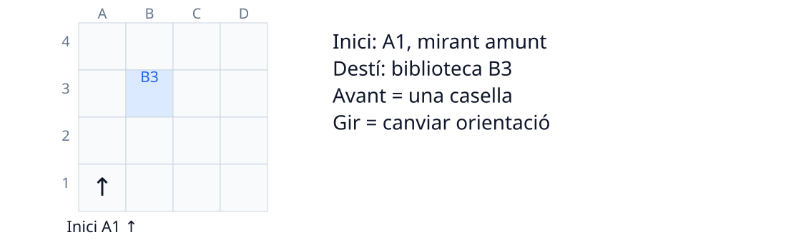

**A1 ↑ → biblioteca B3.** Una ordre «avant» avança una casella; un gir canvia l’orientació sense moure la fitxa.

<!--
Bloc «Llegir i comprovar una ruta»: 00–20 min de sessió (20 minuts).
-->

---

<!-- _class: activity -->

## Escriviu una ruta

1. Acordeu les ordres per arribar a la biblioteca.
2. Una persona les escriu o les diu.
3. L’altra les executa amb el dit o mentalment.

Comproveu també **cap on mira al final**.

<!--
Bloc «Llegir i comprovar una ruta»: 00–20 min de sessió (20 minuts).

Temps orientatiu de la dinàmica: 3 minuts.
-->

---

<!-- _class: solution -->

## Una solució, ordre a ordre

| Ordre | Casella | Orientació |
|---|---|---|
| Inici | A1 | Amunt |
| Avant | A2 | Amunt |
| Avant | A3 | Amunt |
| Dreta | A3 | Dreta |
| Avant | B3 | Dreta |

<!--
Bloc «Llegir i comprovar una ruta»: 00–20 min de sessió (20 minuts).
-->

---

<!-- _class: diagram -->

## La solució, vista sobre el mapa

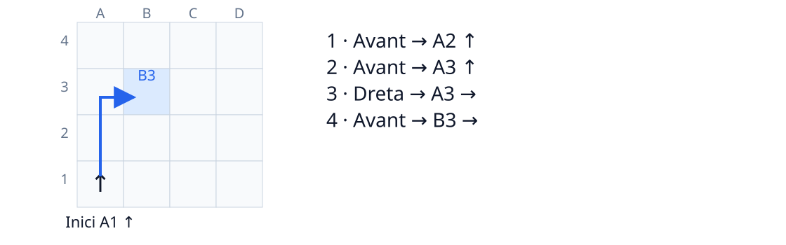

El recorregut arriba a B3 i acaba mirant a la dreta. **El tercer pas és un gir: no avança de casella.**

<!--
Bloc «Llegir i comprovar una ruta»: 00–20 min de sessió (20 minuts).
-->

---

## Què ens ha obligat a pensar?

<div class="flow"><span>Situar-nos</span><span class="arrow">→</span><span>Ordenar</span><span class="arrow">→</span><span>Anticipar</span><span class="arrow">→</span><span>Comprovar</span></div>

Hem necessitat un inici, una orientació i ordres compartides.

Una altra ruta també pot ser correcta: cal executar-la i justificar-la.

<!--
Bloc «Llegir i comprovar una ruta»: 00–20 min de sessió (20 minuts).
-->

---

<!-- _class: diagram -->

## Girar i avançar són accions diferents

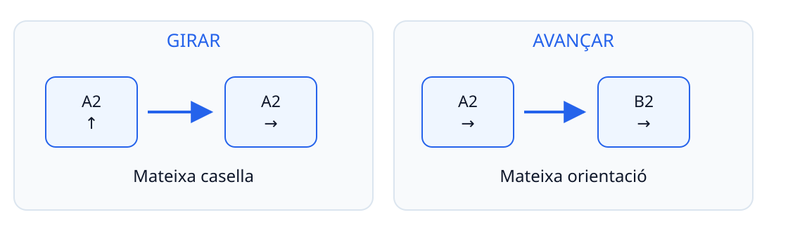

La dreta és la del personatge segons cap on mira. **Després d’un gir, continuem a la mateixa casella.**

<!--
Bloc «Llegir i comprovar una ruta»: 00–20 min de sessió (20 minuts).
-->

---

<!-- _class: activity -->

## Una ruta que no arriba al mateix lloc

**Avant → dreta → avant → avant**

Inici: A1 mirant amunt. Destí previst: B3.

Seguiu-la. On acaba? Quina ordre canviaríeu de lloc?

<!--
Bloc «Llegir i comprovar una ruta»: 00–20 min de sessió (20 minuts).
-->

---

<!-- _class: diagram -->

## Localitzem la diferència

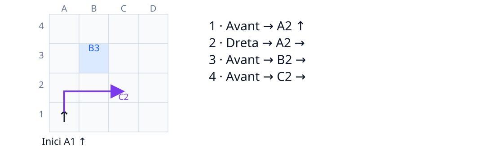

Acabem a **C2**, no a B3. Si movem el segon «avant» abans del gir, obtenim la ruta prevista.

<!--
Bloc «Llegir i comprovar una ruta»: 00–20 min de sessió (20 minuts).
-->

---

<!-- _class: section -->

## Identificar una repetició

<!--
Bloc «Identificar una repetició»: 20–35 min de sessió (15 minuts).

Aquest temps inclou explicacions, treball dels participants i posada en comú. Controleu el tancament del bloc sense avançar les solucions abans de la predicció.
-->

---

<!-- _class: activity -->

## Un patró que torna a començar

Pas · palmada · pas · palmada · pas · palmada.

Quin fragment es repeteix? Quantes vegades?

Acordeu la resposta amb una altra persona.

<!--
Bloc «Identificar una repetició»: 20–35 min de sessió (15 minuts).
-->

---

<!-- _class: diagram -->

## Un patró, tres repeticions

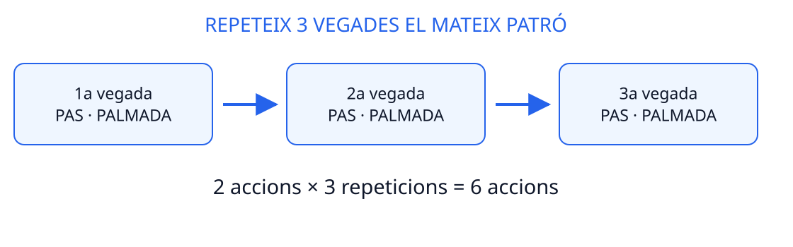

El patró té dues accions. Repetir-lo tres vegades dona **sis accions**, no tres.

<!--
Bloc «Identificar una repetició»: 20–35 min de sessió (15 minuts).
-->

---

## Representació i programació

Podem representar un bucle amb fletxes i una targeta «×3».

Per executar-lo, cal comprovar com s’expressa en el dispositiu disponible.

Una notació en paper ajuda a pensar; no garanteix que tots els robots tinguen els mateixos blocs.

<!--
Bloc «Identificar una repetició»: 20–35 min de sessió (15 minuts).
-->

---

<!-- _class: tangible -->

## Coding Set · La repetició amb peces

```coding-set
repeteix 4
endavant
dreta
fi
```

Dins del bucle hi ha **endavant · dreta**. El repetim quatre vegades. La dansa anterior repetia un altre patró tres vegades.

<!--
Bloc «Identificar una repetició»: 20–35 min de sessió (15 minuts).
-->

---

<!-- _class: activity -->

## Proveu una variació

Ara volem dues repeticions.

Quantes accions hi haurà?
Què canvia en la representació?
Què es manté?

Expliqueu la resposta abans de representar-la.

<!--
Bloc «Identificar una repetició»: 20–35 min de sessió (15 minuts).

Temps orientatiu de la dinàmica: 4 minuts.
-->

---

<!-- _class: diagram -->

## Què canvia quan repetim?

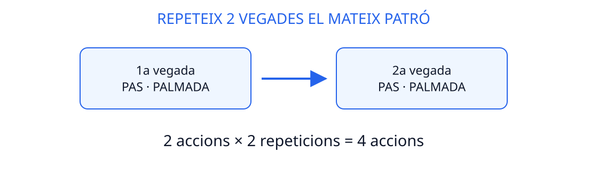

Amb **dues** repeticions, fem quatre accions. Es conserva el patró; canvia el nombre de vegades.

<!--
Bloc «Identificar una repetició»: 20–35 min de sessió (15 minuts).
-->

---

<!-- _class: section -->

## Un botó inicia una resposta

<!--
Bloc «Un botó inicia una resposta»: 35–55 min de sessió (20 minuts).

Aquest temps inclou explicacions, treball dels participants i posada en comú. Controleu el tancament del bloc sense avançar les solucions abans de la predicció.
-->

---

<!-- _class: visual -->

## Demostració · Una resposta al botó A

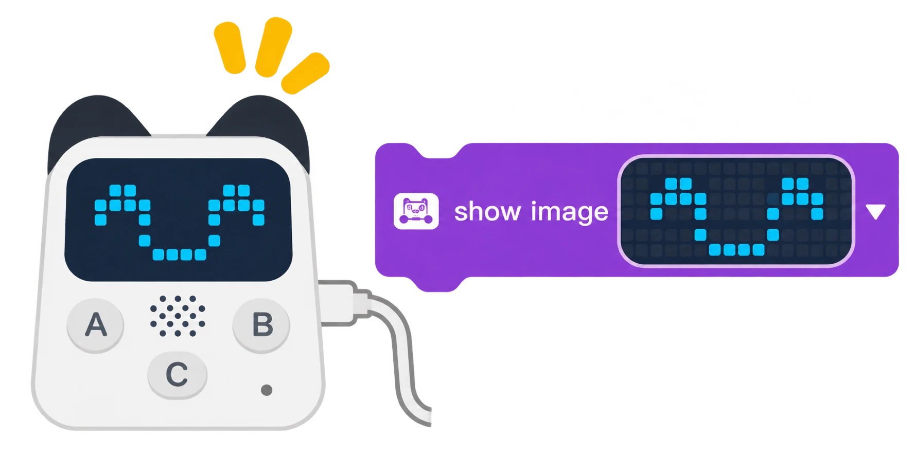

**Objectiu:** entendre què inicia el programa.

Primer llegim el programa. Després anticipem la pantalla.

Codey pot fer aquesta prova sense moure Rocky.

<!--
Bloc «Un botó inicia una resposta»: 35–55 min de sessió (20 minuts).
-->

---

## Codey · Preparar la prova

1. Obriu mBlock 5 i afegiu el dispositiu **Codey**.
2. Connecteu-lo amb un cable USB de dades i enceneu-lo.
3. Comproveu la connexió en mode **En viu**.
4. Prepareu el programa abans de prémer A.

<!--
Bloc «Un botó inicia una resposta»: 35–55 min de sessió (20 minuts).

Si no hi ha Codey, representeu la pantalla en paper o demaneu que anticipen oralment les respostes.
-->

---

<!-- _class: explanation -->

## Codey · En viu i càrrega no són iguals

<div class="compare"><div><h3>En viu</h3><p>Provem els canvis amb Codey connectat. Comprovem que mBlock indica connexió.</p></div><div><h3>Càrrega</h3><p>Transferim el programa al dispositiu perquè puga funcionar sense l’ordinador.</p></div></div>

Per començar, seguim la prova en viu del tutorial. Un cable de càrrega sense dades no permet aquesta connexió.

<!--
Bloc «Un botó inicia una resposta»: 35–55 min de sessió (20 minuts).
-->

---

<!-- _class: blocks -->

## Codey · Llegim el programa

```mblock
quan es prem el botó [A v]
mostra la imatge [cor v]
espera (1) segons
esborra la pantalla
```

**Què inicia la seqüència? Què ocorre durant l’espera?**

<!--
Bloc «Un botó inicia una resposta»: 35–55 min de sessió (20 minuts).
-->

---

<!-- _class: activity -->

## Codey · Predicció abans de provar

Quan premem A, què veurem…

- just després?
- mig segon després?
- dos segons després?

En parelles, acordeu les tres respostes.

<!--
Bloc «Un botó inicia una resposta»: 35–55 min de sessió (20 minuts).
-->

---

<!-- _class: diagram -->

## Codey · La seqüència en el temps

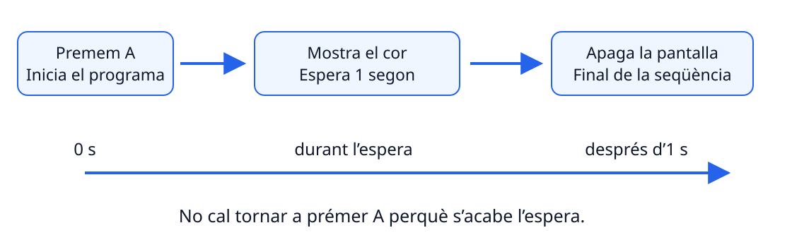

Suposem que només premem A una vegada. L’espera manté el cor abans d’apagar la pantalla.

<!--
Bloc «Un botó inicia una resposta»: 35–55 min de sessió (20 minuts).
-->

---

## Codey · Una modificació, una predicció

**Repte:** volem veure el cor durant tres segons.

Quin bloc canvia? Quins es conserven?

<!--
Bloc «Un botó inicia una resposta»: 35–55 min de sessió (20 minuts).

Solució per a la posada en comú: canvia l’espera d’1 a 3 segons. El botó i el dibuix continuen igual.

Pregunta docent: «Com ho sabies abans de provar?»

Deixeu que les parelles justifiquen el canvi abans de donar la resposta. El resultat es pot comprovar amb el diagrama temporal anterior.
-->

---

<!-- _class: diagram -->

## Un botó i un sensor aporten informació

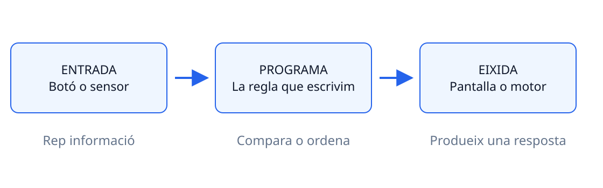

El programa el dissenyem nosaltres. Un botó activa un esdeveniment; un sensor aporta una lectura que podem comparar.

<!--
Bloc «Un botó inicia una resposta»: 35–55 min de sessió (20 minuts).
-->

---

<!-- _class: pause -->

## Pausa

En tornar, continuarem amb el bloc següent.

Deixeu anotada una pregunta que vulgueu recuperar.

<!--
Bloc «Pausa»: 55–60 min de sessió (5 minuts).

Temps orientatiu de la dinàmica: 5 minuts.

Respecteu els cinc minuts de pausa; recupereu una de les preguntes anotades en reprendre la sessió.
-->

---

<!-- _class: section -->

## De les dades a una decisió

<!--
Bloc «De les dades a una decisió»: 60–85 min de sessió (25 minuts).

Aquest temps inclou explicacions, treball dels participants i posada en comú. Controleu el tancament del bloc sense avançar les solucions abans de la predicció.
-->

---

<!-- _class: visual -->

## Demostració · Un fanalet amb micro:bit


**Pregunta:** com fem que una icona responga a la llum?

La matriu LED pot mostrar dibuixos i estimar la llum.

Primer observem lectures; després triem una condició.

<!--
Bloc «De les dades a una decisió»: 60–85 min de sessió (25 minuts).
-->

---

<!-- _class: visual -->

## micro:bit · Què mostrem i què llegim?


La matriu LED mostra imatges i pot estimar la llum.

A MakeCode, busquem la lectura a **Entrada**.

Una primera prova mostra el valor en prémer A.

<!--
Bloc «De les dades a una decisió»: 60–85 min de sessió (25 minuts).
-->

---

<!-- _class: activity -->

## Lectures per a una prova sense material

| Lloc | Prova 1 | Prova 2 | Prova 3 |
|---|---|---|---|
| A | 40 | 43 | 41 |
| B | 120 | 125 | 122 |

**Dades simulades; lectura relativa de 0 a 255.**
Quin lloc dona valors més alts? Què mantindríeu igual?

<!--
Bloc «De les dades a una decisió»: 60–85 min de sessió (25 minuts).
-->

---

<!-- _class: solution -->

## Quina conclusió podem justificar?

En aquestes proves, **B dona lectures més altes que A**.

Mantindríem la placa i l’orientació per comparar els llocs.

No podem concloure que B siga «tres vegades millor per a llegir».

<!--
Bloc «De les dades a una decisió»: 60–85 min de sessió (25 minuts).
-->

---

<!-- _class: diagram -->

## De la lectura a la resposta


En el fanalet: **llum → comparar amb el llindar → icona o pantalla neta**. La placa no decideix què volem dir amb la icona.

<!--
Bloc «De les dades a una decisió»: 60–85 min de sessió (25 minuts).
-->

---

<!-- _class: diagram -->

## La llum obri dues possibilitats

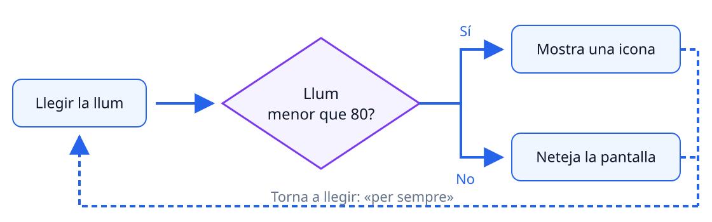

El programa segueix **una branca en cada comprovació**. 80 és un exemple: primer cal observar les lectures reals.

<!--
Bloc «De les dades a una decisió»: 60–85 min de sessió (25 minuts).
-->

---

<!-- _class: blocks -->

## micro:bit · El programa per blocs

```makecode
basic.forever(function () {
    if (input.lightLevel() < 80) {
        basic.showIcon(IconNames.SmallDiamond)
    } else {
        basic.clearScreen()
    }
})
```

El bloc «per sempre» torna a llegir i comparar la llum.

<!--
Bloc «De les dades a una decisió»: 60–85 min de sessió (25 minuts).
-->

---

<!-- _class: diagram -->

## El llindar també es comprova

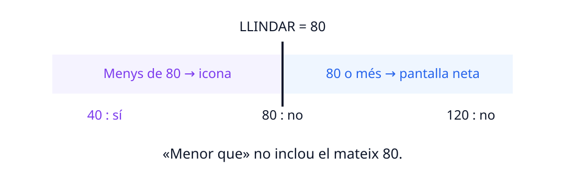

«Menor que 80» no inclou el 80. Comprovem un valor per davall, el límit i un valor per damunt.

<!--
Bloc «De les dades a una decisió»: 60–85 min de sessió (25 minuts).
-->

---

## Canviar el programa o canviar la prova?

Si no apareix la icona, observeu primer la lectura.

Després reviseu el llindar i el programa.

No canvieu llum, posició i llindar al mateix temps: no sabríem què explica la diferència.

<!--
Bloc «De les dades a una decisió»: 60–85 min de sessió (25 minuts).
-->

---

<!-- _class: explanation -->

## Una lectura inicial o una revisió contínua?

<div class="compare"><div><h3>Només en iniciar</h3><p>Llegim la llum una vegada. Si després canvia, el programa pot no actualitzar la resposta.</p></div><div><h3>Per sempre</h3><p>Tornem a llegir, comparar i respondre mentre el programa funciona.</p></div></div>

El fanalet necessita revisar la llum repetidament.

<!--
Bloc «De les dades a una decisió»: 60–85 min de sessió (25 minuts).
-->

---

<!-- _class: section -->

## Comparar amb un mecanisme

<!--
Bloc «Comparar amb un mecanisme»: 85–100 min de sessió (15 minuts).

Aquest temps inclou explicacions, treball dels participants i posada en comú. Controleu el tancament del bloc sense avançar les solucions abans de la predicció.
-->

---

<!-- _class: visual -->

## SPIKE · Una parada amb color

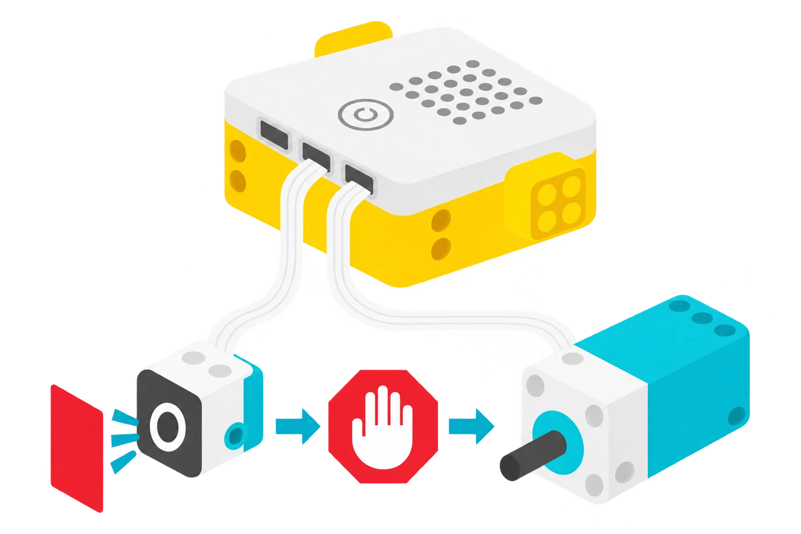

Motor al port A; sensor de color al C.

Eix lliure, sense accessoris, sobre una superfície estable.

Comprovem la lectura de les targetes abans de moure el motor.

<!--
Bloc «Comparar amb un mecanisme»: 85–100 min de sessió (15 minuts).
-->

---

<!-- _class: diagram -->

## SPIKE · Què connectem a cada port?


En aquesta prova, el motor va a **A** i el sensor de color a **C**. Si canviem el port físic, hem de revisar també el programa.

<!--
Bloc «Comparar amb un mecanisme»: 85–100 min de sessió (15 minuts).
-->

---

<!-- _class: blocks -->

## SPIKE · Llegim la seqüència

```spikeapp
quan comença el programa
activa el motor [A v] a velocitat baixa
espera fins que <color al port [C v] = [roig v] :: #047fdf> :: #ffab19
atura el motor [A v]
```

Targeta blanca al principi; després acostem la roja al sensor.

<!--
Bloc «Comparar amb un mecanisme»: 85–100 min de sessió (15 minuts).
-->

---

## SPIKE · Tres comprovacions

**Blanca:** el motor continua mentre espera el color.

**Roja:** el sensor la reconeix i el motor s’atura.

**Una altra targeta:** comprovem què llig el sensor.

Manteniu l’aturada accessible i les mans lluny de l’eix.

<!--
Bloc «Comparar amb un mecanisme»: 85–100 min de sessió (15 minuts).
-->

---

<!-- _class: explanation -->

## Si el motor no s’atura, per on comencem?

<div class="checks"><div><b>1 · Aturem</b><p>Utilitzem l’aturada accessible.</p></div><div><b>2 · Observem</b><p>Quin color indica l’app?</p></div><div><b>3 · Revisem</b><p>Port, distància i llum, una cosa cada vegada.</p></div></div>

No frenem l’eix amb els dits. Aturem abans de recol·locar peces o cables.

<!--
Bloc «Comparar amb un mecanisme»: 85–100 min de sessió (15 minuts).
-->

---

<!-- _class: section -->

## Explicar i transferir

<!--
Bloc «Explicar i transferir»: 100–120 min de sessió (20 minuts).

Aquest temps inclou explicacions, treball dels participants i posada en comú. Controleu el tancament del bloc sense avançar les solucions abans de la predicció.
-->

---

<!-- _class: diagram -->

## Com acompanyem una revisió?

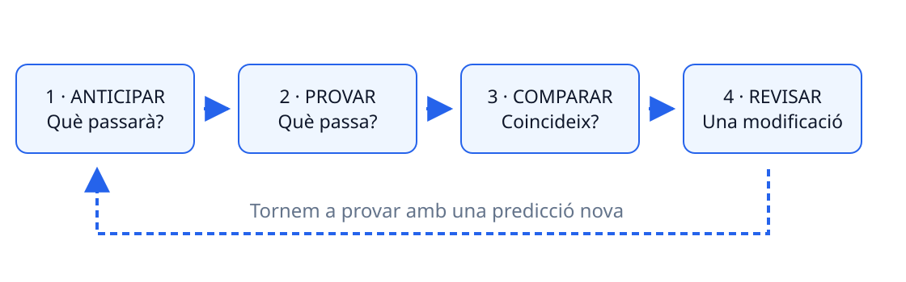

Preguntem què esperàvem i què ha passat. Després canviem **una sola cosa** i tornem a provar.

<!--
Bloc «Explicar i transferir»: 100–120 min de sessió (20 minuts).
-->

---

<!-- _class: activity -->

## La proposta que m’emporte

Completeu oralment o en paper:

**Amb el meu grup treballaria…**
**El repte seria…**
**La primera prova consistiria en…**
**Sabria que han aprés perquè…**

<!--
Bloc «Explicar i transferir»: 100–120 min de sessió (20 minuts).

Temps orientatiu de la dinàmica: 5 minuts.
-->

---

## Compartim una decisió

Expliqueu a una altra parella la proposta en un minut.

Qui escolta pregunta: **«Què farà l’alumnat per demostrar-ho?»**

Reviseu un element abans de donar-la per preparada.

<!--
Bloc «Explicar i transferir»: 100–120 min de sessió (20 minuts).
-->

---

## Abans de la primera prova a l’aula

Comproveu material, espai i alimentació.
Prepareu una alternativa en paper.
Reserveu temps per explicar una millora.

**Una primera experiència curta i comprensible és suficient per començar.**

<!--
Bloc «Explicar i transferir»: 100–120 min de sessió (20 minuts).
-->

---

<!-- _class: resources -->

## Les propostes de partida del web

[Tale-Bot i rutes](https://gerardfp.github.io/robotica200/robot/tale-bot/index.html) · [Coding Set](https://gerardfp.github.io/robotica200/robot/coding-set/index.html)

[Botons i pantalla de Codey](https://gerardfp.github.io/robotica200/tutorial/cr-primeres-passes/index.html)

[El fanalet de micro:bit](https://gerardfp.github.io/robotica200/tutorial/mb-fanalet-llum/index.html)

[Parada per color amb SPIKE](https://gerardfp.github.io/robotica200/tutorial/sp-motors-sensors/index.html)

Les demostracions simplifiquen aquests tutorials. Els noms dels blocs poden variar segons l’idioma de l’aplicació.

<!--
Aquests enllaços són per a consulta posterior. No cal obrir-los durant la sessió ni disposar de connexió per completar les activitats.
-->

---

## Recursos per continuar

**Tutorials del web:** preparar connexions, controls i primeres proves.

**Situacions d’aprenentatge:** context, seqüència i evidències per adaptar.

[Robòtica per a docents](https://gerardfp.github.io/robotica200/) · [Escola 4.0 · GVA](https://portal.edu.gva.es/escola40/va/inici/)

Les imatges reutilitzen il·lustracions del projecte.

<!--
Bloc «Explicar i transferir»: 100–120 min de sessió (20 minuts).
-->
