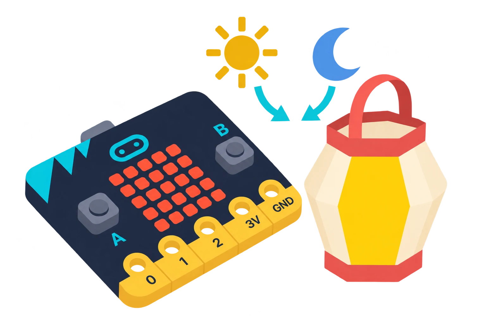
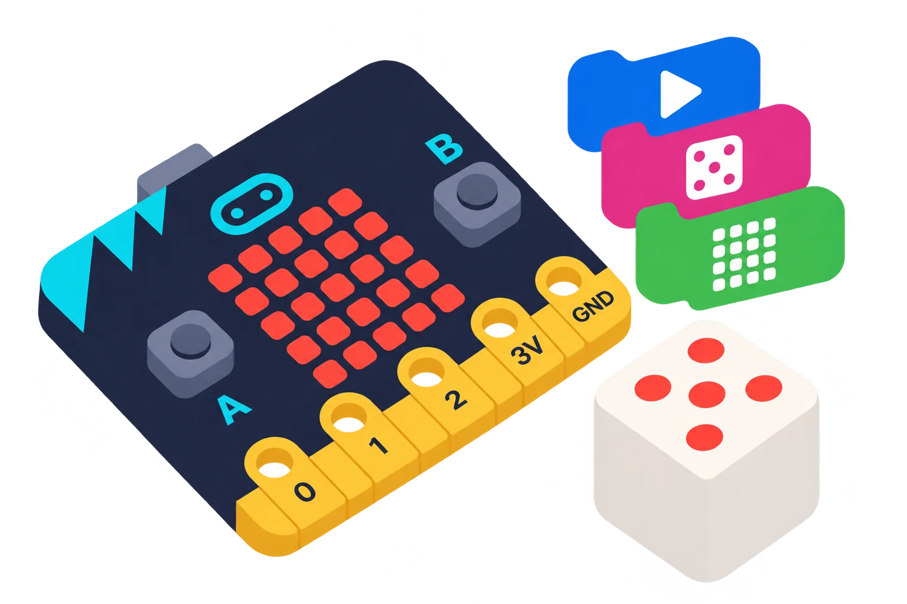
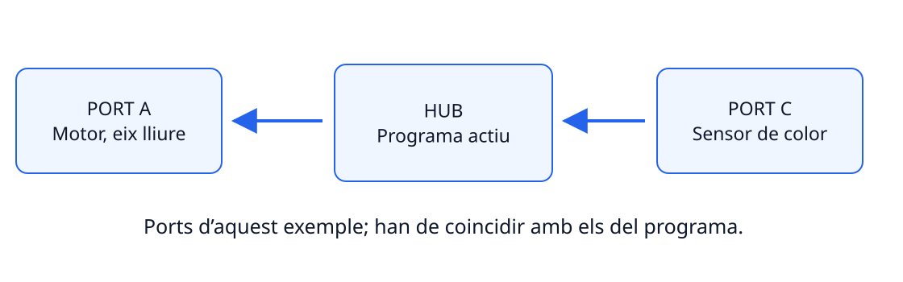

<!-- _class: cover -->

## Entendre com es programa

**Sessió 2 · Format de tres sessions · 2 hores**

Formació presencial per a docents de primària

Robòtica per a docents

<!--
Preparació: comproveu projector i navegació. Només està garantida la projecció; les activitats admeten resposta oral o en paper. Si hi ha dispositius, assageu abans les demostracions i substituïu les simulacions per proves curtes.

**Guió de conducció**

**Obertura suggerida**
«Aquesta és la sessió segona del format de tres sessions. Hui volem entendre seqüències, repeticions i respostes sense dominar un editor. No cal conéixer tots els dispositius per participar».

**Fil conductor**
El format concentra diferents models en una sessió. Useu un exemple per concepte i conserveu temps perquè les parelles expliquen què han entés.

**Preparació abans de projectar**
Obriu les diapositives i la vista del presentador, comproveu que es veuen les imatges i identifiqueu les activitats en parelles. Només tenim garantit projector o PDI. Si disposeu de robots, prepareu una demostració curta abans; no dediqueu l’obertura a una instal·lació improvisada.

**Què observar en començar**
Pregunteu si el grup recorda una idea de la sessió anterior o, en la primera, quina necessitat d’aula vol treballar. Ajusteu els aclariments a les respostes sense afegir més objectius.
-->

---

<!-- _class: section -->

## Llegir i comprovar una ruta

<!--
Bloc «Llegir i comprovar una ruta»: 00–20 min de sessió (20 minuts).

Aquest temps inclou explicacions, treball dels participants i posada en comú. Controleu el tancament del bloc sense avançar les solucions abans de la predicció.

**Guió de conducció**

**Objectiu d’aquest bloc**
Recuperar seqüència i orientació abans de parlar de blocs.

**Com conduir-lo**
Acordeu A1 ↑ i B3, deixeu escriure la ruta i compareu una versió que gira massa prompte. No passeu a les repeticions sense distingir gir i desplaçament.

**Resultat que convé recollir abans d’avançar**
Localitzar una causa concreta de la diferència entre predicció i resultat.

**Gestió del temps**
Useu la franja indicada al començament de la nota com a límit del bloc complet, no com a durada d’aquesta pantalla. Les aclaracions del guió són un banc de suport: seleccioneu-les segons les respostes del grup, sense llegir-les totes literalment.
-->

---

<!-- _class: diagram -->

## El repte de la biblioteca


**A1 ↑ → biblioteca B3.** Una ordre «avant» avança una casella; un gir canvia l’orientació sense moure la fitxa.

<!--
Bloc «Llegir i comprovar una ruta»: 00–20 min de sessió (20 minuts).

**Guió de conducció**

**Què explicar**

Expliqueu com es llig el mapa abans de demanar cap programa: les lletres identifiquen columnes i els nombres, files. A1 és baix a l’esquerra; B3 està una columna a la dreta i dues files més amunt. La fletxa inicial indica cap on mira la fitxa.

**Com mostrar-ho**

Assenyaleu A1, després B3 i finalment la fletxa ↑. Amb el dit, mostreu només un avançament d’A1 a A2. Acordeu dues regles: avançar mou una casella; girar canvia l’orientació sense canviar de casella. No traceu encara la ruta completa.

**Pregunta i resposta esperable**

«Si la fitxa està a A1 mirant amunt, on queda després d’un avant?» Resposta: A2, encara mirant amunt. «Un gir a la dreta l’envia a B1?» No: continua a A1, ara mirant a la dreta.

**Si apareix aquest dubte**

La dreta és la de la fitxa, no sempre la de qui mira la pantalla. Aquesta graella és un model: amb un robot real cal ajustar la mida de les caselles al seu desplaçament.

**Enllaç amb el pas següent**

Ara que compartim les regles, podem escriure ordres sense improvisar-ne el significat.
-->

---

<!-- _class: activity -->

## Escriviu una ruta

1. Acordeu les ordres per arribar a la biblioteca.
2. Una persona les escriu o les diu.
3. L’altra les executa amb el dit o mentalment.

Comproveu també **cap on mira al final**.

<!--
Bloc «Llegir i comprovar una ruta»: 00–20 min de sessió (20 minuts).

Temps orientatiu de la dinàmica: 3 minuts.

**Guió de conducció**

**Què explicar**

Formuleu la consigna completa: «Porteu la fitxa d’A1 a B3, començant cap amunt. Escriviu les ordres i indiqueu l’orientació final». Una persona dicta i l’altra executa exactament allò que escolta, sense completar ordres que falten.

**Com mostrar-ho**

Feu una primera passada per les parelles per comprovar que mantenen el mateix inici. Si treballen oralment, poden marcar els passos amb els dits. No corregiu la ruta mentre l’executen: deixeu que comparen el final amb la predicció.

**Pregunta i resposta esperable**

Una solució és avant, avant, dreta, avant. També hi ha altres rutes vàlides; no exigiu la més curta. Demaneu «on acabes i cap on mires?» per distingir posició i orientació.

**Si apareix aquest dubte**

Si una parella gira i avança en una sola ordre, torneu a les dues regles pactades. Si corregeix sobre la marxa, proposeu repetir la seqüència escrita des del principi.

**Enllaç amb el pas següent**

En acabar, conserveu almenys una proposta per llegir-la ordre a ordre a la transparència següent.
-->

---

<!-- _class: solution -->

## Una solució, ordre a ordre

| Ordre | Casella | Orientació |
|---|---|---|
| Inici | A1 | Amunt |
| Avant | A2 | Amunt |
| Avant | A3 | Amunt |
| Dreta | A3 | Dreta |
| Avant | B3 | Dreta |

<!--
Bloc «Llegir i comprovar una ruta»: 00–20 min de sessió (20 minuts).

**Guió de conducció**

**Què explicar**

Llegiu cada fila com una foto de l’estat de la fitxa després d’una ordre. Comencem a A1 ↑; el primer avant porta a A2 ↑ i el segon a A3 ↑. El gir conserva A3 i canvia ↑ per →. L’últim avant porta a B3 →.

**Com mostrar-ho**

Tapeu amb la mà o assenyaleu només la fila actual. Abans de passar a la següent, deixeu que algú anticipe què canviarà: la casella, l’orientació o totes dues. La taula no és un registre de botons premuts simultàniament.

**Pregunta i resposta esperable**

«Per què A3 apareix dues vegades?» Perquè entre aquestes files hem girat, però no ens hem desplaçat. «Quantes ordres de moviment hem escrit?» Quatre; tres avançaments i un gir.

**Si apareix aquest dubte**

Arribar a B3 no garanteix haver entés la ruta: algú pot haver-la endevinada. La justificació de les files ens permet comprovar la comprensió.

**Enllaç amb el pas següent**

Mostreu després el mateix procés al mapa: canvia la representació, no el programa.
-->

---

<!-- _class: diagram -->

## La solució, vista sobre el mapa


El recorregut arriba a B3 i acaba mirant a la dreta. **El tercer pas és un gir: no avança de casella.**

<!--
Bloc «Llegir i comprovar una ruta»: 00–20 min de sessió (20 minuts).

**Guió de conducció**

**Què explicar**

«La taula anterior i aquest dibuix expliquen la mateixa seqüència». El traç blau resumeix els desplaçaments; la llista de la dreta conserva les quatre ordres. El gir no crea una casella nova, per això no apareix com un tram de recorregut.

**Com mostrar-ho**

Seguiu amb el dit A1 → A2 → A3, atureu-vos per representar el gir i continueu a B3. Acabeu orientant el dit a la dreta. Relacioneu cada parada amb el número d’ordre de la llista.

**Pregunta i resposta esperable**

«Podríem reconstruir tot el programa mirant només la línia blava?» Caldria conéixer també inici, orientació i significat de les ordres. El dibuix del camí, tot sol, no diu tots els girs.

**Si apareix aquest dubte**

No confongueu la fletxa del traç, que indica el sentit del recorregut, amb una ordre independent afegida al programa. Hi ha les quatre ordres de la llista.

**Enllaç amb el pas següent**

Feu explícit que hem passat de representar un camí a comunicar instruccions comprovables.
-->

---

## Què ens ha obligat a pensar?

<div class="flow"><span>Situar-nos</span><span class="arrow">→</span><span>Ordenar</span><span class="arrow">→</span><span>Anticipar</span><span class="arrow">→</span><span>Comprovar</span></div>

Hem necessitat un inici, una orientació i ordres compartides.

Una altra ruta també pot ser correcta: cal executar-la i justificar-la.

<!--
Bloc «Llegir i comprovar una ruta»: 00–20 min de sessió (20 minuts).

**Guió de conducció**

**Què explicar**

Poseu nom al procés viscut: ens hem situat en un mapa, hem ordenat accions, hem imaginat el resultat i l’hem contrastat. Això és el nucli que ens interessa traslladar a l’aula; prémer botons és només una manera d’executar-lo.

**Com mostrar-ho**

Recorreu el diagrama d’esquerra a dreta. Per a cada etapa, recupereu una acció real del grup: acordar A1 ↑, escriure les ordres, dir B3 → abans de moure i comprovar el final.

**Pregunta i resposta esperable**

«En quin moment hem pensat abans d’actuar?» Quan hem anticipat el resultat. «Si una ruta diferent també funciona, com ho sabem?» Executant-la amb les mateixes regles i explicant el final.

**Si apareix aquest dubte**

No convertiu aquestes quatre paraules en un nou vocabulari per memoritzar. Si el grup pot explicar què ha fet, ja tenim una base per introduir termes més específics.

**Enllaç amb el pas següent**

Deteniu-vos en la confusió que sol donar més informació: girar i avançar no són el mateix.
-->

---

<!-- _class: diagram -->

## Girar i avançar són accions diferents


La dreta és la del personatge segons cap on mira. **Després d’un gir, continuem a la mateixa casella.**

<!--
Bloc «Llegir i comprovar una ruta»: 00–20 min de sessió (20 minuts).

**Guió de conducció**

**Què explicar**

Expliqueu els dos panells per separat. A l’esquerra, A2 es repeteix: la fitxa gira d’amunt a dreta sense deixar la casella. A la dreta, A2 canvia a B2 perquè la fitxa, que ja mira a la dreta, avança una casella.

**Com mostrar-ho**

Feu de fitxa amb una mà: un gir és canviar cap on apunta el dit; avançar és desplaçar la mà mantenint aquella direcció. Aquesta representació es pot fer asseguts i sense material.

**Pregunta i resposta esperable**

«Si ara mirem avall, on apunta un gir a la dreta?» Cap a l’esquerra de la pantalla. Demaneu que es posen en el lloc del personatge abans de respondre.

**Si apareix aquest dubte**

Un avançament no significa sempre pujar en el dibuix. Significa moure’s en la direcció que té la fitxa. Eviteu dir simplement «dreta de la pantalla» com si fora una regla del robot.

**Enllaç amb el pas següent**

Useu aquesta distinció per seguir una ruta que gira abans d’hora i explicar on es desvia.
-->

---

<!-- _class: activity -->

## Una ruta que no arriba al mateix lloc

**Avant → dreta → avant → avant**

Inici: A1 mirant amunt. Destí previst: B3.

Seguiu-la. On acaba? Quina ordre canviaríeu de lloc?

<!--
Bloc «Llegir i comprovar una ruta»: 00–20 min de sessió (20 minuts).

**Guió de conducció**

**Què explicar**

Feu servir exactament l’inici A1 ↑ i el destí B3. Llegim avant, dreta, avant, avant. No dieu encara que el gir és massa prompte: la tasca és reconstruir on acaba aquesta versió.

**Com mostrar-ho**

Feu una pausa després de cada ordre i conserveu la posició i orientació. Si una persona es perd, torneu a A1 en lloc de continuar des d’un estat dubtós.

**Pregunta i resposta esperable**

Esperem A2 ↑ després del primer avant, A2 → després del gir, B2 → i finalment C2 →. Pregunteu en quin punt deixa de coincidir amb la ruta prevista.

**Si apareix aquest dubte**

No és una prova d’atenció ràpida. El valor és justificar el canvi. Arribar a C2 també és executar correctament aquest programa, encara que no resolga el repte B3.

**Enllaç amb el pas següent**

Mostreu el mapa de l’error i identifiqueu la primera decisió que convé revisar.
-->

---

<!-- _class: diagram -->

## Localitzem la diferència


Acabem a **C2**, no a B3. Si movem el segon «avant» abans del gir, obtenim la ruta prevista.

<!--
Bloc «Llegir i comprovar una ruta»: 00–20 min de sessió (20 minuts).

**Guió de conducció**

**Què explicar**

La línia acaba a C2 perquè hem girat quan encara faltava pujar una fila. El dispositiu hauria executat les ordres que li hem donat; la discrepància és entre el nostre programa i la destinació que volíem.

**Com mostrar-ho**

Assenyaleu A2, lloc del gir, i compareu-lo amb A3, on giràvem en la solució anterior. Moveu verbalment un avant perquè quede abans de dreta i torneu a seguir la seqüència.

**Pregunta i resposta esperable**

«Hem necessitat afegir una ordre?» No necessàriament: reordenar les quatre ordres dona avant, avant, dreta, avant. «Quina causa explica la diferència?» El moment en què hem canviat d’orientació.

**Si apareix aquest dubte**

Eviteu dir simplement «el robot s’ha equivocat». Aquesta frase amaga la causa que volem investigar. També convé comprovar que hem conservat l’inici abans d’atribuir-ho al programa.

**Enllaç amb el pas següent**

Amplieu la idea: dues seqüències diferents poden acabar al mateix lloc i orientar-se de manera diferent.
-->

---

<!-- _class: section -->

## Identificar una repetició

<!--
Bloc «Identificar una repetició»: 20–35 min de sessió (15 minuts).

Aquest temps inclou explicacions, treball dels participants i posada en comú. Controleu el tancament del bloc sense avançar les solucions abans de la predicció.

**Guió de conducció**

**Objectiu d’aquest bloc**
Separar el patró del nombre de vegades.

**Com conduir-lo**
Representeu pas i palmada, compteu tres repeticions i després dues. Compareu la notació en paper amb les peces del Coding Set, sense atribuir les mateixes funcions a tots els robots.

**Resultat que convé recollir abans d’avançar**
Explicar per què dues accions repetides tres vegades fan sis accions.

**Gestió del temps**
Useu la franja indicada al començament de la nota com a límit del bloc complet, no com a durada d’aquesta pantalla. Les aclaracions del guió són un banc de suport: seleccioneu-les segons les respostes del grup, sense llegir-les totes literalment.
-->

---

<!-- _class: activity -->

## Un patró que torna a començar

Pas · palmada · pas · palmada · pas · palmada.

Quin fragment es repeteix? Quantes vegades?

Acordeu la resposta amb una altra persona.

<!--
Bloc «Identificar una repetició»: 20–35 min de sessió (15 minuts).

**Guió de conducció**

**Què explicar**

Feu llegir pas, palmada, pas, palmada, pas, palmada. Busquem el fragment que torna a aparéixer sencer: pas i palmada, no només la palmada.

**Com mostrar-ho**

Marqueu tres parelles d’accions amb els dits o amb separadors al paper. Es pot representar amb dos gestos de mans si moure’s no és adequat al grup.

**Pregunta i resposta esperable**

«Quantes accions té el fragment?» Dues. «Quantes vegades apareix?» Tres. «Quantes accions hi ha en total?» Sis.

**Si apareix aquest dubte**

Comptar repeticions i comptar accions són preguntes diferents. Si algú diu que es repeteix sis vegades, demaneu quin fragment concret considera que es repeteix.

**Enllaç amb el pas següent**

Mostreu la notació que agrupa les accions dins d’una repetició.
-->

---

<!-- _class: diagram -->

## Un patró, tres repeticions


El patró té dues accions. Repetir-lo tres vegades dona **sis accions**, no tres.

<!--
Bloc «Identificar una repetició»: 20–35 min de sessió (15 minuts).

**Guió de conducció**

**Què explicar**

Expliqueu que les tres caixes són tres execucions del mateix patró. No són tres programes diferents: a cada vegada fem pas i després palmada. La frase inferior relaciona dues accions per tres vegades amb sis accions totals.

**Com mostrar-ho**

Recorreu una caixa i representeu-ne les dues accions abans de passar a la següent. Després feu llegir la instrucció compacta «repeteix tres vegades pas i palmada».

**Pregunta i resposta esperable**

«Podríem canviar el nombre de vegades sense canviar el patró?» Sí. «Si repetim dues vegades, quantes accions farem?» Quatre; ho comprovarem després.

**Si apareix aquest dubte**

No presenteu el bucle només com una manera d’escriure menys. Agrupar un patró ajuda també a entendre, revisar i modificar el programa.

**Enllaç amb el pas següent**

Distingiu aquest model en paper de les peces o blocs concrets que permeten executar-lo.
-->

---

## Representació i programació

Podem representar un bucle amb fletxes i una targeta «×3».

Per executar-lo, cal comprovar com s’expressa en el dispositiu disponible.

Una notació en paper ajuda a pensar; no garanteix que tots els robots tinguen els mateixos blocs.

<!--
Bloc «Identificar una repetició»: 20–35 min de sessió (15 minuts).

**Guió de conducció**

**Què explicar**

Una targeta amb «×3» i dues fletxes és una manera de representar el pensament, però no implica que qualsevol robot entenga aquella notació. Per executar-la hem de traduir-la a les funcions del dispositiu disponible.

**Com mostrar-ho**

Compareu una instrucció oral, una representació en paper i un programa de peces: les tres poden expressar la mateixa repetició amb símbols diferents.

**Pregunta i resposta esperable**

«Si dibuixem un bucle al costat de Tale-Bot, el robot el llig?» No per aquest fet. «Què cal revisar abans d’executar amb Coding Set?» Les peces compatibles i com es delimita el fragment repetit.

**Si apareix aquest dubte**

No traslladeu automàticament una estructura de MakeCode o mBlock als botons d’un altre kit. La idea de repetir és comuna; les possibilitats i la manera de programar-la poden ser diferents.

**Enllaç amb el pas següent**

Llegiu ara un bucle tangible concret del Coding Set.
-->

---

<!-- _class: tangible -->

## Coding Set · La repetició amb peces

```coding-set
repeteix 4
endavant
dreta
fi
```

Dins del bucle hi ha **endavant · dreta**. El repetim quatre vegades. La dansa anterior repetia un altre patró tres vegades.

<!--
Bloc «Identificar una repetició»: 20–35 min de sessió (15 minuts).

**Guió de conducció**

**Què explicar**

Assenyaleu la peça d’inici del bucle amb el nombre 4, les peces endavant i dreta que queden dins i la peça que el tanca. El fragment que es repeteix és endavant i després gir a la dreta.

**Com mostrar-ho**

Feu una lectura expandida d’una vegada i demaneu una segona. Cal arribar a quatre parelles d’accions: vuit ordres dins de les repeticions. El marcador de repetició no és una ordre d’avançar quatre caselles.

**Pregunta i resposta esperable**

«Què compta el 4?» Les vegades que s’executa tot el fragment delimitat. «És el mateix que la dansa anterior?» No: allí el patró era pas i palmada, repetit tres vegades.

**Si apareix aquest dubte**

La representació mostra un programa de peces, no garanteix un recorregut físic concret si no hem preparat el model i la superfície. Comproveu el material del kit abans de demostrar-lo.

**Enllaç amb el pas següent**

Torneu al model senzill per anticipar l’efecte de canviar el nombre de repeticions.
-->

---

<!-- _class: activity -->

## Proveu una variació

Ara volem dues repeticions.

Quantes accions hi haurà?
Què canvia en la representació?
Què es manté?

Expliqueu la resposta abans de representar-la.

<!--
Bloc «Identificar una repetició»: 20–35 min de sessió (15 minuts).

Temps orientatiu de la dinàmica: 4 minuts.

**Guió de conducció**

**Què explicar**

Manteniu el patró pas i palmada, però proposeu repetir-lo dues vegades. Demaneu predir abans de representar-lo. Una persona compta les repeticions i l’altra les accions, i després comparen.

**Com mostrar-ho**

Podeu dir «primera vegada: pas, palmada; segona vegada: pas, palmada». Marqueu el final: no afegim automàticament una tercera vegada perquè era la versió anterior.

**Pregunta i resposta esperable**

Esperem quatre accions totals. El patró no ha canviat; només el nombre de repeticions. La justificació ha d’identificar aquestes dues parts.

**Si apareix aquest dubte**

Si responen dues accions, feu distingir una execució del patró de dues execucions. Si responen sis, comproveu que han substituït el nombre inicial.

**Enllaç amb el pas següent**

Mostreu el diagrama de dues repeticions per contrastar les respostes.
-->

---

<!-- _class: diagram -->

## Què canvia quan repetim?


Amb **dues** repeticions, fem quatre accions. Es conserva el patró; canvia el nombre de vegades.

<!--
Bloc «Identificar una repetició»: 20–35 min de sessió (15 minuts).

**Guió de conducció**

**Què explicar**

El diagrama conserva pas i palmada dins de cada caixa, però ara només hi ha dues caixes. Aquesta comparació mostra una modificació controlada: el contingut del patró és el mateix i la quantitat de vegades és diferent.

**Com mostrar-ho**

Recupereu les prediccions anteriors i feu correspondre cada gest amb una acció. Escriviu, si cal, dues accions per dues vegades igual a quatre.

**Pregunta i resposta esperable**

«Què hauríem de canviar per obtenir una altra dansa sense canviar la durada en nombre d’accions?» Podríem canviar una acció del patró i mantindre dues repeticions; això seria una modificació diferent.

**Si apareix aquest dubte**

No barregeu totes les variacions en la primera prova. Convindrà comparar versions canviant una cosa cada vegada perquè la causa siga explicable.

**Enllaç amb el pas següent**

Passeu de les seqüències preparades a una resposta iniciada per un botó.
-->

---

<!-- _class: section -->

## Un botó inicia una resposta

<!--
Bloc «Un botó inicia una resposta»: 35–55 min de sessió (20 minuts).

Aquest temps inclou explicacions, treball dels participants i posada en comú. Controleu el tancament del bloc sense avançar les solucions abans de la predicció.

**Guió de conducció**

**Objectiu d’aquest bloc**
Entendre una pila de blocs iniciada per un esdeveniment.

**Com conduir-lo**
Prepareu conceptualment Codey, distingiu en viu i càrrega, llegiu el programa i feu predir la pantalla en tres instants. Doneu la resposta després que les parelles l’hagen justificada.

**Resultat que convé recollir abans d’avançar**
Relacionar botó, seqüència i durada de la resposta.

**Gestió del temps**
Useu la franja indicada al començament de la nota com a límit del bloc complet, no com a durada d’aquesta pantalla. Les aclaracions del guió són un banc de suport: seleccioneu-les segons les respostes del grup, sense llegir-les totes literalment.
-->

---

<!-- _class: visual -->

## Demostració · Una resposta al botó A


**Objectiu:** entendre què inicia el programa.

Primer llegim el programa. Després anticipem la pantalla.

Codey pot fer aquesta prova sense moure Rocky.

<!--
Bloc «Un botó inicia una resposta»: 35–55 min de sessió (20 minuts).

**Guió de conducció**

**Què explicar**

«Ara el programa no indica una ruta: associa un fet concret a una resposta. El fet és prémer A i la resposta és mostrar una imatge». Codey és la part amb pantalla i botons; el moviment de la base no intervé en aquesta prova.

**Com mostrar-ho**

Assenyaleu el botó A en la il·lustració i després la pantalla. Si no hi ha dispositiu, feu de pantalla amb un cor dibuixat que puguem mostrar i tapar. No executeu encara la seqüència: primer la llegirem.

**Pregunta i resposta esperable**

«Què hauria d’ocórrer perquè comence?» Prémer A. Encendre el dispositiu i prémer A són fets diferents en aquest exemple.

**Si apareix aquest dubte**

Una cara dibuixada és una resposta programada. No s’està llegint una emoció de cap persona ni detectant si algú està content.

**Enllaç amb el pas següent**

Mostreu els blocs per explicar com s’ha construït aquesta relació.
-->

---

## Codey · Preparar la prova

1. Obriu mBlock 5 i afegiu el dispositiu **Codey**.
2. Connecteu-lo amb un cable USB de dades i enceneu-lo.
3. Comproveu la connexió en mode **En viu**.
4. Prepareu el programa abans de prémer A.

<!--
Bloc «Un botó inicia una resposta»: 35–55 min de sessió (20 minuts).

Si no hi ha Codey, representeu la pantalla en paper o demaneu que anticipen oralment les respostes.

**Guió de conducció**

**Què explicar**

Expliqueu la preparació com una comprovació prèvia, no com una navegació improvisada per menús. Cal seleccionar el dispositiu Codey, connectar-lo amb un cable USB de dades i comprovar que mBlock 5 indica connexió abans d’executar.

**Com mostrar-ho**

Si feu la demostració física, tingueu el projecte obert i assajat. Manteniu el robot quiet; per a pantalla i botons no cal moure la base. Sense material, feu que el grup represente la resposta en paper.

**Pregunta i resposta esperable**

«Si el cable carrega però no connecta, què revisaríem?» Que siga de dades, el dispositiu seleccionat i l’estat de connexió. No sabem que el programa està malament només perquè no hi ha resposta.

**Si apareix aquest dubte**

Els passos exactes depenen de la instal·lació i els permisos de l’equip. Si hi ha un problema tècnic no previst, conserveu el repte amb la simulació i anoteu la incidència.

**Enllaç amb el pas següent**

Distingiu mode en viu i transferència del programa abans de llegir els blocs.
-->

---

<!-- _class: explanation -->

## Codey · En viu i càrrega no són iguals

<div class="compare"><div><h3>En viu</h3><p>Provem els canvis amb Codey connectat. Comprovem que mBlock indica connexió.</p></div><div><h3>Càrrega</h3><p>Transferim el programa al dispositiu perquè puga funcionar sense l’ordinador.</p></div></div>

Per començar, seguim la prova en viu del tutorial. Un cable de càrrega sense dades no permet aquesta connexió.

<!--
Bloc «Un botó inicia una resposta»: 35–55 min de sessió (20 minuts).

**Guió de conducció**

**Què explicar**

En viu, l’ordinador manté la comunicació amb Codey per provar les ordres. En mode de càrrega, transferim el programa perquè puga executar-se al dispositiu segons les condicions d’aquell programa. Són dues maneres de treballar, no dos cables diferents.

**Com mostrar-ho**

Compareu la situació «canvie una imatge i la prove amb el dispositiu connectat» amb «vull desconnectar l’ordinador i conservar el programa carregat». Per a la primera demostració seguim el mode en viu del tutorial.

**Pregunta i resposta esperable**

«Si desconnectem el cable, tot el que havíem provat en viu queda necessàriament carregat?» No. Cal haver transferit el programa per al funcionament autònom.

**Si apareix aquest dubte**

Eviteu resoldre problemes canviant de mode sense saber què esperàvem. Primer confirmeu la connexió i el mode acordat per a la prova.

**Enllaç amb el pas següent**

La pila següent ens permet centrar-nos en la lògica, amb independència de la preparació física.
-->

---

<!-- _class: blocks -->

## Codey · Llegim el programa

```mblock
quan es prem el botó [A v]
mostra la imatge [cor v]
espera (1) segons
esborra la pantalla
```

**Què inicia la seqüència? Què ocorre durant l’espera?**

<!--
Bloc «Un botó inicia una resposta»: 35–55 min de sessió (20 minuts).

**Guió de conducció**

**Què explicar**

Llegiu de dalt a baix: quan es prem A, mostra un cor, espera un segon i esborra la pantalla. El primer bloc indica quan s’inicia la pila; els altres indiquen què passa i en quin ordre. No cal executar cada bloc amb una pulsació nova.

**Com mostrar-ho**

Assenyaleu el bloc inicial i després recorreu la pila amb el dit. En arribar a espera, manteniu visible el cor imaginari; no l’amagueu fins a esborra. Expliqueu un segon com a durada de la imatge en aquesta seqüència.

**Pregunta i resposta esperable**

«Durant l’espera es veu el cor o la pantalla està buida?» Es veu el cor, perquè encara no hem arribat a l’ordre d’esborrar. «Cal prémer A per a cada bloc?» No.

**Si apareix aquest dubte**

La lectura d’esquerra a dreta d’una frase no substitueix l’ordre vertical de la pila. Els noms exactes poden variar en mBlock, però la relació entre inici i accions és la mateixa.

**Enllaç amb el pas següent**

Demaneu ara prediccions en diferents instants abans de mostrar la comprovació temporal.
-->

---

<!-- _class: activity -->

## Codey · Predicció abans de provar

Quan premem A, què veurem…

- just després?
- mig segon després?
- dos segons després?

En parelles, acordeu les tres respostes.

<!--
Bloc «Un botó inicia una resposta»: 35–55 min de sessió (20 minuts).

**Guió de conducció**

**Què explicar**

Preciseu dues condicions: premem A una sola vegada i no hi ha altres programes modificant la pantalla. Demaneu tres respostes, una per a cada instant, amb el motiu. La meta és seguir la seqüència mentalment, no endevinar una animació.

**Com mostrar-ho**

Doneu un breu temps individual i després feu comparar la parella. Podeu marcar el temps dient «premem A ara» i comptant un segon; eviteu que aquesta teatralització substituïsca l’explicació dels blocs.

**Pregunta i resposta esperable**

Esperem cor just després de prémer i mig segon després; pantalla apagada dos segons després. La justificació és que l’espera manté el dibuix durant un segon i després s’executa esborra.

**Si apareix aquest dubte**

Si algú pensa que esperar significa deixar la pantalla buida, demaneu en quin bloc s’ha donat l’ordre d’esborrar. No avancen la resposta els qui ja coneixen el robot.

**Enllaç amb el pas següent**

Useu el diagrama temporal per contrastar les tres prediccions, també les que no coincideixen.
-->

---

<!-- _class: diagram -->

## Codey · La seqüència en el temps


Suposem que només premem A una vegada. L’espera manté el cor abans d’apagar la pantalla.

<!--
Bloc «Un botó inicia una resposta»: 35–55 min de sessió (20 minuts).

**Guió de conducció**

**Què explicar**

Expliqueu que la fila superior mostra accions i la línia inferior ajuda a situar-les en el temps. Prémer A inicia el programa. Mostrar el cor ocorre abans de l’espera; després d’un segon, la pantalla es neteja i aquesta pila acaba.

**Com mostrar-ho**

Recorreu la línia del temps i representeu el cor amb la mà durant l’interval central. Compareu amb les tres respostes de la parella. Aquesta és una representació conceptual, no una mesura precisa del temps d’arrencada del dispositiu.

**Pregunta i resposta esperable**

«Si ja hem premut A, què fa que s’acabe l’espera?» El pas del temps previst al programa; no una altra pulsació. «Què queda després?» La pantalla neta, si no s’executa cap altra acció.

**Si apareix aquest dubte**

El dibuix del cor no desapareix simplement perquè deixem de prémer A. Desapareix per una ordre posterior. Aquest detall ajuda a distingir un programa d’un comandament mantingut.

**Enllaç amb el pas següent**

Plantegeu una modificació mínima: augmentar quant de temps veiem el cor.
-->

---

## Codey · Una modificació, una predicció

**Repte:** volem veure el cor durant tres segons.

Quin bloc canvia? Quins es conserven?

<!--
Bloc «Un botó inicia una resposta»: 35–55 min de sessió (20 minuts).

Solució per a la posada en comú: canvia l’espera d’1 a 3 segons. El botó i el dibuix continuen igual.

Pregunta docent: «Com ho sabies abans de provar?»

Deixeu que les parelles justifiquen el canvi abans de donar la resposta. El resultat es pot comprovar amb el diagrama temporal anterior.

**Guió de conducció**

**Què explicar**

«Volem mantindre exactament el mateix comportament, però veure el cor durant tres segons». Feu que identifiquen què és constant: el botó A, la imatge i l’ordre d’esborrar. Només canvia la durada de l’espera.

**Com mostrar-ho**

Torneu a la pila anterior si cal i demaneu que assenyalen un únic bloc. No proposeu afegir tres cors o prémer el botó tres vegades: aquestes opcions introdueixen altres accions.

**Pregunta i resposta esperable**

La resposta esperada és canviar espera 1 segon per espera 3 segons. Pregunteu «com ho sabies abans de provar?» i accepteu una justificació que relacione l’interval amb la pantalla visible.

**Si apareix aquest dubte**

Si proposen repetir tot el programa, compareu: esborrar i tornar a mostrar no és necessàriament mantindre la mateixa imatge de manera contínua. Canviar una variable ens permet predir millor l’efecte.

**Enllaç amb el pas següent**

Feu el pont amb els sensors: el botó és una entrada que hem accionat nosaltres; altres entrades aporten lectures.
-->

---

<!-- _class: diagram -->

## Un botó i un sensor aporten informació


El programa el dissenyem nosaltres. Un botó activa un esdeveniment; un sensor aporta una lectura que podem comparar.

<!--
Bloc «Un botó inicia una resposta»: 35–55 min de sessió (20 minuts).

**Guió de conducció**

**Què explicar**

Expliqueu les tres caixes amb verbs: una entrada aporta informació; el programa aplica les ordres o regles que hem escrit; una eixida produeix una resposta observable. Eixida no significa una porta física: pot ser la pantalla, el so o un motor.

**Com mostrar-ho**

Llegiu primer l’exemple del botó: A premut → executar la pila → mostrar el cor. Després canvieu només l’entrada: lectura de llum → comparar amb un valor → mostrar una icona o netejar la pantalla.

**Pregunta i resposta esperable**

«La pantalla és el sensor de la nostra intenció?» No. «Qui ha triat què vol dir el cor?» La persona que programa. El dispositiu executa aquella relació.

**Si apareix aquest dubte**

Botó i sensor no funcionen exactament igual en tots els programes: un esdeveniment de botó inicia una seqüència, mentre que una lectura es pot consultar una vegada o repetidament.

**Enllaç amb el pas següent**

Introduïu el fanalet com un exemple de resposta a una lectura que pot anar canviant.
-->

---

<!-- _class: pause -->

## Pausa

En tornar, continuarem amb el bloc següent.

Deixeu anotada una pregunta que vulgueu recuperar.

<!--
Bloc «Pausa»: 55–60 min de sessió (5 minuts).

Temps orientatiu de la dinàmica: 5 minuts.

Respecteu els cinc minuts de pausa; recupereu una de les preguntes anotades en reprendre la sessió.

**Guió de conducció**

Conducció de la pausa
Doneu un punt clar de retorn i conserveu les preguntes pendents. Podeu demanar que cada parella trie quin dubte voldria recuperar després, sense convertir la pausa en una nova tasca obligatòria.

Abans de reprendre
Recordeu en una frase què ja hem comprovat i quin canvi introduirem ara. Si hi ha hagut una incidència tècnica, manteniu l’alternativa en paper per preservar el temps d’aprenentatge. No intenteu recuperar tota la pausa accelerant les explicacions següents.
-->

---

<!-- _class: section -->

## De les dades a una decisió

<!--
Bloc «De les dades a una decisió»: 60–85 min de sessió (25 minuts).

Aquest temps inclou explicacions, treball dels participants i posada en comú. Controleu el tancament del bloc sense avançar les solucions abans de la predicció.

**Guió de conducció**

**Objectiu d’aquest bloc**
Construir una condició a partir d’observacions.

**Com conduir-lo**
Compareu les lectures simulades, limiteu la conclusió i llegiu el fanalet. Comproveu 40, 80 i 120 i distingiu lectura inicial de revisió contínua.

**Resultat que convé recollir abans d’avançar**
Justificar una branca del programa amb una lectura i una comparació.

**Gestió del temps**
Useu la franja indicada al començament de la nota com a límit del bloc complet, no com a durada d’aquesta pantalla. Les aclaracions del guió són un banc de suport: seleccioneu-les segons les respostes del grup, sense llegir-les totes literalment.
-->

---

<!-- _class: visual -->

## Demostració · Un fanalet amb micro:bit



**Pregunta:** com fem que una icona responga a la llum?

La matriu LED pot mostrar dibuixos i estimar la llum.

Primer observem lectures; després triem una condició.

<!--
Bloc «De les dades a una decisió»: 60–85 min de sessió (25 minuts).

**Guió de conducció**

**Què explicar**

«Farem servir una lectura de llum per decidir quan es veu una icona». La micro:bit no ha d’entendre què és la nit: compara un nombre amb un valor que triem. La proposta connecta una observació del medi amb una resposta visible.

**Com mostrar-ho**

Assenyaleu la matriu de LED de la placa a la il·lustració. Expliqueu que participa en l’estimació de llum i també mostra dibuixos. La imatge del fanalet és un context creatiu, no un sistema real d’il·luminació automàtica.

**Pregunta i resposta esperable**

«Què necessitem conéixer abans de triar el valor de comparació?» Algunes lectures en les condicions de la prova. Si no hi ha placa, usarem dades simulades identificades com a exemple.

**Si apareix aquest dubte**

La lectura és relativa, de 0 a 255, i no és una mesura en lux. No tapeu components ni presenteu una lectura simulada com si fora una mesura real del centre.

**Enllaç amb el pas següent**

Mostreu les dues branques de la decisió i feu explícit què passa en cadascuna.
-->

---

<!-- _class: visual -->

## micro:bit · Què mostrem i què llegim?



La matriu LED mostra imatges i pot estimar la llum.

A MakeCode, busquem la lectura a **Entrada**.

Una primera prova mostra el valor en prémer A.

<!--
Bloc «De les dades a una decisió»: 60–85 min de sessió (25 minuts).

**Guió de conducció**

**Què explicar**

Separeu dues funcions de la matriu LED: pot mostrar una icona i també participa en l’estimació de llum ambiental. Per observar el sensor comencem amb una prova que mostre el valor quan premem A.

**Com mostrar-ho**

En MakeCode, localitzeu la lectura a Entrada i situeu-la dins de mostrar nombre en un esdeveniment del botó. Si només projecteu, expliqueu aquesta relació assenyalant entrada i resultat; no cal obrir una configuració nova.

**Pregunta i resposta esperable**

«El nombre que apareix és la icona del fanalet?» No: ara estem observant una lectura per poder triar després la condició. «Per què repetir la lectura?» Per comprovar si és estable i com varia entre llocs.

**Si apareix aquest dubte**

La primera lectura pot requerir una nova comprovació quan s’activa el sensor; no conclogueu amb un únic valor. No presenteu aquestes lectures com a lux ni com una certificació d’il·luminació.

**Enllaç amb el pas següent**

Sense plaques, la taula de dades simulades permet discutir el mateix procediment.
-->

---

<!-- _class: activity -->

## Lectures per a una prova sense material

| Lloc | Prova 1 | Prova 2 | Prova 3 |
|---|---|---|---|
| A | 40 | 43 | 41 |
| B | 120 | 125 | 122 |

**Dades simulades; lectura relativa de 0 a 255.**
Quin lloc dona valors més alts? Què mantindríeu igual?

<!--
Bloc «De les dades a una decisió»: 60–85 min de sessió (25 minuts).

**Guió de conducció**

**Què explicar**

Declareu primer que les dades són simulades. A i B representen dos llocs observats amb un procediment que volem mantindre igual. Cada fila conté tres lectures, no tres sensors diferents ni tres unitats de lux.

**Com mostrar-ho**

Feu llegir A: 40, 43, 41, i B: 120, 125, 122. Busqueu què es manté i què varia una mica dins de cada lloc. No cal calcular mitjanes per observar que totes les lectures de B són més altes.

**Pregunta i resposta esperable**

«Quin lloc dona lectures més altes? Què mantindríem igual?» B; usaríem la mateixa placa, orientació i manera de fer ombra o exposar-la, en condicions comparables.

**Si apareix aquest dubte**

No digueu que hem mesurat aquests valors al centre. Si comparem plaques, orientacions o moments molt diferents, podríem confondre el canvi de lloc amb altres causes.

**Enllaç amb el pas següent**

Demaneu una conclusió que no afirme més del que permet la taula.
-->

---

<!-- _class: solution -->

## Quina conclusió podem justificar?

En aquestes proves, **B dona lectures més altes que A**.

Mantindríem la placa i l’orientació per comparar els llocs.

No podem concloure que B siga «tres vegades millor per a llegir».

<!--
Bloc «De les dades a una decisió»: 60–85 min de sessió (25 minuts).

**Guió de conducció**

**Què explicar**

La conclusió ajustada és que B dona lectures més altes que A en aquestes proves. Encara no hem mesurat confort visual, salut, aptitud per a llegir o consum energètic. Una lectura relativa no permet multiplicar directament aquestes propietats.

**Com mostrar-ho**

Compareu «B dona valors més alts» amb «B és tres vegades millor per a llegir». La primera frase es pot justificar amb la taula; la segona introdueix una qualitat que no hem mesurat.

**Pregunta i resposta esperable**

«Què necessitaríem per generalitzar a altres dies?» Repetir el procediment i observar les condicions. «Una lectura sola és suficient?» Convindria repetir-la i comprovar-ne l’estabilitat.

**Si apareix aquest dubte**

La finalitat no és desautoritzar una hipòtesi, sinó distingir hipòtesi i conclusió. Podem formular noves preguntes sense presentar-les com una resposta ja comprovada.

**Enllaç amb el pas següent**

Useu aquestes lectures per explicar una decisió programada amb dues respostes.
-->

---

<!-- _class: diagram -->

## De la lectura a la resposta


En el fanalet: **llum → comparar amb el llindar → icona o pantalla neta**. La placa no decideix què volem dir amb la icona.

<!--
Bloc «De les dades a una decisió»: 60–85 min de sessió (25 minuts).

**Guió de conducció**

**Què explicar**

Repreneu les tres funcions: informació, regla i resposta. En el fanalet, la informació és un nombre de llum; la regla compara aquell nombre amb un llindar; la resposta és mostrar una icona o netejar la pantalla.

**Com mostrar-ho**

Poseu la lectura 40 a l’entrada i recorreu el diagrama. Canvieu-la per 120 mantenint el programa: ara la mateixa regla dona una altra resposta. Així mostrem què canvia sense atribuir intencions a la placa.

**Pregunta i resposta esperable**

«Qui decideix que la icona representa foscor?» Nosaltres, en dissenyar el projecte. La placa només compara i executa les ordres.

**Si apareix aquest dubte**

Entrada i eixida són funcions, no necessàriament components sempre separats: la matriu LED pot participar en la lectura i mostrar informació. No afegiu un sensor extern que aquesta prova no necessita.

**Enllaç amb el pas següent**

Després de la pausa llegirem la condició i el bucle que fan que la resposta s’actualitze.
-->

---

<!-- _class: diagram -->

## La llum obri dues possibilitats


El programa segueix **una branca en cada comprovació**. 80 és un exemple: primer cal observar les lectures reals.

<!--
Bloc «De les dades a una decisió»: 60–85 min de sessió (25 minuts).

**Guió de conducció**

**Què explicar**

Llegiu el rombe com una pregunta amb dues respostes: «la lectura és menor que 80?». Si és sí, es mostra una icona. Si és no, es neteja la pantalla. Una branca és simplement un dels camins que pot seguir el programa després d’aquesta pregunta.

**Com mostrar-ho**

Seguiu amb el dit el camí d’una lectura 40: entrada, pregunta i branca sí. Repetiu amb 120 per la branca no. Finalment seguiu la fletxa discontínua: tornem a llegir, no ens quedem per sempre en la primera decisió.

**Pregunta i resposta esperable**

«I si la lectura és exactament 80?» No és menor que 80; segueix la branca no. «Es fan les dues respostes en la mateixa comprovació?» No, se’n tria una segons la condició.

**Si apareix aquest dubte**

80 és un exemple. No és un llindar universal de nit, foscor o confort visual. Amb placa real, observem lectures abans de triar-lo i controlem posició i ombra.

**Enllaç amb el pas següent**

Llegiu ara els blocs per relacionar la pregunta del rombe amb el programa que s’executa repetidament.
-->

---

<!-- _class: blocks -->

## micro:bit · El programa per blocs

```makecode
basic.forever(function () {
    if (input.lightLevel() < 80) {
        basic.showIcon(IconNames.SmallDiamond)
    } else {
        basic.clearScreen()
    }
})
```

El bloc «per sempre» torna a llegir i comparar la llum.

<!--
Bloc «De les dades a una decisió»: 60–85 min de sessió (25 minuts).

**Guió de conducció**

**Què explicar**

Llegiu el render oficial: «para siempre» correspon a per sempre; «nivel de luz» és la lectura de llum. Dins hi ha una pregunta, menor que 80, i dues branques: mostrar la icona de diamant o netejar la pantalla.

**Com mostrar-ho**

Assenyaleu primer la peça exterior, després la comparació i finalment les dues accions. Feu dues passades amb lectures diferents per mostrar que el bucle no repeteix sempre la mateixa resposta: torna a consultar la condició.

**Pregunta i resposta esperable**

«Amb 40, què farà? Amb 120?» Mostra icona i neteja pantalla, respectivament. «Si canvia la llum després de començar, podem obtenir una altra resposta?» Sí, perquè llegim repetidament.

**Si apareix aquest dubte**

No cal explicar TypeScript ni memoritzar els noms de categories. El codi del Markdown genera el dibuix, però ací volem entendre la relació entre lectura, condició i acció.

**Enllaç amb el pas següent**

Comproveu el valor límit, que sovint revela una confusió en llegir menor que.
-->

---

<!-- _class: diagram -->

## El llindar també es comprova


«Menor que 80» no inclou el 80. Comprovem un valor per davall, el límit i un valor per damunt.

<!--
Bloc «De les dades a una decisió»: 60–85 min de sessió (25 minuts).

**Guió de conducció**

**Què explicar**

Llindar vol dir el valor amb què decidim separar dos casos. En aquest exemple, la pregunta és estricta: menor que 80. Per això el mateix 80 pertany al grup de 80 o més i no mostra la icona.

**Com mostrar-ho**

Assenyaleu el 40, després el 80 i finalment el 120. En cada cas feu respondre sí o no a la mateixa pregunta abans de dir l’acció. La línia central no representa una zona intermèdia amb una tercera resposta.

**Pregunta i resposta esperable**

«Què canviaria si escrivírem menor o igual que 80?» La lectura 80 passaria a la branca de la icona. No canvieu el programa ara: useu-ho només per aclarir la lectura de la condició.

**Si apareix aquest dubte**

Llindar no vol dir un valor oficial correcte per a qualsevol aula. Cal triar-lo després d’observar lectures i repetir la prova en les condicions reals.

**Enllaç amb el pas següent**

Expliqueu com revisar una resposta inesperada sense tocar totes les variables alhora.
-->

---

## Canviar el programa o canviar la prova?

Si no apareix la icona, observeu primer la lectura.

Després reviseu el llindar i el programa.

No canvieu llum, posició i llindar al mateix temps: no sabríem què explica la diferència.

<!--
Bloc «De les dades a una decisió»: 60–85 min de sessió (25 minuts).

**Guió de conducció**

**Què explicar**

Proposeu una incidència concreta: fem ombra però no veiem la icona. Primer volem saber quina lectura obté la placa; després si aquella lectura compleix la condició i, finalment, si s’executa l’acció esperada.

**Com mostrar-ho**

Useu un exemple hipotètic identificat com a tal: si amb ombra llegim 95, un llindar 80 no activarà la icona. Això no demostra un error del bucle; cal revisar la lectura i el criteri triat.

**Pregunta i resposta esperable**

«Si alhora movem la placa, canviem la llum i posem un altre llindar, sabrem què ho ha resolt?» No amb claredat. Trieu un canvi i anoteu la predicció.

**Si apareix aquest dubte**

No useu una única lectura com a certesa permanent. La posició de la mà o de la placa pot modificar la prova i convé repetir-la.

**Enllaç amb el pas següent**

El contrast següent explica per què una resposta pot quedar desactualitzada encara que la condició siga correcta.
-->

---

<!-- _class: explanation -->

## Una lectura inicial o una revisió contínua?

<div class="compare"><div><h3>Només en iniciar</h3><p>Llegim la llum una vegada. Si després canvia, el programa pot no actualitzar la resposta.</p></div><div><h3>Per sempre</h3><p>Tornem a llegir, comparar i respondre mentre el programa funciona.</p></div></div>

El fanalet necessita revisar la llum repetidament.

<!--
Bloc «De les dades a una decisió»: 60–85 min de sessió (25 minuts).

**Guió de conducció**

**Què explicar**

Compareu quan es consulta la llum. Si només ho fem a l’inici, la resposta es basa en aquell primer instant. Si posem lectura, comparació i resposta dins de per sempre, el programa torna a consultar l’estat i pot canviar la resposta.

**Com mostrar-ho**

Imagineu que iniciem amb lectura 120 i després fem ombra fins a 40. En la lectura única, la pantalla pot continuar com estava; en la revisió contínua, s’aplicarà la branca de la icona en una nova comprovació.

**Pregunta i resposta esperable**

«Cal tornar a prémer un botó perquè el bucle faça la comprovació següent?» No. «La repetició garanteix una resposta si el valor mai travessa el llindar?» Tampoc: continua aplicant la mateixa regla.

**Si apareix aquest dubte**

No és una lectura simultània de tot el futur. És una seqüència que es repeteix mentre el programa funciona.

**Enllaç amb el pas següent**

Passeu al mecanisme SPIKE per conservar la mateixa lògica amb una resposta motora.
-->

---

<!-- _class: section -->

## Comparar amb un mecanisme

<!--
Bloc «Comparar amb un mecanisme»: 85–100 min de sessió (15 minuts).

Aquest temps inclou explicacions, treball dels participants i posada en comú. Controleu el tancament del bloc sense avançar les solucions abans de la predicció.

**Guió de conducció**

**Objectiu d’aquest bloc**
Transferir la condició d’una pantalla a un motor.

**Com conduir-lo**
Identifiqueu ports i components, llegiu espera fins que i contrasteu targetes. Si el muntatge no està preparat, manteniu la demostració en el diagrama i expliqueu l’aturada accessible.

**Resultat que convé recollir abans d’avançar**
Explicar què fa que s’execute el bloc d’aturar i què cal comprovar si no passa.

**Gestió del temps**
Useu la franja indicada al començament de la nota com a límit del bloc complet, no com a durada d’aquesta pantalla. Les aclaracions del guió són un banc de suport: seleccioneu-les segons les respostes del grup, sense llegir-les totes literalment.
-->

---

<!-- _class: visual -->

## SPIKE · Una parada amb color


Motor al port A; sensor de color al C.

Eix lliure, sense accessoris, sobre una superfície estable.

Comprovem la lectura de les targetes abans de moure el motor.

<!--
Bloc «Comparar amb un mecanisme»: 85–100 min de sessió (15 minuts).

**Guió de conducció**

**Què explicar**

Presentem una prova sense vehicle: un motor solt gira lentament i el programa l’atura quan el sensor llig el color acordat. El motor va al port A i el sensor al C perquè així ho indicarà el programa.

**Com mostrar-ho**

Assenyaleu els tres elements a la imatge: hub, sensor i motor. Amb material, prepareu l’eix lliure, sense rodes ni accessoris, i comproveu el color indicat per l’app abans d’iniciar el moviment.

**Pregunta i resposta esperable**

«Què ha de detectar el sensor perquè pare?» El color programat, en aquest exemple roig. «La targeta frena el motor físicament?» No: la lectura permet que el programa execute atura.

**Si apareix aquest dubte**

La distància i la llum poden afectar la lectura. Manteniu l’aturada accessible i mans, cabells, roba i cables lluny de l’eix; no el freneu amb els dits.

**Enllaç amb el pas següent**

El diagrama de ports ajuda a comprovar que programa i connexions parlen dels mateixos components.
-->

---

<!-- _class: diagram -->

## SPIKE · Què connectem a cada port?



En aquesta prova, el motor va a **A** i el sensor de color a **C**. Si canviem el port físic, hem de revisar també el programa.

<!--
Bloc «Comparar amb un mecanisme»: 85–100 min de sessió (15 minuts).

**Guió de conducció**

**Què explicar**

Llegiu els ports com adreces del hub: A identifica el motor d’aquesta prova i C, el sensor de color. Les fletxes mostren la funció de control cap al motor i la informació que arriba del sensor; no representen un recorregut ni una connexió sense cable.

**Com mostrar-ho**

Compareu el port físic amb la lletra escrita als blocs. Si el motor es connectara a un altre port, caldria revisar aquell valor al programa, amb el sistema aturat.

**Pregunta i resposta esperable**

«Podem donar per bo el programa sense mirar els cables?» No: una lletra correcta al dibuix pot no coincidir amb el muntatge real.

**Si apareix aquest dubte**

Les lletres A i C són les triades per aquest exemple, no una regla que reserve aquells ports per sempre a aquests components. Seguiu la preparació del kit disponible.

**Enllaç amb el pas següent**

Llegiu la seqüència completa abans d’activar cap moviment.
-->

---

<!-- _class: blocks -->

## SPIKE · Llegim la seqüència

```spikeapp
quan comença el programa
activa el motor [A v] a velocitat baixa
espera fins que <color al port [C v] = [roig v] :: #047fdf> :: #ffab19
atura el motor [A v]
```

Targeta blanca al principi; després acostem la roja al sensor.

<!--
Bloc «Comparar amb un mecanisme»: 85–100 min de sessió (15 minuts).

**Guió de conducció**

**Què explicar**

La pila fa quatre coses en ordre: comença el programa, activa el motor A lentament, espera fins que el sensor del port C detecte roig i atura A. Espera fins que és diferent d’esperar un segon: depén d’una condició, no d’un temps fix.

**Com mostrar-ho**

Assenyaleu el bloc groc inicial, el motor, la condició de color i l’aturada. Mentre espera la condició, el motor que ja hem activat pot continuar girant; per això necessitem supervisió i aturada accessible.

**Pregunta i resposta esperable**

«Si el sensor no reconeix mai roig, s’executa necessàriament l’últim bloc?» No; en aquest esquema pot quedar esperant i caldria aturar manualment.

**Si apareix aquest dubte**

No interpreteu el color dibuixat a la targeta com una lectura garantida. Observeu què informa l’app i manteniu la distància de prova acordada.

**Enllaç amb el pas següent**

Contrastem el comportament amb tres casos en lloc de donar-lo per comprovat amb una sola passada.
-->

---

## SPIKE · Tres comprovacions

**Blanca:** el motor continua mentre espera el color.

**Roja:** el sensor la reconeix i el motor s’atura.

**Una altra targeta:** comprovem què llig el sensor.

Manteniu l’aturada accessible i les mans lluny de l’eix.

<!--
Bloc «Comparar amb un mecanisme»: 85–100 min de sessió (15 minuts).

**Guió de conducció**

**Què explicar**

Expliqueu què ens informa cada cas. La targeta blanca inicial permet veure el motor activat mentre la condició encara no es compleix. La roja hauria de provocar la parada quan el sensor la reconeix. Una altra targeta ajuda a comprovar que la condició no és qualsevol objecte.

**Com mostrar-ho**

Abans de cada prova, acordeu què esperem i què observarem: color mostrat per l’app i estat del motor. Repetiu des d’un inici comparable; no acosteu les mans a l’eix.

**Pregunta i resposta esperable**

«Si para amb una altra targeta, què revisaríem?» La lectura del sensor, la condició i els ports. «Si no para amb roja?» Primer aturem i observem què està llegint.

**Si apareix aquest dubte**

Un únic resultat correcte no garanteix que el muntatge siga estable en totes les condicions. Aquesta és una prova educativa de condició i resposta.

**Enllaç amb el pas següent**

La pantalla següent ordena una revisió segura d’un resultat inesperat.
-->

---

<!-- _class: explanation -->

## Si el motor no s’atura, per on comencem?

<div class="checks"><div><b>1 · Aturem</b><p>Utilitzem l’aturada accessible.</p></div><div><b>2 · Observem</b><p>Quin color indica l’app?</p></div><div><b>3 · Revisem</b><p>Port, distància i llum, una cosa cada vegada.</p></div></div>

No frenem l’eix amb els dits. Aturem abans de recol·locar peces o cables.

<!--
Bloc «Comparar amb un mecanisme»: 85–100 min de sessió (15 minuts).

**Guió de conducció**

**Què explicar**

Prioritzeu l’ordre proposat: aturar, observar i revisar. No intentem diagnosticar acostant els dits a un motor en moviment. Una vegada parat, mirem la lectura de color i la correspondència dels ports.

**Com mostrar-ho**

Formuleu una hipòtesi senzilla, com «el sensor no està llegint roig a aquesta distància». Manteniu la resta igual, ajusteu una condició amb el programa aturat i torneu a provar amb una predicció.

**Pregunta i resposta esperable**

«Si canviem el port al programa sense revisar el cable, què sabem?» Encara no hem identificat la causa. La comprovació ha d’enllaçar una observació amb una modificació.

**Si apareix aquest dubte**

No presenteu aquesta parada com un mecanisme de protecció real. Si la prova no respon, manteniu-la aturada i continueu el raonament amb el diagrama.

**Enllaç amb el pas següent**

Conserveu aquesta pauta quan proposeu una resposta útil per a l’aula.
-->

---

<!-- _class: section -->

## Explicar i transferir

<!--
Bloc «Explicar i transferir»: 100–120 min de sessió (20 minuts).

Aquest temps inclou explicacions, treball dels participants i posada en comú. Controleu el tancament del bloc sense avançar les solucions abans de la predicció.

**Guió de conducció**

**Objectiu d’aquest bloc**
Aplicar la lectura de programes a una proposta pròpia.

**Com conduir-lo**
Demaneu una entrada o seqüència senzilla, una resposta esperada i una prova. La parella que escolta ha de poder formular què observaria per saber si s’ha entés.

**Resultat que convé recollir abans d’avançar**
Una proposta que puguen preparar abans de la sessió de disseny.

**Gestió del temps**
Useu la franja indicada al començament de la nota com a límit del bloc complet, no com a durada d’aquesta pantalla. Les aclaracions del guió són un banc de suport: seleccioneu-les segons les respostes del grup, sense llegir-les totes literalment.
-->

---

<!-- _class: diagram -->

## Com acompanyem una revisió?


Preguntem què esperàvem i què ha passat. Després canviem **una sola cosa** i tornem a provar.

<!--
Bloc «Explicar i transferir»: 100–120 min de sessió (20 minuts).

**Guió de conducció**

**Què explicar**

Llegiu el cicle com una conversa: abans, què esperes? Després de provar, què ha passat? En comparar, on es diferencien? En revisar, què canviaràs? La darrera fletxa indica que la modificació necessita una nova comprovació.

**Com mostrar-ho**

Torneu a una ruta que acabaria a C2. En lloc de dir immediatament l’ordre correcta, demaneu que localitzen el gir i comparen el camí amb la destinació B3.

**Pregunta i resposta esperable**

Una resposta útil és «hem girat massa prompte; provarem d’avançar una vegada més abans de girar». Si diuen «està malament», demaneu quin fet concret els ho fa pensar.

**Si apareix aquest dubte**

Canviar una sola cosa és una pauta per entendre la causa, no una prohibició absoluta. Si el programa té diversos errors, aneu resolent-los de manera que es puga explicar cada canvi.

**Enllaç amb el pas següent**

Conserveu aquestes preguntes en preparar la proposta pròpia del final.
-->

---

<!-- _class: activity -->

## La proposta que m’emporte

Completeu oralment o en paper:

**Amb el meu grup treballaria…**
**El repte seria…**
**La primera prova consistiria en…**
**Sabria que han aprés perquè…**

<!--
Bloc «Explicar i transferir»: 100–120 min de sessió (20 minuts).

Temps orientatiu de la dinàmica: 5 minuts.

**Guió de conducció**

**Què explicar**

Demaneu una proposta breu, no una programació completa. Les quatre frases han de formar una cadena: aprenentatge, repte, primera prova i evidència. La mateixa ruta de la biblioteca és vàlida si poden justificar com l’adaptarien.

**Com mostrar-ho**

Modeleu una resposta: «Treballaria instruccions clares; una parella guiaria una altra a un llibre; provaríem dues ordres; escoltaria si expliquen què han corregit». Després deixeu que cada parella concrete el seu grup i material.

**Pregunta i resposta esperable**

«Com sabrem que no hem triat primer el robot i després inventat l’objectiu?» L’aprenentatge i la prova continuen tenint sentit encara que representem la solució en paper.

**Si apareix aquest dubte**

Si la proposta inclou moltes funcions, demaneu quina és imprescindible per a la primera prova. Si l’evidència és «que funcione», afegiu què haurà d’explicar l’alumnat.

**Enllaç amb el pas següent**

La parella següent escoltarà la proposta per comprovar si una altra persona la podria entendre.
-->

---

## Compartim una decisió

Expliqueu a una altra parella la proposta en un minut.

Qui escolta pregunta: **«Què farà l’alumnat per demostrar-ho?»**

Reviseu un element abans de donar-la per preparada.

<!--
Bloc «Explicar i transferir»: 100–120 min de sessió (20 minuts).

**Guió de conducció**

**Què explicar**

Organitzeu un intercanvi curt. Qui explica ha de dir què aprendria el grup, què faria i què observaria. Qui escolta no puntua la idea: formula una pregunta que permeta preparar-la millor.

**Com mostrar-ho**

Proposeu la pregunta projectada i doneu un exemple: «Si el robot arriba però no poden explicar el gir, què et faltaria comprovar?». En acabar, cada parella fa una modificació concreta.

**Pregunta i resposta esperable**

Esperem que l’evidència es concrete: «demanarem que anticipen el final abans de provar i expliquen una correcció». No cal que totes les propostes utilitzen el mateix material.

**Si apareix aquest dubte**

No convertiu el compartir en sis exposicions llargues si el temps és curt. Prioritzeu que totes les parelles reben una pregunta i revisen la pròpia proposta.

**Enllaç amb el pas següent**

Tanqueu amb la preparació mínima per al primer dia, no amb una nova llista de funcions.
-->

---

## Abans de la primera prova a l’aula

Comproveu material, espai i alimentació.
Prepareu una alternativa en paper.
Reserveu temps per explicar una millora.

**Una primera experiència curta i comprensible és suficient per començar.**

<!--
Bloc «Explicar i transferir»: 100–120 min de sessió (20 minuts).

**Guió de conducció**

**Què explicar**

Recapituleu tres decisions operatives: material que funciona, alternativa preparada i temps reservat per explicar. La primera aplicació és una prova docent que després revisarem; no ha de desplegar totes les possibilitats del kit.

**Com mostrar-ho**

Demaneu que cadascú identifique què ha de comprovar abans d’entrar a classe. Amb dispositiu: alimentació, connexió i resposta prevista. Sense dispositiu: mapa, regles i consigna que una altra persona entenga.

**Pregunta i resposta esperable**

«Què és més important afegir ara: una funció nova o una pregunta que ens mostre la comprensió?» En aquesta primera proposta, normalment la pregunta i la comprovació.

**Si apareix aquest dubte**

No sacrifiqueu el tancament perquè el muntatge o la connexió s’allarguen. Si cal, completeu la conversa amb la representació en paper.

**Enllaç amb el pas següent**

Presenteu els recursos com a ajuda per continuar, no com a contingut que s’haja de llegir ara.
-->

---

<!-- _class: resources -->

## Les propostes de partida del web

[Tale-Bot i rutes](https://gerardfp.github.io/robotica200/robot/tale-bot/index.html) · [Coding Set](https://gerardfp.github.io/robotica200/robot/coding-set/index.html)

[Botons i pantalla de Codey](https://gerardfp.github.io/robotica200/tutorial/cr-primeres-passes/index.html)

[El fanalet de micro:bit](https://gerardfp.github.io/robotica200/tutorial/mb-fanalet-llum/index.html)

[Parada per color amb SPIKE](https://gerardfp.github.io/robotica200/tutorial/sp-motors-sensors/index.html)

Les demostracions simplifiquen aquests tutorials. Els noms dels blocs poden variar segons l’idioma de l’aplicació.

<!--
Aquests enllaços són per a consulta posterior. No cal obrir-los durant la sessió ni disposar de connexió per completar les activitats.

**Guió de conducció**

**Què explicar**

Expliqueu què aporta cada tipus de recurs: el tutorial resol l’ús concret del dispositiu; una situació d’aprenentatge situa aquell ús dins d’un repte, una seqüència i unes evidències. Escola 4.0 és el referent institucional del projecte.

**Com mostrar-ho**

Assenyaleu un enllaç relacionat amb una demostració que ja hàgem entés. No navegueu per tot el catàleg durant el tancament: l’objectiu és que sàpien on tornar quan preparen una activitat.

**Pregunta i resposta esperable**

«Si vull saber com connectar Codey, què consultaria?» El tutorial. «Si vull adaptar un repte a diverses sessions?» Una SDA, revisant-ne grup, temps i material.

**Si apareix aquest dubte**

Els noms dels blocs poden variar segons l’idioma i la versió de l’aplicació. Els exemples visuals de la formació ajuden a raonar, però no substitueixen la comprovació del model real.

**Enllaç amb el pas següent**

Tanqueu recuperant una decisió que cada parella s’emporta i la pregunta que voldria provar a l’aula.
-->

---

## Recursos per continuar

**Tutorials del web:** preparar connexions, controls i primeres proves.

**Situacions d’aprenentatge:** context, seqüència i evidències per adaptar.

[Robòtica per a docents](https://gerardfp.github.io/robotica200/) · [Escola 4.0 · GVA](https://portal.edu.gva.es/escola40/va/inici/)

Les imatges reutilitzen il·lustracions del projecte.

<!--
Bloc «Explicar i transferir»: 100–120 min de sessió (20 minuts).

**Guió de conducció**

**Què explicar**

Expliqueu què aporta cada tipus de recurs: el tutorial resol l’ús concret del dispositiu; una situació d’aprenentatge situa aquell ús dins d’un repte, una seqüència i unes evidències. Escola 4.0 és el referent institucional del projecte.

**Com mostrar-ho**

Assenyaleu un enllaç relacionat amb una demostració que ja hàgem entés. No navegueu per tot el catàleg durant el tancament: l’objectiu és que sàpien on tornar quan preparen una activitat.

**Pregunta i resposta esperable**

«Si vull saber com connectar Codey, què consultaria?» El tutorial. «Si vull adaptar un repte a diverses sessions?» Una SDA, revisant-ne grup, temps i material.

**Si apareix aquest dubte**

Els noms dels blocs poden variar segons l’idioma i la versió de l’aplicació. Els exemples visuals de la formació ajuden a raonar, però no substitueixen la comprovació del model real.

**Enllaç amb el pas següent**

Tanqueu recuperant una decisió que cada parella s’emporta i la pregunta que voldria provar a l’aula.
-->
