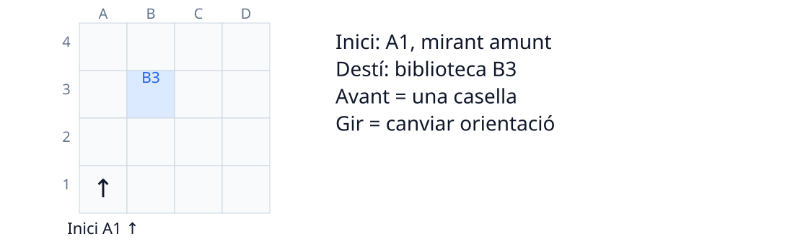
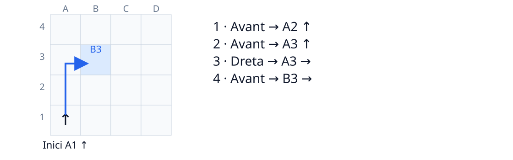
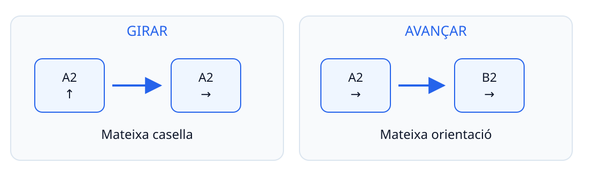
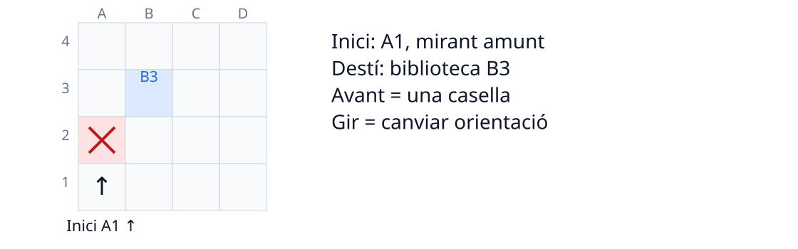
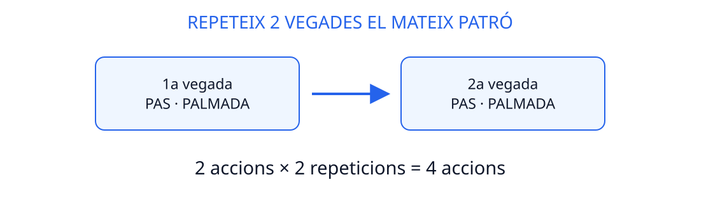
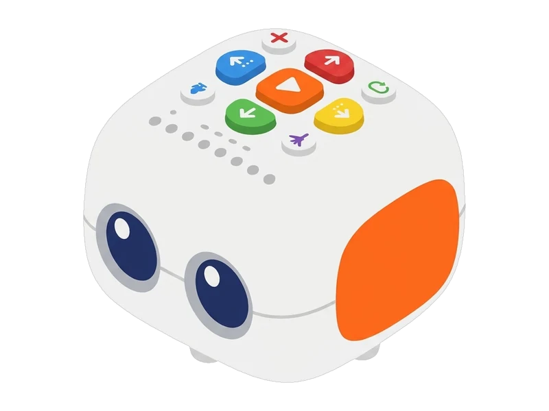
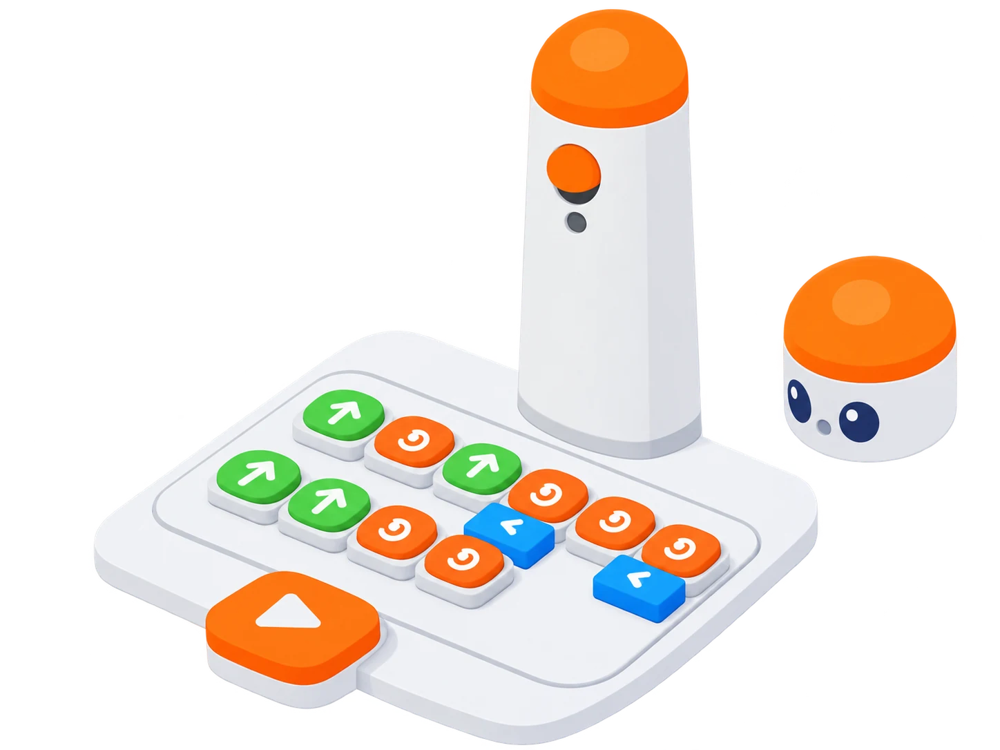
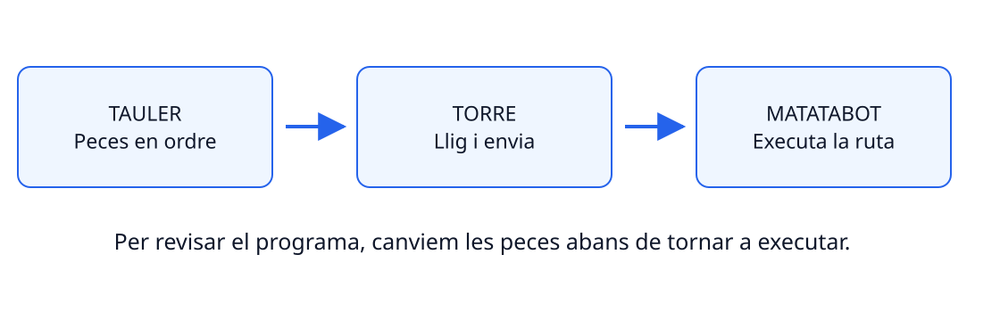
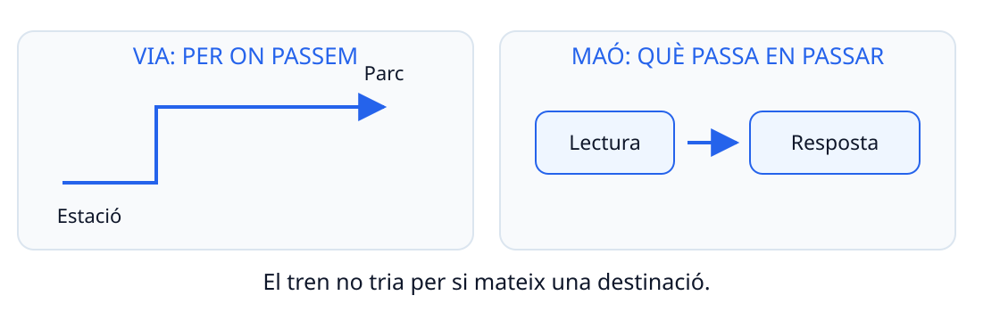
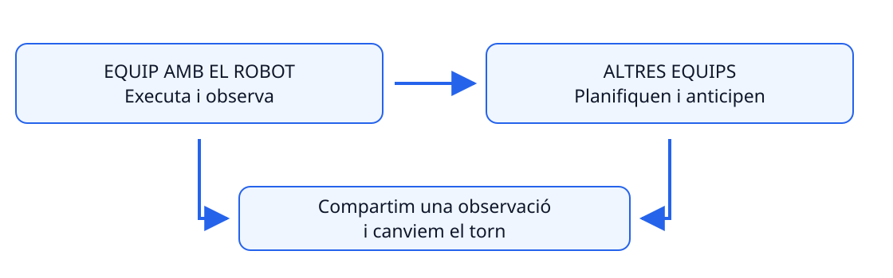

<!-- _class: cover -->

## Rutes i programació tangible

**Sessió 2 · Format de quatre sessions · 2 hores**

Formació presencial per a docents de primària

Robòtica per a docents

<!--
Preparació: comproveu projector i navegació. Només està garantida la projecció; les activitats admeten resposta oral o en paper. Si hi ha dispositius, assageu abans les demostracions i substituïu les simulacions per proves curtes.

**Guió de conducció**

**Obertura suggerida**
«Aquesta és la sessió segona del format de quatre sessions. Hui volem planificar, revisar i comunicar rutes. No cal conéixer tots els dispositius per participar».

**Fil conductor**
Partirem d’un mapa amb regles compartides, afegirem restriccions i repeticions i després compararem botons, peces i vies.

**Preparació abans de projectar**
Obriu les diapositives i la vista del presentador, comproveu que es veuen les imatges i identifiqueu les activitats en parelles. Només tenim garantit projector o PDI. Si disposeu de robots, prepareu una demostració curta abans; no dediqueu l’obertura a una instal·lació improvisada.

**Què observar en començar**
Pregunteu si el grup recorda una idea de la sessió anterior o, en la primera, quina necessitat d’aula vol treballar. Ajusteu els aclariments a les respostes sense afegir més objectius.
-->

---

<!-- _class: section -->

## Situar-nos i escriure ordres

<!--
Bloc «Situar-nos i escriure ordres»: 00–20 min de sessió (20 minuts).

Aquest temps inclou explicacions, treball dels participants i posada en comú. Controleu el tancament del bloc sense avançar les solucions abans de la predicció.

**Guió de conducció**

**Objectiu d’aquest bloc**
Compartir regles per comunicar rutes.

**Com conduir-lo**
Llegiu la graella, escriviu una seqüència en parelles i comproveu posició i orientació. Si apareix el dubte del gir, representeu-lo abans de continuar.

**Resultat que convé recollir abans d’avançar**
Una ruta que puguem seguir sense completar instruccions a ull.

**Gestió del temps**
Useu la franja indicada al començament de la nota com a límit del bloc complet, no com a durada d’aquesta pantalla. Les aclaracions del guió són un banc de suport: seleccioneu-les segons les respostes del grup, sense llegir-les totes literalment.
-->

---

<!-- _class: diagram -->

## El repte de la biblioteca



**A1 ↑ → biblioteca B3.** Una ordre «avant» avança una casella; un gir canvia l’orientació sense moure la fitxa.

<!--
Bloc «Situar-nos i escriure ordres»: 00–20 min de sessió (20 minuts).

**Guió de conducció**

**Què explicar**

Expliqueu com es llig el mapa abans de demanar cap programa: les lletres identifiquen columnes i els nombres, files. A1 és baix a l’esquerra; B3 està una columna a la dreta i dues files més amunt. La fletxa inicial indica cap on mira la fitxa.

**Com mostrar-ho**

Assenyaleu A1, després B3 i finalment la fletxa ↑. Amb el dit, mostreu només un avançament d’A1 a A2. Acordeu dues regles: avançar mou una casella; girar canvia l’orientació sense canviar de casella. No traceu encara la ruta completa.

**Pregunta i resposta esperable**

«Si la fitxa està a A1 mirant amunt, on queda després d’un avant?» Resposta: A2, encara mirant amunt. «Un gir a la dreta l’envia a B1?» No: continua a A1, ara mirant a la dreta.

**Si apareix aquest dubte**

La dreta és la de la fitxa, no sempre la de qui mira la pantalla. Aquesta graella és un model: amb un robot real cal ajustar la mida de les caselles al seu desplaçament.

**Enllaç amb el pas següent**

Ara que compartim les regles, podem escriure ordres sense improvisar-ne el significat.
-->

---

<!-- _class: activity -->

## Escriviu una ruta

1. Acordeu les ordres per arribar a la biblioteca.
2. Una persona les escriu o les diu.
3. L’altra les executa amb el dit o mentalment.

Comproveu també **cap on mira al final**.

<!--
Bloc «Situar-nos i escriure ordres»: 00–20 min de sessió (20 minuts).

Temps orientatiu de la dinàmica: 3 minuts.

**Guió de conducció**

**Què explicar**

Formuleu la consigna completa: «Porteu la fitxa d’A1 a B3, començant cap amunt. Escriviu les ordres i indiqueu l’orientació final». Una persona dicta i l’altra executa exactament allò que escolta, sense completar ordres que falten.

**Com mostrar-ho**

Feu una primera passada per les parelles per comprovar que mantenen el mateix inici. Si treballen oralment, poden marcar els passos amb els dits. No corregiu la ruta mentre l’executen: deixeu que comparen el final amb la predicció.

**Pregunta i resposta esperable**

Una solució és avant, avant, dreta, avant. També hi ha altres rutes vàlides; no exigiu la més curta. Demaneu «on acabes i cap on mires?» per distingir posició i orientació.

**Si apareix aquest dubte**

Si una parella gira i avança en una sola ordre, torneu a les dues regles pactades. Si corregeix sobre la marxa, proposeu repetir la seqüència escrita des del principi.

**Enllaç amb el pas següent**

En acabar, conserveu almenys una proposta per llegir-la ordre a ordre a la transparència següent.
-->

---

<!-- _class: solution -->

## Una solució, ordre a ordre

| Ordre | Casella | Orientació |
|---|---|---|
| Inici | A1 | Amunt |
| Avant | A2 | Amunt |
| Avant | A3 | Amunt |
| Dreta | A3 | Dreta |
| Avant | B3 | Dreta |

<!--
Bloc «Situar-nos i escriure ordres»: 00–20 min de sessió (20 minuts).

**Guió de conducció**

**Què explicar**

Llegiu cada fila com una foto de l’estat de la fitxa després d’una ordre. Comencem a A1 ↑; el primer avant porta a A2 ↑ i el segon a A3 ↑. El gir conserva A3 i canvia ↑ per →. L’últim avant porta a B3 →.

**Com mostrar-ho**

Tapeu amb la mà o assenyaleu només la fila actual. Abans de passar a la següent, deixeu que algú anticipe què canviarà: la casella, l’orientació o totes dues. La taula no és un registre de botons premuts simultàniament.

**Pregunta i resposta esperable**

«Per què A3 apareix dues vegades?» Perquè entre aquestes files hem girat, però no ens hem desplaçat. «Quantes ordres de moviment hem escrit?» Quatre; tres avançaments i un gir.

**Si apareix aquest dubte**

Arribar a B3 no garanteix haver entés la ruta: algú pot haver-la endevinada. La justificació de les files ens permet comprovar la comprensió.

**Enllaç amb el pas següent**

Mostreu després el mateix procés al mapa: canvia la representació, no el programa.
-->

---

<!-- _class: diagram -->

## La solució, vista sobre el mapa



El recorregut arriba a B3 i acaba mirant a la dreta. **El tercer pas és un gir: no avança de casella.**

<!--
Bloc «Situar-nos i escriure ordres»: 00–20 min de sessió (20 minuts).

**Guió de conducció**

**Què explicar**

«La taula anterior i aquest dibuix expliquen la mateixa seqüència». El traç blau resumeix els desplaçaments; la llista de la dreta conserva les quatre ordres. El gir no crea una casella nova, per això no apareix com un tram de recorregut.

**Com mostrar-ho**

Seguiu amb el dit A1 → A2 → A3, atureu-vos per representar el gir i continueu a B3. Acabeu orientant el dit a la dreta. Relacioneu cada parada amb el número d’ordre de la llista.

**Pregunta i resposta esperable**

«Podríem reconstruir tot el programa mirant només la línia blava?» Caldria conéixer també inici, orientació i significat de les ordres. El dibuix del camí, tot sol, no diu tots els girs.

**Si apareix aquest dubte**

No confongueu la fletxa del traç, que indica el sentit del recorregut, amb una ordre independent afegida al programa. Hi ha les quatre ordres de la llista.

**Enllaç amb el pas següent**

Feu explícit que hem passat de representar un camí a comunicar instruccions comprovables.
-->

---

## Què ens ha obligat a pensar?

<div class="flow"><span>Situar-nos</span><span class="arrow">→</span><span>Ordenar</span><span class="arrow">→</span><span>Anticipar</span><span class="arrow">→</span><span>Comprovar</span></div>

Hem necessitat un inici, una orientació i ordres compartides.

Una altra ruta també pot ser correcta: cal executar-la i justificar-la.

<!--
Bloc «Situar-nos i escriure ordres»: 00–20 min de sessió (20 minuts).

**Guió de conducció**

**Què explicar**

Poseu nom al procés viscut: ens hem situat en un mapa, hem ordenat accions, hem imaginat el resultat i l’hem contrastat. Això és el nucli que ens interessa traslladar a l’aula; prémer botons és només una manera d’executar-lo.

**Com mostrar-ho**

Recorreu el diagrama d’esquerra a dreta. Per a cada etapa, recupereu una acció real del grup: acordar A1 ↑, escriure les ordres, dir B3 → abans de moure i comprovar el final.

**Pregunta i resposta esperable**

«En quin moment hem pensat abans d’actuar?» Quan hem anticipat el resultat. «Si una ruta diferent també funciona, com ho sabem?» Executant-la amb les mateixes regles i explicant el final.

**Si apareix aquest dubte**

No convertiu aquestes quatre paraules en un nou vocabulari per memoritzar. Si el grup pot explicar què ha fet, ja tenim una base per introduir termes més específics.

**Enllaç amb el pas següent**

Deteniu-vos en la confusió que sol donar més informació: girar i avançar no són el mateix.
-->

---

<!-- _class: diagram -->

## Girar i avançar són accions diferents



La dreta és la del personatge segons cap on mira. **Després d’un gir, continuem a la mateixa casella.**

<!--
Bloc «Situar-nos i escriure ordres»: 00–20 min de sessió (20 minuts).

**Guió de conducció**

**Què explicar**

Expliqueu els dos panells per separat. A l’esquerra, A2 es repeteix: la fitxa gira d’amunt a dreta sense deixar la casella. A la dreta, A2 canvia a B2 perquè la fitxa, que ja mira a la dreta, avança una casella.

**Com mostrar-ho**

Feu de fitxa amb una mà: un gir és canviar cap on apunta el dit; avançar és desplaçar la mà mantenint aquella direcció. Aquesta representació es pot fer asseguts i sense material.

**Pregunta i resposta esperable**

«Si ara mirem avall, on apunta un gir a la dreta?» Cap a l’esquerra de la pantalla. Demaneu que es posen en el lloc del personatge abans de respondre.

**Si apareix aquest dubte**

Un avançament no significa sempre pujar en el dibuix. Significa moure’s en la direcció que té la fitxa. Eviteu dir simplement «dreta de la pantalla» com si fora una regla del robot.

**Enllaç amb el pas següent**

Useu aquesta distinció per seguir una ruta que gira abans d’hora i explicar on es desvia.
-->

---

<!-- _class: section -->

## Comprovar i corregir

<!--
Bloc «Comprovar i corregir»: 20–40 min de sessió (20 minuts).

Aquest temps inclou explicacions, treball dels participants i posada en comú. Controleu el tancament del bloc sense avançar les solucions abans de la predicció.

**Guió de conducció**

**Objectiu d’aquest bloc**
Revisar ordres amb una causa i una restricció explícites.

**Com conduir-lo**
Compareu la ruta que acaba a C2, dues rutes que arriben a B3 i el cas amb A2 tancada. Feu justificar les solucions abans de mostrar els mapes.

**Resultat que convé recollir abans d’avançar**
Explicar què ha canviat en el programa o en el problema i per què.

**Gestió del temps**
Useu la franja indicada al començament de la nota com a límit del bloc complet, no com a durada d’aquesta pantalla. Les aclaracions del guió són un banc de suport: seleccioneu-les segons les respostes del grup, sense llegir-les totes literalment.
-->

---

<!-- _class: activity -->

## Una ruta que no arriba al mateix lloc

**Avant → dreta → avant → avant**

Inici: A1 mirant amunt. Destí previst: B3.

Seguiu-la. On acaba? Quina ordre canviaríeu de lloc?

<!--
Bloc «Comprovar i corregir»: 20–40 min de sessió (20 minuts).

**Guió de conducció**

**Què explicar**

Feu servir exactament l’inici A1 ↑ i el destí B3. Llegim avant, dreta, avant, avant. No dieu encara que el gir és massa prompte: la tasca és reconstruir on acaba aquesta versió.

**Com mostrar-ho**

Feu una pausa després de cada ordre i conserveu la posició i orientació. Si una persona es perd, torneu a A1 en lloc de continuar des d’un estat dubtós.

**Pregunta i resposta esperable**

Esperem A2 ↑ després del primer avant, A2 → després del gir, B2 → i finalment C2 →. Pregunteu en quin punt deixa de coincidir amb la ruta prevista.

**Si apareix aquest dubte**

No és una prova d’atenció ràpida. El valor és justificar el canvi. Arribar a C2 també és executar correctament aquest programa, encara que no resolga el repte B3.

**Enllaç amb el pas següent**

Mostreu el mapa de l’error i identifiqueu la primera decisió que convé revisar.
-->

---

<!-- _class: diagram -->

## Localitzem la diferència


Acabem a **C2**, no a B3. Si movem el segon «avant» abans del gir, obtenim la ruta prevista.

<!--
Bloc «Comprovar i corregir»: 20–40 min de sessió (20 minuts).

**Guió de conducció**

**Què explicar**

La línia acaba a C2 perquè hem girat quan encara faltava pujar una fila. El dispositiu hauria executat les ordres que li hem donat; la discrepància és entre el nostre programa i la destinació que volíem.

**Com mostrar-ho**

Assenyaleu A2, lloc del gir, i compareu-lo amb A3, on giràvem en la solució anterior. Moveu verbalment un avant perquè quede abans de dreta i torneu a seguir la seqüència.

**Pregunta i resposta esperable**

«Hem necessitat afegir una ordre?» No necessàriament: reordenar les quatre ordres dona avant, avant, dreta, avant. «Quina causa explica la diferència?» El moment en què hem canviat d’orientació.

**Si apareix aquest dubte**

Eviteu dir simplement «el robot s’ha equivocat». Aquesta frase amaga la causa que volem investigar. També convé comprovar que hem conservat l’inici abans d’atribuir-ho al programa.

**Enllaç amb el pas següent**

Amplieu la idea: dues seqüències diferents poden acabar al mateix lloc i orientar-se de manera diferent.
-->

---

## Dues rutes correctes poden ser diferents

**A:** avant · avant · dreta · avant.
**B:** dreta · avant · esquerra · avant · avant.

Des d’A1 ↑, totes dues arriben a B3.
A acaba mirant a la dreta; B acaba mirant amunt.

Quina convé si després volem continuar cap a B4?

<!--
Bloc «Comprovar i corregir»: 20–40 min de sessió (20 minuts).

**Guió de conducció**

**Què explicar**

Compareu dos criteris: arribada i orientació final. A fa avant, avant, dreta, avant i acaba a B3 →. B fa dreta, avant, esquerra, avant, avant i acaba a B3 ↑. Les dues compleixen arribar a B3.

**Com mostrar-ho**

Reconstruïu B amb calma: el primer gir deixa A1 →; avancem a B1; girem a B1 ↑; avancem a B2 i B3. No representeu el gir esquerre com un avançament cap a la columna A.

**Pregunta i resposta esperable**

«Si després volem anar a B4, quina deixa la fitxa millor orientada?» B, perquè ja mira amunt. La justificació interessa més que triar la ruta amb menys ordres inicials.

**Si apareix aquest dubte**

La ruta més curta per a una primera destinació no és sempre la més convenient per al problema complet. Cal llegir totes les condicions abans d’avaluar una solució.

**Enllaç amb el pas següent**

La comparació següent explicita les ordres que caldria afegir en cada cas.
-->

---

<!-- _class: explanation -->

## Si volem continuar fins a B4…

<div class="compare"><div><h3>Després de la ruta A</h3><p>Som a B3 mirant a la dreta. Necessitem <b>girar a l’esquerra i avançar</b>.</p></div><div><h3>Després de la ruta B</h3><p>Som a B3 mirant amunt. Només necessitem <b>avançar</b>.</p></div></div>

La destinació anterior coincideix, però l’orientació final canvia les ordres següents.

<!--
Bloc «Comprovar i corregir»: 20–40 min de sessió (20 minuts).

**Guió de conducció**

**Què explicar**

Expliqueu cada continuació a partir de l’estat final, sense tornar a A1. Després d’A som a B3 →: girar a l’esquerra ens deixa B3 ↑ i un avant porta a B4. Després de B som a B3 ↑: basta un avant.

**Com mostrar-ho**

Assenyaleu primer la casella, comuna als dos panells, i després l’orientació, que és diferent. Aquesta és la informació que decideix què escrivim a continuació.

**Pregunta i resposta esperable**

«Podem copiar la mateixa continuació sense revisar l’orientació?» No. Un avant després d’A portaria a C3; després de B portaria a B4.

**Si apareix aquest dubte**

No confongueu esquerra del personatge amb anar a la columna de l’esquerra. El gir només prepara la direcció del pròxim desplaçament.

**Enllaç amb el pas següent**

Afegiu una restricció al mapa per mostrar que el context també pot obligar a revisar la ruta.
-->

---

<!-- _class: diagram -->

## Una casella tancada



**Ara A2 està tancada.** Busqueu una ruta fins a B3. Conserveu l’inici A1 ↑ i el significat de les ordres.

<!--
Bloc «Comprovar i corregir»: 20–40 min de sessió (20 minuts).

Temps orientatiu de la dinàmica: 5 minuts.

**Guió de conducció**

**Què explicar**

El punt inicial i el destí no canvien, però ara no podem entrar a A2. La creu roja representa una restricció del problema en paper; no significa que el robot la detecte automàticament.

**Com mostrar-ho**

Assenyaleu A2 i feu observar que la ruta inicial avançava justament cap a aquella casella. Demaneu una altra ruta, mantenint totes les regles de moviment.

**Pregunta i resposta esperable**

Una resposta possible és dreta, avant, esquerra, avant, avant. No la doneu abans de deixar buscar. Demaneu que nombren les caselles visitades per justificar que eviten A2.

**Si apareix aquest dubte**

No afegiu una suposada funció d’evitar obstacles si no l’hem programada ni comprovat en el model. El repte actual el resol l’equip planificant el camí.

**Enllaç amb el pas següent**

Contrasteu una proposta amb la ruta alternativa representada a continuació.
-->

---

<!-- _class: diagram -->

## Una ruta alternativa


**Dreta · avant · esquerra · avant · avant.** Passem per B1 i B2 fins a B3, mirant amunt. La casella A2 queda fora del recorregut.

<!--
Bloc «Comprovar i corregir»: 20–40 min de sessió (20 minuts).

**Guió de conducció**

**Què explicar**

Recorreu la solució: A1 ↑, gir dreta en A1, avanç a B1, gir esquerra en B1, avanç a B2 i avanç a B3. La casella marcada A2 no forma part del recorregut i el final queda orientat amunt.

**Com mostrar-ho**

Useu el traç per comprovar les caselles i la frase de baix per conservar les ordres. Atureu-vos als dos girs, perquè no afegeixen cap casella al camí.

**Pregunta i resposta esperable**

«Què hem mantingut igual respecte del repte anterior?» Inici, destí i significat de les ordres. «Què ha canviat?» Una casella que no podem ocupar i, per tant, la ruta.

**Si apareix aquest dubte**

Una altra ruta també pot ser vàlida. Comproveu-la amb les mateixes condicions i eviteu presentar el dibuix com l’única resposta correcta.

**Enllaç amb el pas següent**

Passeu als patrons repetits per buscar estructures que podem descriure de manera més curta.
-->

---

<!-- _class: section -->

## Repetir una seqüència

<!--
Bloc «Repetir una seqüència»: 40–55 min de sessió (15 minuts).

Aquest temps inclou explicacions, treball dels participants i posada en comú. Controleu el tancament del bloc sense avançar les solucions abans de la predicció.

**Guió de conducció**

**Objectiu d’aquest bloc**
Reconéixer un fragment repetit i modificar-ne el nombre de vegades.

**Com conduir-lo**
Comenceu amb gestos o paraules i passeu al bucle tangible. Feu comptar accions i repeticions per separat i contrasteu una variació.

**Resultat que convé recollir abans d’avançar**
Distingir el contingut del patró del nombre de repeticions.

**Gestió del temps**
Useu la franja indicada al començament de la nota com a límit del bloc complet, no com a durada d’aquesta pantalla. Les aclaracions del guió són un banc de suport: seleccioneu-les segons les respostes del grup, sense llegir-les totes literalment.
-->

---

<!-- _class: activity -->

## Un patró que torna a començar

Pas · palmada · pas · palmada · pas · palmada.

Quin fragment es repeteix? Quantes vegades?

Acordeu la resposta amb una altra persona.

<!--
Bloc «Repetir una seqüència»: 40–55 min de sessió (15 minuts).

**Guió de conducció**

**Què explicar**

Feu llegir pas, palmada, pas, palmada, pas, palmada. Busquem el fragment que torna a aparéixer sencer: pas i palmada, no només la palmada.

**Com mostrar-ho**

Marqueu tres parelles d’accions amb els dits o amb separadors al paper. Es pot representar amb dos gestos de mans si moure’s no és adequat al grup.

**Pregunta i resposta esperable**

«Quantes accions té el fragment?» Dues. «Quantes vegades apareix?» Tres. «Quantes accions hi ha en total?» Sis.

**Si apareix aquest dubte**

Comptar repeticions i comptar accions són preguntes diferents. Si algú diu que es repeteix sis vegades, demaneu quin fragment concret considera que es repeteix.

**Enllaç amb el pas següent**

Mostreu la notació que agrupa les accions dins d’una repetició.
-->

---

<!-- _class: diagram -->

## Un patró, tres repeticions


El patró té dues accions. Repetir-lo tres vegades dona **sis accions**, no tres.

<!--
Bloc «Repetir una seqüència»: 40–55 min de sessió (15 minuts).

**Guió de conducció**

**Què explicar**

Expliqueu que les tres caixes són tres execucions del mateix patró. No són tres programes diferents: a cada vegada fem pas i després palmada. La frase inferior relaciona dues accions per tres vegades amb sis accions totals.

**Com mostrar-ho**

Recorreu una caixa i representeu-ne les dues accions abans de passar a la següent. Després feu llegir la instrucció compacta «repeteix tres vegades pas i palmada».

**Pregunta i resposta esperable**

«Podríem canviar el nombre de vegades sense canviar el patró?» Sí. «Si repetim dues vegades, quantes accions farem?» Quatre; ho comprovarem després.

**Si apareix aquest dubte**

No presenteu el bucle només com una manera d’escriure menys. Agrupar un patró ajuda també a entendre, revisar i modificar el programa.

**Enllaç amb el pas següent**

Distingiu aquest model en paper de les peces o blocs concrets que permeten executar-lo.
-->

---

## Representació i programació

Podem representar un bucle amb fletxes i una targeta «×3».

Per executar-lo, cal comprovar com s’expressa en el dispositiu disponible.

Una notació en paper ajuda a pensar; no garanteix que tots els robots tinguen els mateixos blocs.

<!--
Bloc «Repetir una seqüència»: 40–55 min de sessió (15 minuts).

**Guió de conducció**

**Què explicar**

Una targeta amb «×3» i dues fletxes és una manera de representar el pensament, però no implica que qualsevol robot entenga aquella notació. Per executar-la hem de traduir-la a les funcions del dispositiu disponible.

**Com mostrar-ho**

Compareu una instrucció oral, una representació en paper i un programa de peces: les tres poden expressar la mateixa repetició amb símbols diferents.

**Pregunta i resposta esperable**

«Si dibuixem un bucle al costat de Tale-Bot, el robot el llig?» No per aquest fet. «Què cal revisar abans d’executar amb Coding Set?» Les peces compatibles i com es delimita el fragment repetit.

**Si apareix aquest dubte**

No traslladeu automàticament una estructura de MakeCode o mBlock als botons d’un altre kit. La idea de repetir és comuna; les possibilitats i la manera de programar-la poden ser diferents.

**Enllaç amb el pas següent**

Llegiu ara un bucle tangible concret del Coding Set.
-->

---

<!-- _class: tangible -->

## Coding Set · La repetició amb peces

```coding-set
repeteix 4
endavant
dreta
fi
```

Dins del bucle hi ha **endavant · dreta**. El repetim quatre vegades. La dansa anterior repetia un altre patró tres vegades.

<!--
Bloc «Repetir una seqüència»: 40–55 min de sessió (15 minuts).

**Guió de conducció**

**Què explicar**

Assenyaleu la peça d’inici del bucle amb el nombre 4, les peces endavant i dreta que queden dins i la peça que el tanca. El fragment que es repeteix és endavant i després gir a la dreta.

**Com mostrar-ho**

Feu una lectura expandida d’una vegada i demaneu una segona. Cal arribar a quatre parelles d’accions: vuit ordres dins de les repeticions. El marcador de repetició no és una ordre d’avançar quatre caselles.

**Pregunta i resposta esperable**

«Què compta el 4?» Les vegades que s’executa tot el fragment delimitat. «És el mateix que la dansa anterior?» No: allí el patró era pas i palmada, repetit tres vegades.

**Si apareix aquest dubte**

La representació mostra un programa de peces, no garanteix un recorregut físic concret si no hem preparat el model i la superfície. Comproveu el material del kit abans de demostrar-lo.

**Enllaç amb el pas següent**

Torneu al model senzill per anticipar l’efecte de canviar el nombre de repeticions.
-->

---

<!-- _class: activity -->

## Proveu una variació

Ara volem dues repeticions.

Quantes accions hi haurà?
Què canvia en la representació?
Què es manté?

Expliqueu la resposta abans de representar-la.

<!--
Bloc «Repetir una seqüència»: 40–55 min de sessió (15 minuts).

Temps orientatiu de la dinàmica: 4 minuts.

**Guió de conducció**

**Què explicar**

Manteniu el patró pas i palmada, però proposeu repetir-lo dues vegades. Demaneu predir abans de representar-lo. Una persona compta les repeticions i l’altra les accions, i després comparen.

**Com mostrar-ho**

Podeu dir «primera vegada: pas, palmada; segona vegada: pas, palmada». Marqueu el final: no afegim automàticament una tercera vegada perquè era la versió anterior.

**Pregunta i resposta esperable**

Esperem quatre accions totals. El patró no ha canviat; només el nombre de repeticions. La justificació ha d’identificar aquestes dues parts.

**Si apareix aquest dubte**

Si responen dues accions, feu distingir una execució del patró de dues execucions. Si responen sis, comproveu que han substituït el nombre inicial.

**Enllaç amb el pas següent**

Mostreu el diagrama de dues repeticions per contrastar les respostes.
-->

---

<!-- _class: diagram -->

## Què canvia quan repetim?



Amb **dues** repeticions, fem quatre accions. Es conserva el patró; canvia el nombre de vegades.

<!--
Bloc «Repetir una seqüència»: 40–55 min de sessió (15 minuts).

**Guió de conducció**

**Què explicar**

El diagrama conserva pas i palmada dins de cada caixa, però ara només hi ha dues caixes. Aquesta comparació mostra una modificació controlada: el contingut del patró és el mateix i la quantitat de vegades és diferent.

**Com mostrar-ho**

Recupereu les prediccions anteriors i feu correspondre cada gest amb una acció. Escriviu, si cal, dues accions per dues vegades igual a quatre.

**Pregunta i resposta esperable**

«Què hauríem de canviar per obtenir una altra dansa sense canviar la durada en nombre d’accions?» Podríem canviar una acció del patró i mantindre dues repeticions; això seria una modificació diferent.

**Si apareix aquest dubte**

No barregeu totes les variacions en la primera prova. Convindrà comparar versions canviant una cosa cada vegada perquè la causa siga explicable.

**Enllaç amb el pas següent**

Passeu de les seqüències preparades a una resposta iniciada per un botó.
-->

---

<!-- _class: pause -->

## Pausa

En tornar, continuarem amb el bloc següent.

Deixeu anotada una pregunta que vulgueu recuperar.

<!--
Bloc «Pausa»: 55–60 min de sessió (5 minuts).

Temps orientatiu de la dinàmica: 5 minuts.

Respecteu els cinc minuts de pausa; recupereu una de les preguntes anotades en reprendre la sessió.

**Guió de conducció**

Conducció de la pausa
Doneu un punt clar de retorn i conserveu les preguntes pendents. Podeu demanar que cada parella trie quin dubte voldria recuperar després, sense convertir la pausa en una nova tasca obligatòria.

Abans de reprendre
Recordeu en una frase què ja hem comprovat i quin canvi introduirem ara. Si hi ha hagut una incidència tècnica, manteniu l’alternativa en paper per preservar el temps d’aprenentatge. No intenteu recuperar tota la pausa accelerant les explicacions següents.
-->

---

<!-- _class: section -->

## Del paper als materials

<!--
Bloc «Del paper als materials»: 60–80 min de sessió (20 minuts).

Aquest temps inclou explicacions, treball dels participants i posada en comú. Controleu el tancament del bloc sense avançar les solucions abans de la predicció.

**Guió de conducció**

**Objectiu d’aquest bloc**
Entendre què afegeix l’execució física.

**Com conduir-lo**
Compareu botons, peces i via. Per a cada material identifiqueu què prepara el grup i què comprova després. No intenteu una connexió no assajada amb tots els dispositius.

**Resultat que convé recollir abans d’avançar**
Una primera prova física curta i una alternativa que conserve el repte.

**Gestió del temps**
Useu la franja indicada al començament de la nota com a límit del bloc complet, no com a durada d’aquesta pantalla. Les aclaracions del guió són un banc de suport: seleccioneu-les segons les respostes del grup, sense llegir-les totes literalment.
-->

---

<!-- _class: visual -->

## Tale-Bot



Programem moviments amb els botons del robot.

**Una proposta:** Una ruta entre tres llocs d’un conte.

<!--
Bloc «Del paper als materials»: 60–80 min de sessió (20 minuts).

**Guió de conducció**

**Què explicar**

Presenteu-lo com un robot amb botons al mateix aparell. «Per començar, podem fer una ruta curta entre dos llocs d’un conte». Escrivim primer les ordres i després les introduïm. No necessita un editor de blocs en pantalla per a aquesta prova.

**Com mostrar-ho**

Assenyaleu en la imatge els elements que intervenen en aquesta proposta, sense repassar tots els accessoris del kit. La il·lustració identifica el material; no és una prova del programa que expliquem.

**Pregunta i resposta esperable**

«Quina acció de l’alumnat ens permet aquest material?» Busquem planificar, anticipar una resposta o comparar una prova, segons l’exemple. Demaneu una justificació de la tria, no una preferència per l’aparença del robot.

**Si apareix aquest dubte**

No atribuïu lectura automàtica a qualsevol mapa de paper ni detecció genèrica d’obstacles. Si no disposeu del dispositiu físic, no improviseu una connexió: llegiu i representeu la seqüència amb el grup.

**Enllaç amb el pas següent**

La transparència següent acota una primera decisió i els límits que convé tindre clars.
-->

---

## Tale-Bot · Primera decisió

**Què cal tindre present?**

Els mapes interactius necessiten zones codificades compatibles; una quadrícula de paper serveix per orientar-nos, però no activa eixes funcions.

**Abans de la prova:** què esperem observar?
**Després:** quina decisió podrà explicar l’alumnat?

<!--
Bloc «Del paper als materials»: 60–80 min de sessió (20 minuts).

**Guió de conducció**

**Què explicar**

Recupereu la proposta anterior i llegiu-ne el límit: No atribuïu lectura automàtica a qualsevol mapa de paper ni detecció genèrica d’obstacles. L’objectiu d’aquesta pantalla és evitar començar amb una expectativa que el material no pot complir.

**Com mostrar-ho**

Plantegeu una ruta curta entre dos llocs d’un conte i feu distingir allò que prepara la persona docent d’allò que executa el dispositiu. Useu el programa o el recorregut, no una resposta atribuïda a una voluntat del robot.

**Pregunta i resposta esperable**

«Abans de provar, què esperem observar? Després, quina decisió podrà explicar l’alumnat?» Accepteu una resposta concreta vinculada a l’exemple: ordre, botó, lectura o condició.

**Si apareix aquest dubte**

Si algú proposa una funció diferent, anoteu-la per consultar el tutorial del model disponible. No deduïu prestacions a partir de l’aspecte del robot o d’un altre kit.

**Enllaç amb el pas següent**

Continueu amb la representació del programa si n’hi ha una; en cas contrari, compareu aquesta opció amb el material següent.
-->

---

<!-- _class: tangible -->

## Tale-Bot · Llegim els botons en ordre

```talebot
endavant
endavant
dreta
endavant
executa
```

Preparem les ordres i després premem **executa**. El gir canvia l’orientació: no avança. Les icones representen la seqüència, no la disposició física dels botons.

<!--
Bloc «Del paper als materials»: 60–80 min de sessió (20 minuts).

**Guió de conducció**

**Què explicar**

Llegiu endavant, endavant, dreta, endavant i, al final, executa. Les primeres quatre icones preparen ordres; l’última posa en marxa la seqüència. El dibuix és una fila per llegir, no la disposició real del panell.

**Com mostrar-ho**

Assenyaleu una icona cada vegada i relacioneu-la amb la ruta A1 ↑ fins a B3 →. Diferencieu preparar el programa i veure’l executar: no esperem un desplaçament físic en cada lectura de la fila projectada.

**Pregunta i resposta esperable**

«Executa afegeix una casella a la ruta?» No: inicia la seqüència preparada. «El tercer símbol desplaça el robot?» No, és un gir.

**Si apareix aquest dubte**

Amb material, reviseu abans les ordres guardades i la distància real d’un avançament. Els colors i la disposició s’han d’identificar en el model disponible.

**Enllaç amb el pas següent**

Compareu amb Coding Set: la seqüència també existeix, però les ordres són peces externes.
-->

---

<!-- _class: visual -->

## Tale-Bot · Del paper al robot


Marqueu inici i orientació.

Observeu quant avança **una ordre** i ajusteu les caselles.

Esborreu les ordres anteriors i proveu una ruta curta.

<!--
Bloc «Del paper als materials»: 60–80 min de sessió (20 minuts).

**Guió de conducció**

**Què explicar**

El pas al material afegeix condicions que el model de paper simplificava. Abans de preparar una ruta llarga, provem un avant per saber quant es desplaça el robot sobre aquella superfície i ajustar les caselles.

**Com mostrar-ho**

Marqueu inici i orientació, prepareu poques ordres i reviseu que no quede una seqüència anterior. Executeu només després d’haver dit on hauria d’acabar.

**Pregunta i resposta esperable**

«Si es queda entre caselles, és segur que hem escrit malament la ruta?» No: pot caldre revisar mida de la graella, superfície o posició inicial, a més de les ordres.

**Si apareix aquest dubte**

La il·lustració no aporta una escala de mesura fiable. Comproveu el model disponible i eviteu deduir una distància exacta a partir del dibuix.

**Enllaç amb el pas següent**

Compareu aquest programa de botons amb un programa de peces que podem llegir a la vista.
-->

---

<!-- _class: visual -->

## Coding Set



Construïm el programa amb peces al tauler; la torre el llig i el MatataBot el segueix.

**Una proposta:** Comparar dues seqüències movent una peça.

<!--
Bloc «Del paper als materials»: 60–80 min de sessió (20 minuts).

**Guió de conducció**

**Què explicar**

Presenteu-lo com un sistema amb tauler, torre de lectura i MatataBot. «Per començar, podem fer comparar una seqüència inicial i una versió amb una peça canviada». Les peces mantenen el programa a la vista. La torre el llig i comunica les ordres al MatataBot.

**Com mostrar-ho**

Assenyaleu en la imatge els elements que intervenen en aquesta proposta, sense repassar tots els accessoris del kit. La il·lustració identifica el material; no és una prova del programa que expliquem.

**Pregunta i resposta esperable**

«Quina acció de l’alumnat ens permet aquest material?» Busquem planificar, anticipar una resposta o comparar una prova, segons l’exemple. Demaneu una justificació de la tria, no una preferència per l’aparença del robot.

**Si apareix aquest dubte**

Una peça és una ordre del programa; no és un botó situat damunt del robot. Si no disposeu del dispositiu físic, no improviseu una connexió: llegiu i representeu la seqüència amb el grup.

**Enllaç amb el pas següent**

La transparència següent acota una primera decisió i els límits que convé tindre clars.
-->

---

## Coding Set · Primera decisió

**Què cal tindre present?**

Cal preparar torre, tauler i robot; no són botons sobre el mateix robot.

**Abans de la prova:** què esperem observar?
**Després:** quina decisió podrà explicar l’alumnat?

<!--
Bloc «Del paper als materials»: 60–80 min de sessió (20 minuts).

**Guió de conducció**

**Què explicar**

Recupereu la proposta anterior i llegiu-ne el límit: Una peça és una ordre del programa; no és un botó situat damunt del robot. L’objectiu d’aquesta pantalla és evitar començar amb una expectativa que el material no pot complir.

**Com mostrar-ho**

Plantegeu comparar una seqüència inicial i una versió amb una peça canviada i feu distingir allò que prepara la persona docent d’allò que executa el dispositiu. Useu el programa o el recorregut, no una resposta atribuïda a una voluntat del robot.

**Pregunta i resposta esperable**

«Abans de provar, què esperem observar? Després, quina decisió podrà explicar l’alumnat?» Accepteu una resposta concreta vinculada a l’exemple: ordre, botó, lectura o condició.

**Si apareix aquest dubte**

Si algú proposa una funció diferent, anoteu-la per consultar el tutorial del model disponible. No deduïu prestacions a partir de l’aspecte del robot o d’un altre kit.

**Enllaç amb el pas següent**

Continueu amb la representació del programa si n’hi ha una; en cas contrari, compareu aquesta opció amb el material següent.
-->

---

<!-- _class: tangible -->

## Coding Set · Llegim les peces

```coding-set
endavant
endavant
dreta
endavant
```

Al tauler, llegim les peces **d’esquerra a dreta i de dalt a baix**. Aquesta fila representa una ruta; la torre ha de poder llegir-la abans d’executar-la.

<!--
Bloc «Del paper als materials»: 60–80 min de sessió (20 minuts).

**Guió de conducció**

**Què explicar**

Les quatre peces representen endavant, endavant, dreta i endavant. El tauler fa de suport del programa; no cal recordar una fila de botons perquè les peces queden visibles. La torre ha de poder llegir la seqüència segons les instruccions del kit.

**Com mostrar-ho**

Feu llegir la fila d’esquerra a dreta abans de simular cap moviment. Després proposeu moure la tercera peça a una altra posició i anticipeu que no tindrem necessàriament el mateix resultat.

**Pregunta i resposta esperable**

«Què ens facilita deixar el programa a la vista?» Revisar una ordre, comparar dues versions i explicar el canvi a una altra persona.

**Si apareix aquest dubte**

No suposeu que la lectura ocorre només perquè les peces estan prop del robot. Tauler, torre, robot i ordre de lectura s’han de preparar i comprovar.

**Enllaç amb el pas següent**

El diagrama següent separa el paper de cada element del sistema.
-->

---

<!-- _class: diagram -->

## Coding Set · Com circulen les ordres?



El tauler manté el programa visible. La torre el llig i envia les ordres; el MatataBot les executa.

<!--
Bloc «Del paper als materials»: 60–80 min de sessió (20 minuts).

**Guió de conducció**

**Què explicar**

Expliqueu el diagrama com tres funcions: al tauler escrivim amb peces; la torre llig el programa i envia les ordres; el MatataBot les executa. Les fletxes representen aquest flux de lectura i comunicació, no un recorregut del robot damunt de tres caixes.

**Com mostrar-ho**

Assenyaleu cada caixa i feu la correspondència amb la imatge anterior. Per a una seqüència equivocada, reviseu primer les peces; per a un sistema que no respon, comproveu també alimentació i connexió del kit.

**Pregunta i resposta esperable**

«Si canviem una peça, què ha de passar abans que canvie la ruta?» Cal tornar a llegir i executar el programa preparat. El robot no interpreta allò que una persona volia escriure.

**Si apareix aquest dubte**

No presenteu la torre com un sensor del recorregut o de la destinació. En aquesta prova intervé en la lectura del programa.

**Enllaç amb el pas següent**

Passeu al tren per mostrar un altre model: allí la via mateixa condiciona per on es mou.
-->

---

<!-- _class: visual -->

## Coding Set · El programa es pot llegir


Comproveu torre, tauler i MatataBot.

Llegiu les peces en ordre abans de prémer Play.

La imatge mostra un exemple: comprovem què fa cada peça del nostre programa.

<!--
Bloc «Del paper als materials»: 60–80 min de sessió (20 minuts).

**Guió de conducció**

**Què explicar**

La imatge mostra una relació entre una fila de peces i un recorregut. Useu-la per identificar que el programa existeix abans d’executar-lo i que podem revisar-ne l’ordre.

**Com mostrar-ho**

Feu distingir tauler, torre i MatataBot. Llegiu una seqüència curta amb el grup i demaneu una predicció; si hi ha material, comprovem primer que el sistema respon amb una sola ordre coneguda.

**Pregunta i resposta esperable**

«Què ens permet comparar dues versions?» Conservar les peces o una representació de la primera seqüència i indicar quina hem mogut.

**Si apareix aquest dubte**

La imatge és un exemple, no una consigna que s’haja de copiar sense revisar-la. El mapa, les unitats de moviment i l’orientació han d’estar definits en la prova real.

**Enllaç amb el pas següent**

El tren ens permet veure un altre cas en què també el muntatge físic participa en la solució.
-->

---

<!-- _class: visual -->

## Coding Express


La via defineix el recorregut; els maons d’acció provoquen respostes del tren.

**Una proposta:** Una història amb estació, parada i destinació.

<!--
Bloc «Del paper als materials»: 60–80 min de sessió (20 minuts).

**Guió de conducció**

**Què explicar**

Presenteu-lo com un tren que circula per vies i respon a maons d’acció. «Per començar, podem fer ordenar una història amb estació, parada i destinació». Muntem la via per decidir el recorregut i situem un maó per provocar una resposta en passar.

**Com mostrar-ho**

Assenyaleu en la imatge els elements que intervenen en aquesta proposta, sense repassar tots els accessoris del kit. La il·lustració identifica el material; no és una prova del programa que expliquem.

**Pregunta i resposta esperable**

«Quina acció de l’alumnat ens permet aquest material?» Busquem planificar, anticipar una resposta o comparar una prova, segons l’exemple. Demaneu una justificació de la tria, no una preferència per l’aparença del robot.

**Si apareix aquest dubte**

El tren no comprén el relat ni tria el destí. Via i maó tenen funcions diferents. Si no disposeu del dispositiu físic, no improviseu una connexió: llegiu i representeu la seqüència amb el grup.

**Enllaç amb el pas següent**

La transparència següent acota una primera decisió i els límits que convé tindre clars.
-->

---

## Coding Express · Primera decisió

**Què cal tindre present?**

El tren no tria una destinació. Els girs de la via no són ordres de gir com en Tale-Bot.

**Abans de la prova:** què esperem observar?
**Després:** quina decisió podrà explicar l’alumnat?

<!--
Bloc «Del paper als materials»: 60–80 min de sessió (20 minuts).

**Guió de conducció**

**Què explicar**

Recupereu la proposta anterior i llegiu-ne el límit: El tren no comprén el relat ni tria el destí. Via i maó tenen funcions diferents. L’objectiu d’aquesta pantalla és evitar començar amb una expectativa que el material no pot complir.

**Com mostrar-ho**

Plantegeu ordenar una història amb estació, parada i destinació i feu distingir allò que prepara la persona docent d’allò que executa el dispositiu. Useu el programa o el recorregut, no una resposta atribuïda a una voluntat del robot.

**Pregunta i resposta esperable**

«Abans de provar, què esperem observar? Després, quina decisió podrà explicar l’alumnat?» Accepteu una resposta concreta vinculada a l’exemple: ordre, botó, lectura o condició.

**Si apareix aquest dubte**

Si algú proposa una funció diferent, anoteu-la per consultar el tutorial del model disponible. No deduïu prestacions a partir de l’aspecte del robot o d’un altre kit.

**Enllaç amb el pas següent**

Continueu amb la representació del programa si n’hi ha una; en cas contrari, compareu aquesta opció amb el material següent.
-->

---

<!-- _class: diagram -->

## Coding Express · Via i resposta



La via resol el recorregut. El maó introdueix una resposta. **No és una ordre de gir en una quadrícula.**

<!--
Bloc «Del paper als materials»: 60–80 min de sessió (20 minuts).

**Guió de conducció**

**Què explicar**

Llegiu el panell esquerre com una decisió de construcció: la via determina per on pot passar el tren. Llegiu el dret com una relació entre lectura d’un maó i resposta. Són dues decisions que sovint es confonen en començar.

**Com mostrar-ho**

Assenyaleu el recorregut estació-parc i imagineu canviar una corba: canviaria el camí. Després manteniu la via i situeu un maó d’acció: canviaríem què passa en un punt del viatge.

**Pregunta i resposta esperable**

«Un maó que provoca un so decideix a quina estació anem?» No. «Canviar la via pot canviar el recorregut sense afegir cap ordre de gir?» Sí.

**Si apareix aquest dubte**

Comproveu les respostes dels maons del kit abans de fer una demostració. El diagrama no diu que qualsevol peça de color tinga una funció ni que el tren trie una branca per comprendre el relat.

**Enllaç amb el pas següent**

Relacioneu aquest model amb una història: l’alumnat dona sentit a les parades i comprova l’ordre.
-->

---

<!-- _class: visual -->

## Coding Express · La via és part del problema


**Repte:** de l’estació al parc passant per una parada.

Primer dibuixem i muntem la via. Després anticipem el viatge.

Un maó d’acció pot introduir una resposta; comprovem-la amb el kit.

<!--
Bloc «Del paper als materials»: 60–80 min de sessió (20 minuts).

**Guió de conducció**

**Què explicar**

Expliqueu el repte narratiu: viatjar de l’estació al parc passant per una parada. Primer decidim on ha d’anar el tren i muntem una via que ho permeta. Després decidim si volem una resposta en algun punt.

**Com mostrar-ho**

Dibuixeu mentalment o en paper l’ordre estació-parada-parc. Assenyaleu on té sentit un maó d’acció, però no l’associeu a una funció concreta si no l’heu comprovat en el kit.

**Pregunta i resposta esperable**

«Què passaria si muntem la via amb la parada després del parc?» El recorregut ja no coincideix amb l’ordre del relat. Afegir un maó de so no ho resol necessàriament.

**Si apareix aquest dubte**

No doneu al tren capacitat d’escollir una destinació pel significat de la història. El grup dissenya i comprova la via i les respostes.

**Enllaç amb el pas següent**

Abans de narrar el viatge, mostreu com preparar-ne el moviment i l’aturada.
-->

---

<!-- _class: visual -->

## Coding Express · Impuls i aturada


Reviseu unions i espai d’aturada.

Enceneu i doneu una empenta suau segons la guia del kit.

Compareu aturada manual i resposta al maó roig disponible.

<!--
Bloc «Del paper als materials»: 60–80 min de sessió (20 minuts).

**Guió de conducció**

**Què explicar**

La prova diferencia l’impuls inicial i el moviment motoritzat. Reviseu la via, enceneu segons el model i doneu una empenta curta i suau. Després compareu l’aturada manual indicada a la guia amb la resposta al maó roig compatible.

**Com mostrar-ho**

Assenyaleu en la imatge inici, tren i zona d’aturada. Si hi ha material, manteniu la prova curta i assajada. Sense kit, feu moure una fitxa sobre una via dibuixada i verbalitzeu què comprovaríeu.

**Pregunta i resposta esperable**

«Com sabem que el maó ha produït una resposta?» Repetim des del mateix punt i observem el pas pel maó, diferenciant-ho d’una intervenció manual.

**Si apareix aquest dubte**

No empenyeu el tren mentre el motor ja funciona ni forceu peces. Si el maó no respon, atureu i reviseu la preparació del model; no convertiu-ho en una carrera.

**Enllaç amb el pas següent**

Useu les parades per construir una seqüència narrativa que una altra parella puga explicar.
-->

---

<!-- _class: section -->

## Una història en equip

<!--
Bloc «Una història en equip»: 80–100 min de sessió (20 minuts).

Aquest temps inclou explicacions, treball dels participants i posada en comú. Controleu el tancament del bloc sense avançar les solucions abans de la predicció.

**Guió de conducció**

**Objectiu d’aquest bloc**
Relacionar ordre del relat i ordre del recorregut.

**Com conduir-lo**
Demaneu tres llocs, una frase per lloc i una ruta que una altra parella puga seguir. Observeu com l’ordre afecta el sentit de la història.

**Resultat que convé recollir abans d’avançar**
Una narració i una ruta coherents, amb una decisió explicada.

**Gestió del temps**
Useu la franja indicada al començament de la nota com a límit del bloc complet, no com a durada d’aquesta pantalla. Les aclaracions del guió són un banc de suport: seleccioneu-les segons les respostes del grup, sense llegir-les totes literalment.
-->

---

<!-- _class: activity -->

## Una història amb tres parades

**Estació:** qui viatja i per què?
**Parada:** què ha de recollir?
**Parc:** com acaba la història?

En parelles, dibuixeu el recorregut i una frase per lloc.
Una altra parella ha de poder explicar el viatge.

<!--
Bloc «Una història en equip»: 80–100 min de sessió (20 minuts).

Temps orientatiu de la dinàmica: 6 minuts.

**Guió de conducció**

**Què explicar**

Doneu un relat mínim com a model: un personatge ix de l’estació, recull una cosa en una parada i arriba al parc per a una finalitat. El grup tria els detalls, però el recorregut i les frases han de conservar l’ordre.

**Com mostrar-ho**

Demaneu un dibuix simple i una frase per lloc. No cal una maqueta acabada. Una altra parella haurà de seguir el viatge amb la fitxa i contar què ocorre en arribar a cada parada.

**Pregunta i resposta esperable**

«Podem canviar l’ordre de les parades i mantindre la història?» Depén del relat: si encara no hem recollit allò que necessitem al parc, haurem de revisar-lo.

**Si apareix aquest dubte**

No confongueu tres llocs d’una història amb tres funcions del robot. La tasca principal pot ser ordenar i comunicar, amb una funció tècnica molt senzilla.

**Enllaç amb el pas següent**

La posada en comú ha d’explicar com sabrem si el relat i la ruta són comprensibles.
-->

---

## Què podem observar en la història?

L’ordre dels esdeveniments és comprensible.

El relat i el recorregut coincideixen.

L’alumnat justifica una parada o una modificació.

La narració i la programació comparteixen una seqüència.

<!--
Bloc «Una història en equip»: 80–100 min de sessió (20 minuts).

**Guió de conducció**

**Què explicar**

Busquem tres coses: ordre comprensible, correspondència entre relat i recorregut i una decisió justificada. No estem avaluant la bellesa de la maqueta o si el tren completa un trajecte sense intervenció.

**Com mostrar-ho**

Escolteu una parella i pregunteu en quin punt de la ruta ocorre cada fet. Després feu que una altra parella la conte amb les instruccions rebudes.

**Pregunta i resposta esperable**

Una resposta amb evidència és «hem posat la parada abans del parc perquè primer cal recollir el llibre». Si només diuen «és més bonic», demaneu què canvia en el sentit de la història.

**Si apareix aquest dubte**

Una història imaginativa pot tindre una ruta confusa, i una ruta correcta pot no comunicar el relat. Cal mirar les dues relacions segons l’objectiu triat.

**Enllaç amb el pas següent**

Reforceu la idea amb la pregunta sobre què passa quan canviem les parades.
-->

---

<!-- _class: visual -->

## Una història té recorregut i sentit


La via situa les parades. El relat explica per què hi anem.

**Pregunta docent:** «Què passaria en la història si canviàrem l’ordre de les parades?»

<!--
Bloc «Una història en equip»: 80–100 min de sessió (20 minuts).

**Guió de conducció**

**Què explicar**

Expliqueu que el tren recorre una estructura preparada, però el sentit de les parades prové del relat del grup. L’aprenentatge lingüístic apareix quan l’alumnat ha de comunicar aquest sentit a una altra persona.

**Com mostrar-ho**

Useu una modificació concreta: col·locar la destinació abans de la recollida. Demaneu si cal canviar la via, la història o totes dues per mantindre coherència.

**Pregunta i resposta esperable**

«Quina informació necessita la parella que escolta?» Inici, ordre dels llocs i què passa en cadascun. No hauria d’haver d’endevinar la intenció dels autors.

**Si apareix aquest dubte**

No atribuïu al robot la capacitat de detectar incoherències narratives. Les persones comparen, expliquen i decideixen què modificar.

**Enllaç amb el pas següent**

Passeu a l’organització dels torns perquè aquests processos continuen també fora de la prova amb el tren.
-->

---

<!-- _class: diagram -->

## Una prova amb treball per a tothom



Cada equip conserva la seua tasca mentre espera. El torn acaba amb una observació que els altres poden aprofitar.

<!--
Bloc «Una història en equip»: 80–100 min de sessió (20 minuts).

**Guió de conducció**

**Què explicar**

Expliqueu que disposar d’una sola unitat no obliga a una classe sencera a esperar. El diagrama diferencia l’equip que executa i observa del treball dels altres: planificar, anticipar o comparar versions en paper.

**Com mostrar-ho**

Imagineu quatre equips. L’equip que prova té una seqüència curta preparada; els altres anoten on acabarà o revisen la pròpia ruta. En acabar, comparteix una observació útil i cedeix el torn.

**Pregunta i resposta esperable**

«Quina tasca concreta tenen els equips que esperen?» No basta «mirar»: poden predir la casella final i justificar-la, o detectar una diferència respecte de la ruta prevista.

**Si apareix aquest dubte**

No convertiu el canvi de torn en una prova de rapidesa. Si un equip no està preparat, ha de poder seguir treballant en paper sense perdre la possibilitat d’aprendre.

**Enllaç amb el pas següent**

Concreteu els rols perquè manipular el robot no siga l’única forma visible de participar.
-->

---

## Rols rotatius

**Planifica:** proposa i justifica les ordres.
**Programa:** introdueix allò acordat.
**Comprova:** compara predicció i resultat.
**Explica:** registra una decisió.

En equips de tres, uniu comprovació i explicació.

<!--
Bloc «Una història en equip»: 80–100 min de sessió (20 minuts).

**Guió de conducció**

**Què explicar**

Expliqueu que els rols distribueixen responsabilitats, no etiqueten capacitats. Planificar proposa i justifica; programar introdueix allò acordat; comprovar compara amb la predicció; explicar deixa constància d’una decisió.

**Com mostrar-ho**

Useu una mateixa ruta i demaneu què faria cada rol abans, durant i després de la prova. En equips de tres es poden unir comprovació i explicació. Acordeu una rotació després de cada prova o repte curt.

**Pregunta i resposta esperable**

«Qui pensa el programa?» Tot l’equip, encara que una persona introduïsca les ordres. «Qui ha de saber explicar-lo?» Tothom; el rol de portaveu no eximeix les altres persones de comprendre.

**Si apareix aquest dubte**

Eviteu que la persona amb més experiència es quede sempre el dispositiu. Tampoc interpreteu una dificultat de manipulació com una dificultat de comprensió.

**Enllaç amb el pas següent**

Reforceu les diverses maneres de participar i explicar l’aprenentatge.
-->

---

<!-- _class: section -->

## Preparar la primera aplicació

<!--
Bloc «Preparar la primera aplicació»: 100–120 min de sessió (20 minuts).

Aquest temps inclou explicacions, treball dels participants i posada en comú. Controleu el tancament del bloc sense avançar les solucions abans de la predicció.

**Guió de conducció**

**Objectiu d’aquest bloc**
Transferir les rutes a la pràctica docent.

**Com conduir-lo**
Feu triar un grup, una consigna curta i una prova que es puga repetir. La revisió entre parelles ha d’ajudar a preparar, no a competir per complexitat.

**Resultat que convé recollir abans d’avançar**
Una proposta amb material, torns i una pregunta d’aprenentatge.

**Gestió del temps**
Useu la franja indicada al començament de la nota com a límit del bloc complet, no com a durada d’aquesta pantalla. Les aclaracions del guió són un banc de suport: seleccioneu-les segons les respostes del grup, sense llegir-les totes literalment.
-->

---

<!-- _class: activity -->

## La proposta que m’emporte

Completeu oralment o en paper:

**Amb el meu grup treballaria…**
**El repte seria…**
**La primera prova consistiria en…**
**Sabria que han aprés perquè…**

<!--
Bloc «Preparar la primera aplicació»: 100–120 min de sessió (20 minuts).

Temps orientatiu de la dinàmica: 5 minuts.

**Guió de conducció**

**Què explicar**

Demaneu una proposta breu, no una programació completa. Les quatre frases han de formar una cadena: aprenentatge, repte, primera prova i evidència. La mateixa ruta de la biblioteca és vàlida si poden justificar com l’adaptarien.

**Com mostrar-ho**

Modeleu una resposta: «Treballaria instruccions clares; una parella guiaria una altra a un llibre; provaríem dues ordres; escoltaria si expliquen què han corregit». Després deixeu que cada parella concrete el seu grup i material.

**Pregunta i resposta esperable**

«Com sabrem que no hem triat primer el robot i després inventat l’objectiu?» L’aprenentatge i la prova continuen tenint sentit encara que representem la solució en paper.

**Si apareix aquest dubte**

Si la proposta inclou moltes funcions, demaneu quina és imprescindible per a la primera prova. Si l’evidència és «que funcione», afegiu què haurà d’explicar l’alumnat.

**Enllaç amb el pas següent**

La parella següent escoltarà la proposta per comprovar si una altra persona la podria entendre.
-->

---

## Compartim una decisió

Expliqueu a una altra parella la proposta en un minut.

Qui escolta pregunta: **«Què farà l’alumnat per demostrar-ho?»**

Reviseu un element abans de donar-la per preparada.

<!--
Bloc «Preparar la primera aplicació»: 100–120 min de sessió (20 minuts).

**Guió de conducció**

**Què explicar**

Organitzeu un intercanvi curt. Qui explica ha de dir què aprendria el grup, què faria i què observaria. Qui escolta no puntua la idea: formula una pregunta que permeta preparar-la millor.

**Com mostrar-ho**

Proposeu la pregunta projectada i doneu un exemple: «Si el robot arriba però no poden explicar el gir, què et faltaria comprovar?». En acabar, cada parella fa una modificació concreta.

**Pregunta i resposta esperable**

Esperem que l’evidència es concrete: «demanarem que anticipen el final abans de provar i expliquen una correcció». No cal que totes les propostes utilitzen el mateix material.

**Si apareix aquest dubte**

No convertiu el compartir en sis exposicions llargues si el temps és curt. Prioritzeu que totes les parelles reben una pregunta i revisen la pròpia proposta.

**Enllaç amb el pas següent**

Tanqueu amb la preparació mínima per al primer dia, no amb una nova llista de funcions.
-->

---

## Abans de la primera prova a l’aula

Comproveu material, espai i alimentació.
Prepareu una alternativa en paper.
Reserveu temps per explicar una millora.

**Una primera experiència curta i comprensible és suficient per començar.**

<!--
Bloc «Preparar la primera aplicació»: 100–120 min de sessió (20 minuts).

**Guió de conducció**

**Què explicar**

Recapituleu tres decisions operatives: material que funciona, alternativa preparada i temps reservat per explicar. La primera aplicació és una prova docent que després revisarem; no ha de desplegar totes les possibilitats del kit.

**Com mostrar-ho**

Demaneu que cadascú identifique què ha de comprovar abans d’entrar a classe. Amb dispositiu: alimentació, connexió i resposta prevista. Sense dispositiu: mapa, regles i consigna que una altra persona entenga.

**Pregunta i resposta esperable**

«Què és més important afegir ara: una funció nova o una pregunta que ens mostre la comprensió?» En aquesta primera proposta, normalment la pregunta i la comprovació.

**Si apareix aquest dubte**

No sacrifiqueu el tancament perquè el muntatge o la connexió s’allarguen. Si cal, completeu la conversa amb la representació en paper.

**Enllaç amb el pas següent**

Presenteu els recursos com a ajuda per continuar, no com a contingut que s’haja de llegir ara.
-->

---

<!-- _class: resources -->

## Les propostes de partida del web

[Tale-Bot i rutes](https://gerardfp.github.io/robotica200/robot/tale-bot/index.html) · [Coding Set](https://gerardfp.github.io/robotica200/robot/coding-set/index.html)

[Botons i pantalla de Codey](https://gerardfp.github.io/robotica200/tutorial/cr-primeres-passes/index.html)

[El fanalet de micro:bit](https://gerardfp.github.io/robotica200/tutorial/mb-fanalet-llum/index.html)

[Parada per color amb SPIKE](https://gerardfp.github.io/robotica200/tutorial/sp-motors-sensors/index.html)

Les demostracions simplifiquen aquests tutorials. Els noms dels blocs poden variar segons l’idioma de l’aplicació.

<!--
Aquests enllaços són per a consulta posterior. No cal obrir-los durant la sessió ni disposar de connexió per completar les activitats.

**Guió de conducció**

**Què explicar**

Expliqueu què aporta cada tipus de recurs: el tutorial resol l’ús concret del dispositiu; una situació d’aprenentatge situa aquell ús dins d’un repte, una seqüència i unes evidències. Escola 4.0 és el referent institucional del projecte.

**Com mostrar-ho**

Assenyaleu un enllaç relacionat amb una demostració que ja hàgem entés. No navegueu per tot el catàleg durant el tancament: l’objectiu és que sàpien on tornar quan preparen una activitat.

**Pregunta i resposta esperable**

«Si vull saber com connectar Codey, què consultaria?» El tutorial. «Si vull adaptar un repte a diverses sessions?» Una SDA, revisant-ne grup, temps i material.

**Si apareix aquest dubte**

Els noms dels blocs poden variar segons l’idioma i la versió de l’aplicació. Els exemples visuals de la formació ajuden a raonar, però no substitueixen la comprovació del model real.

**Enllaç amb el pas següent**

Tanqueu recuperant una decisió que cada parella s’emporta i la pregunta que voldria provar a l’aula.
-->

---

## Recursos per continuar

**Tutorials del web:** preparar connexions, controls i primeres proves.

**Situacions d’aprenentatge:** context, seqüència i evidències per adaptar.

[Robòtica per a docents](https://gerardfp.github.io/robotica200/) · [Escola 4.0 · GVA](https://portal.edu.gva.es/escola40/va/inici/)

Les imatges reutilitzen il·lustracions del projecte.

<!--
Bloc «Preparar la primera aplicació»: 100–120 min de sessió (20 minuts).

**Guió de conducció**

**Què explicar**

Expliqueu què aporta cada tipus de recurs: el tutorial resol l’ús concret del dispositiu; una situació d’aprenentatge situa aquell ús dins d’un repte, una seqüència i unes evidències. Escola 4.0 és el referent institucional del projecte.

**Com mostrar-ho**

Assenyaleu un enllaç relacionat amb una demostració que ja hàgem entés. No navegueu per tot el catàleg durant el tancament: l’objectiu és que sàpien on tornar quan preparen una activitat.

**Pregunta i resposta esperable**

«Si vull saber com connectar Codey, què consultaria?» El tutorial. «Si vull adaptar un repte a diverses sessions?» Una SDA, revisant-ne grup, temps i material.

**Si apareix aquest dubte**

Els noms dels blocs poden variar segons l’idioma i la versió de l’aplicació. Els exemples visuals de la formació ajuden a raonar, però no substitueixen la comprovació del model real.

**Enllaç amb el pas següent**

Tanqueu recuperant una decisió que cada parella s’emporta i la pregunta que voldria provar a l’aula.
-->
