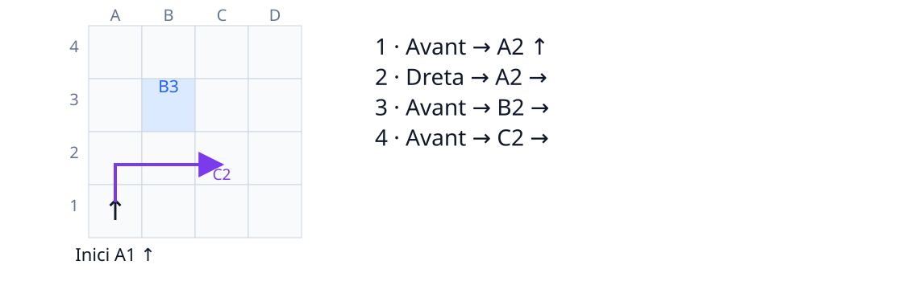
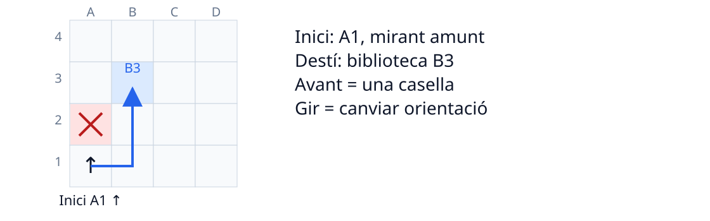
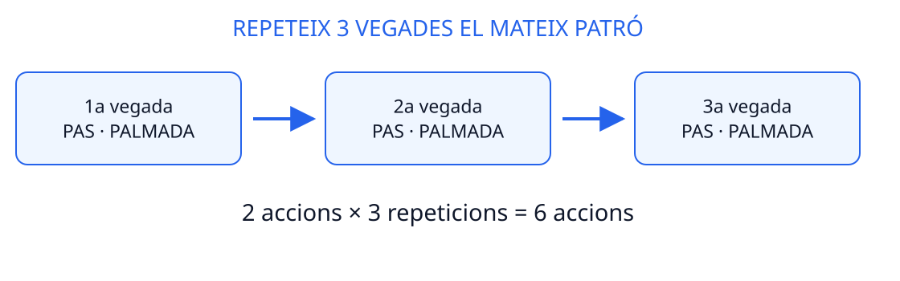
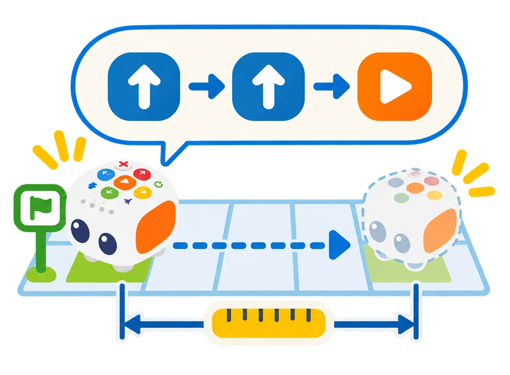
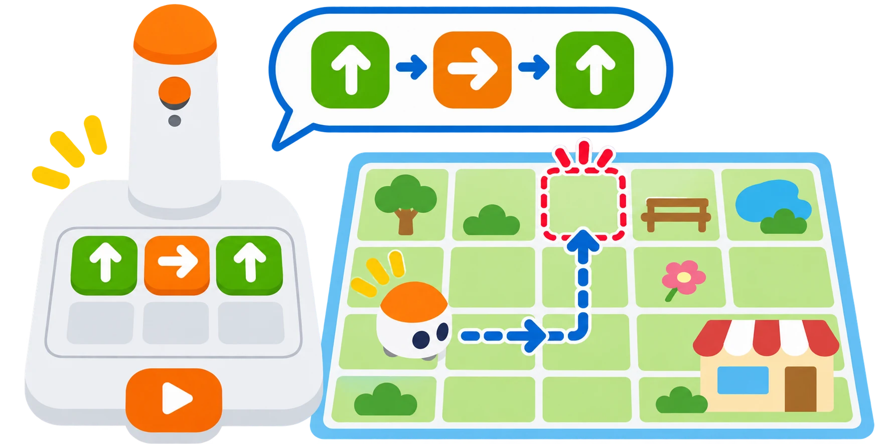
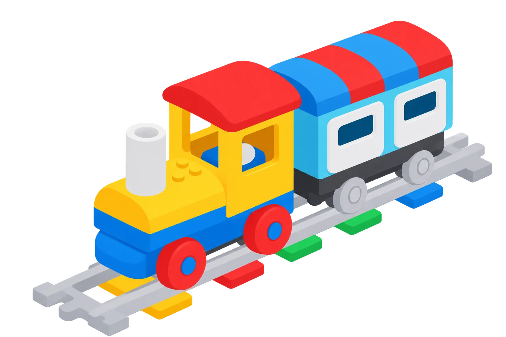
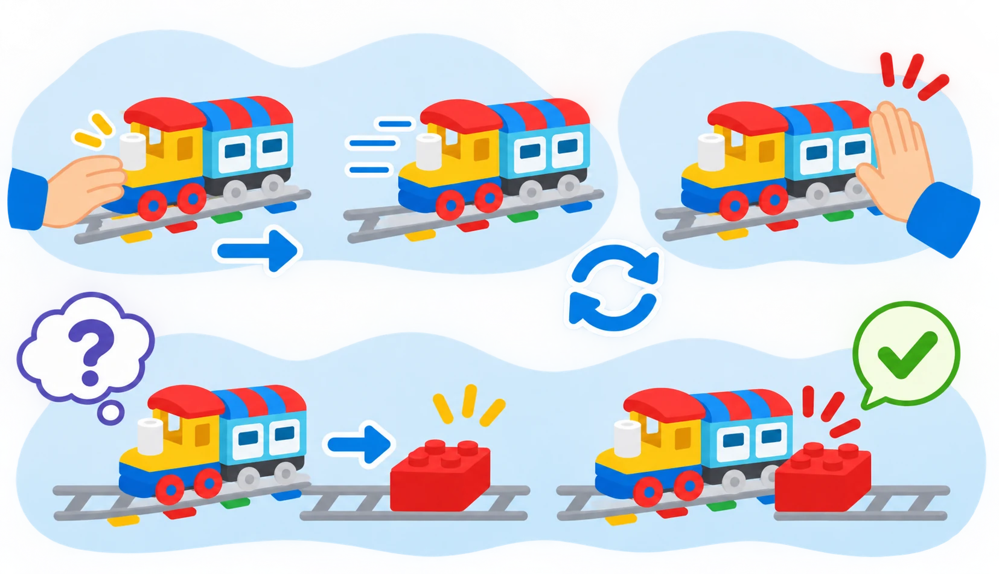
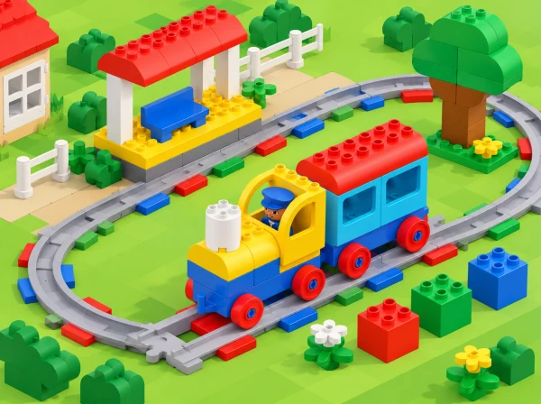

<!-- _class: cover -->

## Rutes i programació tangible

**Sessió 2 · Format de quatre sessions · 2 hores**

Formació presencial per a docents de primària

Robòtica per a docents

---

<!-- _class: section -->

## Situar-nos i escriure ordres

**00–20 min · 20 minuts**


---

<!-- _class: diagram -->

## El repte de la biblioteca


**A1 ↑ → biblioteca B3.** Una ordre «avant» avança una casella; un gir canvia l’orientació sense moure la fitxa.

---

<!-- _class: activity -->

## Escriviu una ruta · 3 minuts

1. Acordeu les ordres per arribar a la biblioteca.
2. Una persona les escriu o les diu.
3. L’altra les executa amb el dit o mentalment.

Comproveu també **cap on mira al final**.

---

<!-- _class: solution -->

## Una solució, ordre a ordre

| Ordre | Casella | Orientació |
|---|---|---|
| Inici | A1 | Amunt |
| Avant | A2 | Amunt |
| Avant | A3 | Amunt |
| Dreta | A3 | Dreta |
| Avant | B3 | Dreta |

---

<!-- _class: diagram -->

## La solució, vista sobre el mapa


El recorregut arriba a B3 i acaba mirant a la dreta. **El tercer pas és un gir: no avança de casella.**

---

## Què ens ha obligat a pensar?

<div class="flow"><span>Situar-nos</span><span class="arrow">→</span><span>Ordenar</span><span class="arrow">→</span><span>Anticipar</span><span class="arrow">→</span><span>Comprovar</span></div>

Hem necessitat un inici, una orientació i ordres compartides.

Una altra ruta també pot ser correcta: cal executar-la i justificar-la.

---

<!-- _class: diagram -->

## Girar i avançar són accions diferents


La dreta és la del personatge segons cap on mira. **Després d’un gir, continuem a la mateixa casella.**

---

<!-- _class: section -->

## Comprovar i corregir

**20–40 min · 20 minuts**


---

<!-- _class: activity -->

## Una ruta que no arriba al mateix lloc

**Avant → dreta → avant → avant**

Inici: A1 mirant amunt. Destí previst: B3.

Seguiu-la. On acaba? Quina ordre canviaríeu de lloc?

---

<!-- _class: diagram -->

## Localitzem la diferència



Acabem a **C2**, no a B3. Si movem el segon «avant» abans del gir, obtenim la ruta prevista.

---

## Dues rutes correctes poden ser diferents

**A:** avant · avant · dreta · avant.
**B:** dreta · avant · esquerra · avant · avant.

Des d’A1 ↑, totes dues arriben a B3.
A acaba mirant a la dreta; B acaba mirant amunt.

Quina convé si després volem continuar cap a B4?

---

<!-- _class: explanation -->

## Si volem continuar fins a B4…

<div class="compare"><div><h3>Després de la ruta A</h3><p>Som a B3 mirant a la dreta. Necessitem <b>girar a l’esquerra i avançar</b>.</p></div><div><h3>Després de la ruta B</h3><p>Som a B3 mirant amunt. Només necessitem <b>avançar</b>.</p></div></div>

La destinació anterior coincideix, però l’orientació final canvia les ordres següents.

---

<!-- _class: diagram -->

## Una casella tancada · 5 minuts


**Ara A2 està tancada.** Busqueu una ruta fins a B3. Conserveu l’inici A1 ↑ i el significat de les ordres.

---

<!-- _class: diagram -->

## Una ruta alternativa



**Dreta · avant · esquerra · avant · avant.** Passem per B1 i B2 fins a B3, mirant amunt. La casella A2 queda fora del recorregut.

---

<!-- _class: section -->

## Repetir una seqüència

**40–55 min · 15 minuts**


---

<!-- _class: activity -->

## Un patró que torna a començar

Pas · palmada · pas · palmada · pas · palmada.

Quin fragment es repeteix? Quantes vegades?

Acordeu la resposta amb una altra persona.

---

<!-- _class: diagram -->

## Un patró, tres repeticions



El patró té dues accions. Repetir-lo tres vegades dona **sis accions**, no tres.

---

## Representació i programació

Podem representar un bucle amb fletxes i una targeta «×3».

Per executar-lo, cal comprovar com s’expressa en el dispositiu disponible.

Una notació en paper ajuda a pensar; no garanteix que tots els robots tinguen els mateixos blocs.

---

<!-- _class: tangible -->

## Coding Set · La repetició amb peces

```coding-set
repeteix 4
endavant
dreta
fi
```

Dins del bucle hi ha **endavant · dreta**. El repetim quatre vegades. La dansa anterior repetia un altre patró tres vegades.

---

<!-- _class: activity -->

## Proveu una variació · 4 minuts

Ara volem dues repeticions.

Quantes accions hi haurà?
Què canvia en la representació?
Què es manté?

Expliqueu la resposta abans de representar-la.

---

<!-- _class: diagram -->

## Què canvia quan repetim?


Amb **dues** repeticions, fem quatre accions. Es conserva el patró; canvia el nombre de vegades.

---

<!-- _class: section -->

## Pausa

**55–60 min · 5 minuts**

Una pausa abans de continuar.

---

<!-- _class: pause -->

## Pausa · 5 minuts

En tornar, continuarem amb el bloc següent.

Deixeu anotada una pregunta que vulgueu recuperar.

---

<!-- _class: section -->

## Del paper als materials

**60–80 min · 20 minuts**


---

<!-- _class: visual -->

## Tale-Bot


Programem moviments amb els botons del robot.

**Una proposta:** Una ruta entre tres llocs d’un conte.

---

## Tale-Bot · Primera decisió

**Què cal tindre present?**

Els mapes interactius necessiten zones codificades compatibles; una quadrícula de paper serveix per orientar-nos, però no activa eixes funcions.

**Abans de la prova:** què esperem observar?
**Després:** quina decisió podrà explicar l’alumnat?

---

<!-- _class: tangible -->

## Tale-Bot · Llegim els botons en ordre

```talebot
endavant
endavant
dreta
endavant
executa
```

Preparem les ordres i després premem **executa**. El gir canvia l’orientació: no avança. Les icones representen la seqüència, no la disposició física dels botons.

---

<!-- _class: visual -->

## Tale-Bot · Del paper al robot



Marqueu inici i orientació.

Observeu quant avança **una ordre** i ajusteu les caselles.

Esborreu les ordres anteriors i proveu una ruta curta.

---

<!-- _class: visual -->

## Coding Set


Construïm el programa amb peces al tauler; la torre el llig i el MatataBot el segueix.

**Una proposta:** Comparar dues seqüències movent una peça.

---

## Coding Set · Primera decisió

**Què cal tindre present?**

Cal preparar torre, tauler i robot; no són botons sobre el mateix robot.

**Abans de la prova:** què esperem observar?
**Després:** quina decisió podrà explicar l’alumnat?

---

<!-- _class: tangible -->

## Coding Set · Llegim les peces

```coding-set
endavant
endavant
dreta
endavant
```

Al tauler, llegim les peces **d’esquerra a dreta i de dalt a baix**. Aquesta fila representa una ruta; la torre ha de poder llegir-la abans d’executar-la.

---

<!-- _class: diagram -->

## Coding Set · Com circulen les ordres?


El tauler manté el programa visible. La torre el llig i envia les ordres; el MatataBot les executa.

---

<!-- _class: visual -->

## Coding Set · El programa es pot llegir



Comproveu torre, tauler i MatataBot.

Llegiu les peces en ordre abans de prémer Play.

La imatge mostra un exemple: comprovem què fa cada peça del nostre programa.

---

<!-- _class: visual -->

## Coding Express



La via defineix el recorregut; els maons d’acció provoquen respostes del tren.

**Una proposta:** Una història amb estació, parada i destinació.

---

## Coding Express · Primera decisió

**Què cal tindre present?**

El tren no tria una destinació. Els girs de la via no són ordres de gir com en Tale-Bot.

**Abans de la prova:** què esperem observar?
**Després:** quina decisió podrà explicar l’alumnat?

---

<!-- _class: diagram -->

## Coding Express · Via i resposta


La via resol el recorregut. El maó introdueix una resposta. **No és una ordre de gir en una quadrícula.**

---

<!-- _class: visual -->

## Coding Express · La via és part del problema


**Repte:** de l’estació al parc passant per una parada.

Primer dibuixem i muntem la via. Després anticipem el viatge.

Un maó d’acció pot introduir una resposta; comprovem-la amb el kit.

---

<!-- _class: visual -->

## Coding Express · Impuls i aturada



Reviseu unions i espai d’aturada.

Enceneu i doneu una empenta suau segons la guia del kit.

Compareu aturada manual i resposta al maó roig disponible.

---

<!-- _class: section -->

## Una història en equip

**80–100 min · 20 minuts**


---

<!-- _class: activity -->

## Una història amb tres parades · 6 minuts

**Estació:** qui viatja i per què?
**Parada:** què ha de recollir?
**Parc:** com acaba la història?

En parelles, dibuixeu el recorregut i una frase per lloc.
Una altra parella ha de poder explicar el viatge.

---

## Què podem observar en la història?

L’ordre dels esdeveniments és comprensible.

El relat i el recorregut coincideixen.

L’alumnat justifica una parada o una modificació.

La narració i la programació comparteixen una seqüència.

---

<!-- _class: visual -->

## Una història té recorregut i sentit



La via situa les parades. El relat explica per què hi anem.

**Pregunta docent:** «Què passaria en la història si canviàrem l’ordre de les parades?»

---

<!-- _class: diagram -->

## Una prova amb treball per a tothom


Cada equip conserva la seua tasca mentre espera. El torn acaba amb una observació que els altres poden aprofitar.

---

## Rols rotatius

**Planifica:** proposa i justifica les ordres.
**Programa:** introdueix allò acordat.
**Comprova:** compara predicció i resultat.
**Explica:** registra una decisió.

En equips de tres, uniu comprovació i explicació.

---

<!-- _class: section -->

## Preparar la primera aplicació

**100–120 min · 20 minuts**


---

<!-- _class: activity -->

## La proposta que m’emporte · 5 minuts

Completeu oralment o en paper:

**Amb el meu grup treballaria…**
**El repte seria…**
**La primera prova consistiria en…**
**Sabria que han aprés perquè…**

---

## Compartim una decisió

Expliqueu a una altra parella la proposta en un minut.

Qui escolta pregunta: **«Què farà l’alumnat per demostrar-ho?»**

Reviseu un element abans de donar-la per preparada.

---

## Abans de la primera prova a l’aula

Comproveu material, espai i alimentació.
Prepareu una alternativa en paper.
Reserveu temps per explicar una millora.

**Una primera experiència curta i comprensible és suficient per començar.**

---

<!-- _class: resources -->

## Les propostes de partida del web

[Tale-Bot i rutes](https://gerardfp.github.io/robotica200/robot/tale-bot/index.html) · [Coding Set](https://gerardfp.github.io/robotica200/robot/coding-set/index.html)

[Botons i pantalla de Codey](https://gerardfp.github.io/robotica200/tutorial/cr-primeres-passes/index.html)

[El fanalet de micro:bit](https://gerardfp.github.io/robotica200/tutorial/mb-fanalet-llum/index.html)

[Parada per color amb SPIKE](https://gerardfp.github.io/robotica200/tutorial/sp-motors-sensors/index.html)

Les demostracions simplifiquen aquests tutorials. Els noms dels blocs poden variar segons l’idioma de l’aplicació.

---

## Recursos per continuar

**Tutorials del web:** preparar connexions, controls i primeres proves.

**Situacions d’aprenentatge:** context, seqüència i evidències per adaptar.

[Robòtica per a docents](https://gerardfp.github.io/robotica200/) · [Escola 4.0 · GVA](https://portal.edu.gva.es/escola40/va/inici/)

Les imatges reutilitzen il·lustracions del projecte.
