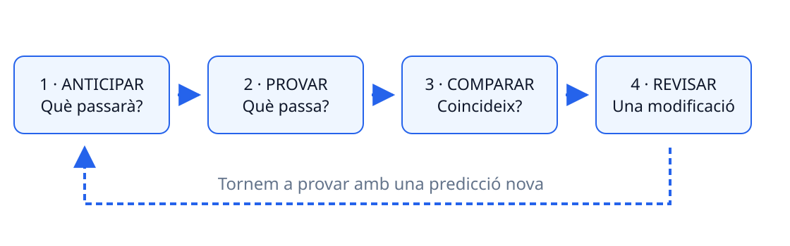
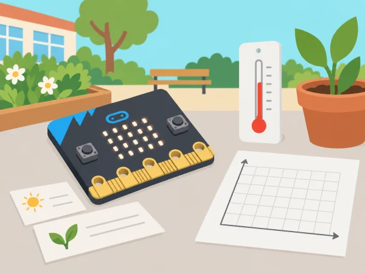
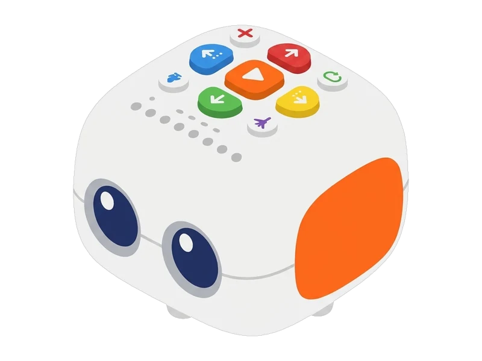
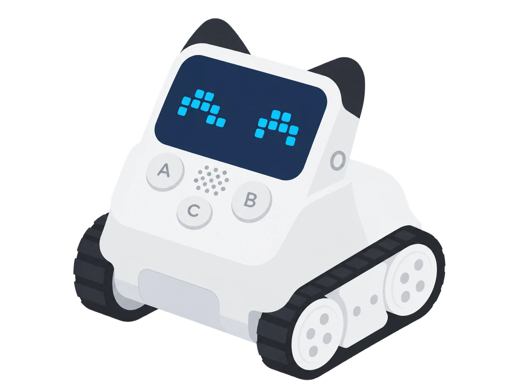
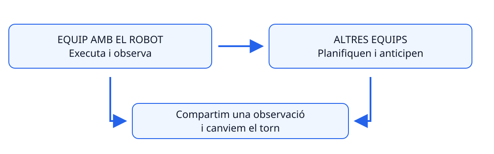
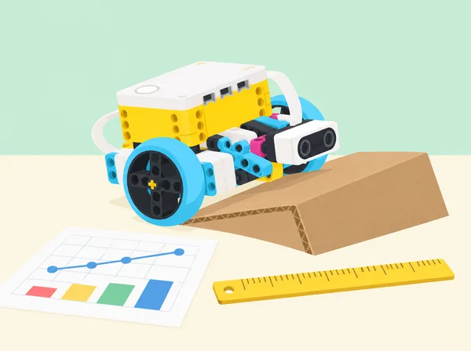
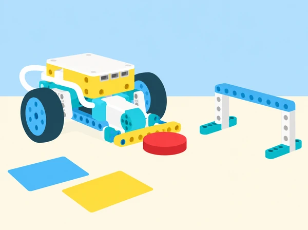

<!-- _class: cover -->

## Dissenyar una proposta per a l’aula

**Sessió 4 · Format de quatre sessions · 2 hores**

Formació presencial per a docents de primària

Robòtica per a docents

<!--
Preparació: comproveu projector i navegació. Només està garantida la projecció; les activitats admeten resposta oral o en paper. Si hi ha dispositius, assageu abans les demostracions i substituïu les simulacions per proves curtes.

**Guió de conducció**

**Obertura suggerida**
«Aquesta és la sessió final de l’itinerari triat. Hui volem eixir amb una primera proposta que es puga preparar, observar i revisar. No cal conéixer tots els dispositius per participar».

**Fil conductor**
Modeleu una proposta abans de demanar disseny autònom. La revisió entre parelles ha de concretar un canvi i una primera aplicació, no valorar la creativitat de la persona docent.

**Preparació abans de projectar**
Obriu les diapositives i la vista del presentador, comproveu que es veuen les imatges i identifiqueu les activitats en parelles. Només tenim garantit projector o PDI. Si disposeu de robots, prepareu una demostració curta abans; no dediqueu l’obertura a una instal·lació improvisada.

**Què observar en començar**
Pregunteu si el grup recorda una idea de la sessió anterior o, en la primera, quina necessitat d’aula vol treballar. Ajusteu els aclariments a les respostes sense afegir més objectius.
-->

---

<!-- _class: section -->

## Del tema al repte

<!--
Bloc «Del tema al repte»: 00–20 min de sessió (20 minuts).

Aquest temps inclou explicacions, treball dels participants i posada en comú. Controleu el tancament del bloc sense avançar les solucions abans de la predicció.

**Guió de conducció**

**Objectiu d’aquest bloc**
Transformar una idea general en una consigna comprovable.

**Com conduir-lo**
Compareu tema, repte i aprenentatge amb la biblioteca. Llegiu el mapa sonor com una adaptació possible i reduïu la primera aplicació a una experiència curta.

**Resultat que convé recollir abans d’avançar**
Una acció de l’alumnat que tinga inici, prova i possibilitat d’explicació.

**Gestió del temps**
Useu la franja indicada al començament de la nota com a límit del bloc complet, no com a durada d’aquesta pantalla. Les aclaracions del guió són un banc de suport: seleccioneu-les segons les respostes del grup, sense llegir-les totes literalment.
-->

---

## Un tema encara no és un repte

**Tema:** la biblioteca.

**Repte:** explicar una ruta perquè una altra parella arribe a un llibre.

**Aprenentatge:** ordenar instruccions i revisar-les amb una prova.

<!--
Bloc «Del tema al repte»: 00–20 min de sessió (20 minuts).

**Guió de conducció**

**Què explicar**

Distingiu de què parlarem, què ha de resoldre l’alumnat i què volem que aprenga. Biblioteca és un tema. Comunicar una ruta perquè una altra parella arribe a un llibre és un repte. Ordenar i revisar instruccions és l’aprenentatge principal.

**Com mostrar-ho**

Formuleu primer una proposta massa oberta, «farem robots a la biblioteca», i afegiu-hi una acció, un destinatari i una comprovació. La proposta es torna preparable sense necessitar un projecte més gran.

**Pregunta i resposta esperable**

«Si el tema és el pati, quin repte podríem investigar?» Comparar lectures de dos llocs amb el mateix procediment. No cal que tot el grup trie el mateix tema.

**Si apareix aquest dubte**

Un repte no ha de ser espectacular ni exigir una solució única. Ha de permetre prendre decisions, comprovar-les i explicar-les.

**Enllaç amb el pas següent**

Mostreu com l’aprenentatge triat determina què considerarem una evidència útil.
-->

---

<!-- _class: diagram -->

## De l’aprenentatge a l’evidència

Completem la proposta triant **material, temps i participació**. L’evidència ha de respondre a l’aprenentatge.

<!--
Bloc «Del tema al repte»: 00–20 min de sessió (20 minuts).

**Guió de conducció**

**Què explicar**

Llegiu la cadena amb el cas complet: volem ordenar instruccions; proposem arribar a un llibre; una altra parella executa la seqüència; escoltem com s’explica una correcció. El darrer element ha de donar informació sobre el primer.

**Com mostrar-ho**

Assenyaleu cada caixa i feu repetir la relació en una frase. Completeu-la amb temps, materials i participació, que són decisions de preparació encara que no càpiguen totes dins del diagrama.

**Pregunta i resposta esperable**

«Si l’evidència fora només una foto del robot davant del llibre, què ens faltaria?» Saber si les instruccions eren clares i com s’han revisat. La foto pot complementar, però no substitueix aquella informació.

**Si apareix aquest dubte**

No busquem una rúbrica llarga per a cada repte. Una pregunta ben triada i una nota breu poden ser suficients per decidir la pròxima ajuda.

**Enllaç amb el pas següent**

Apliqueu aquesta cadena quan llegim un context i, després, quan emplenem la proposta pròpia.
-->

---

<!-- _class: visual -->

## Llegim una proposta · El mapa sonor

Un recorregut amb parades permet narrar i ordenar.

**Adaptació curta:** triar dues parades, escriure les ordres i contar què passa en arribar.

La il·lustració és un context; el grup concreta el seu mapa.

<!--
Bloc «Del tema al repte»: 00–20 min de sessió (20 minuts).

**Guió de conducció**

**Què explicar**

Expliqueu una adaptació curta del context il·lustrat: triar dues parades, acordar què es contarà en cadascuna i preparar instruccions perquè una altra parella seguisca el recorregut. El so o la narració han d’ajudar a comunicar, no ser un afegit obligatori.

**Com mostrar-ho**

Assenyaleu dos elements de la imatge i proposeu una frase breu per a cada parada. Per executar amb un robot, el grup haurà de construir un mapa propi amb inici, orientació i unitats conegudes.

**Pregunta i resposta esperable**

«Quina evidència podríem recollir?» Que una altra parella entenga l’ordre i que els autors expliquen una decisió del recorregut o del relat.

**Si apareix aquest dubte**

La il·lustració no és per si mateixa un mapa que el sensor puga llegir. Tampoc cal usar enregistrament de veu per treballar una narració oral.

**Enllaç amb el pas següent**

Reduïu la primera versió a una seqüència que càpiga en una única experiència d’aula.
-->

---

## La primera versió ha de cabre en una sessió

| Moment | Què fa l’alumnat? | Minuts |
|---|---|---|
| Anticipar | Situa inici i destí | 5 |
| Preparar | Escriu les ordres | 10 |
| Provar | Intercanvia i executa | 10 |
| Explicar | Justifica una millora | 5 |

Trenta minuts per a una primera experiència.

<!--
Bloc «Del tema al repte»: 00–20 min de sessió (20 minuts).

**Guió de conducció**

**Què explicar**

Aquesta taula és un exemple de classe de trenta minuts, no el rellotge de la formació presencial. Els temps es mantenen projectats perquè el grup està aprenent a dissenyar una sessió d’aula.

**Com mostrar-ho**

Llegiu les quatre fases amb les accions de l’alumnat: situar, preparar ordres, provar amb una altra parella i explicar una millora. Observeu que planificar i conversar ocupen temps, no només l’ús del robot.

**Pregunta i resposta esperable**

«Què passaria si la connexió consumeix els deu minuts de prova?» Podem continuar amb la representació en paper i mantindre la conversa d’aprenentatge, anotant la incidència tècnica per resoldre-la després.

**Si apareix aquest dubte**

La taula és un model ajustable. No prometeu que qualsevol grup o muntatge complete la tasca en aquest temps; la primera aplicació servirà per revisar-lo.

**Enllaç amb el pas següent**

Concreteu quina resposta oral ens permetria saber què ha entés l’alumnat.
-->

---

<!-- _class: section -->

## Evidències i participació

<!--
Bloc «Evidències i participació»: 20–40 min de sessió (20 minuts).

Aquest temps inclou explicacions, treball dels participants i posada en comú. Controleu el tancament del bloc sense avançar les solucions abans de la predicció.

**Guió de conducció**

**Objectiu d’aquest bloc**
Decidir què observarem i com podrà participar tothom.

**Com conduir-lo**
Compareu respostes orals, distingiu producte i procés i concreteu suports. Useu el mateix repte per evitar que cada concepte parega una activitat nova.

**Resultat que convé recollir abans d’avançar**
Una pregunta final i almenys un suport que mantinga la meta d’aprenentatge.

**Gestió del temps**
Useu la franja indicada al començament de la nota com a límit del bloc complet, no com a durada d’aquesta pantalla. Les aclaracions del guió són un banc de suport: seleccioneu-les segons les respostes del grup, sense llegir-les totes literalment.
-->

---

<!-- _class: solution -->

## Una evidència que podem escoltar

**Pregunta:** «Quina ordre has canviat i per què?»

**Resposta poc informativa:** «Perquè ara funciona».

**Resposta amb evidència:** «He mogut l’avant abans del gir perquè ens faltava una casella cap amunt».

<!--
Bloc «Evidències i participació»: 20–40 min de sessió (20 minuts).

**Guió de conducció**

**Què explicar**

Compareu la informació de les dues respostes, sense jutjar la persona. «Ara funciona» diu que el resultat ha canviat. «He mogut l’avant abans del gir perquè faltava una casella» relaciona una decisió amb una causa.

**Com mostrar-ho**

Feu de docent i de participant per llegir el diàleg. Després demaneu al grup què ens permet saber la segona resposta que no apareix en la primera.

**Pregunta i resposta esperable**

«Quina pregunta ajudaria si només ens diuen que funciona?» «Quina ordre has canviat?» o «on acabaves abans?». Esperem que concreten una acció i el seu efecte.

**Si apareix aquest dubte**

No exigiu formulacions tècniques ni una frase memoritzada. Una explicació amb un dibuix o assenyalant el recorregut pot donar la mateixa evidència.

**Enllaç amb el pas següent**

Diferencieu el producte final de les evidències que podem observar durant el procés.
-->

---

<!-- _class: explanation -->

## El resultat i l’aprenentatge es complementen

<h3>Producte</h3>
Una ruta dibuixada o un programa que arriba al destí.

<h3>Evidència del procés</h3>
Anticipar el final, localitzar una diferència i explicar una correcció.

No tot s’ha d’escriure: una conversa breu també aporta evidència.

<!--
Bloc «Evidències i participació»: 20–40 min de sessió (20 minuts).

**Guió de conducció**

**Què explicar**

El producte és allò que construïm o obtenim: una ruta, un programa o una maqueta. L’evidència del procés ens ajuda a interpretar què s’ha entés: anticipar, comparar i justificar una correcció. No són dues activitats que cal afegir sempre per separat.

**Com mostrar-ho**

Useu un mateix cas: la ruta final és el producte; escoltar per què s’ha canviat un gir és una evidència sobre la comprensió. També podem mirar dues versions del programa.

**Pregunta i resposta esperable**

«Un producte correcte demostra que totes les persones de l’equip ho han entés?» No necessàriament. Podem demanar a diferents membres que expliquen una decisió amb els suports que necessiten.

**Si apareix aquest dubte**

Eviteu convertir observar en emplenar moltes fitxes. La documentació ha de ser proporcionada a la decisió docent que volem prendre.

**Enllaç amb el pas següent**

La taula següent ofereix tres observacions senzilles per començar.
-->

---

## Observar sense complicar l’avaluació

| Què observem? | Evidència possible |
|---|---|
| Anticipa | Assenyala el final abans de provar |
| Comprova | Compara ruta prevista i ruta real |
| Revisa | Canvia una ordre i explica el motiu |

Preneu una nota breu durant la conversa.

<!--
Bloc «Evidències i participació»: 20–40 min de sessió (20 minuts).

**Guió de conducció**

**Què explicar**

Expliqueu què es mira en cada fila. Anticipar és indicar un final abans de provar; comprovar és comparar-lo amb el resultat; revisar és modificar alguna cosa amb un motiu. Una nota breu pot recollir què fa el grup i quina ajuda necessita.

**Com mostrar-ho**

Modeleu una anotació descriptiva: «assenyala B3 abans de provar; confon gir i avançament; ho corregeix amb la fletxa de suport». Això informa millor que escriure simplement «bé» o «malament».

**Pregunta i resposta esperable**

«Quina ajuda podríem decidir a partir d’aquesta observació?» Tornar a representar el gir sense desplaçament o reduir la ruta. L’observació ha de servir per orientar l’acció.

**Si apareix aquest dubte**

No presenteu les tres files com una escala rígida d’alumnat ni com un diagnòstic individual complet. Són pistes situades en una activitat.

**Enllaç amb el pas següent**

Penseu quins suports permetrien mostrar la mateixa comprensió d’altres maneres.
-->

---

<!-- _class: visual -->

## Un mateix objectiu, diferents suports

**Amb ajuda:** dues ordres i fletxes grans.

**Amb autonomia:** una ruta amb un gir.

**Ampliació:** comparar dues rutes possibles.

<!--
Bloc «Evidències i participació»: 20–40 min de sessió (20 minuts).

**Guió de conducció**

**Què explicar**

La meta continua sent comunicar i revisar instruccions. Les variacions canvien l’accés o la complexitat: menys ordres, símbols més grans, ajuda per manipular o comparació de dues rutes. No cal començar tothom exactament pel mateix repte.

**Com mostrar-ho**

Useu una ruta curta i expliqueu què conservaríeu: inici, significat de les ordres i justificació d’un canvi. Després afegiu un gir o una restricció per ampliar, sense llevar els suports de comunicació necessaris.

**Pregunta i resposta esperable**

«Reduir a dues ordres lleva l’aprenentatge?» No si encara cal anticipar i explicar. «Una persona que no manipula pot demostrar comprensió?» Sí, dirigint o revisant la seqüència.

**Si apareix aquest dubte**

No assigneu versions segons etiquetes fixes. Reviseu el suport a partir del que observeu i permeteu que els rols canvien.

**Enllaç amb el pas següent**

Connecteu aquestes decisions amb la planificació del material i els torns.
-->

---

## Participar també és anticipar i explicar

Fletxes grans, consignes orals i temps per pensar.

Podem explicar amb veu, dibuix o demostració.

Una altra persona pot manipular el dispositiu seguint les nostres instruccions.

<!--
Bloc «Evidències i participació»: 20–40 min de sessió (20 minuts).

**Guió de conducció**

**Què explicar**

«Fer robòtica no és només tocar el robot». Una persona pot formular les ordres, anticipar el resultat o justificar una correcció mentre una altra executa. Aquesta distinció permet adaptar l’accés sense llevar l’objectiu.

**Com mostrar-ho**

Poseu un exemple: una persona dicta dues fletxes grans i una altra les introdueix. Després la primera explica si la predicció coincideix. Oferiu veu, dibuix i demostració com a formes de resposta.

**Pregunta i resposta esperable**

«Quin suport canviaria l’accés però mantindria el repte?» Fletxes més grans, consigna oral, menys ordres inicials o una persona que manipule seguint instruccions.

**Si apareix aquest dubte**

Eviteu repartir rols segons suposicions fixes sobre l’alumnat. El suport ha de permetre prendre decisions, no convertir una persona en espectadora permanent.

**Enllaç amb el pas següent**

Expliqueu com les preguntes del docent ajuden a revisar sense resoldre el repte per l’equip.
-->

---

<!-- _class: diagram -->

## Com acompanyem una revisió?

Preguntem què esperàvem i què ha passat. Després canviem **una sola cosa** i tornem a provar.

<!--
Bloc «Evidències i participació»: 20–40 min de sessió (20 minuts).

**Guió de conducció**

**Què explicar**

Llegiu el cicle com una conversa: abans, què esperes? Després de provar, què ha passat? En comparar, on es diferencien? En revisar, què canviaràs? La darrera fletxa indica que la modificació necessita una nova comprovació.

**Com mostrar-ho**

Torneu a una ruta que acabaria a C2. En lloc de dir immediatament l’ordre correcta, demaneu que localitzen el gir i comparen el camí amb la destinació B3.

**Pregunta i resposta esperable**

Una resposta útil és «hem girat massa prompte; provarem d’avançar una vegada més abans de girar». Si diuen «està malament», demaneu quin fet concret els ho fa pensar.

**Si apareix aquest dubte**

Canviar una sola cosa és una pauta per entendre la causa, no una prohibició absoluta. Si el programa té diversos errors, aneu resolent-los de manera que es puga explicar cada canvi.

**Enllaç amb el pas següent**

Conserveu aquestes preguntes en preparar la proposta pròpia del final.
-->

---

<!-- _class: section -->

## Triar i preparar els recursos

<!--
Bloc «Triar i preparar els recursos»: 40–55 min de sessió (15 minuts).

Aquest temps inclou explicacions, treball dels participants i posada en comú. Controleu el tancament del bloc sense avançar les solucions abans de la predicció.

**Guió de conducció**

**Objectiu d’aquest bloc**
Fer viable la proposta amb la dotació real.

**Com conduir-lo**
Recupereu un cas de dades i feu revisar funció, preparació, nombre d’unitats i alternativa. Concreteu què fan els equips mentre un altre prova.

**Resultat que convé recollir abans d’avançar**
Una elecció de material justificada, amb torns i alternativa.

**Gestió del temps**
Useu la franja indicada al començament de la nota com a límit del bloc complet, no com a durada d’aquesta pantalla. Les aclaracions del guió són un banc de suport: seleccioneu-les segons les respostes del grup, sense llegir-les totes literalment.
-->

---

<!-- _class: visual -->

## Una investigació al pati

**Pregunta:** dos llocs donen lectures diferents?

**Prova:** tres lectures per lloc amb la mateixa placa i orientació.

**Evidència:** registre i conclusió. La imatge contextualitza la proposta.

<!--
Bloc «Triar i preparar els recursos»: 40–55 min de sessió (15 minuts).

**Guió de conducció**

**Què explicar**

El pati és el context; la pregunta concreta és si dos llocs donen lectures diferents amb el mateix procediment. La il·lustració no és un registre real del centre: ajuda a imaginar què prepararem.

**Com mostrar-ho**

Feu triar dos punts identificables i tres lectures per punt. Acordeu usar la mateixa placa, orientació i manera de fer la lectura. Si no hi ha dispositiu, torneu a la taula simulada de la sessió de sensors.

**Pregunta i resposta esperable**

«Què entregaríem o explicaríem al final?» Un registre i una conclusió que compare les lectures sense afirmar propietats que no hem mesurat.

**Si apareix aquest dubte**

No equipareu lectura relativa de llum amb lux ni amb confort visual. No cal eixir del centre durant la formació per entendre el disseny de la prova.

**Enllaç amb el pas següent**

Abans de triar definitivament el material, feu les quatre preguntes de preparació.
-->

---

## Triem el material amb quatre preguntes

Quina funció necessitem?
Quina preparació podem assumir?
Quantes unitats tenim?
Quina alternativa hi ha si falla la connexió?

La tria ha de permetre provar i explicar el repte dins del temps.

<!--
Bloc «Triar i preparar els recursos»: 40–55 min de sessió (15 minuts).

**Guió de conducció**

**Què explicar**

Llegiu les preguntes com un filtre pràctic. Primer la funció necessària; després la preparació, les unitats i l’alternativa. Per a una ruta narrada pot bastar programació tangible; per comparar llum necessitem una lectura o dades per simular-la.

**Com mostrar-ho**

Compareu dues decisions per al mateix centre: un únic robot preparat amb treball en paper per torns, o diversos dispositius que encara no sabem connectar. La disponibilitat no es redueix al nombre de caixes.

**Pregunta i resposta esperable**

«Què faríem si la connexió no respon el dia de la classe?» Mantindre una alternativa que permeta pensar i explicar el mateix repte, i revisar la part tècnica després.

**Si apareix aquest dubte**

No trieu per quantitat de funcions anunciades. L’eina ha de facilitar una prova observable dins del temps i amb els suports del grup.

**Enllaç amb el pas següent**

El resum visual següent relaciona cada eina amb una primera funció que ja coneixem.
-->

---

<!-- _class: gallery -->

## La funció que necessitem orienta la tria

<figure><figcaption>Ruta tangible</figcaption></figure><figure><figcaption>Botó i pantalla</figcaption></figure><figure><figcaption>Lectures i dades</figcaption></figure>

Trieu segons el repte, el temps de preparació i la dotació real. Cap material és una obligació.

<!--
Bloc «Triar i preparar els recursos»: 40–55 min de sessió (15 minuts).

**Guió de conducció**

**Què explicar**

Les tres imatges no són una classificació de qualitat. Recorden tres entrades possibles: ruta tangible, botó i pantalla, lectura i dades. Un mateix material pot tindre altres possibilitats; ara busquem una funció que sabem preparar.

**Com mostrar-ho**

Demaneu que la parella situe la seua proposta al costat d’una funció, no necessàriament d’un producte. Després expliqueu quina preparació comportaria i si hi ha una alternativa en paper.

**Pregunta i resposta esperable**

«Si ja tenim un altre material que resol el mateix repte, hem de canviar-lo?» No. Justificar la correspondència amb l’objectiu és més important que seguir una llista de preferències.

**Si apareix aquest dubte**

No deduïu que cada robot pertany exclusivament a un cicle o una matèria. La complexitat ve també del problema i de l’ajuda que oferim.

**Enllaç amb el pas següent**

Passeu a la plantilla per escriure una proposta que una altra persona puga entendre.
-->

---

<!-- _class: diagram -->

## Una prova amb treball per a tothom

Cada equip conserva la seua tasca mentre espera. El torn acaba amb una observació que els altres poden aprofitar.

<!--
Bloc «Triar i preparar els recursos»: 40–55 min de sessió (15 minuts).

**Guió de conducció**

**Què explicar**

Expliqueu que disposar d’una sola unitat no obliga a una classe sencera a esperar. El diagrama diferencia l’equip que executa i observa del treball dels altres: planificar, anticipar o comparar versions en paper.

**Com mostrar-ho**

Imagineu quatre equips. L’equip que prova té una seqüència curta preparada; els altres anoten on acabarà o revisen la pròpia ruta. En acabar, comparteix una observació útil i cedeix el torn.

**Pregunta i resposta esperable**

«Quina tasca concreta tenen els equips que esperen?» No basta «mirar»: poden predir la casella final i justificar-la, o detectar una diferència respecte de la ruta prevista.

**Si apareix aquest dubte**

No convertiu el canvi de torn en una prova de rapidesa. Si un equip no està preparat, ha de poder seguir treballant en paper sense perdre la possibilitat d’aprendre.

**Enllaç amb el pas següent**

Concreteu els rols perquè manipular el robot no siga l’única forma visible de participar.
-->

---

## Rols rotatius

**Planifica:** proposa i justifica les ordres.
**Programa:** introdueix allò acordat.
**Comprova:** compara predicció i resultat.
**Explica:** registra una decisió.

En equips de tres, uniu comprovació i explicació.

<!--
Bloc «Triar i preparar els recursos»: 40–55 min de sessió (15 minuts).

**Guió de conducció**

**Què explicar**

Expliqueu que els rols distribueixen responsabilitats, no etiqueten capacitats. Planificar proposa i justifica; programar introdueix allò acordat; comprovar compara amb la predicció; explicar deixa constància d’una decisió.

**Com mostrar-ho**

Useu una mateixa ruta i demaneu què faria cada rol abans, durant i després de la prova. En equips de tres es poden unir comprovació i explicació. Acordeu una rotació després de cada prova o repte curt.

**Pregunta i resposta esperable**

«Qui pensa el programa?» Tot l’equip, encara que una persona introduïsca les ordres. «Qui ha de saber explicar-lo?» Tothom; el rol de portaveu no eximeix les altres persones de comprendre.

**Si apareix aquest dubte**

Eviteu que la persona amb més experiència es quede sempre el dispositiu. Tampoc interpreteu una dificultat de manipulació com una dificultat de comprensió.

**Enllaç amb el pas següent**

Reforceu les diverses maneres de participar i explicar l’aprenentatge.
-->

---

<!-- _class: pause -->

## Pausa

En tornar, continuarem amb el bloc següent.

Deixeu anotada una pregunta que vulgueu recuperar.

<!--
Bloc «Pausa»: 55–60 min de sessió (5 minuts).

Temps orientatiu de la dinàmica: 5 minuts.

Respecteu els cinc minuts de pausa; recupereu una de les preguntes anotades en reprendre la sessió.

**Guió de conducció**

Conducció de la pausa
Doneu un punt clar de retorn i conserveu les preguntes pendents. Podeu demanar que cada parella trie quin dubte voldria recuperar després, sense convertir la pausa en una nova tasca obligatòria.

Abans de reprendre
Recordeu en una frase què ja hem comprovat i quin canvi introduirem ara. Si hi ha hagut una incidència tècnica, manteniu l’alternativa en paper per preservar el temps d’aprenentatge. No intenteu recuperar tota la pausa accelerant les explicacions següents.
-->

---

<!-- _class: section -->

## Dissenyar una proposta

<!--
Bloc «Dissenyar una proposta»: 60–85 min de sessió (25 minuts).

Aquest temps inclou explicacions, treball dels participants i posada en comú. Controleu el tancament del bloc sense avançar les solucions abans de la predicció.

**Guió de conducció**

**Objectiu d’aquest bloc**
Escriure una primera versió que una altra persona puga aplicar.

**Com conduir-lo**
Modeleu la plantilla abans de demanar treball autònom. Durant el disseny, prioritzeu consigna, prova i evidència sobre detalls decoratius o funcions extra.

**Resultat que convé recollir abans d’avançar**
Una proposta breu preparada per rebre una revisió entre parelles.

**Gestió del temps**
Useu la franja indicada al començament de la nota com a límit del bloc complet, no com a durada d’aquesta pantalla. Les aclaracions del guió són un banc de suport: seleccioneu-les segons les respostes del grup, sense llegir-les totes literalment.
-->

---

<!-- _class: worksheet -->

## La plantilla, a la pantalla

**Grup i cicle:** …
**Aprenentatge:** …
**Consigna per a l’alumnat:** …
**Material i alternativa en paper:** …
**Seqüència i minuts:** …
**Evidència i pregunta final:** …

<!--
Bloc «Dissenyar una proposta»: 60–85 min de sessió (25 minuts).

**Guió de conducció**

**Què explicar**

Expliqueu cada camp amb el cas de la biblioteca. Grup i cicle situen la proposta; aprenentatge diu què volem veure; consigna és allò que direm a l’alumnat; material i alternativa fan viable la prova; seqüència reparteix el temps; evidència i pregunta orienten l’observació.

**Com mostrar-ho**

No deixeu sis títols sense modelar: completeu oralment una línia de cada camp abans de demanar treball autònom. Es pot copiar la plantilla al paper sense imprimir cap fitxa.

**Pregunta i resposta esperable**

«Una consigna pot ser només “treballar orientació”?» Això és un objectiu o tema, no una acció clara per a l’alumnat. Demaneu què ha de fer i com sabrà si ho ha resolt.

**Si apareix aquest dubte**

No cal usar terminologia administrativa ni emplenar una SDA completa. La plantilla serveix per preparar una primera experiència acotada.

**Enllaç amb el pas següent**

Comproveu la coherència de les decisions i mostreu després un exemple ja emplenat.
-->

---

<!-- _class: diagram -->

## Comprovem que les decisions encaixen

Si volem ordenar instruccions, la prova ha de permetre executar-les i revisar-les. **Una activitat atractiva també necessita un aprenentatge explícit.**

<!--
Bloc «Dissenyar una proposta»: 60–85 min de sessió (25 minuts).

**Guió de conducció**

**Què explicar**

Llegiu la cadena amb el cas complet: volem ordenar instruccions; proposem arribar a un llibre; una altra parella executa la seqüència; escoltem com s’explica una correcció. El darrer element ha de donar informació sobre el primer.

**Com mostrar-ho**

Assenyaleu cada caixa i feu repetir la relació en una frase. Completeu-la amb temps, materials i participació, que són decisions de preparació encara que no càpiguen totes dins del diagrama.

**Pregunta i resposta esperable**

«Si l’evidència fora només una foto del robot davant del llibre, què ens faltaria?» Saber si les instruccions eren clares i com s’han revisat. La foto pot complementar, però no substitueix aquella informació.

**Si apareix aquest dubte**

No busquem una rúbrica llarga per a cada repte. Una pregunta ben triada i una nota breu poden ser suficients per decidir la pròxima ajuda.

**Enllaç amb el pas següent**

Apliqueu aquesta cadena quan llegim un context i, després, quan emplenem la proposta pròpia.
-->

---

<!-- _class: worksheet -->

## Un exemple emplenat

**Grup:** primer cicle.
**Aprenentatge:** ordenar i revisar instruccions.
**Consigna:** porta la fitxa d’A1 a B3 i escriu la ruta.
**Material:** quadrícula i fletxes; robot opcional.
**Evidència:** una altra parella segueix les ordres.
**Pregunta:** quina ordre has canviat i per què?

<!--
Bloc «Dissenyar una proposta»: 60–85 min de sessió (25 minuts).

**Guió de conducció**

**Què explicar**

Llegiu l’exemple com una proposta executable: primer cicle, instruccions per anar d’A1 a B3, quadrícula i fletxes, una altra parella que prova i una pregunta sobre la correcció. El robot és opcional perquè el procés també es pot representar.

**Com mostrar-ho**

Si cal recuperar el mapa, recordeu A1 baix a l’esquerra mirant amunt i B3 una columna a la dreta i dues files més amunt. La consigna necessita aquella orientació inicial, encara que el resum no la repetisca en cada camp.

**Pregunta i resposta esperable**

«Què faria l’altra parella si falta l’orientació?» Hauria d’endevinar-la. Aprofiteu-ho per detectar una informació que convé afegir abans d’aplicar la proposta.

**Si apareix aquest dubte**

L’exemple és una base que s’ha de contextualitzar, no una fitxa perfecta per copiar sense llegir. La revisió per una altra parella permet trobar aquests buits.

**Enllaç amb el pas següent**

Doneu el temps de disseny perquè cada parella adapte o prepare una proposta pròpia.
-->

---

<!-- _class: activity -->

## Disseny en parelles

1. Acordeu l’aprenentatge i el repte.
2. Escriviu la consigna, el material i la seqüència.
3. Decidiu com participarà tothom i quines evidències recollireu.
4. Comproveu si una altra persona ho podria aplicar.

Podeu reutilitzar la biblioteca, el mapa sonor o les dades de llum.

<!--
Bloc «Dissenyar una proposta»: 60–85 min de sessió (25 minuts).

Temps orientatiu de la dinàmica: 15 minuts.

Distribució dels 15 minuts de treball: 3 min per a aprenentatge i repte; 5 min per a consigna, material i seqüència; 4 min per a participació i evidències; 3 min per a comprovar si una altra persona ho podria aplicar.

**Guió de conducció**

**Què explicar**

Heu de convertir les decisions en una proposta breu. Poden adaptar biblioteca, mapa sonor o dades de llum; no cal inventar una situació nova per demostrar comprensió. El temps de treball està distribuït en les notes, no a la pantalla.

**Com mostrar-ho**

En els primers minuts, comproveu que cada parella té un aprenentatge i una consigna. Més endavant pregunteu quina evidència recolliran i com participaran les persones que no manipulen.

**Pregunta i resposta esperable**

«Què explicaria una altra persona si només llegira aquesta proposta?» Hauria de saber què prepara, què diu al grup i què observa. Si no, concreteu un camp abans d’afegir activitats.

**Si apareix aquest dubte**

Eviteu dedicar tot el temps al relat decoratiu o a triar imatges. Una proposta sintètica amb prova i evidència clares és suficient per a aquesta fase.

**Enllaç amb el pas següent**

Prepareu l’intercanvi: una altra parella haurà d’explicar què ha entés i suggerir una millora.
-->

---

<!-- _class: section -->

## Revisar i millorar

<!--
Bloc «Revisar i millorar»: 85–105 min de sessió (20 minuts).

Aquest temps inclou explicacions, treball dels participants i posada en comú. Controleu el tancament del bloc sense avançar les solucions abans de la predicció.

**Guió de conducció**

**Objectiu d’aquest bloc**
Convertir un retorn en una decisió aplicable.

**Com conduir-lo**
Organitzeu l’intercanvi, demaneu primer què s’ha entés i després una dificultat i una millora concreta. Reserveu uns minuts perquè els autors facen el canvi i n’expliquen el motiu.

**Resultat que convé recollir abans d’avançar**
Una versió revisada amb un canvi justificat, no només comentaris generals.

**Gestió del temps**
Useu la franja indicada al començament de la nota com a límit del bloc complet, no com a durada d’aquesta pantalla. Les aclaracions del guió són un banc de suport: seleccioneu-les segons les respostes del grup, sense llegir-les totes literalment.
-->

---

<!-- _class: activity -->

## Revisió entre parelles

Intercanvieu la proposta.

1. Expliqueu què enteneu que farà l’alumnat.
2. Assenyaleu una dificultat de temps o material.
3. Proposeu una millora concreta.

Retorneu-la amb un canvi que els autors puguen aplicar.

<!--
Bloc «Revisar i millorar»: 85–105 min de sessió (20 minuts).

Temps orientatiu de la dinàmica: 8 minuts.

**Guió de conducció**

**Què explicar**

Qui revisa comença retornant allò que ha entés, no opinant si li agrada el tema. Després identifica una dificultat concreta de temps, material o consigna i proposa un canvi possible.

**Com mostrar-ho**

Modeleu un retorn: «Entenc que guiarem una fitxa a un llibre. No veig cap on mira al principi. Afegiria una fletxa d’inici». Els autors escolten, decideixen i anoten què revisen.

**Pregunta i resposta esperable**

«Una millora ha de fer la proposta més llarga?» No. Llevar un gir o reduir una funció pot fer-la més clara i viable.

**Si apareix aquest dubte**

No useu la revisió com una valoració de la competència de la persona docent. Parlem d’una proposta concreta que encara estem preparant.

**Enllaç amb el pas següent**

Les pantalles següents comparen un comentari general amb un retorn que es pot aplicar.
-->

---

## Una revisió que ajuda a decidir

«És massa difícil» és una valoració general.

**«Amb tres girs ens faltarà temps; podem començar amb un»** proposa una modificació.

Els autors decideixen què canvien i expliquen el motiu.

<!--
Bloc «Revisar i millorar»: 85–105 min de sessió (20 minuts).

**Guió de conducció**

**Què explicar**

Compareu «és massa difícil» amb «amb tres girs ens faltarà temps; podem començar amb un». La segona frase identifica una causa probable i proposa una modificació que es pot discutir i provar.

**Com mostrar-ho**

Demaneu reformular un comentari real del treball anterior seguint aquest model: què hem observat, què podria dificultar i què canviaríem. Els autors no estan obligats a acceptar-lo sense pensar.

**Pregunta i resposta esperable**

«Com sabrem si llevar un gir manté l’aprenentatge?» Comprovant que encara cal ordenar, anticipar i explicar. Simplificar no ha de llevar tot el repte.

**Si apareix aquest dubte**

Un retorn concret tampoc és una garantia: pot ser una hipòtesi docent que ajustarem després d’aplicar la sessió.

**Enllaç amb el pas següent**

Relacioneu la revisió docent amb el mateix cicle de prova i millora que demanem a l’alumnat.
-->

---

<!-- _class: diagram -->

## Una revisió és una nova oportunitat de prova

La proposta millora quan podem dir **què canviem, per què i com ho comprovarem**, mantenint la meta d’aprenentatge.

<!--
Bloc «Revisar i millorar»: 85–105 min de sessió (20 minuts).

**Guió de conducció**

**Què explicar**

El cicle és el mateix que al programa: anticipem com funcionarà la proposta, la provem, comparem amb allò previst i modifiquem una decisió. Una proposta escrita no és el final del procés.

**Com mostrar-ho**

Useu un canvi sorgit en la revisió: reduir la ruta, afegir una marca d’orientació o modificar el torn. Demaneu quina observació permetria saber si ajuda.

**Pregunta i resposta esperable**

«Què canviem i per què? Com ho comprovarem?» Una resposta útil relaciona un canvi concret amb la meta d’aprenentatge, no només amb acabar abans.

**Si apareix aquest dubte**

No reviseu simultàniament tots els camps sense conservar la primera versió. Comparar les versions ajuda a entendre la decisió i compartir-la amb altres docents.

**Enllaç amb el pas següent**

Tanqueu la preparació amb una prova del material i el registre que voldríeu utilitzar.
-->

---

<!-- _class: visual -->

## Preparem una prova que puguem observar

Assageu el muntatge o la ruta.

Acordeu què mantindreu igual entre proves.

Prepareu un registre senzill i una alternativa en paper.

<!--
Bloc «Revisar i millorar»: 85–105 min de sessió (20 minuts).

**Guió de conducció**

**Què explicar**

Assajar abans de classe no és només comprovar que s’encén el robot. És executar la ruta o el programa, revisar l’espai i saber quina resposta observarem. La imatge contextualitza una prova, però no proporciona dades reals ni una garantia del muntatge.

**Com mostrar-ho**

Acordeu una condició que mantindreu igual i un registre senzill, com predicció, resultat i canvi. Si hi ha motor o peces mòbils, prepareu també aturada i espai segur.

**Pregunta i resposta esperable**

«Què preparem si no podem disposar del robot?» La representació que conserve el problema: graella i ordres, pantalla dibuixada o taula de dades simulades.

**Si apareix aquest dubte**

No convertiu l’alternativa en una activitat desconnectada de l’objectiu. Ha de permetre pensar i explicar allò que volíem observar, encara que no valide el comportament físic.

**Enllaç amb el pas següent**

Poseu data i grup a la primera aplicació i decidiu què revisareu després.
-->

---

<!-- _class: section -->

## Acordar la primera aplicació

<!--
Bloc «Acordar la primera aplicació»: 105–120 min de sessió (15 minuts).

Aquest temps inclou explicacions, treball dels participants i posada en comú. Controleu el tancament del bloc sense avançar les solucions abans de la predicció.

**Guió de conducció**

**Objectiu d’aquest bloc**
Tancar amb un pas realista després de la formació.

**Com conduir-lo**
Feu decidir grup, preparació i primera prova. Expliqueu quina observació voldríem recuperar després d’impartir-la. No afegiu nous continguts tècnics en aquest tancament.

**Resultat que convé recollir abans d’avançar**
Un primer pas concret i una pauta per revisar l’experiència.

**Gestió del temps**
Useu la franja indicada al començament de la nota com a límit del bloc complet, no com a durada d’aquesta pantalla. Les aclaracions del guió són un banc de suport: seleccioneu-les segons les respostes del grup, sense llegir-les totes literalment.
-->

---

<!-- _class: visual -->

## Després de la prova, revisem les evidències

Què ha fet el grup sense ajuda?

Quin dubte s’ha repetit?

Què canviaríem en el repte, els suports o el temps?

<!--
Bloc «Acordar la primera aplicació»: 105–120 min de sessió (15 minuts).

**Guió de conducció**

**Què explicar**

La revisió posterior mira què ha fet realment l’alumnat, no només si hem seguit la planificació. Una activitat pot haver sigut agradable i, alhora, deixar un dubte que convé reprendre.

**Com mostrar-ho**

Modeleu un registre breu: «tres equips anticipaven el final; dos confonien gir i desplaçament; la pròxima vegada farem una representació amb la mà abans de programar». És un exemple de com usar una observació, no una dada de la formació.

**Pregunta i resposta esperable**

«Què canviarem a partir d’aquesta evidència?» Un suport, la consigna, la quantitat d’ordres o el temps de conversa. No cal canviar de robot per començar a millorar.

**Si apareix aquest dubte**

Eviteu generalitzar sobre tot l’alumnat a partir d’una única resposta o atribuir el resultat només a la tecnologia.

**Enllaç amb el pas següent**

Acabeu amb una decisió d’aplicació concreta i compartiu què us caldrà preparar.
-->

---

<!-- _class: activity -->

## La proposta que m’emporte

Completeu oralment o en paper:

**Amb el meu grup treballaria…**
**El repte seria…**
**La primera prova consistiria en…**
**Sabria que han aprés perquè…**

<!--
Bloc «Acordar la primera aplicació»: 105–120 min de sessió (15 minuts).

Temps orientatiu de la dinàmica: 5 minuts.

**Guió de conducció**

**Què explicar**

Demaneu una proposta breu, no una programació completa. Les quatre frases han de formar una cadena: aprenentatge, repte, primera prova i evidència. La mateixa ruta de la biblioteca és vàlida si poden justificar com l’adaptarien.

**Com mostrar-ho**

Modeleu una resposta: «Treballaria instruccions clares; una parella guiaria una altra a un llibre; provaríem dues ordres; escoltaria si expliquen què han corregit». Després deixeu que cada parella concrete el seu grup i material.

**Pregunta i resposta esperable**

«Com sabrem que no hem triat primer el robot i després inventat l’objectiu?» L’aprenentatge i la prova continuen tenint sentit encara que representem la solució en paper.

**Si apareix aquest dubte**

Si la proposta inclou moltes funcions, demaneu quina és imprescindible per a la primera prova. Si l’evidència és «que funcione», afegiu què haurà d’explicar l’alumnat.

**Enllaç amb el pas següent**

La parella següent escoltarà la proposta per comprovar si una altra persona la podria entendre.
-->

---

## Compartim una decisió

Expliqueu a una altra parella la proposta en un minut.

Qui escolta pregunta: **«Què farà l’alumnat per demostrar-ho?»**

Reviseu un element abans de donar-la per preparada.

<!--
Bloc «Acordar la primera aplicació»: 105–120 min de sessió (15 minuts).

**Guió de conducció**

**Què explicar**

Organitzeu un intercanvi curt. Qui explica ha de dir què aprendria el grup, què faria i què observaria. Qui escolta no puntua la idea: formula una pregunta que permeta preparar-la millor.

**Com mostrar-ho**

Proposeu la pregunta projectada i doneu un exemple: «Si el robot arriba però no poden explicar el gir, què et faltaria comprovar?». En acabar, cada parella fa una modificació concreta.

**Pregunta i resposta esperable**

Esperem que l’evidència es concrete: «demanarem que anticipen el final abans de provar i expliquen una correcció». No cal que totes les propostes utilitzen el mateix material.

**Si apareix aquest dubte**

No convertiu el compartir en sis exposicions llargues si el temps és curt. Prioritzeu que totes les parelles reben una pregunta i revisen la pròpia proposta.

**Enllaç amb el pas següent**

Tanqueu amb la preparació mínima per al primer dia, no amb una nova llista de funcions.
-->

---

## Abans de la primera prova a l’aula

Comproveu material, espai i alimentació.
Prepareu una alternativa en paper.
Reserveu temps per explicar una millora.

**Una primera experiència curta i comprensible és suficient per començar.**

<!--
Bloc «Acordar la primera aplicació»: 105–120 min de sessió (15 minuts).

**Guió de conducció**

**Què explicar**

Recapituleu tres decisions operatives: material que funciona, alternativa preparada i temps reservat per explicar. La primera aplicació és una prova docent que després revisarem; no ha de desplegar totes les possibilitats del kit.

**Com mostrar-ho**

Demaneu que cadascú identifique què ha de comprovar abans d’entrar a classe. Amb dispositiu: alimentació, connexió i resposta prevista. Sense dispositiu: mapa, regles i consigna que una altra persona entenga.

**Pregunta i resposta esperable**

«Què és més important afegir ara: una funció nova o una pregunta que ens mostre la comprensió?» En aquesta primera proposta, normalment la pregunta i la comprovació.

**Si apareix aquest dubte**

No sacrifiqueu el tancament perquè el muntatge o la connexió s’allarguen. Si cal, completeu la conversa amb la representació en paper.

**Enllaç amb el pas següent**

Presenteu els recursos com a ajuda per continuar, no com a contingut que s’haja de llegir ara.
-->

---

<!-- _class: resources -->

## Les propostes de partida del web

[Tale-Bot i rutes](https://gerardfp.github.io/robotica200/robot/tale-bot/index.html) · [Coding Set](https://gerardfp.github.io/robotica200/robot/coding-set/index.html)

[Botons i pantalla de Codey](https://gerardfp.github.io/robotica200/tutorial/cr-primeres-passes/index.html)

[El fanalet de micro:bit](https://gerardfp.github.io/robotica200/tutorial/mb-fanalet-llum/index.html)

[Parada per color amb SPIKE](https://gerardfp.github.io/robotica200/tutorial/sp-motors-sensors/index.html)

Les demostracions simplifiquen aquests tutorials. Els noms dels blocs poden variar segons l’idioma de l’aplicació.

<!--
Aquests enllaços són per a consulta posterior. No cal obrir-los durant la sessió ni disposar de connexió per completar les activitats.

**Guió de conducció**

**Què explicar**

Expliqueu què aporta cada tipus de recurs: el tutorial resol l’ús concret del dispositiu; una situació d’aprenentatge situa aquell ús dins d’un repte, una seqüència i unes evidències. Escola 4.0 és el referent institucional del projecte.

**Com mostrar-ho**

Assenyaleu un enllaç relacionat amb una demostració que ja hàgem entés. No navegueu per tot el catàleg durant el tancament: l’objectiu és que sàpien on tornar quan preparen una activitat.

**Pregunta i resposta esperable**

«Si vull saber com connectar Codey, què consultaria?» El tutorial. «Si vull adaptar un repte a diverses sessions?» Una SDA, revisant-ne grup, temps i material.

**Si apareix aquest dubte**

Els noms dels blocs poden variar segons l’idioma i la versió de l’aplicació. Els exemples visuals de la formació ajuden a raonar, però no substitueixen la comprovació del model real.

**Enllaç amb el pas següent**

Tanqueu recuperant una decisió que cada parella s’emporta i la pregunta que voldria provar a l’aula.
-->

---

## Recursos per continuar

**Tutorials del web:** preparar connexions, controls i primeres proves.

**Situacions d’aprenentatge:** context, seqüència i evidències per adaptar.

[Robòtica per a docents](https://gerardfp.github.io/robotica200/) · [Escola 4.0 · GVA](https://portal.edu.gva.es/escola40/va/inici/)

Les imatges reutilitzen il·lustracions del projecte.

<!--
Bloc «Acordar la primera aplicació»: 105–120 min de sessió (15 minuts).

**Guió de conducció**

**Què explicar**

Expliqueu què aporta cada tipus de recurs: el tutorial resol l’ús concret del dispositiu; una situació d’aprenentatge situa aquell ús dins d’un repte, una seqüència i unes evidències. Escola 4.0 és el referent institucional del projecte.

**Com mostrar-ho**

Assenyaleu un enllaç relacionat amb una demostració que ja hàgem entés. No navegueu per tot el catàleg durant el tancament: l’objectiu és que sàpien on tornar quan preparen una activitat.

**Pregunta i resposta esperable**

«Si vull saber com connectar Codey, què consultaria?» El tutorial. «Si vull adaptar un repte a diverses sessions?» Una SDA, revisant-ne grup, temps i material.

**Si apareix aquest dubte**

Els noms dels blocs poden variar segons l’idioma i la versió de l’aplicació. Els exemples visuals de la formació ajuden a raonar, però no substitueixen la comprovació del model real.

**Enllaç amb el pas següent**

Tanqueu recuperant una decisió que cada parella s’emporta i la pregunta que voldria provar a l’aula.
-->
