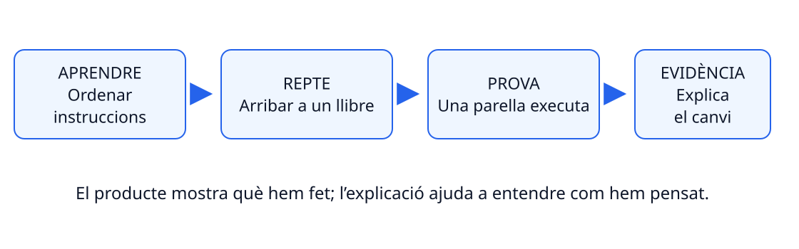
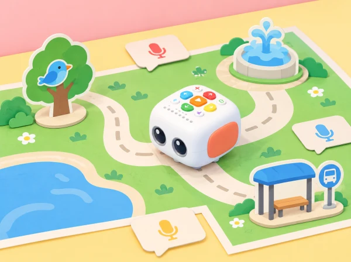
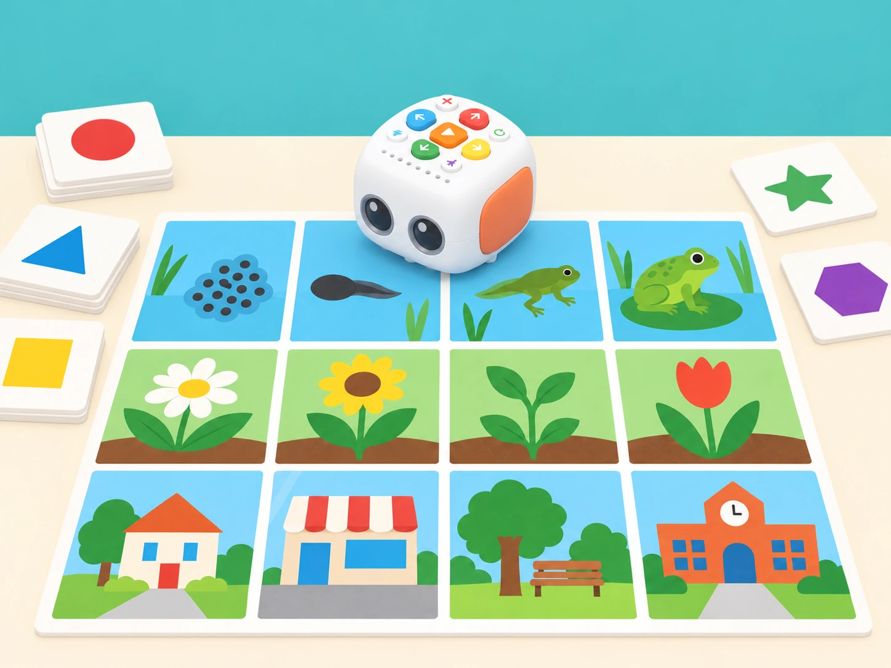
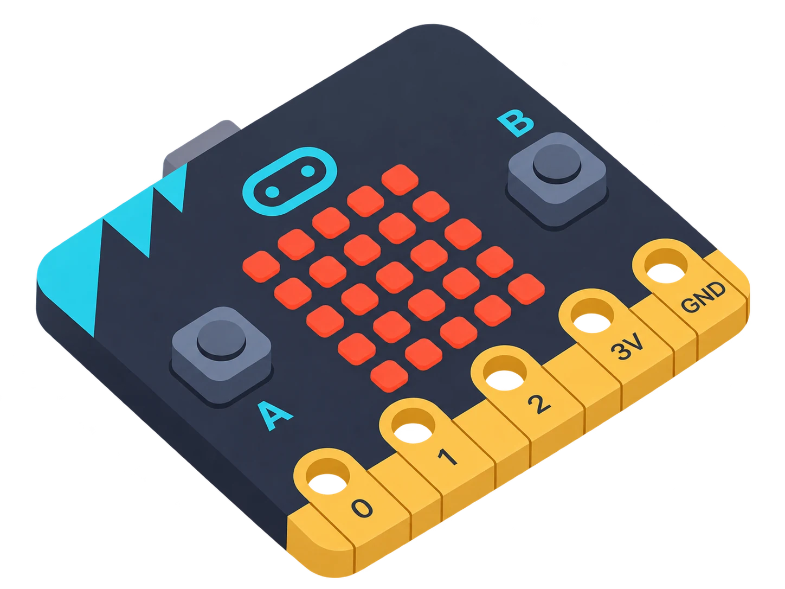

<!-- _class: cover -->

## Dissenyar una proposta per a l’aula

**Sessió 4 · Format de quatre sessions · 2 hores**

Formació presencial per a docents de primària

Robòtica per a docents

---

<!-- _class: section -->

## Del tema al repte

**00–20 min · 20 minuts**

---

## Un tema encara no és un repte

**Tema:** la biblioteca.

**Repte:** explicar una ruta perquè una altra parella arribe a un llibre.

**Aprenentatge:** ordenar instruccions i revisar-les amb una prova.

---

<!-- _class: diagram -->

## De l’aprenentatge a l’evidència

Completem la proposta triant **material, temps i participació**. L’evidència ha de respondre a l’aprenentatge.

---

<!-- _class: visual -->

## Llegim una proposta · El mapa sonor

Un recorregut amb parades permet narrar i ordenar.

**Adaptació curta:** triar dues parades, escriure les ordres i contar què passa en arribar.

La il·lustració és un context; el grup concreta el seu mapa.

---

## La primera versió ha de cabre en una sessió

| Moment | Què fa l’alumnat? | Minuts |
|---|---|---|
| Anticipar | Situa inici i destí | 5 |
| Preparar | Escriu les ordres | 10 |
| Provar | Intercanvia i executa | 10 |
| Explicar | Justifica una millora | 5 |

Trenta minuts per a una primera experiència.

---

<!-- _class: section -->

## Evidències i participació

**20–40 min · 20 minuts**

---

<!-- _class: solution -->

## Una evidència que podem escoltar

**Pregunta:** «Quina ordre has canviat i per què?»

**Resposta poc informativa:** «Perquè ara funciona».

**Resposta amb evidència:** «He mogut l’avant abans del gir perquè ens faltava una casella cap amunt».

---

<!-- _class: explanation -->

## El resultat i l’aprenentatge es complementen

<h3>Producte</h3>
Una ruta dibuixada o un programa que arriba al destí.

<h3>Evidència del procés</h3>
Anticipar el final, localitzar una diferència i explicar una correcció.

No tot s’ha d’escriure: una conversa breu també aporta evidència.

---

## Observar sense complicar l’avaluació

| Què observem? | Evidència possible |
|---|---|
| Anticipa | Assenyala el final abans de provar |
| Comprova | Compara ruta prevista i ruta real |
| Revisa | Canvia una ordre i explica el motiu |

Preneu una nota breu durant la conversa.

---

<!-- _class: visual -->

## Un mateix objectiu, diferents suports

**Amb ajuda:** dues ordres i fletxes grans.

**Amb autonomia:** una ruta amb un gir.

**Ampliació:** comparar dues rutes possibles.

---

## Participar també és anticipar i explicar

Fletxes grans, consignes orals i temps per pensar.

Podem explicar amb veu, dibuix o demostració.

Una altra persona pot manipular el dispositiu seguint les nostres instruccions.

---

<!-- _class: diagram -->

## Com acompanyem una revisió?

Preguntem què esperàvem i què ha passat. Després canviem **una sola cosa** i tornem a provar.

---

<!-- _class: section -->

## Triar i preparar els recursos

**40–55 min · 15 minuts**

---

<!-- _class: visual -->

## Una investigació al pati

**Pregunta:** dos llocs donen lectures diferents?

**Prova:** tres lectures per lloc amb la mateixa placa i orientació.

**Evidència:** registre i conclusió. La imatge contextualitza la proposta.

---

## Triem el material amb quatre preguntes

Quina funció necessitem?
Quina preparació podem assumir?
Quantes unitats tenim?
Quina alternativa hi ha si falla la connexió?

La tria ha de permetre provar i explicar el repte dins del temps.

---

<!-- _class: gallery -->

## La funció que necessitem orienta la tria

<figure><figcaption>Ruta tangible</figcaption></figure><figure><figcaption>Botó i pantalla</figcaption></figure><figure><figcaption>Lectures i dades</figcaption></figure>

Trieu segons el repte, el temps de preparació i la dotació real. Cap material és una obligació.

---

<!-- _class: diagram -->

## Una prova amb treball per a tothom

Cada equip conserva la seua tasca mentre espera. El torn acaba amb una observació que els altres poden aprofitar.

---

## Rols rotatius

**Planifica:** proposa i justifica les ordres.
**Programa:** introdueix allò acordat.
**Comprova:** compara predicció i resultat.
**Explica:** registra una decisió.

En equips de tres, uniu comprovació i explicació.

---

<!-- _class: section -->

## Pausa

**55–60 min · 5 minuts**

Una pausa abans de continuar.

---

<!-- _class: pause -->

## Pausa · 5 minuts

En tornar, continuarem amb el bloc següent.

Deixeu anotada una pregunta que vulgueu recuperar.

---

<!-- _class: section -->

## Dissenyar una proposta

**60–85 min · 25 minuts**

---

<!-- _class: worksheet -->

## La plantilla, a la pantalla

**Grup i cicle:** …
**Aprenentatge:** …
**Consigna per a l’alumnat:** …
**Material i alternativa en paper:** …
**Seqüència i minuts:** …
**Evidència i pregunta final:** …

---

<!-- _class: diagram -->

## Comprovem que les decisions encaixen

Si volem ordenar instruccions, la prova ha de permetre executar-les i revisar-les. **Una activitat atractiva també necessita un aprenentatge explícit.**

---

<!-- _class: worksheet -->

## Un exemple emplenat

**Grup:** primer cicle.
**Aprenentatge:** ordenar i revisar instruccions.
**Consigna:** porta la fitxa d’A1 a B3 i escriu la ruta.
**Material:** quadrícula i fletxes; robot opcional.
**Evidència:** una altra parella segueix les ordres.
**Pregunta:** quina ordre has canviat i per què?

---

<!-- _class: activity -->

## Disseny en parelles · 15 minuts

**3 min:** aprenentatge i repte.
**5 min:** consigna, material i seqüència.
**4 min:** participació i evidències.
**3 min:** comprovar si una altra persona ho podria aplicar.

Podeu reutilitzar la biblioteca, el mapa sonor o les dades de llum.

---

<!-- _class: section -->

## Revisar i millorar

**85–105 min · 20 minuts**

---

<!-- _class: activity -->

## Revisió entre parelles · 8 minuts

Intercanvieu la proposta.

1. Expliqueu què enteneu que farà l’alumnat.
2. Assenyaleu una dificultat de temps o material.
3. Proposeu una millora concreta.

Retorneu-la amb un canvi que els autors puguen aplicar.

---

## Una revisió que ajuda a decidir

«És massa difícil» és una valoració general.

**«Amb tres girs ens faltarà temps; podem començar amb un»** proposa una modificació.

Els autors decideixen què canvien i expliquen el motiu.

---

<!-- _class: diagram -->

## Una revisió és una nova oportunitat de prova

La proposta millora quan podem dir **què canviem, per què i com ho comprovarem**, mantenint la meta d’aprenentatge.

---

<!-- _class: visual -->

## Preparem una prova que puguem observar

Assageu el muntatge o la ruta.

Acordeu què mantindreu igual entre proves.

Prepareu un registre senzill i una alternativa en paper.

---

<!-- _class: section -->

## Acordar la primera aplicació

**105–120 min · 15 minuts**

---

<!-- _class: visual -->

## Després de la prova, revisem les evidències

Què ha fet el grup sense ajuda?

Quin dubte s’ha repetit?

Què canviaríem en el repte, els suports o el temps?

---

<!-- _class: activity -->

## La proposta que m’emporte · 5 minuts

Completeu oralment o en paper:

**Amb el meu grup treballaria…**
**El repte seria…**
**La primera prova consistiria en…**
**Sabria que han aprés perquè…**

---

## Compartim una decisió

Expliqueu a una altra parella la proposta en un minut.

Qui escolta pregunta: **«Què farà l’alumnat per demostrar-ho?»**

Reviseu un element abans de donar-la per preparada.

---

## Abans de la primera prova a l’aula

Comproveu material, espai i alimentació.
Prepareu una alternativa en paper.
Reserveu temps per explicar una millora.

**Una primera experiència curta i comprensible és suficient per començar.**

---

<!-- _class: resources -->

## Les propostes de partida del web

[Tale-Bot i rutes](https://gerardfp.github.io/robotica200/robot/tale-bot/index.html) · [Coding Set](https://gerardfp.github.io/robotica200/robot/coding-set/index.html)

[Botons i pantalla de Codey](https://gerardfp.github.io/robotica200/tutorial/cr-primeres-passes/index.html)

[El fanalet de micro:bit](https://gerardfp.github.io/robotica200/tutorial/mb-fanalet-llum/index.html)

[Parada per color amb SPIKE](https://gerardfp.github.io/robotica200/tutorial/sp-motors-sensors/index.html)

Les demostracions simplifiquen aquests tutorials. Els noms dels blocs poden variar segons l’idioma de l’aplicació.

---

## Recursos per continuar

**Tutorials del web:** preparar connexions, controls i primeres proves.

**Situacions d’aprenentatge:** context, seqüència i evidències per adaptar.

[Robòtica per a docents](https://gerardfp.github.io/robotica200/) · [Escola 4.0 · GVA](https://portal.edu.gva.es/escola40/va/inici/)

Les imatges reutilitzen il·lustracions del projecte.
